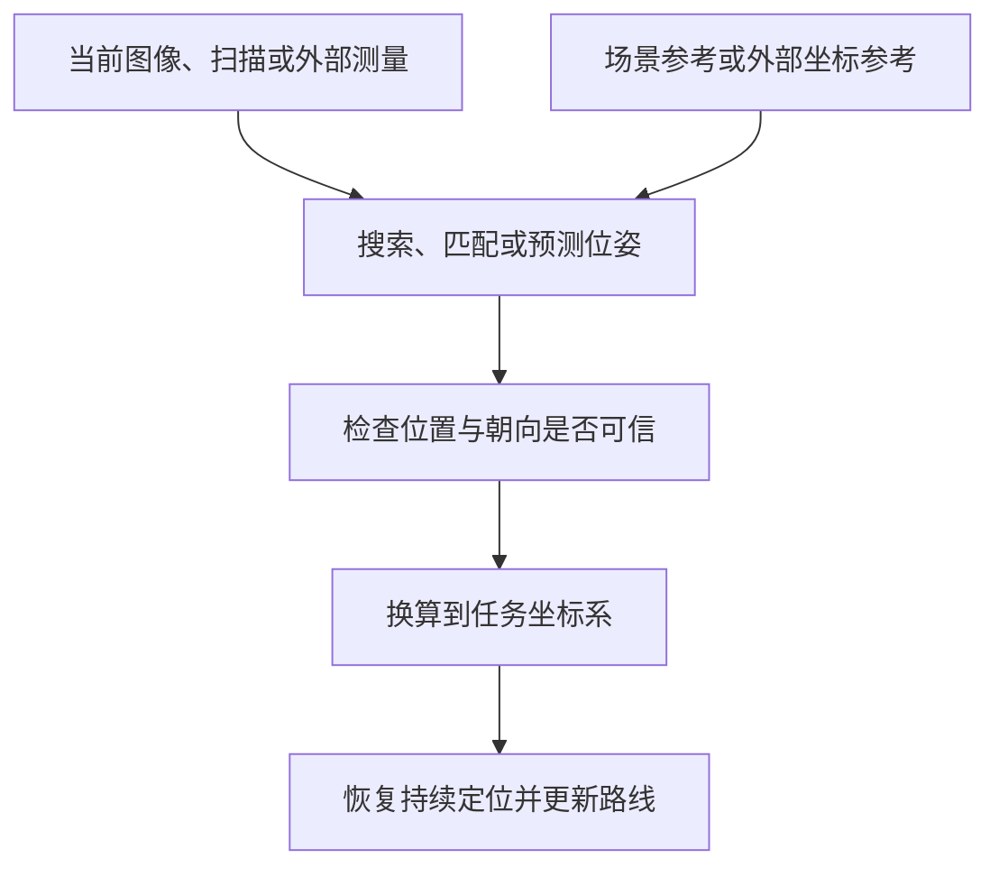
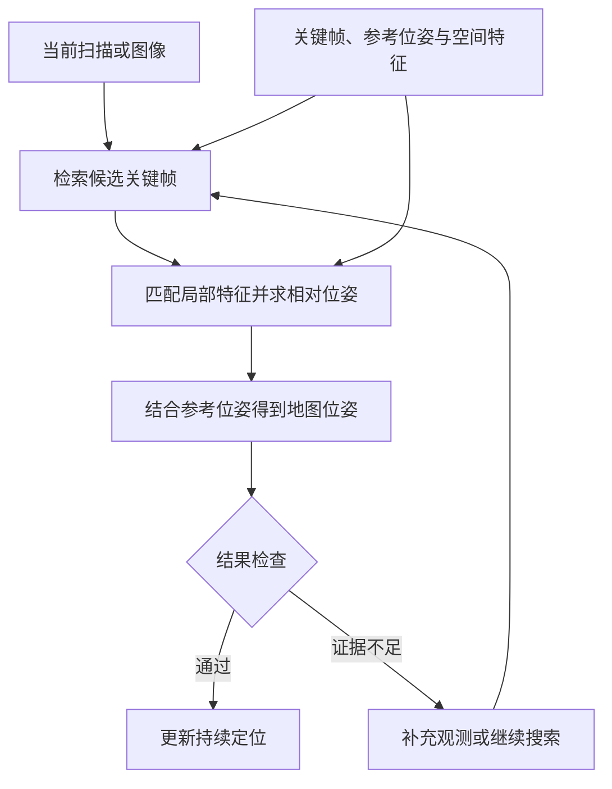
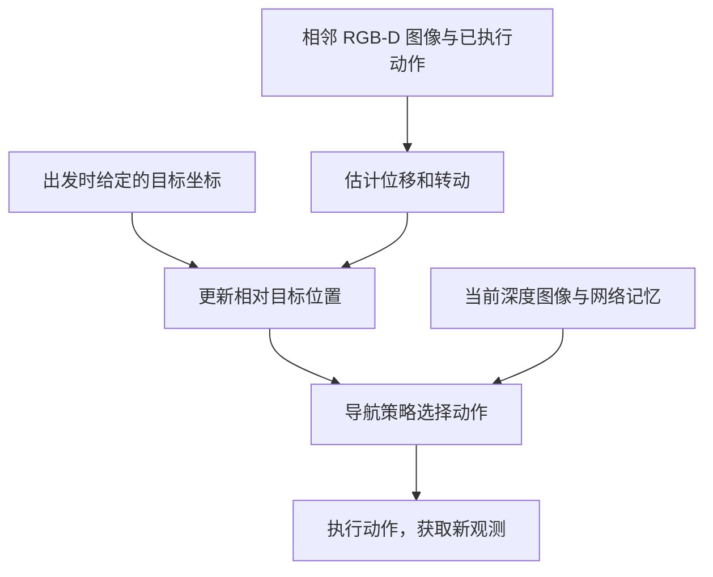

# 33. 重定位的地图需求与替代方案

机器人行驶时需要持续估计自己的位置和朝向，两者合称位姿。遮挡、观测不足或机器人被搬动，都可能使原有定位失效。重定位利用当前观测或新的测量，重新确定机器人在任务坐标系中的位姿，使系统能够继续使用原来的目标和路线。

本章讨论的问题是：重定位是否需要全局地图？重定位可以不使用一张完整、稠密且统一拼接的全局几何地图。恢复位姿所需的参考，可以是整张几何地图，也可以是历史图像或激光扫描、稀疏特征、经过训练的场景模型，或外部定位提供的测量。下面列出这些做法保存什么信息，以及怎样恢复定位。

| 恢复定位所用的参考 | 保存或提供什么 | 怎样恢复定位 | 代表工作 |
|---|---|---|---|
| 整张几何地图 | 栅格、点云等环境几何及其坐标 | 将当前观测与地图匹配，搜索位置和朝向 | Reliable MCL [P01] |
| 关键帧与局部地图 | 有代表性的历史观测、采集位姿及局部几何 | 找到对应地点，再计算与参考观测之间的位姿关系 | BEVPlace++ [P19] |
| 稀疏特征 | 少量三维点、线或其他地标及其坐标 | 将当前特征与地图特征对应，再求解位姿 | AirSLAM [P04] |
| 场景专用模型 | 从该区域的观测与坐标中学到的关系 | 预测当前位姿，或预测用于求解位姿的场景坐标 | FusedNet [P07] |
| 外部定位 | 卫星、基站或已知地标提供的测量 | 估计所需的位置和朝向，再换算到任务坐标系 | UWB 融合定位见 DURAL [P12] |

依靠环境信息在整个工作区域恢复定位，仍需保存或学习覆盖该范围的场景参考。稀疏特征减少记录的细节，子地图改变数据的组织方式，两者都可以保留全区域的定位覆盖。若只保存一条路线附近的数据，恢复范围也主要限定在沿线。外部定位能够提供所需位姿并完成坐标换算时，则可以省去环境地图匹配。

因此，比较地图需求时，要说明参考覆盖哪些位置、保存多少细节、怎样组织，以及恢复时还需要哪些辅助信息。全局激光定位综述分别讨论地图组织与位姿求解流程，视觉定位综述进一步介绍了将场景信息保存在模型参数中的方法。[P28]、[P29] 下文沿这一顺序展开，最后补充 Partsey 等不靠 GPS 和罗盘、依靠视觉里程计完成目标点导航的做法。

## 33.1 重定位要恢复什么

### 33.1.1 从持续定位到失效恢复

持续定位通常从一个已知或较可靠的位姿出发，结合新观测更新结果。里程计估计连续时刻之间的位移和转动，将这些相对运动累计起来，就能持续更新机器人相对于起点的位姿。地图匹配还可以利用环境中的固定结构修正累计误差。

原有位姿失去可信依据后，系统需要重新确定当前位置。例如，机器人被搬到另一处，轮速记录仍停留在搬动前的位置，继续累计轮速就会沿用错误的起点。重定位需要利用当前图像、激光扫描或外部测量，找到机器人现在的位置和朝向。

当初始位姿未知，需要在较大范围内寻找位置和朝向时，这项任务通常称为全局定位。它可以用于启动时的初始化，也可以用于定位失效后的恢复。已有大致位置时，重定位可以缩小搜索范围；完全失去位置线索时，则需要在允许的范围内重新搜索。Yin 等的综述将重定位作为全局定位的一种应用场景，与闭环和跨机器人定位分别介绍。[P28]（§1.2）

### 33.1.2 场景参考怎样与任务坐标联系

任务坐标系规定目标和机器人位置怎样表示。例如，目标在地图中的坐标为 $(10,4)$，重定位就需要给出机器人在同一坐标系中的位置和朝向，规划器才能重新计算通向目标的路线。若定位结果首先处于另一个坐标系，还需知道两套坐标之间的换算关系。

建图根据图像、激光等观测记录环境，并确定各项记录的位置或相互关系。这些记录可以在任务开始前获得，也可以在本次运行中逐步建立。利用运行中已建立的数据恢复定位时，系统同样需要保留可供识别的观测，以及它们与原任务坐标之间的关系。

地图保存的内容与用途有关。定位地图记录便于识别地点、计算位姿的观测或特征；规划地图记录障碍与可通行区域。两者可以共用数据，也可以分别维护。重定位对地图的需求，首先取决于恢复位姿需要哪些参考。

### 33.1.3 恢复范围与记录细节

全局地图通常覆盖整个工作区域，局部地图只记录其中一部分。覆盖范围与记录细节是两个方面：少量有代表性的特征可以分布在整个区域，一幅细致的局部点云则可能只覆盖一个房间。

依靠环境信息恢复定位时，当前观测需要与保存或学习的场景信息建立对应。要求在整个工作区域恢复，就需要相应范围的参考覆盖，并有足够信息区分相似地点、确定位置和朝向。地图没有覆盖的位置、已经显著改变的结构，以及缺少可用特征的观测，都可能使恢复失败。

一次恢复通常经历获取观测、形成位姿候选、检查结果和更新任务坐标几个环节。下面的流程图概括了信息的来源与去向。

## 33.2 恢复定位可以保存哪些场景参考

激光定位综述介绍了关键帧子地图、全局特征地图和全局度量地图三种常用组织形式。[P28]（§2）下面从常见的几何地图讲起，再说明历史观测、稀疏特征和学习模型怎样提供参考。地图中的数据可以按需要组合使用，例如关键帧既可附带局部点云，也可附带稀疏特征。

### 33.2.1 栅格、点云与建筑几何

一种常见做法是将工作区域的观测放入统一坐标系，形成栅格或点云地图。占用栅格把空间划分为格子，记录障碍的位置；点云则记录环境表面上的空间点。恢复时，算法比较当前扫描与地图，寻找能够解释当前观测的位置和朝向。

Reliable MCL 使用已有全局地图，结合持续定位、全局位姿候选与可靠性估计完成定位。[P01] 地图覆盖范围给出了环境匹配可以搜索的范围。若另有大致位置或楼层信息，系统可以只在对应区域寻找候选。

建筑资料也能提供几何参考。AGLoc 使用标有实际尺寸和位置的墙体、通道多边形，并假定 Wi-Fi 与气压计提供大致位置，先确定楼层和搜索区域，再匹配激光扫描。[P02] BIM-Loc 将建筑信息模型与里程计结合，并估计设计模型与实际环境的差异。[P11] 这些方法减少了事先详细扫描环境的工作，同时需要维护建筑资料、坐标关系及相应辅助条件。

### 33.2.2 历史观测、关键帧与子地图

系统可以选择有代表性的历史图像或激光扫描，保存观测及其采集位姿。这种代表性记录称为关键帧。关键帧还可以附带附近的点云或其他局部几何，形成子地图。恢复时，先找出与当前观测对应的关键帧，再读取相关数据计算位姿。

BEVPlace++ 将激光点云投影为鸟瞰图，保存关键帧鸟瞰图、地图位姿和用于检索的特征。定位时，它先检索相似记录，再利用局部特征求出当前扫描与参考扫描之间的平移和转动。[P19] 所需信息保存在分散的参考记录中，系统可以按候选地点读取数据。

关键帧与子地图也可以按地点之间的通行关系连接起来。系统用连接关系选择经过哪些地点，再用各地点的局部几何精确定位。这种结合地点连接与局部距离信息的形式称为拓扑度量地图。

沿路线自主重复行驶就是一种典型用途：先由操作者带领机器人记录沿途局部地图和相邻地点的关系，之后将实时观测与已记录子地图比较，确定机器人相对于原路线的位置和朝向，再修正运动。[P25] LiDAR Teach, Radar Repeat 则在记录路线时使用激光，自主重复行驶时使用雷达匹配沿线数据。[P17]

沿线任务可以只保存路线附近的参考，无须先将全部子地图精确拼接成一张大地图。定位结果首先相对于当前子地图或路线表示；需要输出另一张地图中的位姿时，再利用保存的坐标关系换算。要求全区域恢复时，则需在相应区域布置足够的参考记录。

### 33.2.3 稀疏三维特征

定位地图还可以只保存便于重复观测的点、线或其他地标，以及它们的坐标和识别特征。与保存大量表面点相比，这种表示减少了环境细节，恢复时重点寻找当前观测与已知地标之间的对应。

AirSLAM 保存关键帧位姿、地图三维点和线，以及图像与地图特征之间的关系。重新定位时，系统找到候选关键帧，将当前图像特征与地图三维点对应，再求解相机位姿。[P04] 这一系统同时使用关键帧组织和稀疏几何：前者帮助查找相关数据，后者提供精确求解需要的空间约束。

稀疏地图仍可覆盖整个工作区域。它节省的是记录的细节，定位覆盖取决于特征在哪里、当前传感器能否再次观测到它们，以及这些特征能否区分相似地点。

### 33.2.4 将场景信息保存在模型中

场景专用模型用带已知位姿或坐标的观测训练，将场景与坐标之间的关系保存在参数中。运行时，可以从当前图像直接预测位姿，也可以先预测图像中各点在场景中的三维坐标，再通过几何关系求解相机位姿。视觉定位综述分别介绍了这两种做法。[P29]（§IV-A2、§IV-B2）

FusedNet 属于直接预测位姿的方法。它用标有拍摄位姿的场景图像训练网络，融合图像的整体与局部特征，从单幅图像预测机器人的平面位置和朝向。[P07] 运行时可以省去对地图记录的逐项检索，采集场景训练数据与更新模型则成为准备和维护工作的一部分。

这类模型的参考覆盖由训练数据与实际定位表现共同决定。用于新区域时，需要检查是否仍能正确建立观测与坐标的联系。通用特征提取网络可以在其他场景训练，再用于提取当前观测特征；场景专用定位网络还承担了保存特定区域坐标关系的作用。

## 33.3 重定位怎样求出位姿

场景参考确定后，下一步是从当前观测得到位置和朝向。Yin 等按地点识别与位姿估计的衔接方式，梳理了四类单次观测定位流程。[P28]（§3）

| 求解流程 | 处理过程 | 得到的结果 |
|---|---|---|
| 只识别地点 | 检索最相似的历史记录 | 候选地点，或用参考记录的位姿近似当前位置 |
| 先识别地点，再估计位姿 | 检索候选，再由独立的几何求解器对齐观测 | 当前观测相对于参考的位姿，以及换算后的地图位姿 |
| 联合识别地点与估计位姿 | 两项任务共享特征表示或处理流程 | 候选地点与相对位姿，具体自由度由方法决定 |
| 直接求解全局位姿 | 在地图特征中直接匹配，或由模型预测 | 地图坐标系中的位姿 |

只识别地点时，精度受参考记录间距等因素影响。任务需要精确位置和朝向时，还要利用观测中的空间信息求解。下面将检索、几何求解和结果检查连成完整过程。

### 33.3.1 检索地点，再计算相对位姿

检索先将整幅图像或扫描概括成一组便于比较的数值，称为全局描述子，再从数据库中找出相似记录。局部描述子则描述某个特征点或小区域，用于建立具体的空间对应。

在 BEVPlace++ 中，全局描述子用于检索关键帧，局部描述子用于匹配当前鸟瞰图与候选鸟瞰图。算法根据对应关系，求出两次观测之间的平移和转动。[P19] 把两组空间观测对齐的过程称为配准。结合参考关键帧已知的地图位姿，就能得到当前地图位姿。

视觉方法可以将当前图像中的二维特征，对应到地图中的三维点。已知相机成像关系后，算法寻找能够将这些三维点投影到对应图像位置的相机位姿。AirSLAM 在重定位中使用这种求解方式，并根据有效匹配检查候选。[P04] 将传感器位姿换成机体位姿时，还需使用相机或雷达与机体之间的固定安装关系。

地点识别与位姿估计可以使用各自的特征，也可以共享特征。BEVPlace++ 同时提取用于检索和求解的描述子，减少重复处理；UniLGL 同样将地点识别与三维位姿估计连接起来。[P19]、[P03] 位姿组合的公式见[补充说明](research/relocalization-method-notes.md#pose-composition)。

### 33.3.2 在地图中直接搜索或预测位姿

直接地图匹配可以在一组可能的位姿中，比较当前观测与地图的符合程度。蒙特卡洛定位用粒子表示这些位姿假设，根据运动更新粒子，再为更符合观测的假设分配较高权重。Reliable MCL 还利用局部观测与地图特征产生全局候选，并与持续定位结果融合，同时估计结果的可靠程度。[P01]

特征地图也可以直接参与全局匹配。算法从当前观测中提取地标或结构，与地图特征建立对应，再求出使它们对齐的位置和朝向。搜索范围较大时，需要处理大量可能对应，并排除重复结构产生的错误组合。[P28]（§3.4.1）

模型预测则由训练得到的函数输出位姿或场景坐标。直接预测位姿的方法省去显式几何匹配；预测场景坐标的方法继续利用几何求解得到位姿。[P29] 采用哪种求解过程，会改变运行计算量、训练工作和适应新场景的方式。

### 33.3.3 连续观测与结果确认

单次观测可能包含遮挡或重复结构，使多个位置看起来同样合理。系统可以结合连续图像或扫描，检查同一位姿假设能否解释后续观测。里程计还可以约束相邻时刻之间的运动，使候选逐渐集中。全局激光定位综述将这种利用连续观测的过程作为序列定位单独讨论。[P28]（§4）

结果检查可以利用匹配数量与分布、空间对齐误差，以及不同候选之间的差异。接入导航时，还应确认接受的位姿与后续运动相符，并能换算到任务使用的坐标系。候选不足以区分地点时，系统可以保留多个假设、继续获取观测，或利用大致位置缩小搜索范围。具体接受条件需结合所选算法设置，并通过独立测量验证。

## 33.4 借助外部定位恢复位姿

### 33.4.1 从外部测量获得坐标参考

卫星导航、UWB 基站或已知坐标的视觉标记，可以为机器人提供新的位置约束。环境匹配依靠已记录的场景结构，外部定位则依靠卫星、基站或标记与测量之间的关系。

DURAL 将 UWB 位置测量与激光、惯性和轮速融合，改善连续定位。[P12] 采用同类测量恢复定位时，系统需要利用有效测量重新初始化或修正状态，并通过初始位姿未知与定位丢失实验，确认恢复过程能够完成。

### 33.4.2 补齐朝向并换算到任务坐标系

恢复完整位姿时，还需确定朝向。单天线 GNSS 或单个 UWB 标签的一次位置测量，通常不足以确定机体朝向。系统需要配合其他朝向测量、多个测量点或一段运动估计。视觉标记能够提供相对位姿时，则需完成相机标定，保证标记可见，并使用正确的安装关系。

外部测量坐标系与任务坐标系不同时，需要先建立两者之间的变换。外部测量及配合的估计过程能够确定所需位置和朝向，并完成这项换算后，就可以据此恢复原任务，省去环境地图匹配。方案的准备工作相应包括设施安装、坐标标定，以及测量覆盖和可用性维护。

## 33.5 怎样比较地图需求与恢复表现

### 33.5.1 覆盖范围、细节与数据组织

比较方案时，先规定要在哪些位置恢复，再检查这些位置有哪些可用参考。只要求在已记录路线附近恢复，可以保留沿线数据；要求在整个工作区域恢复，则需维持相应范围的参考覆盖。参考覆盖充分后，还要检查视角变化、结构重复和环境变化带来的失败。

减少地图开销可以采取不同调整，实际影响如下。

| 调整方式 | 改变了什么 | 需要检验什么 |
|---|---|---|
| 降采样或保留稀疏特征 | 减少记录细节 | 特征是否仍可识别，位姿误差是否增大 |
| 减少关键帧 | 降低参考记录密度 | 相邻记录之间是否留下恢复困难的位置 |
| 仅保留路线附近数据 | 缩小参考覆盖范围 | 偏离路线后还能在哪些位置恢复 |
| 分成子地图并按需读取 | 改变组织和加载方式 | 检索是否准确，加载等待与内存占用是多少 |
| 改用场景专用模型 | 将场景信息转入模型参数 | 训练覆盖、预测误差及更新成本怎样变化 |

按需读取主要减少同时驻留内存的数据，磁盘中仍需保存参考记录和检索索引。使用外部定位时，也应记录基站或地标的覆盖范围，以及测量中断后的恢复条件。

### 33.5.2 初始条件与输出要求

已知大致位置、已知楼层或有人工提示时，搜索范围会缩小。初始位姿完全未知时，需要在更大范围中排除相似地点。比较依靠 Wi-Fi、楼层信息或其他辅助的方法时，应明确列出这些条件，并按相同初始范围设置对照。

输出需说明坐标系与自由度。平面通行任务通常需要位置 $(x,y)$ 和朝向角 $\psi$，共三个自由度；完整三维位姿还包括高度、横滚和俯仰，共六个自由度。BEVPlace++ 重点估计平面三自由度，其余量可以取自参考记录。[P19] 实验应根据实际独立估计的量设置误差要求。

相对于当前子地图或路线的位姿，可以支持沿线行驶。若要继续使用另一张地图中的目标，还需完成坐标换算。比较时应分别记录候选地点是否正确、位姿计算是否准确，以及结果是否已经进入任务坐标系。

### 33.5.3 恢复成功率与总成本

重定位实验需要事先规定允许的位置与朝向误差、结果连续成立的时长，以及超时条件，再用独立测量检查实际位姿。成功率应包含全部尝试，并分别记录失败、超时和错误接受的情况。粒子滤波完整性监测研究分析了定位误差很大、系统却未报警的风险，这类错误需要单独统计。[P13]

| 检查项目 | 实验条件 | 主要记录 |
|---|---|---|
| 恢复范围 | 不同地点、路线偏离及参考未覆盖位置 | 哪些位置可以恢复，哪些位置失败 |
| 初始位置线索 | 已知大致位姿、完全未知、错误初始位姿 | 成功率、耗时及辅助信息需求 |
| 环境与观测变化 | 遮挡、重复结构、光照或布局变化 | 错误候选、位姿误差与错误接受 |
| 地图和模型缩减 | 改变特征数量、记录密度或模型规模 | 磁盘、内存、误差与耗时变化 |

总耗时包括失效检测、搜索、位姿计算和结果检查。总成本还包括采集环境数据、训练模型、维护地图或设施的工作。传感器、计算平台和每次处理的观测时长应保持一致，或明确列出差异，再比较满足同一恢复要求需要的资源。

重定位成功后，还应检查导航能否继续：目标是否仍处于正确坐标、路线是否重新规划、机器人是否到达目标。地点检索准确率、位姿恢复成功率和最终到达率分别记录，便于找到失败环节。

## 33.6 WHEELTEC 的实施顺序

### 33.6.1 明确恢复范围与任务坐标 {#navigation-map-needs}

先列出机器人需要在哪些区域恢复、目标在哪个坐标系中，以及允许的位置误差、朝向误差和恢复时间。反复前往已知地点的任务，可以先保留覆盖相应区域的地图，验证恢复过程，再逐步减少数据。

Navigation2（Nav2）的常规配置用已有地图组织全局路线，并用机器人附近的局部代价地图处理实时障碍。[S02] 使用这套配置时，要同时确认定位地图、规划地图和目标坐标之间的关系。局部障碍地图随观测更新，恢复定位则需要将当前位置重新关联到任务使用的地图。

### 33.6.2 建立完整的位姿恢复流程

已有二维雷达与导航地图时，可以从 AMCL 开始，确认雷达、轮速和坐标关系，再分别测试初始位姿正确、初始位姿错误、初始位姿未知，以及运行中定位丢失的情况。AMCL 可以在地图范围内重新生成位姿假设，自动恢复还需确定何时启动搜索、怎样搜索和何时接受结果。[S01] 实现核对项见[补充说明](research/relocalization-method-notes.md#amcl-implementation)。

采用 MID360 时，可以保留 FAST-LIO 连续估计局部运动的功能，再增加关键帧保存、候选检索、位姿求解和结果检查。先确认重启后能加载参考数据并恢复位姿，再测试遮挡、路线偏离和环境变化。[第 42 章](42-mid360-fast-lio.md)与[第 43 章](43-mid360-fast-lio-data-flow.md)说明里程计和点云的产生过程。

重定位成功后，将地图位姿与同一时刻的里程计位姿组合，更新 `map → odom` 修正，使局部连续运动重新关联到原地图，并保持 `odom → base_link` 连续。[S03] 检测到定位失效时应暂停任务并约束运动；候选通过验证、坐标关系更新且路径重新检查后，再恢复导航。公式与时间戳要求见[补充说明](research/relocalization-method-notes.md#map-odom-recovery)。

### 33.6.3 在相同恢复要求下减少地图开销

完整流程稳定后，再逐项减少关键帧、压缩几何数据或采用按需读取。每次调整都按第 33.5 节检查覆盖范围、误差、耗时和资源占用。若改用场景专用模型，增加训练与更新工作记录；若采用外部定位，增加朝向、坐标标定和测量中断试验。

本车试验应保存全部成功和失败记录，比较每次调整节省的资源与新增条件。只有在预定区域内仍满足位姿误差与恢复时间要求，数据缩减才完成了既定目标。

## 33.7 补充：不靠 GPS 和罗盘的 mapless 导航

Partsey 等研究了目标点导航：机器人在未知环境中，依靠相机观测和运动估计前往指定目标。运行时没有 GPS 与罗盘，也不建立供定位或规划查询的显式环境地图。系统采用视觉里程计与导航策略两个模块。[P27]

### 33.7.1 出发时给定目标，途中累计运动

任务开始时，系统获得目标相对于起点的准确坐标。机器人不需要先知道完整环境布局，但已经知道从起点看，目标在什么方向、距离多远。

机器人移动后，视觉里程计根据连续两帧彩色与深度图像，以及两次观测之间已执行的动作，估计位移和转动。系统用这一估计更新目标相对于机器人的位置。例如，机器人估计自己向目标方向前进了一段距离，就相应减少估计的剩余距离；转向后，则将目标方向换算到新的机体朝向。这样便能持续更新与初始目标的位置关系。[P27]（§2–3、图 2）

### 33.7.2 用观测、相对目标和记忆选择动作

导航策略接收当前深度图像、更新后的相对目标位置和网络内部记忆，选择前进、转向或停止。深度图像提供附近障碍信息，视觉里程计更新目标的相对位置，网络记忆则帮助策略利用此前的观测与动作。[P27]

机器人执行动作后，用新观测重复上述过程。系统省去单独构建和查询环境地图的步骤，保留运动估计和网络记忆，并持续更新目标的相对位置。作者通过引入动作信息、数据增强，以及扩大训练数据和模型规模，改进用于导航的视觉里程计。导航策略训练时使用仿真器提供的准确位置和朝向，测试运行时改用视觉里程计估计。[P27]（§3–4）

### 33.7.3 累计误差怎样影响任务结果

这套系统依靠连续运动估计维持与目标的联系，运行流程没有地图匹配或外部定位恢复环节。里程计误差会影响估计的目标位置，可能使机器人在距离真实目标仍较远的位置发出停止指令。

论文规定，在距真实目标不超过 $0.36\,\mathrm{m}$ 时发出停止指令才记为成功。Habitat Challenge 2021 仿真测试集上的成功率为 94%；实机初步实验共 9 次任务，成功率为 11%。最终未满足到达条件的任务计为失败。[P27]（§2、§5.2、§6）

这一方案通过改进视觉里程计和导航策略，提高从已知初始目标出发的到达表现。定位失效后重新找回原任务位姿，则需要系统另有恢复机制。本章前述场景匹配、场景模型与外部定位，分别说明了这种恢复可以利用哪些参考。

在线建图、自由区域树、学习场景规划与其他直接生成运动的方法，见[补充说明](research/relocalization-method-notes.md#online-navigation-methods)。

## 参考与补充阅读

地图组织、重定位流程与场景模型的综述依据见[重定位分类核查说明](research/relocalization-taxonomy-reference-audit.md)。代表方法的原文位置与适用条件见[重定位证据表](research/relocalization-evidence.csv)，Partsey 与在线导航工作的设置见[在线导航核查说明](research/online-navigation-reference-audit.md)。位姿公式、AMCL 实现及其他相关方法见[补充说明](research/relocalization-method-notes.md)，正文与补充说明共用以下参考编号。

### 参考文献 {#references}

- P01 · M35 — Akai, Naoki (2023). *Reliable Monte Carlo localization for mobile robots*. Journal of Field Robotics. [DOI](https://doi.org/10.1002/rob.22149).
- P02 · S03 — Xie, Fujing et al. (2024). *Robust Lifelong Indoor LiDAR Localization Using the Area Graph*. IEEE Robotics and Automation Letters. [DOI](https://doi.org/10.1109/lra.2023.3334158).
- P03 · SC-P195 — Shen, Hongming et al. (2026). *UniLGL: Learning Uniform Place Recognition for FOV-Limited/Panoramic LiDAR Global Localization*. IEEE Transactions on Robotics. [DOI](https://doi.org/10.1109/tro.2026.3672514).
- P04 · R05 — Xu, Kuan et al. (2025). *AirSLAM: An Efficient and Illumination-Robust Point-Line Visual SLAM System*. IEEE Transactions on Robotics. [DOI](https://doi.org/10.1109/tro.2025.3539171).
- P05 · R06 — Cattaneo, Daniele et al. (2025). *CMRNext: Camera to LiDAR Matching in the Wild for Localization and Extrinsic Calibration*. IEEE Transactions on Robotics. [DOI](https://doi.org/10.1109/tro.2025.3546784).
- P06 · S26 — Zhang, Lintong et al. (2026). *Visual localization in 3D maps: comparing point cloud, mesh, and NeRF representations*. Autonomous Robots. [DOI](https://doi.org/10.1007/s10514-025-10232-5).
- P07 · M21 — Chen, Fang-xing et al. (2024). *FusedNet: End-to-End Mobile Robot Relocalization in Dynamic Large-Scale Scene*. IEEE Robotics and Automation Letters. [DOI](https://doi.org/10.1109/lra.2024.3372465).
- P08 · M34 — Xie, Yuanyan et al. (2023). *Indoor Visual Re-Localization for Long-Term Autonomous Robots Based on Object-Level Features and Semantic Relationships*. IEEE Robotics and Automation Letters. [DOI](https://doi.org/10.1109/lra.2022.3233235).
- P09 · R10 — Kruzhkov, Evgenii et al. (2026). *OMCL: Open-Vocabulary Monte Carlo Localization*. IEEE Robotics and Automation Letters. [DOI](https://doi.org/10.1109/lra.2026.3653333).
- P10 · E56 — Wang, Zihang et al. (2026). *LiteFT-PR: Lightweight and Fault-Tolerant LiDAR-Camera Fusion Network for Robust Place Recognition via Model Distillation*. IEEE Robotics and Automation Letters. [DOI](https://doi.org/10.1109/lra.2026.3662634).
- P11 · S36 — Yinqiang Zhang et al. (2026). *BIM-Loc: BIM-integrated discrepancy-aware LiDAR-based indoor localization*. The International Journal of Robotics Research. [DOI](https://doi.org/10.1177/02783649261462593).
- P12 · E03 — Hu, Kun et al. (2026). *DURAL: Degradation-Resistant Robust Adaptive Localization by LiDAR-Inertial-UWB-Wheel Fusion for Coal Mine Robots*. Journal of Field Robotics. [DOI](https://doi.org/10.1002/rob.70200).
- P13 · M28 — Hafez, Osama Abdul et al. (2024). *How Safe Is Particle Filtering-Based Localization for Mobile Robots? An Integrity Monitoring Approach*. IEEE Transactions on Robotics. [DOI](https://doi.org/10.1109/tro.2024.3420798).
- P14 · SC-M039 — Liang, Jing et al. (2024). *MTG: Mapless Trajectory Generator with Traversability Coverage for Outdoor Navigation*. 2024 IEEE International Conference on Robotics and Automation (ICRA). [DOI](https://doi.org/10.1109/icra57147.2024.10611319).
- P15 · SC-M043 — Liang, Jing et al. (2024). *DTG : Diffusion-based Trajectory Generation for Mapless Global Navigation*. 2024 IEEE/RSJ International Conference on Intelligent Robots and Systems (IROS). [DOI](https://doi.org/10.1109/iros58592.2024.10802055).
- P16 · SC-P134 — Jose Luis Blanco-Claraco (2025). *A flexible framework for accurate LiDAR odometry, map manipulation, and localization*. The International Journal of Robotics Research. [DOI](https://doi.org/10.1177/02783649251316881).
- P17 · R11 — Xiao, Renxiang et al. (2026). *LiDAR Teach, Radar Repeat: Robust Cross-Modal Navigation in Degenerate and Varying Environments*. IEEE Transactions on Robotics. [DOI](https://doi.org/10.1109/tro.2026.3699433).
- P18 — Ratz, Sebastian et al. (2020). *OneShot Global Localization: Instant LiDAR-Visual Pose Estimation*. 2020 IEEE International Conference on Robotics and Automation (ICRA). [DOI](https://doi.org/10.1109/ICRA40945.2020.9197458).
- P19 · H53 — Luo, Lun et al. (2025). *BEVPlace++: Fast, Robust, and Lightweight LiDAR Global Localization for Autonomous Ground Vehicles*. IEEE Transactions on Robotics, 41, 4479–4498. [DOI](https://doi.org/10.1109/TRO.2025.3585385).
- P20 · M05 — Li, Yulin et al. (2025). *FRTree Planner: Robot Navigation in Cluttered and Unknown Environments With Tree of Free Regions*. IEEE Robotics and Automation Letters, 10(4), 3811–3818. [DOI](https://doi.org/10.1109/LRA.2025.3544519).
- P21 · E26 — Keyumarsi, Shaghayegh, Made Widhi Surya Atman, and Azwirman Gusrialdi (2024). *LiDAR-Based Online Control Barrier Function Synthesis for Safe Navigation in Unknown Environments*. IEEE Robotics and Automation Letters, 9(2), 1043–1050. [DOI](https://doi.org/10.1109/LRA.2023.3339059).
- P22 · H47 — Liu, Yuchen, Ruiqi Ni, and Ahmed H. Qureshi (2025). *Physics-Informed Neural Mapping and Motion Planning in Unknown Environments*. IEEE Transactions on Robotics, 41, 2200–2212. [DOI](https://doi.org/10.1109/TRO.2025.3548495).

- P23 · TAX01 — DeSouza, G. N., and A. C. Kak (2002). *Vision for mobile robot navigation: a survey*. IEEE Transactions on Pattern Analysis and Machine Intelligence, 24(2), 237–267. [DOI](https://doi.org/10.1109/34.982903).
- P24 · X04 — Zhu, Kai, and Tao Zhang (2021). *Deep reinforcement learning based mobile robot navigation: A review*. Tsinghua Science and Technology, 26(5), 674–691. [DOI](https://doi.org/10.26599/TST.2021.9010012).
- P25 · J01 — Krawciw, Alexander, and Timothy D. Barfoot (2026). *Local Maps Are All You Need: A Review of Topometric Teach and Repeat Navigation*. Annual Review of Control, Robotics, and Autonomous Systems, 9, 301–324. [DOI](https://doi.org/10.1146/annurev-control-032724-020548).
- P26 · SC-R073 — Placed, Julio A. et al. (2023). *A Survey on Active Simultaneous Localization and Mapping: State of the Art and New Frontiers*. IEEE Transactions on Robotics, 39(3), 1686–1705. [DOI](https://doi.org/10.1109/TRO.2023.3248510).
- P27 — Partsey, Ruslan et al. (2022). *Is Mapping Necessary for Realistic PointGoal Navigation?* Proceedings of the IEEE/CVF Conference on Computer Vision and Pattern Recognition (CVPR), 17232–17241. [论文与引文](https://openaccess.thecvf.com/content/CVPR2022/html/Partsey_Is_Mapping_Necessary_for_Realistic_PointGoal_Navigation_CVPR_2022_paper.html).

- P28 — Yin, Huan et al. (2024). *A Survey on Global LiDAR Localization: Challenges, Advances and Open Problems*. International Journal of Computer Vision, 132, 3139–3171. [DOI](https://doi.org/10.1007/s11263-024-02019-5) · [作者公开全文](https://arxiv.org/html/2302.07433v5).
- P29 · SC-R052 — Chen, Changhao et al. (2024). *Deep Learning for Visual Localization and Mapping: A Survey*. IEEE Transactions on Neural Networks and Learning Systems, 35(12), 17000–17020. [DOI](https://doi.org/10.1109/TNNLS.2023.3309809).

软件与坐标规范：

- S01 — [Navigation2 Humble：AMCL 源码](https://github.com/ros-navigation/navigation2/blob/3c3db59d6969d8ecee8e68468693d006397f4a0c/nav2_amcl/src/amcl_node.cpp)，核对 `globalLocalizationCallback`、`uniformPoseGenerator`、`reinitialize_global_localization` 与恢复参数默认值。
- S02 — [Navigation2 Humble：默认参数](https://github.com/ros-navigation/navigation2/blob/3c3db59d6969d8ecee8e68468693d006397f4a0c/nav2_bringup/params/nav2_params.yaml)，局部代价地图配置为 `local_costmap.global_frame: odom` 与 `rolling_window: true`。
- S03 — [REP-105：Coordinate Frames for Mobile Platforms](https://github.com/ros-infrastructure/rep/blob/11ca24a41f31480dfb9562ba99f2a5b93d3ebda5/rep-0105.rst)，核对 `odom` 的连续性与 `map` 的全局修正语义。

## 章节导航

[上一章：地图、定位与 TF](32-map-localization-tf.md) · [返回本篇](index.md) · [下一章：Nav2 导航](34-nav2-navigation.md)

[P01]: #p01
[P02]: #p02
[P03]: #p03
[P04]: #p04
[P05]: #p05
[P06]: #p06
[P07]: #p07
[P08]: #p08
[P09]: #p09
[P10]: #p10
[P11]: #p11
[P12]: #p12
[P13]: #p13
[P14]: #p14
[P15]: #p15
[P16]: #p16
[P17]: #p17
[P18]: #p18
[P19]: #p19
[P20]: #p20
[P21]: #p21
[P22]: #p22
[P23]: #p23
[P24]: #p24
[P25]: #p25
[P26]: #p26
[P27]: #p27
[P28]: #p28
[P29]: #p29
[S01]: #s01
[S02]: #s02
[S03]: #s03
