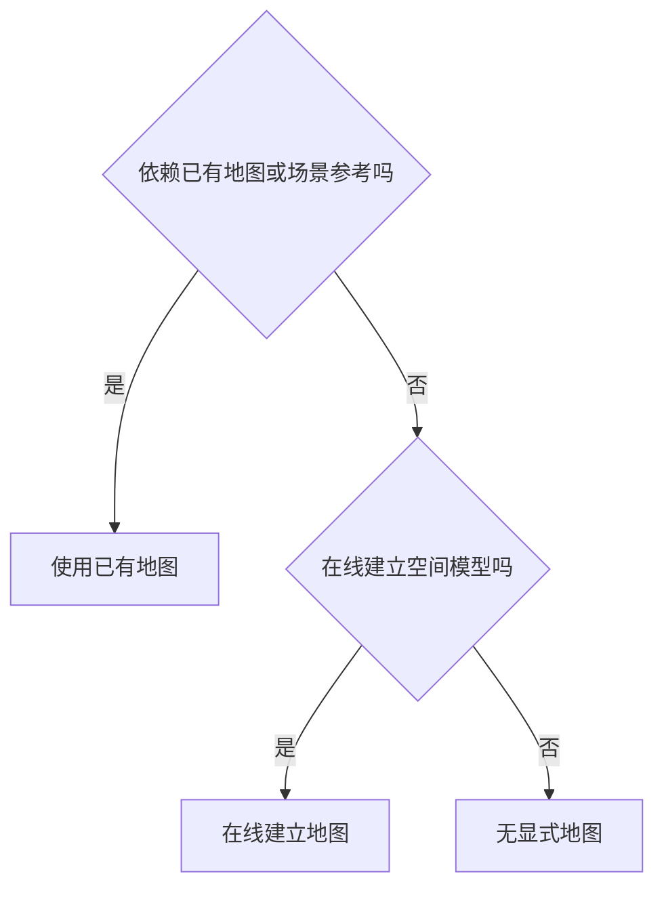
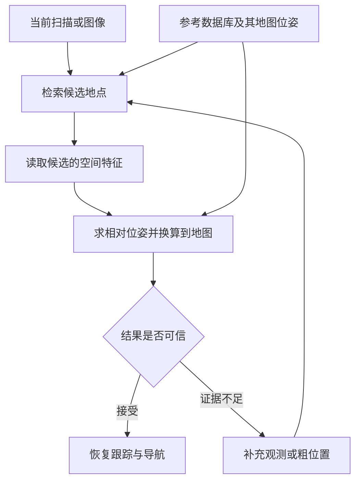
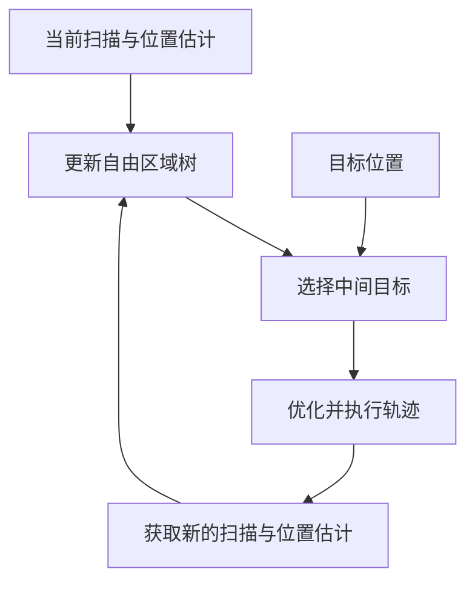

# 33. 移动机器人导航的地图依赖

移动机器人完成导航，是否必须先获得一张完整的全局地图？已有研究提供了三条路线：使用已有地图，运行中建立地图，以及根据观测直接生成运动。本章按这三类方法，说明环境信息怎样进入导航过程、哪些地图信息可以省去，以及相应的条件与代价。

导航不一定需要预建的完整全局地图。已有地图可以帮助机器人确定位置并规划路线，在线建图可以在运动中逐步获取环境信息，无显式地图的方法则根据附近观测和目标生成轨迹或控制指令。三条路线都要解决怎样朝目标前进、怎样避开障碍的问题，但保存和使用环境信息的方式不同。

| 路线 | 环境信息怎样使用 | 代表工作与地图需求 |
|---|---|---|
| 使用已有地图 | 出发前提供环境参考，运行中据此定位和规划 | Reliable MCL、BEVPlace++ 使用已有定位地图，示教复现也可以使用拓扑连接的局部地图 [P01]、[P19]、[P25] |
| 在线建立地图 | 不依赖预建地图，从实时观测建立供规划查询的空间模型 | FRTree 维护自由区域树，Active NTFields 在线学习场景模型，无须先建完整地图 [P20]、[P22] |
| 无显式地图 | 不依赖已有地图，也不建立供定位或规划查询的显式空间模型 | LiDAR 在线控制屏障函数直接修正控制，DTG 从观测生成轨迹，位置与目标仍需由相应输入提供 [P21]、[P15] |

上述分类借鉴经典综述对室内视觉导航的三分法，并结合本章讨论的系统明确判断顺序。[P23] “全局”描述地图覆盖与组织范围，“稠密”描述记录细节的多少，“预建”说明地图何时获得，三者需要分别判断。使用局部地图不一定属于无地图导航，使用已有地图也不一定需要一张全局一致的稠密地图。

因此，是否需要全局地图要按任务判断：前往目标可以不依赖预建全局地图，沿已知路线运行可以只保存路线相关的参考。若要求依靠环境匹配在整个工作区域从未知位置恢复，就需要覆盖该范围的定位参考，但参考可以稀疏保存，也不必是一张全局一致的稠密地图。

第 33.1 节说明分类判据，第 33.2～33.4 节依次展开三条路线的流程和条件。第 33.5 节比较覆盖、定位与恢复能力，第 33.6 节给出 WHEELTEC 的实施顺序。坐标计算、软件核对项与延伸研究集中在[补充说明](research/relocalization-method-notes.md)。

## 33.1 怎样判断一种方法的地图依赖

判断地图依赖，需要先说明地图在系统中起什么作用，再区分地图何时获得。地图的表示形式和运行模式会影响归类，本节据此给出统一的判断顺序。

### 33.1.1 地图的来源与表示是不同维度

地图保存环境中的空间关系，供机器人查询。例如，占用栅格把空间划分为格子并记录障碍，拓扑地图用节点表示地点、用边表示地点之间的连接。机器人可以根据栅格检查一段路径是否碰撞，也可以根据拓扑连接选择经过哪些地点。度量、拓扑及其组合描述地图怎样表示环境，稀疏与稠密则描述保存多少细节。[P26]

同一种表示既可以事先建立，也可以在线更新。机器人在未知环境中逐步绘制栅格地图，与加载一张栅格地图后出发，采用了不同的信息获取方式。反过来，已有的环境参考可以是栅格、关键帧数据库或局部地图组成的网络，不能只根据文件形式判断地图依赖。

学习模型也可能保存环境信息。根据当前观测提取特征的通用网络，与使用部署场景的图像和坐标训练的位姿模型，依赖的先验信息不同。后者虽然没有显式地图文件，仍保存了特定场景与位置的联系。本章将这种模型纳入已有场景参考讨论，并在比较时注明其形式。

### 33.1.2 按固定运行模式依次判断

经典综述区分基于地图、基于建图和无地图导航，但后续论文对“无地图”的用法并不一致。有的工作用它表示不需要预建全局地图，有的工作仍保留局部地图或历史观测。[P23]、[P24] 为使三类不重叠，本章按下列顺序判断一个确定的运行模式。

首先检查运行是否依赖事先提供的环境地图或场景参考。依赖者归入使用已有地图，即使运行中还更新局部障碍。对不依赖已有参考的模式，再检查是否在线建立可供定位或规划查询的空间模型。建立者归入在线建立地图，其余归入无显式地图。这里的空间模型包括局部栅格、自由区域树和按位置查询的场景模型，传感器缓存与一般控制状态则不直接等同于地图。

已有地图和在线建图按这个先后顺序判断，下图中的每个运行模式因此只进入一个分支。

判断对象是运行模式。示教复现系统在示教时采集环境，复现时使用已经保存的参考，两个阶段应分别说明。论文只提出轨迹生成器时，也应先判断该模块，再检查完整导航系统是否另有地图和定位模块。上述顺序是本章为统一比较而采用的判据，不意味着所有论文都以同样方式使用名称。

## 33.2 使用已有地图：将观测关联到已知环境

已有地图把观测、地点和路线联系起来。本节先说明定位与规划怎样使用地图，再以稀疏历史观测展开位姿恢复过程，随后解释局部地图怎样组成导航网络，以及建筑资料和学习模型怎样改变参考形式。

### 33.2.1 从地图定位到路线执行

位置与朝向合称为位姿。使用已有地图时，系统先比较当前观测与地图，确定机器人位姿，再结合地图中的目标规划路线。控制器执行路线中的局部运动，实时障碍观测则用于调整附近的通行选择。已有地图提供出发前的环境参考，实时感知补充运行中的变化。

二维栅格定位可以同时保留多个位姿假设，分别检查当前扫描与地图是否相符。蒙特卡洛定位把每个假设称为粒子，利用运动测量更新粒子位姿，再根据扫描与地图的比较结果调整权重。Reliable MCL 还增加可靠性估计与全局搜索分支，将短时局部观测与地图特征匹配，产生新的位姿候选并与持续跟踪融合。[P01]

原位姿未知或估计失效时，重新确定已有地图中的位姿称为重定位。重定位改变了定位过程的搜索范围，地图仍负责将观测关联到已知地点。有可靠近似位姿时可以在附近更新估计，从未知位置恢复时则要搜索更大的位置和朝向范围。

### 33.2.2 稀疏历史观测怎样恢复位姿

定位地图可以只保存有代表性的历史观测，以及采集时的地图位姿。代表性记录称为关键帧。地图位姿给出参考地点在哪里，当前观测与关键帧的比较则用于求出机器人相对于该地点的位置和朝向。

BEVPlace++ 将激光空间点从上方投影成鸟瞰图，提取用于比较的数值特征，称为描述子。概括整幅观测的全局描述子用于检索相似关键帧，描述具体位置的局部描述子用于建立空间对应。数据库保存关键帧鸟瞰图、地图位姿和全局描述子，求解时再使用局部特征。[P19]（§III）

当前扫描进入系统后，算法生成同类描述子，取出相似的历史记录作为候选。候选只说明机器人可能在哪一带，布局重复、遮挡或视角变化都可能造成误检。BEVPlace++ 随后建立当前鸟瞰图与候选之间的局部特征对应，求解使对应尽量一致的平移和转动。把空间观测对齐的过程称为配准，求出的相对位姿再与候选地图位姿组合，得到当前地图位姿。[P19]（§III-D）

视觉方法也能完成这种联系。AirSLAM 保存关键帧位姿、地图三维点和线，以及图像与地图特征之间的对应。识别到候选后，算法用当前图像中的点与地图三维点匹配，根据三维点的图像投影求解相机位姿，再利用相机与机体的安装关系换算为机器人位姿。[P04]

求出位姿后，系统仍需检查有效对应的数量与分布、对齐误差，以及其他候选是否同样合理。接入机器人系统时，还应利用后续观测和里程计运动检查位姿是否持续成立。证据不足时可以继续搜索、保留多个候选或请求粗位置辅助，接受后的位姿才交给跟踪与导航。连续验证是工程接入要求，具体论文采用的判据需分别核对。

参考数据库既提供候选地点，也提供位姿换算所需的空间关系。下图将检索、求解和接受判定连接起来。

稀疏保存减少了环境细节，但有效参考仍要覆盖预期恢复区域。数据量较大时，可以先检索，再读取候选附近的局部参考，即子地图。按需读取减少常驻内存，持久存储中仍需保留参考、索引与坐标关系。位姿组合公式见[补充说明](research/relocalization-method-notes.md#pose-composition)。

### 33.2.3 用拓扑连接局部地图

局部地图也可以通过地点之间的连接组成导航网络。拓扑层决定经过哪些地点，每个地点的局部度量地图提供附近的几何关系。这种组合通常称为拓扑度量地图，可以在较大范围组织路线，又将精细定位限制在当前使用的子地图中。[P25]

示教复现首先由操作者带机器人沿路线运行，记录局部地图与相邻地点的相对关系。复现时，系统在已保存的地点网络中选择通往目标的节点序列，再将实时观测与附近子地图比较，估计机器人相对于示教路线的偏差，控制器据此跟随路线。初始化时可以先识别所在地点，再完成局部几何定位。[P25]（§2）

局部几何关系足以支持路线跟随时，各子地图不必都调整到一张全局一致的度量地图中。[P25]（§1、§2.3）因此，省去全局一致的度量地图，与省去已有环境参考是不同的结论。示教复现仍依赖已记录的路线与子地图，通行范围也受已有网络约束。

### 33.2.4 改变已有参考的形式

已有参考还可以来自建筑资料。AGLoc 用带实际长度和位置的墙体、通道多边形匹配当前激光，并假定 Wi-Fi 与气压计能提供粗位置，先缩小楼层与候选区域，再搜索精确位姿。[P02] BIM-Loc 将建筑信息模型与里程计结合，并估计设计模型与实际环境之间的差异。[P11] 建筑资料减少了详细扫描的需求，仍要满足资料坐标、结构一致性和初始信息条件。

FusedNet 则使用带场景位姿的图像训练网络，从单幅图像预测平面位置与朝向。[P07] 模型参数保存了场景与坐标的联系，运行时可以省去显式地图检索，但定位能力仍受训练覆盖与场景变化影响。使用模型替代地图文件时，应把训练、场景更新和新区域适应纳入地图成本。

已有参考可以减少到任务所需的程度。只需沿已知路线复现时，可以保存路线相关的参考。要求依靠环境匹配在整个工作区域从未知位置恢复时，就要保留覆盖相应范围、足以区分位置的地图或场景信息。

## 33.3 在线建立地图：在运动中获取环境信息

在线建图从实时观测形成空间模型，再用模型规划运动。本节先说明观测如何放到共同坐标中，再以自由区域树展开完整规划流程，最后说明连续场景模型怎样在线学习。

### 33.3.1 将局部观测组织成空间模型

没有预建地图时，机器人仍可以建立运行所用的坐标系。坐标系规定原点与轴向，位姿和目标因此能够用同一套坐标表示，无须已经知道全部障碍。对于前往给定位置的任务，当前位置与目标之间的关系必须能用于规划。

里程计根据轮速、图像、激光或惯性测量估计相对运动。机器人利用运动估计，将不同时刻的观测放到共同坐标中，逐步记录障碍、可通行区域及其连接。记录可以是只覆盖附近的栅格，也可以是随探索扩展的区域树。将当前点云转换成局部高程图，再在其中优化下一段路径，也属于在线建立环境表示。

空间模型可以随机器人移动而更新，无须始终保留全部历史。保留越多连接与探索记录，越有利于识别已访问分支和退出死路，但存储与维护开销也会增加。里程计漂移则会影响观测之间的对齐，规划器不会因为具有在线地图就自动获得可靠定位能力。

### 33.3.2 从自由区域树到可执行轨迹

FRTree 用实时点云寻找附近可以继续前进的方向，沿各方向提取一组相互重叠的自由区域。自由区域描述当前观测中没有障碍的空间，区域之间的重叠为连续通行提供候选连接。规划器将方向和区域组织成树，新增观测到达时继续扩展。[P20]（§III-A）

选择分支时，FRTree 同时考虑通向候选区域的距离，以及候选区域到目标的估计距离，选出本轮中间目标。轨迹优化器再检查运动约束与机器人整个外形能否通过自由区域序列，生成交给控制器执行的轨迹。目标选择算法明确输入机器人当前位置与目标位置。[P20]（§III-B–C）

机器人前进后获取新的观测，规划器更新树并重新选择中间目标。尚未观测到的空间是否真正可通行，需要后续感知确认。某条分支不能继续时，算法利用已访问区域和死路记录，沿树回退到仍有其他可行分支的节点，再继续搜索。[P20]（§III-A–B）

自由区域树在每轮规划中保存可通行关系，位置与目标输入则决定运动朝向何处。下图将观测、在线模型和执行过程连接起来。

FRTree 省去了预建环境地图，但仍维护在线空间结构。路径会随观测逐步形成，机器人可能需要回退。论文的 Go1 四足机器人实验也不能直接视为 WHEELTEC 轮式底盘验证，迁移时仍需检查车体外形和运动约束。

### 33.3.3 在线学习供规划查询的场景模型

空间模型也可以是连续函数。Active NTFields 输入里程计与激光或深度观测，根据观察到的障碍形成训练样本，在线学习位置之间的到达时间。规划时，算法查询模型，并沿预计到达时间减小的方向生成路径。[P22]（§IV-D–E）

探索过程还维护占用地图，用于区分已观察与未观察区域，从边界选择接下来要观察的位置，再利用学习模型生成前往该处的路径。[P22]（§IV-E）模型参数、在线样本和探索地图共同保存了环境信息，采用神经网络并不意味着省去了地图。

在线建图将预先采集环境的成本转移到运行中，同时承担感知、模型更新与规划的计算。感知范围、模型误差、探索策略和定位质量共同限制到达能力。某组未知环境实验中的成功，不能推断任意环境都能成功，也不能单独证明重启后可以恢复原有地图位姿。

## 33.4 无显式地图：由观测直接生成运动

无显式地图的方法省去独立的环境空间模型，将观测用于控制求解或轨迹生成。本节先说明直接修正控制的流程，再说明学习模型怎样生成轨迹，最后讨论目标、位置和历史信息仍需满足的条件。

### 33.4.1 根据当前扫描修正控制指令

LiDAR 在线控制屏障函数方法先给出朝向目标的控制指令，再从当前扫描中的障碍边界估计附近的安全条件。控制屏障函数将安全条件转化为控制求解中的避障约束，求解器据此修正原指令，将结果交给机器人执行。新的扫描到达后，算法重新构造约束，不持续累积环境地图。[P21]（§III–IV）

直接修正控制减少了地图维护，但控制指令仍需要当前位置与目标关系。该研究的 TurtleBot3 实验由外部光学定位系统 Vicon 提供位置，避障结果不能被解释为机器人自行完成了未知位置启动或失效重定位。[P21]（§V-A）

安全约束还要与实际控制能力相容。论文指出，加入控制输入限制后，控制求解可能不可行，观测数据持续更新时的安全结论也依赖相应假设。[P21]（§IV-B）局部安全控制与长距离到达能力需要分别验证。

### 33.4.2 从观测生成轨迹

学习方法可以将最近的传感器观测编码后，直接输出候选轨迹。MTG 根据激光观测和运动信息生成可通行方向上的轨迹，DTG 进一步将目标作为输入，用扩散模型生成朝向目标的轨迹。[P14]、[P15] 轨迹生成后，完整系统还要选择可执行运动，并由局部规划与控制完成跟随。

DTG 的输入包括连续激光观测、速度与目标信息，训练阶段则使用可通行地图和规划结果提供监督。论文的实机系统还结合下层局部规划器处理运动执行，小型与动态障碍也交由局部规划处理。[P15]（§III、§IV）因此，无显式地图的结论应限定到相应模块和运行输入，完整系统的地图使用仍需另行检查。

训练地图与运行地图的作用不同。通用模型可以在其他区域学习后用于新环境，不要求预先采集部署区域的地图。若模型必须使用部署场景及其坐标训练，则仍依赖该场景的先验参考，如第 33.2 节的位姿回归模型。比较模型时，应同时说明训练数据来自哪里，以及运行时实际读取什么。

### 33.4.3 省去地图后仍需哪些信息

无显式地图的方法也可以保留最近观测、速度状态或网络内部记忆。是否构建地图，取决于是否将环境组织成可供定位或规划查询的空间模型，不能仅凭是否保存历史数据判断。[P23]、[P24] 控制器也可以由外部系统获得目标相对方向，而无须自己估计全局位姿。

缺少环境空间模型时，机器人难以直接查询远处路线或已经探索过的连接，遇到遮挡、布局重复或死路时，可能需要额外的搜索与记忆机制。若增加可查询的区域树、局部地图或历史地点网络，应按完整运行模式重新判断类别，并检查新增模型带来的到达能力和维护开销。

## 33.5 怎样比较三条路线的能力与代价

三条路线说明环境信息怎样获得和使用，选型还需要明确任务要求。本节先判断所需的地图覆盖，再检查定位与失效恢复的信息来源，最后统一实验和资源指标。

### 33.5.1 根据任务判断是否需要全局地图

前往给定目标不一定需要预建全局地图。在线建图可以逐步发现路线，无显式地图的方法也可以根据目标输入和局部观测持续生成运动。已有地图则能提前提供远处的连接关系，减少未知区域中的搜索。三种选择改变了信息获取方式与搜索代价，并不存在仅凭地图多少就能判断的优劣顺序。

“全局地图”还应说明是覆盖整个任务范围的参考，还是放在统一坐标中的全局一致度量地图。拓扑连接的局部地图可以覆盖长路线，却不要求所有几何关系都全局一致。稀疏关键帧也可以覆盖整个工作区域。减少细节、改变地图组织和缩小覆盖范围，解决的是不同的成本问题。[P25]、[P26]

要求在已有地图中从未知位置恢复时，参考必须覆盖预期恢复区域，并包含足以确定所需位姿的信息。只在指定区域恢复，可以保留局部有效参考。要求依靠环境匹配在整个工作区域恢复，就应保留覆盖该范围的定位地图或场景参考。按需加载只改变读取和内存需求，不取消参考覆盖要求。

### 33.5.2 检查位置、目标与失效恢复的来源

里程计提供相对运动，已知初始位姿时可以据此持续更新位置。重新启动后若初始位姿未知，同一段运动可以发生在不同地点，单凭运动本身无法确定机器人处于原地图的何处。重新建立局部地图也只确定局部结构，新旧坐标之间的关系仍需通过已知参考求出。

坐标已知的外部基站或地标可以提供另一种参考。DURAL 将 UWB 位置测量与激光、惯性和轮速融合，改善连续定位。[P12] 若用同类测量支持失效恢复，还需验证重新初始化、朝向确定和基站坐标对齐。外部设施改变了位置来源，其部署、标定与覆盖应计入系统成本。

位置测量也不一定给出机体朝向。单天线 GNSS 或单个 UWB 标签的单次位置测量通常不足以确定朝向，视觉标记则需要相机标定、可见性与正确的几何解。只有外部参考能恢复任务所需的位置和朝向，并已关联到原地图坐标，才能据此替代环境匹配完成重定位。

平面通行任务通常需要位置 $(x,y)$ 和平面内朝向角 $\psi$，即三个自由度。完整三维位姿还包括高度、横滚和俯仰，共六个自由度。BEVPlace++ 重点估计平面三自由度，其余量可取自参考记录，这与独立恢复并验证六自由度不同。[P19] 比较恢复能力前，应先统一运动假设与输出要求。

### 33.5.3 用一致的实验检验代价

导航实验应记录是否到达目标、是否碰撞、路径长度与耗时，并说明目标和位置从何处获得。重定位实验则需另行规定允许的位置与朝向误差、结果连续成立的时长及超时条件。到达率、候选检索准确率和重定位成功率分别对应不同环节。

| 检查项目 | 应控制或改变什么 | 主要回答的问题 |
|---|---|---|
| 环境与地图条件 | 已知、未知及布局变化，局部或全局覆盖 | 方法依赖了哪些事先信息，能否适应新区域 |
| 定位与目标输入 | 可靠初值、未知初值、定位失效及外部辅助 | 到达能力由哪些定位条件支持，能否继续使用原目标 |
| 搜索与拒绝 | 遮挡、重复结构、死路和参考未覆盖区域 | 能否退出无效分支、拒绝错误地点，而非错误接受 |
| 地图与模型缩减 | 关键帧数量、分辨率、存储和加载方式 | 节省资源后，覆盖、误差与耗时怎样变化 |

正确位姿应由独立真值或可靠测量确认，算法自己的相似度与配准误差只用于接受判定。成功率需包含全部尝试，并分别记录失败、超时和错误接受。粒子滤波完整性监测研究专门分析了大定位误差发生而系统未报警的风险，错误接受因此需要单独统计。[P13]

资源比较应包括预先采集或训练、地图磁盘占用、在线内存、模型更新和运行时延。恢复耗时还要包含失效检测、搜索、求解和验证。传感器、计算平台和观测累积条件应保持一致或明确列出，最终比较满足同一任务要求所需的总成本。

## 33.6 WHEELTEC 的实施顺序

对 WHEELTEC，先按任务选择地图路线，再建立可以重复验证的定位与导航基线。已有地图路线需要检查失效后的坐标恢复，未知环境路线则需要逐步验证局部运动、搜索与到达能力。以下步骤属于工程建议，具体能力仍需在本车上确认。

### 33.6.1 先选择完整系统的地图路线 {#navigation-map-needs}

Navigation2（Nav2）是 ROS 2 中常用的一套导航框架。常规配置利用已有地图组织全局路线，同时用机器人附近的局部代价地图处理实时障碍。[S02] 因为运行依赖已有地图，这套配置属于第一类，局部地图在线更新不会改变归类。

若任务是反复前往已知地点，可以先采用已有地图，明确目标坐标、允许恢复的范围及误差。若任务是在新环境中前往给定目标，则先确定目标与位置的来源，再选择在线建图或直接感知控制。比较论文模块与完整系统时，应列出里程计、地图、规划和控制分别由谁提供。

### 33.6.2 建立已有地图的定位与恢复基线

已有二维雷达与导航地图时，可以从 AMCL 开始，确认雷达、轮速和坐标关系，再测试正确初值、错误初值、全局启动与失效恢复。AMCL 提供全局重新初始化能力，自主恢复仍需配置触发、搜索与接受条件。[S01] 实现核对项见[补充说明](research/relocalization-method-notes.md#amcl-implementation)。

MID360 路线可以保留 FAST-LIO 的连续局部里程计，再增加参考关键帧、候选检索、几何求解与验证。先保存关联地图位姿的参考，验证重启加载和完整恢复过程，再逐步减少关键帧或采用按需读取。每次变化都用第 33.5 节的实验检查覆盖、误差和耗时。[第 42 章](42-mid360-fast-lio.md)与[第 43 章](43-mid360-fast-lio-data-flow.md)说明里程计和点云的产生过程。

重定位成功后，系统将地图位姿与同一时刻的里程计位姿组合，更新 `map → odom` 修正，使局部连续运动重新关联到原地图，并保持 `odom → base_link` 连续。[S03] 检测到定位失效时应暂停任务并约束运动，候选通过验证、坐标关系更新且路径重新检查后再恢复导航。公式与时间戳要求见[补充说明](research/relocalization-method-notes.md#map-odom-recovery)。

### 33.6.3 逐步验证未知环境中的到达能力

未知环境实验先验证可靠的局部里程计、实时障碍感知和目标输入，再检查短程规划与执行。采用在线建图时，继续验证模型更新、中间目标选择、已访问区域记录和死路回退。采用直接感知控制时，则先确认位置输入、控制约束和求解失败后的行为。

仅删除预建地图不足以完成未知环境导航转换。系统还要在感知范围外逐步选择方向，在定位漂移、不可行路径和目标暂不可达时采取明确行动。局部运动稳定后，再增加距离、遮挡与路线分支，用到达率和失效记录判断是否需要扩展空间模型。

实施选择最终取决于要保留什么能力。在线建图可以省去出发前的完整地图，无显式地图可以进一步减少地图维护，已有地图则支持利用历史环境信息安排路线与恢复位置。地图覆盖、位置输入和恢复要求应与具体任务一起确定。

## 参考与补充阅读

经典分类、术语边界与拓扑度量地图的依据见[分类证据表](research/navigation-taxonomy-evidence.csv)和[分类核查说明](research/navigation-taxonomy-reference-audit.md)。重定位相关工作见[原论文证据表](research/relocalization-evidence.csv)，在线规划工作见[在线导航证据表](research/online-navigation-evidence.csv)。坐标推导与其他方法见[补充说明](research/relocalization-method-notes.md#related-methods)，正文和补充说明共用以下参考编号。

### 参考文献 {#references}

- P01 · M35 — Akai, Naoki (2023). *Reliable Monte Carlo localization for mobile robots*. Journal of Field Robotics. [DOI](https://doi.org/10.1002/rob.22149).
- P02 · S03 — Xie, Fujing et al. (2024). *Robust Lifelong Indoor LiDAR Localization Using the Area Graph*. IEEE Robotics and Automation Letters. [DOI](https://doi.org/10.1109/lra.2023.3334158).
- P03 · SC-P195 — Shen, Hongming et al. (2026). *UniLGL: Learning Uniform Place Recognition for FOV-Limited/Panoramic LiDAR Global Localization*. IEEE Transactions on Robotics. [DOI](https://doi.org/10.1109/tro.2026.3672514).
- P04 · R05 — Xu, Kuan et al. (2025). *AirSLAM: An Efficient and Illumination-Robust Point-Line Visual SLAM System*. IEEE Transactions on Robotics. [DOI](https://doi.org/10.1109/tro.2025.3539171).
- P05 · R06 — Cattaneo, Daniele et al. (2025). *CMRNext: Camera to LiDAR Matching in the Wild for Localization and Extrinsic Calibration*. IEEE Transactions on Robotics. [DOI](https://doi.org/10.1109/tro.2025.3546784).
- P06 · S26 — Zhang, Lintong et al. (2026). *Visual localization in 3D maps: comparing point cloud, mesh, and NeRF representations*. Autonomous Robots. [DOI](https://doi.org/10.1007/s10514-025-10232-5).
- P07 · M21 — Chen, Fang-xing et al. (2024). *FusedNet: End-to-End Mobile Robot Relocalization in Dynamic Large-Scale Scene*. IEEE Robotics and Automation Letters. [DOI](https://doi.org/10.1109/lra.2024.3372465).
- P08 · M34 — Xie, Yuanyan et al. (2023). *Indoor Visual Re-Localization for Long-Term Autonomous Robots Based on Object-Level Features and Semantic Relationships*. IEEE Robotics and Automation Letters. [DOI](https://doi.org/10.1109/lra.2022.3233235).
- P09 · R10 — Kruzhkov, Evgenii et al. (2026). *OMCL: Open-Vocabulary Monte Carlo Localization*. IEEE Robotics and Automation Letters. [DOI](https://doi.org/10.1109/lra.2026.3653333).
- P10 · E56 — Wang, Zihang et al. (2026). *LiteFT-PR: Lightweight and Fault-Tolerant LiDAR-Camera Fusion Network for Robust Place Recognition via Model Distillation*. IEEE Robotics and Automation Letters. [DOI](https://doi.org/10.1109/lra.2026.3662634).
- P11 · S36 — Yinqiang Zhang et al. (2026). *BIM-Loc: BIM-integrated discrepancy-aware LiDAR-based indoor localization*. The International Journal of Robotics Research. [DOI](https://doi.org/10.1177/02783649261462593).
- P12 · E03 — Hu, Kun et al. (2026). *DURAL: Degradation-Resistant Robust Adaptive Localization by LiDAR-Inertial-UWB-Wheel Fusion for Coal Mine Robots*. Journal of Field Robotics. [DOI](https://doi.org/10.1002/rob.70200).
- P13 · M28 — Hafez, Osama Abdul et al. (2024). *How Safe Is Particle Filtering-Based Localization for Mobile Robots? An Integrity Monitoring Approach*. IEEE Transactions on Robotics. [DOI](https://doi.org/10.1109/tro.2024.3420798).
- P14 · SC-M039 — Liang, Jing et al. (2024). *MTG: Mapless Trajectory Generator with Traversability Coverage for Outdoor Navigation*. 2024 IEEE International Conference on Robotics and Automation (ICRA). [DOI](https://doi.org/10.1109/icra57147.2024.10611319).
- P15 · SC-M043 — Liang, Jing et al. (2024). *DTG : Diffusion-based Trajectory Generation for Mapless Global Navigation*. 2024 IEEE/RSJ International Conference on Intelligent Robots and Systems (IROS). [DOI](https://doi.org/10.1109/iros58592.2024.10802055).
- P16 · SC-P134 — Jose Luis Blanco-Claraco (2025). *A flexible framework for accurate LiDAR odometry, map manipulation, and localization*. The International Journal of Robotics Research. [DOI](https://doi.org/10.1177/02783649251316881).
- P17 · R11 — Xiao, Renxiang et al. (2026). *LiDAR Teach, Radar Repeat: Robust Cross-Modal Navigation in Degenerate and Varying Environments*. IEEE Transactions on Robotics. [DOI](https://doi.org/10.1109/tro.2026.3699433).
- P18 — Ratz, Sebastian et al. (2020). *OneShot Global Localization: Instant LiDAR-Visual Pose Estimation*. 2020 IEEE International Conference on Robotics and Automation (ICRA). [DOI](https://doi.org/10.1109/ICRA40945.2020.9197458).
- P19 · H53 — Luo, Lun et al. (2025). *BEVPlace++: Fast, Robust, and Lightweight LiDAR Global Localization for Autonomous Ground Vehicles*. IEEE Transactions on Robotics, 41, 4479–4498. [DOI](https://doi.org/10.1109/TRO.2025.3585385).
- P20 · M05 — Li, Yulin et al. (2025). *FRTree Planner: Robot Navigation in Cluttered and Unknown Environments With Tree of Free Regions*. IEEE Robotics and Automation Letters, 10(4), 3811–3818. [DOI](https://doi.org/10.1109/LRA.2025.3544519).
- P21 · E26 — Keyumarsi, Shaghayegh, Made Widhi Surya Atman, and Azwirman Gusrialdi (2024). *LiDAR-Based Online Control Barrier Function Synthesis for Safe Navigation in Unknown Environments*. IEEE Robotics and Automation Letters, 9(2), 1043–1050. [DOI](https://doi.org/10.1109/LRA.2023.3339059).
- P22 · H47 — Liu, Yuchen, Ruiqi Ni, and Ahmed H. Qureshi (2025). *Physics-Informed Neural Mapping and Motion Planning in Unknown Environments*. IEEE Transactions on Robotics, 41, 2200–2212. [DOI](https://doi.org/10.1109/TRO.2025.3548495).

- P23 · TAX01 — DeSouza, G. N., and A. C. Kak (2002). *Vision for mobile robot navigation: a survey*. IEEE Transactions on Pattern Analysis and Machine Intelligence, 24(2), 237–267. [DOI](https://doi.org/10.1109/34.982903).
- P24 · X04 — Zhu, Kai, and Tao Zhang (2021). *Deep reinforcement learning based mobile robot navigation: A review*. Tsinghua Science and Technology, 26(5), 674–691. [DOI](https://doi.org/10.26599/TST.2021.9010012).
- P25 · J01 — Krawciw, Alexander, and Timothy D. Barfoot (2026). *Local Maps Are All You Need: A Review of Topometric Teach and Repeat Navigation*. Annual Review of Control, Robotics, and Autonomous Systems, 9, 301–324. [DOI](https://doi.org/10.1146/annurev-control-032724-020548).
- P26 · SC-R073 — Placed, Julio A. et al. (2023). *A Survey on Active Simultaneous Localization and Mapping: State of the Art and New Frontiers*. IEEE Transactions on Robotics, 39(3), 1686–1705. [DOI](https://doi.org/10.1109/TRO.2023.3248510).

软件与坐标规范：

- S01 — [Navigation2 Humble：AMCL 源码](https://github.com/ros-navigation/navigation2/blob/3c3db59d6969d8ecee8e68468693d006397f4a0c/nav2_amcl/src/amcl_node.cpp)，核对 `globalLocalizationCallback`、`uniformPoseGenerator`、`reinitialize_global_localization` 与恢复参数默认值。
- S02 — [Navigation2 Humble：默认参数](https://github.com/ros-navigation/navigation2/blob/3c3db59d6969d8ecee8e68468693d006397f4a0c/nav2_bringup/params/nav2_params.yaml)，局部代价地图配置为 `local_costmap.global_frame: odom` 与 `rolling_window: true`。
- S03 — [REP-105：Coordinate Frames for Mobile Platforms](https://github.com/ros-infrastructure/rep/blob/11ca24a41f31480dfb9562ba99f2a5b93d3ebda5/rep-0105.rst)，核对 `odom` 的连续性与 `map` 的全局修正语义。

## 章节导航

[上一章：地图、定位与 TF](32-map-localization-tf.md) · [返回本篇](index.md) · [下一章：Nav2 导航](34-nav2-navigation.md)

[P01]: #p01
[P02]: #p02
[P03]: #p03
[P04]: #p04
[P05]: #p05
[P06]: #p06
[P07]: #p07
[P08]: #p08
[P09]: #p09
[P10]: #p10
[P11]: #p11
[P12]: #p12
[P13]: #p13
[P14]: #p14
[P15]: #p15
[P16]: #p16
[P17]: #p17
[P18]: #p18
[P19]: #p19
[P20]: #p20
[P21]: #p21
[P22]: #p22
[P23]: #p23
[P24]: #p24
[P25]: #p25
[P26]: #p26
[S01]: #s01
[S02]: #s02
[S03]: #s03
