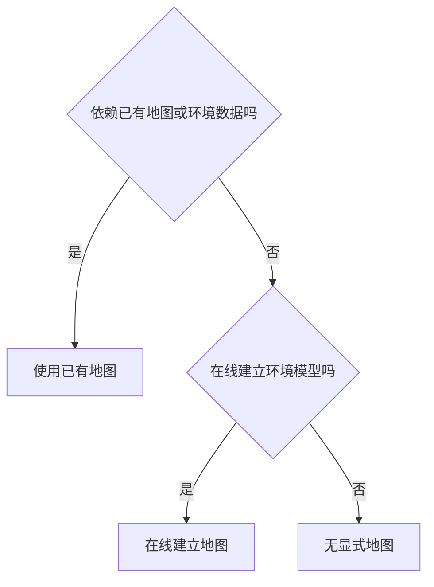
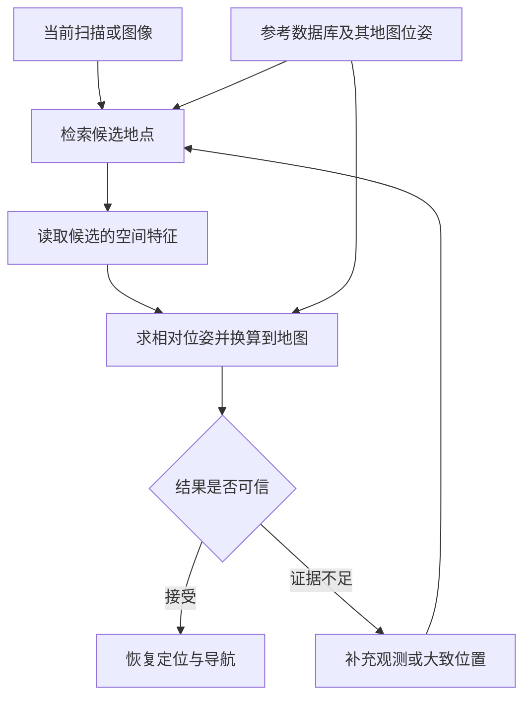
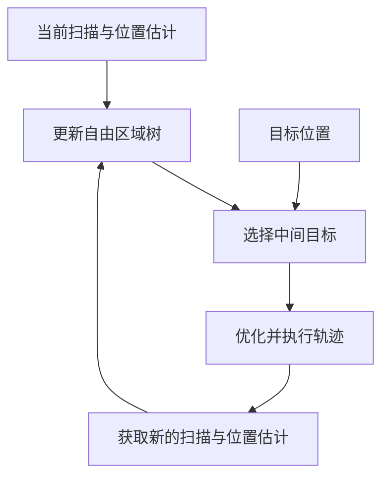

# 33. 移动机器人导航的地图依赖

移动机器人导航时，是否必须先把整个工作区域建成地图？答案是不一定。机器人可以使用事先建好的地图，也可以在行进中逐步建图，还可以利用传感器采集的周围环境数据，结合目标信息直接计算下一步运动。本章按这三类方法，说明机器人怎样完成导航、需要哪些环境信息，以及省去地图后要满足什么条件。

| 方法类别 | 环境信息怎样使用 | 代表工作与地图需求 |
|---|---|---|
| 使用已有地图 | 利用事先保存的环境数据，确定位置或规划路线 | Reliable MCL 使用已有地图定位。机器人也可以先由人带领记录路线，再自主沿路线重复行驶 [P01]、[P25] |
| 在线建立地图 | 根据实时观测建立地图，再用地图选择路线 | FRTree 记录已观察到的可通行区域，逐步向目标搜索 [P20] |
| 无显式地图 | 根据附近观测和目标信息，直接生成轨迹或控制指令 | LiDAR 在线控制屏障函数根据当前扫描修正控制指令，DTG 从观测生成轨迹 [P21]、[P15] |

对于前往给定目标的任务，后两类方法可以在运动中感知障碍、逐步寻找路线，不要求出发前已有整个区域的地图。沿已知路线重复运行时，也可以只保存这条路线附近的地图，无须预先采集整个工作区域。[P20]、[P25]

机器人失去定位后，若要通过环境匹配重新确定自己在原地图中的位置和朝向，就需要把当前图像或激光扫描与事先保存的环境数据进行比较。要求在哪些区域恢复定位，就要为哪些区域保存足够的可匹配数据。保存内容可以是有代表性的图像、激光扫描及其位置，只要能够支持定位，就不必记录环境的所有细节。[P04]、[P19]

第 33.1 节说明分类规则，第 33.2～33.4 节依次展开三类方法的流程和条件。第 33.5 节比较地图覆盖范围、定位与恢复能力，第 33.6 节给出 WHEELTEC 的实施顺序。坐标计算、软件核对项与其他相关研究集中在[补充说明](research/relocalization-method-notes.md)。

## 33.1 怎样判断一种方法的地图依赖

图像、激光扫描等传感器数据，在本章统称为观测。判断一种方法是否依赖地图，需要先了解地图保存什么、怎样使用，再检查地图是事先提供的，还是运行时建立的。本节先说明地图的作用，再给出分类规则。

### 33.1.1 地图记录什么，何时建立

地图记录环境中有哪些地点、障碍，以及它们的位置或连接关系。例如，占用栅格把空间划分为格子，记录哪些格子有障碍。拓扑地图用节点表示地点，用边表示地点之间可以通行。机器人可以根据栅格检查路径是否经过障碍，也可以根据地点连接选择路线。记录距离和位置的地图称为度量地图，记录地点连接的地图称为拓扑地图，两种形式也可以结合使用。[P26]

地图可以事先建立，也可以在机器人运行时建立。机器人在未知环境中逐步绘制栅格地图，与加载一张栅格地图后出发，都使用栅格，但获得地图的时间不同。已有地图也可以保存为图像与激光扫描的记录，或相互连接的局部地图。因此，分类时要检查机器人实际使用了哪些环境数据，以及数据何时获得。

学习模型也可能保存特定环境的信息。有的网络只从当前图像或扫描中提取特征，可以用于不同场景。有的网络则用实际工作区域的图像和坐标训练，学习从图像预测位置和朝向。后一种模型虽然没有单独的地图文件，参数中仍保存了场景与位置的联系，本章将其归入依赖已有环境信息的方法。

### 33.1.2 按实际使用的数据依次判断

经典综述区分基于地图、基于建图和无地图导航，但后续论文对“无地图”的用法并不一致。有的工作用它表示不需要预建全局地图，有的工作仍保留局部地图或历史观测。[P23]、[P24] 本章统一按以下顺序分类，并分别检查同一系统在不同阶段使用的数据。

首先检查机器人是否依赖工作区域已有的地图、场景记录，或用该区域数据训练的定位模型。如果依赖，就归入使用已有地图，即使运行中还更新附近的障碍。其余方法再检查是否将观测整理成环境模型，供后续定位或规划使用。如果建立了这种模型，就归入在线建立地图，否则归入无显式地图。

环境模型可以记录各处的障碍、可通行区域及其连接，让算法按位置查找所需信息。局部栅格、自由区域树和后文介绍的学习模型都可以起这种作用。仅暂存最近几次扫描或记录机器人速度，则不直接等同于建图。

按照是否依赖已有环境数据、是否在线建立环境模型的顺序判断，同一运行阶段只会进入下图中的一个分支。

例如，由人带领记录路线、再自主重复行驶的系统，在记录阶段采集环境数据，在重复行驶阶段使用已有数据，两个阶段应分别判断。论文只提出轨迹生成器时，也应先判断该模块，再检查完整导航系统是否另有地图和定位模块。上述顺序用于统一本章的比较，其他论文可能采用不同的分类名称。

## 33.2 使用已有地图：确定位置并规划路线

机器人可以将当前图像或扫描与已有地图比较，确定所在地点，再利用地图规划路线。本节先说明定位与规划流程，再解释历史观测怎样用于恢复定位，随后介绍相互连接的局部地图，以及建筑资料和学习模型的用法。

### 33.2.1 在地图中定位，再沿路线行驶

位置与朝向合称为位姿。使用已有地图时，系统先比较当前观测与地图，确定机器人位姿，再根据地图中的目标位置规划路线。控制器让机器人沿路线行驶，传感器持续检测附近障碍，以便调整运动。地图提供已经采集的环境信息，实时感知则用于发现运行中的变化。

二维栅格定位可以同时保留多个可能的位置和朝向，分别检查当前扫描与地图是否相符。蒙特卡洛定位用粒子表示这些可能的位姿，根据测得的运动更新粒子，再为与观测更相符的粒子分配较高权重，从而优先保留这些位姿假设。Reliable MCL 还估计定位结果的可靠程度，并增加全局搜索：将短时间内采集的局部观测与地图特征匹配，得到新的位姿候选，与持续更新的定位结果融合。[P01]

初始位姿未知或原定位结果失效时，重新确定机器人在已有地图中的位姿称为重定位。已知大致位置和朝向时，系统可以在附近搜索。如果完全不知道位于何处，就需要搜索更大的位置和朝向范围，再通过观测与地图的匹配确定结果。

### 33.2.2 用有代表性的历史观测恢复定位

定位地图可以只保存有代表性的历史图像或激光扫描，以及采集时在地图中的位姿。这种代表性记录称为关键帧。系统将当前观测与关键帧比较，求出两次观测之间的相对位姿，再结合关键帧在地图中的位姿，计算机器人当前的地图位姿。

BEVPlace++ 将激光空间点从上方投影成鸟瞰图，提取用于比较的数值特征，称为描述子。概括整幅观测的全局描述子用于检索相似关键帧，描述具体位置的局部描述子用于建立空间对应。数据库保存关键帧鸟瞰图、地图位姿和全局描述子，求解时再使用局部特征。[P19]（§III）

当前扫描进入系统后，算法生成同类描述子，取出相似的历史记录作为候选。候选只说明机器人可能在哪一带，布局重复、遮挡或视角变化都可能造成误检。BEVPlace++ 随后建立当前鸟瞰图与候选之间的局部特征对应，求解使对应尽量一致的平移和转动。把空间观测对齐的过程称为配准，求出的相对位姿再与候选地图位姿组合，得到当前地图位姿。[P19]（§III-D）

视觉方法也能完成这种联系。AirSLAM 保存关键帧位姿、地图三维点和线，以及图像与地图特征之间的对应。识别到候选后，算法用当前图像中的点与地图三维点匹配，根据三维点的图像投影求解相机位姿，再利用相机与机体的安装关系换算为机器人位姿。[P04]

求出位姿后，系统仍需检查有效匹配的数量与分布、对齐误差，以及其他候选是否同样合理。在实际导航系统中，还应结合后续观测和里程计测得的运动，检查结果是否持续一致。证据不足时，可以继续搜索、保留多个候选，或由其他定位来源提供大致位置。位姿通过检查后，再用于持续定位和导航。后续连续检查属于本章的工程建议，各论文实际采用的接受条件需分别核对。

参考数据库既提供候选地点，也提供位姿换算所需的空间关系。下图将检索、求解和接受判定连接起来。

只保存部分关键帧可以减少数据量，但仍需覆盖预期恢复定位的区域。数据较多时，可以先检索候选地点，再读取候选附近的一小部分地图，即子地图。按需读取可以减少同时加载到内存的数据，磁盘中仍需保存地图、检索索引及相应的坐标关系。位姿组合公式见[补充说明](research/relocalization-method-notes.md#pose-composition)。

### 33.2.3 用拓扑连接局部地图

局部地图也可以按地点之间的通行关系连接起来。系统先选择经过哪些地点，再使用各地点的局部地图，确定机器人在附近的位置和朝向。这种结合地点连接与局部几何信息的方式称为拓扑度量地图，可以用于规划较长路线，同时只在当前使用的子地图中进行精确定位。[P25]

一种典型用法是先由操作者带领机器人沿路线行驶，记录沿途的局部地图和相邻地点之间的相对关系。之后自主行驶时，系统从已记录的地点中选择通往目标的路线，将实时观测与附近子地图比较，计算机器人相对于原路线的位置和朝向，再通过控制器修正运动。开始自主行驶时，可以先识别所在地点，再在该地点的局部地图中确定位置和朝向。[P25]（§2）

沿路线行驶主要利用当前子地图中的距离、方向，以及通向下一子地图的连接。系统可以依次使用这些局部信息自主重复行驶，无须先把全部子地图精确拼接成一张覆盖整条路线的大地图。[P25]（§1、§2.3）自主行驶仍依赖已记录的路线与子地图，可选择的路线也受已记录地点及其连接关系限制。

### 33.2.4 使用建筑资料或经过训练的场景模型

建筑资料也可以提供定位所需的环境信息。AGLoc 用标有实际尺寸和位置的墙体、通道多边形与当前激光扫描匹配，并假定 Wi-Fi 与气压计能提供大致位置，先确定楼层、缩小搜索区域，再搜索精确位姿。[P02] BIM-Loc 将建筑信息模型与里程计结合，并估计设计模型与实际环境之间的差异。[P11] 使用建筑资料可以减少事先详细扫描环境的工作，但仍需确认资料使用的坐标、建筑结构的实际变化，以及算法要求的初始位置信息。

FusedNet 则使用标有拍摄位姿的场景图像训练网络，从单幅图像预测平面位置与朝向。[P07] 模型参数保存了场景与坐标的联系，运行时可以省去地图检索，但定位能力仍受训练数据覆盖范围和场景变化影响。采用这种方法时，还需考虑采集训练数据、更新模型，以及将模型用于新区域所需的工作。

保存哪些环境数据，应由任务决定。只需沿已知路线重复行驶时，可以仅保存沿途的局部地图。要求依靠环境匹配在整个工作区域恢复定位时，就要保留覆盖相应范围、足以区分地点并计算位姿的数据。

## 33.3 在线建立地图：在运动中获取环境信息

在线建图将实时观测整理成环境模型，再用模型规划运动。本节先说明怎样将不同时间的观测放到同一坐标系中，再以自由区域树展开规划流程，最后说明怎样在运行中学习供规划使用的环境模型。

### 33.3.1 用局部观测记录障碍与可通行区域

没有预建地图时，机器人仍可以建立坐标系，用同一原点和坐标轴表示机器人位姿与目标位置。坐标系只规定怎样描述位置，并不要求已经知道全部障碍。前往给定目标时，规划器必须能够根据当前位置和目标位置，计算两者之间的距离与方向。

里程计根据轮速、图像、激光或惯性测量估计相对运动。机器人利用运动估计，将不同时刻的观测放到同一坐标系中，逐步记录障碍、可通行区域及其连接。记录可以是只覆盖附近的栅格，也可以是随探索扩展的区域树。将当前点云整理成记录地面高度的局部高程图，再据此优化下一段路径，也属于在线建图。

环境模型可以随机器人移动而更新，无须始终保留全部历史。保留较多已探索区域及其连接，有助于判断哪些方向已经尝试过、遇到死路后应退回哪里，但也会增加存储和更新开销。里程计误差逐渐累积时，不同时刻的观测可能无法准确放到一起，因此在线建图仍需要可靠的运动估计。

### 33.3.2 从自由区域树到可执行轨迹

FRTree 用实时点云寻找附近可以继续前进的方向，沿各方向提取一组相互重叠的自由区域。自由区域描述当前观测中没有障碍的空间，区域之间的重叠为连续通行提供候选连接。规划器将方向和区域组织成树，新增观测到达时继续扩展。[P20]（§III-A）

选择分支时，FRTree 同时考虑到达候选区域的距离，以及从候选区域到目标的估计距离，选出本次规划先要到达的中间目标。轨迹优化器再检查机器人能否按自身运动限制依次通过这些自由区域，同时确认机体能够通过，生成交给控制器执行的轨迹。选择中间目标时，算法明确需要机器人当前位置与目标位置。[P20]（§III-B–C）

机器人前进后获取新的观测，规划器更新树并重新选择中间目标。尚未观测到的空间是否真正可通行，需要后续感知确认。某条分支不能继续时，算法利用已访问区域和死路记录，沿树回退到仍有其他可行分支的节点，再继续搜索。[P20]（§III-A–B）

自由区域树记录可以通行的区域及其连接，规划器结合当前位置与目标位置选择前进方向。下图将环境感知、地图更新与运动执行连接起来。

FRTree 无须预建环境地图，但仍在运行中记录可通行区域及其连接。路径会随观测逐步形成，机器人可能需要回退。论文使用 Go1 四足机器人进行实验，尚不能据此判断 WHEELTEC 轮式底盘能否使用同一方法，还需检查车体尺寸和运动限制。

### 33.3.3 在运行中学习供规划使用的环境模型

环境模型还可以用函数表示。Active NTFields 根据里程计与激光或深度观测，将障碍信息整理成训练样本，在运行中学习从一个位置到另一个位置需要的时间。规划时，算法用模型估计到达目标所需的时间，并沿估计时间逐渐减小的方向生成路径。[P22]（§IV-D–E）

探索过程还维护占用地图，用于区分已观察与未观察区域，从边界选择接下来要观察的位置，再利用学习模型生成前往该处的路径。[P22]（§IV-E）模型参数、在线样本和探索地图共同保存了环境信息，采用神经网络并不意味着省去了地图。

在线建图省去了事先采集完整地图的工作，运行时则需要同时完成感知、模型更新与规划。机器人能否到达目标，取决于感知范围、模型误差、探索方法和定位质量。某组未知环境实验成功，不能据此推断任意环境都能成功，也不能证明重启后可以恢复原地图中的位姿。

## 33.4 无显式地图：由观测直接生成运动

无显式地图的方法不单独建立供定位或规划使用的环境模型，而是根据传感器观测计算控制指令或生成轨迹。本节先说明怎样直接修正控制，再介绍学习模型怎样生成轨迹，最后检查目标、位置和历史信息从何而来。

### 33.4.1 根据当前扫描修正控制指令

LiDAR 在线控制屏障函数方法先计算朝向目标的控制指令，再根据当前扫描中的障碍边界，计算为避开障碍需要满足的条件。控制屏障函数将这些条件写成对控制指令的数学约束，求解器据此修正原指令，将结果交给机器人执行。新的扫描到达后，算法重新计算约束，不持续累积环境地图。[P21]（§III–IV）

这种方法减少了地图更新和存储工作，计算控制指令时仍需知道当前位置与目标的关系。该研究的 TurtleBot3 实验由外部光学定位系统 Vicon 提供位置，因此实验验证的避障能力，不能说明机器人能够自行确定未知的初始位置，或在定位丢失后重新定位。[P21]（§V-A）

避障要求还需要在机器人实际能够执行的控制范围内满足。论文指出，如果同时限制控制指令的取值范围，求解器可能找不到满足全部条件的指令。观测数据持续更新时，论文的安全结论也依赖相应假设。[P21]（§IV-B）附近避障是否安全、能否最终到达远处目标，需要分别验证。

### 33.4.2 从观测生成轨迹

学习方法可以将最近的传感器观测编码后，直接输出候选轨迹。MTG 根据激光观测和运动信息生成可通行方向上的轨迹，DTG 进一步将目标作为输入，用扩散模型生成朝向目标的轨迹。[P14]、[P15] 轨迹生成后，完整系统还要选择可执行运动，并由局部规划与控制完成跟随。

DTG 的输入包括连续激光观测、速度与目标信息，训练时则利用可通行地图和规划结果生成轨迹，作为模型的学习目标。论文的实机系统还使用局部规划器，将生成的轨迹用于实际运动，并处理小型和动态障碍。[P15]（§III、§IV）因此，判断轨迹生成器不依赖显式地图后，还需检查系统中其他模块是否使用地图。

训练时使用地图，与运行时依赖工作区域的地图，作用不同。通用模型可以在其他区域学习后用于新环境，不要求预先采集实际工作区域的地图。如果必须先用工作区域的图像和坐标训练模型，就仍依赖该区域事先采集的环境信息，例如第 33.2 节根据图像预测位姿的模型。比较模型时，应同时说明训练数据来自哪里，以及运行时实际读取什么。

### 33.4.3 省去地图后仍需哪些信息

无显式地图的方法也可以保留最近观测、速度状态或网络内部记忆。判断是否建图，要看系统是否建立了记录各处环境信息、供定位或规划使用的模型，不能仅凭是否保存历史数据判断。[P23]、[P24] 如果外部系统已经提供目标相对于机器人的方向，控制器也可以据此前进，无须自己估计全局位姿。

没有环境模型时，机器人难以查找远处路线，也难以判断哪些通路已经探索过。遇到遮挡、布局重复或死路时，系统可能需要额外的搜索方法和历史记录。若因此增加区域树、局部地图或相互连接的地点记录，就需要重新判断整套方法属于哪一类，并检查新增记录是否改善了到达目标的能力、增加了多少更新和存储开销。

## 33.5 怎样比较三类方法的能力与代价

三类方法获得和使用环境信息的方式不同，选择方法时还需要明确任务要求。本节先判断地图需要覆盖哪些区域，再检查位置估计和失效恢复所需的信息，最后说明实验和资源消耗怎样比较。

### 33.5.1 根据任务判断是否需要全局地图

前往给定目标不一定需要预建全局地图。在线建图可以逐步发现路线，无显式地图的方法也可以根据目标输入和局部观测持续生成运动。已有地图则能提前提供远处的连接关系，减少未知区域中的搜索。三类方法获得信息的时间不同，寻找路线所需的尝试也不同，因此不能只按地图的数据量判断优劣。

判断地图能否缩减，需要先明确准备减少什么。缩小覆盖范围，会减少可以利用地图的区域。减少环境细节，例如只保留部分关键帧，可以降低数据量，但仍可能覆盖整个工作区域。将局部地图通过地点连接组织起来，则可以支持长路线导航，而不必先把所有局部地图精确拼接成一张覆盖整条路线的大地图。[P25]、[P26]

对于依靠环境匹配的重定位，覆盖范围尤其重要。系统先将当前观测与已保存的数据比较，找到候选地点，再计算当前位置和朝向。若某个区域没有可匹配的数据，这种流程就无法在该区域恢复定位。因此，只要求在指定区域恢复时，可以仅保存相应区域的数据。要求在整个工作区域恢复时，就应保留覆盖该范围、足以区分地点并计算位姿的定位地图。

地图较大时，可以先检索候选地点，再读取候选附近的数据。这种按需加载方式减少了同时驻留内存的数据量，磁盘中仍需保存全部预期恢复区域的数据。

### 33.5.2 检查位置、目标与失效恢复的来源

里程计提供相对运动，已知初始位姿时可以据此持续更新位置。重新启动后若初始位姿未知，同一段运动可以发生在不同地点，单凭运动本身无法确定机器人处于原地图的何处。重新建立局部地图也只能记录附近环境，还需要与已有地图匹配，或借助坐标已知的外部定位设施，确定新旧坐标系之间的关系。

坐标已知的外部基站或地标，也可以用于确定机器人位置。DURAL 将 UWB 位置测量与激光、惯性和轮速融合，改善连续定位。[P12] 若要用同类测量在定位丢失后恢复位置，还需检查怎样重新估计状态、确定朝向，以及把基站坐标换算到地图坐标。采用外部设施时，其安装、标定和测量覆盖范围也应计入系统成本。

测得位置也不一定能确定机体朝向。单天线 GNSS 或单个 UWB 标签的一次位置测量，通常不足以确定朝向。使用视觉标记时，则需完成相机标定、保证标记可见，并正确计算相机与标记之间的位姿。只有外部测量能够确定任务所需的位置和朝向，并能换算到原地图坐标，才能用它替代环境匹配完成重定位。

平面通行任务通常需要位置 $(x,y)$ 和平面内朝向角 $\psi$，即三个自由度。完整三维位姿还包括高度、横滚和俯仰，共六个自由度。BEVPlace++ 重点估计平面三自由度，其余量可取自参考记录，这与独立恢复并验证六自由度不同。[P19] 比较恢复能力前，应先统一运动假设与输出要求。

### 33.5.3 用一致的实验检验代价

导航实验应记录是否到达目标、是否碰撞、路径长度与耗时，并说明目标和位置从何处获得。重定位实验则需另行规定允许的位置与朝向误差、结果连续成立的时长及超时条件。到达率、候选检索准确率和重定位成功率分别对应不同环节。

| 检查项目 | 应控制或改变什么 | 主要回答的问题 |
|---|---|---|
| 环境与地图条件 | 已知、未知及布局变化，局部或全局覆盖 | 方法依赖了哪些事先信息，能否适应新区域 |
| 定位与目标输入 | 已知初始位姿、初始位姿未知、定位失效及外部辅助 | 到达目标需要哪些定位条件，能否继续使用原目标 |
| 搜索与结果检查 | 遮挡、重复结构、死路和地图未覆盖区域 | 能否退回其他分支、排除错误地点，避免将错误定位结果判为正确 |
| 地图与模型缩减 | 关键帧数量、分辨率、存储和加载方式 | 节省资源后，覆盖、误差与耗时怎样变化 |

实验中应使用独立测量得到的位置和朝向，检查定位结果是否正确。算法自己的相似度与配准误差可以决定是否接受候选，但不能单独证明实际定位正确。成功率需包含全部尝试，并分别记录失败、超时，以及将错误定位结果判为正确的情况。粒子滤波完整性监测研究专门分析了定位误差很大、系统却未报警的风险，这类错误需要单独统计。[P13]

资源比较应包括事先采集环境数据或训练模型的工作、地图磁盘占用、运行内存、模型更新和计算耗时。恢复定位的总耗时还应包含失效检测、搜索、位姿计算和结果检查。传感器、计算平台和每次处理所用观测的时间范围应保持一致，或明确列出差异，再比较满足同一任务要求所需的总成本。

## 33.6 WHEELTEC 的实施顺序

对 WHEELTEC，先按任务选择导航方法，再完成基本定位与导航，并通过重复实验确认结果。使用已有地图时，需要检查定位丢失后怎样恢复地图坐标。面向未知环境时，则需依次验证短距离运动、路线搜索和能否到达目标。以下步骤属于工程建议，具体能力仍需在本车上确认。

### 33.6.1 先确定整套导航系统采用哪类方法 {#navigation-map-needs}

Navigation2（Nav2）是 ROS 2 中常用的一套导航框架。常规配置利用已有地图组织全局路线，同时用机器人附近的局部代价地图处理实时障碍。[S02] 因为运行依赖已有地图，这套配置属于第一类，局部地图在线更新不会改变归类。

若任务是反复前往已知地点，可以先采用已有地图，明确目标坐标、需要恢复定位的区域和允许误差。若任务是在新环境中前往给定目标，则先确定当前位置怎样估计、目标位置怎样提供，再选择在线建图或直接根据观测计算运动。比较论文模块与完整系统时，应列出里程计、地图、规划和控制分别由谁提供。

### 33.6.2 先验证已有地图中的定位与恢复

已有二维雷达与导航地图时，可以从 AMCL 开始，确认雷达、轮速和坐标关系，再分别测试初始位姿正确、初始位姿错误、初始位姿未知，以及运行中定位丢失的情况。AMCL 可以在地图范围内重新生成位姿假设，自动恢复定位还需确定何时启动搜索、怎样搜索、何时接受结果。[S01] 实现核对项见[补充说明](research/relocalization-method-notes.md#amcl-implementation)。

采用 MID360 时，可以保留 FAST-LIO 连续估计局部运动的功能，再增加关键帧保存、候选地点检索、位姿计算和结果检查。先保存关键帧及其地图位姿，确认重启后能够加载数据并完成恢复定位，再逐步减少关键帧或采用按需读取。每次变化都用第 33.5 节的实验检查覆盖范围、误差和耗时。[第 42 章](42-mid360-fast-lio.md)与[第 43 章](43-mid360-fast-lio-data-flow.md)说明里程计和点云的产生过程。

重定位成功后，系统将地图位姿与同一时刻的里程计位姿组合，更新 `map → odom` 修正，使局部连续运动重新关联到原地图，并保持 `odom → base_link` 连续。[S03] 检测到定位失效时应暂停任务并约束运动，候选通过验证、坐标关系更新且路径重新检查后再恢复导航。公式与时间戳要求见[补充说明](research/relocalization-method-notes.md#map-odom-recovery)。

### 33.6.3 逐步验证能否在未知环境中到达目标

未知环境实验先检查局部里程计是否可靠、能否检测附近障碍，以及目标位置是否正确传入，再验证短距离规划与行驶。采用在线建图时，继续检查模型更新、中间目标选择、已探索区域记录，以及遇到死路后能否退回其他分支。直接根据观测计算控制指令时，则需确认当前位置从何而来、指令是否满足底盘限制，以及计算失败后机器人采取什么行动。

让机器人在未知环境中导航，还需要为尚未观察到的区域选择探索方向，并处理定位误差累积、路径无法通过和目标暂时无法到达的情况。短距离运动稳定后，再逐步增加行驶距离、遮挡和路线分支，根据到达目标的成功率和失败记录，判断是否需要保存更多环境信息。

选择导航方法，最终要看任务需要什么能力。在线建图可以省去出发前的完整地图，无显式地图可以进一步减少地图更新与存储工作，已有地图则可用于提前规划路线，并在定位丢失后匹配历史环境数据。需要覆盖哪些区域、当前位置从何而来、定位丢失后怎样恢复，都应根据具体任务确定。

## 参考与补充阅读

经典分类、术语边界与拓扑度量地图的依据见[分类证据表](research/navigation-taxonomy-evidence.csv)和[分类核查说明](research/navigation-taxonomy-reference-audit.md)。重定位相关工作见[原论文证据表](research/relocalization-evidence.csv)，在线规划工作见[在线导航证据表](research/online-navigation-evidence.csv)。坐标推导与其他方法见[补充说明](research/relocalization-method-notes.md#related-methods)，正文和补充说明共用以下参考编号。

### 参考文献 {#references}

- P01 · M35 — Akai, Naoki (2023). *Reliable Monte Carlo localization for mobile robots*. Journal of Field Robotics. [DOI](https://doi.org/10.1002/rob.22149).
- P02 · S03 — Xie, Fujing et al. (2024). *Robust Lifelong Indoor LiDAR Localization Using the Area Graph*. IEEE Robotics and Automation Letters. [DOI](https://doi.org/10.1109/lra.2023.3334158).
- P03 · SC-P195 — Shen, Hongming et al. (2026). *UniLGL: Learning Uniform Place Recognition for FOV-Limited/Panoramic LiDAR Global Localization*. IEEE Transactions on Robotics. [DOI](https://doi.org/10.1109/tro.2026.3672514).
- P04 · R05 — Xu, Kuan et al. (2025). *AirSLAM: An Efficient and Illumination-Robust Point-Line Visual SLAM System*. IEEE Transactions on Robotics. [DOI](https://doi.org/10.1109/tro.2025.3539171).
- P05 · R06 — Cattaneo, Daniele et al. (2025). *CMRNext: Camera to LiDAR Matching in the Wild for Localization and Extrinsic Calibration*. IEEE Transactions on Robotics. [DOI](https://doi.org/10.1109/tro.2025.3546784).
- P06 · S26 — Zhang, Lintong et al. (2026). *Visual localization in 3D maps: comparing point cloud, mesh, and NeRF representations*. Autonomous Robots. [DOI](https://doi.org/10.1007/s10514-025-10232-5).
- P07 · M21 — Chen, Fang-xing et al. (2024). *FusedNet: End-to-End Mobile Robot Relocalization in Dynamic Large-Scale Scene*. IEEE Robotics and Automation Letters. [DOI](https://doi.org/10.1109/lra.2024.3372465).
- P08 · M34 — Xie, Yuanyan et al. (2023). *Indoor Visual Re-Localization for Long-Term Autonomous Robots Based on Object-Level Features and Semantic Relationships*. IEEE Robotics and Automation Letters. [DOI](https://doi.org/10.1109/lra.2022.3233235).
- P09 · R10 — Kruzhkov, Evgenii et al. (2026). *OMCL: Open-Vocabulary Monte Carlo Localization*. IEEE Robotics and Automation Letters. [DOI](https://doi.org/10.1109/lra.2026.3653333).
- P10 · E56 — Wang, Zihang et al. (2026). *LiteFT-PR: Lightweight and Fault-Tolerant LiDAR-Camera Fusion Network for Robust Place Recognition via Model Distillation*. IEEE Robotics and Automation Letters. [DOI](https://doi.org/10.1109/lra.2026.3662634).
- P11 · S36 — Yinqiang Zhang et al. (2026). *BIM-Loc: BIM-integrated discrepancy-aware LiDAR-based indoor localization*. The International Journal of Robotics Research. [DOI](https://doi.org/10.1177/02783649261462593).
- P12 · E03 — Hu, Kun et al. (2026). *DURAL: Degradation-Resistant Robust Adaptive Localization by LiDAR-Inertial-UWB-Wheel Fusion for Coal Mine Robots*. Journal of Field Robotics. [DOI](https://doi.org/10.1002/rob.70200).
- P13 · M28 — Hafez, Osama Abdul et al. (2024). *How Safe Is Particle Filtering-Based Localization for Mobile Robots? An Integrity Monitoring Approach*. IEEE Transactions on Robotics. [DOI](https://doi.org/10.1109/tro.2024.3420798).
- P14 · SC-M039 — Liang, Jing et al. (2024). *MTG: Mapless Trajectory Generator with Traversability Coverage for Outdoor Navigation*. 2024 IEEE International Conference on Robotics and Automation (ICRA). [DOI](https://doi.org/10.1109/icra57147.2024.10611319).
- P15 · SC-M043 — Liang, Jing et al. (2024). *DTG : Diffusion-based Trajectory Generation for Mapless Global Navigation*. 2024 IEEE/RSJ International Conference on Intelligent Robots and Systems (IROS). [DOI](https://doi.org/10.1109/iros58592.2024.10802055).
- P16 · SC-P134 — Jose Luis Blanco-Claraco (2025). *A flexible framework for accurate LiDAR odometry, map manipulation, and localization*. The International Journal of Robotics Research. [DOI](https://doi.org/10.1177/02783649251316881).
- P17 · R11 — Xiao, Renxiang et al. (2026). *LiDAR Teach, Radar Repeat: Robust Cross-Modal Navigation in Degenerate and Varying Environments*. IEEE Transactions on Robotics. [DOI](https://doi.org/10.1109/tro.2026.3699433).
- P18 — Ratz, Sebastian et al. (2020). *OneShot Global Localization: Instant LiDAR-Visual Pose Estimation*. 2020 IEEE International Conference on Robotics and Automation (ICRA). [DOI](https://doi.org/10.1109/ICRA40945.2020.9197458).
- P19 · H53 — Luo, Lun et al. (2025). *BEVPlace++: Fast, Robust, and Lightweight LiDAR Global Localization for Autonomous Ground Vehicles*. IEEE Transactions on Robotics, 41, 4479–4498. [DOI](https://doi.org/10.1109/TRO.2025.3585385).
- P20 · M05 — Li, Yulin et al. (2025). *FRTree Planner: Robot Navigation in Cluttered and Unknown Environments With Tree of Free Regions*. IEEE Robotics and Automation Letters, 10(4), 3811–3818. [DOI](https://doi.org/10.1109/LRA.2025.3544519).
- P21 · E26 — Keyumarsi, Shaghayegh, Made Widhi Surya Atman, and Azwirman Gusrialdi (2024). *LiDAR-Based Online Control Barrier Function Synthesis for Safe Navigation in Unknown Environments*. IEEE Robotics and Automation Letters, 9(2), 1043–1050. [DOI](https://doi.org/10.1109/LRA.2023.3339059).
- P22 · H47 — Liu, Yuchen, Ruiqi Ni, and Ahmed H. Qureshi (2025). *Physics-Informed Neural Mapping and Motion Planning in Unknown Environments*. IEEE Transactions on Robotics, 41, 2200–2212. [DOI](https://doi.org/10.1109/TRO.2025.3548495).

- P23 · TAX01 — DeSouza, G. N., and A. C. Kak (2002). *Vision for mobile robot navigation: a survey*. IEEE Transactions on Pattern Analysis and Machine Intelligence, 24(2), 237–267. [DOI](https://doi.org/10.1109/34.982903).
- P24 · X04 — Zhu, Kai, and Tao Zhang (2021). *Deep reinforcement learning based mobile robot navigation: A review*. Tsinghua Science and Technology, 26(5), 674–691. [DOI](https://doi.org/10.26599/TST.2021.9010012).
- P25 · J01 — Krawciw, Alexander, and Timothy D. Barfoot (2026). *Local Maps Are All You Need: A Review of Topometric Teach and Repeat Navigation*. Annual Review of Control, Robotics, and Autonomous Systems, 9, 301–324. [DOI](https://doi.org/10.1146/annurev-control-032724-020548).
- P26 · SC-R073 — Placed, Julio A. et al. (2023). *A Survey on Active Simultaneous Localization and Mapping: State of the Art and New Frontiers*. IEEE Transactions on Robotics, 39(3), 1686–1705. [DOI](https://doi.org/10.1109/TRO.2023.3248510).

软件与坐标规范：

- S01 — [Navigation2 Humble：AMCL 源码](https://github.com/ros-navigation/navigation2/blob/3c3db59d6969d8ecee8e68468693d006397f4a0c/nav2_amcl/src/amcl_node.cpp)，核对 `globalLocalizationCallback`、`uniformPoseGenerator`、`reinitialize_global_localization` 与恢复参数默认值。
- S02 — [Navigation2 Humble：默认参数](https://github.com/ros-navigation/navigation2/blob/3c3db59d6969d8ecee8e68468693d006397f4a0c/nav2_bringup/params/nav2_params.yaml)，局部代价地图配置为 `local_costmap.global_frame: odom` 与 `rolling_window: true`。
- S03 — [REP-105：Coordinate Frames for Mobile Platforms](https://github.com/ros-infrastructure/rep/blob/11ca24a41f31480dfb9562ba99f2a5b93d3ebda5/rep-0105.rst)，核对 `odom` 的连续性与 `map` 的全局修正语义。

## 章节导航

[上一章：地图、定位与 TF](32-map-localization-tf.md) · [返回本篇](index.md) · [下一章：Nav2 导航](34-nav2-navigation.md)

[P01]: #p01
[P02]: #p02
[P03]: #p03
[P04]: #p04
[P05]: #p05
[P06]: #p06
[P07]: #p07
[P08]: #p08
[P09]: #p09
[P10]: #p10
[P11]: #p11
[P12]: #p12
[P13]: #p13
[P14]: #p14
[P15]: #p15
[P16]: #p16
[P17]: #p17
[P18]: #p18
[P19]: #p19
[P20]: #p20
[P21]: #p21
[P22]: #p22
[P23]: #p23
[P24]: #p24
[P25]: #p25
[P26]: #p26
[S01]: #s01
[S02]: #s02
[S03]: #s03
