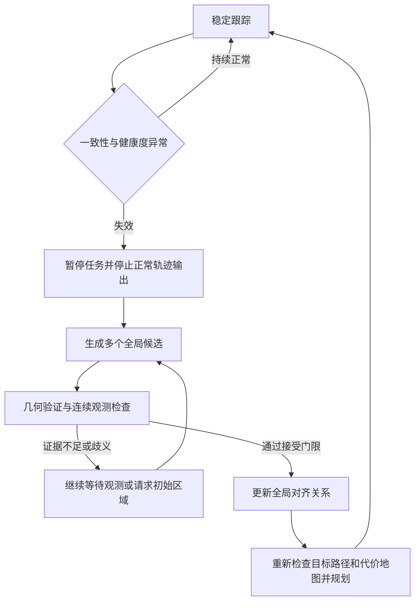

# 33. 移动机器人重定位方案与全局地图依赖

移动机器人恢复原有全局坐标系中的位置和姿态，通常需要与该坐标系关联的参考信息；这份参考不一定是完整、稠密、常驻内存的全局地图。它可以是二维栅格、局部子地图及其全局位姿、带坐标的关键帧、稀疏建筑结构、语义地标、示教路线，也可以是已标定的外部基站。部分学习方法把场景与坐标的联系存入网络权重，运行时没有显式地图文件，但仍存在场景参考依赖。[P01]—[P13]

局部避障、局部轨迹生成和全局重定位解决的任务不同。前两者可以主要依赖实时传感器和局部运动估计；后者需要建立当前位置与原坐标系的对应关系。方案对地图的依赖，具体体现在参考信息的来源、存储形式、可恢复的自由度和初始化条件上。

建图、加载地图和 TF 的基础操作见[第 32 章](32-map-localization-tf.md)，导航组件的工作过程见[第 34 章](34-nav2-navigation.md)。

## 33.1 分析地图依赖的五个维度

重定位对地图的需求，取决于参考信息能否约束目标位姿。稠密点云、稀疏关键帧、建筑结构和外部锚点的形式不同，都需要建立观测与坐标之间的联系。

| 维度 | 核心问题 | 对方案设计的影响 |
|---|---|---|
| 坐标与尺度 | 参考信息如何关联到原地图坐标系 | 关键帧位姿、地标坐标或外部坐标变换需要持久保存 |
| 覆盖范围 | 哪些区域有可用参考，哪些位置容易混淆 | 决定可恢复区域及候选检索范围 |
| 几何与自由度 | 观测能够约束平面位姿还是完整三维位姿 | 决定需要保留的几何信息及辅助传感器 |
| 初始不确定性 | 已知近似位置，还是位置和方向都未知 | 决定采用局部配准、全局搜索还是粗定位辅助 |
| 存储与计算 | 哪些数据常驻内存，哪些按需加载 | 决定索引、子地图和在线计算的组织方式 |

例如，按候选加载子地图可以降低在线内存占用；用墙体多边形替代详细点云可以减少存储；引入外部锚点可以改变定位参考的来源。这些选择分别改变资源需求、参考表示和测量方式。

## 33.2 先区分需要恢复的状态

| 任务 | 需要知道什么 | 常见参考 | 与原地图位姿的关系 |
|---|---|---|---|
| 短时相对里程计 | 从上一时刻移动了多少 | 连续图像、扫描、IMU、轮速 | 提供相对运动；重启后需重新建立与原地图的对齐 |
| 位姿跟踪 | 已知近似位置后持续更新 | 先验地图与上一时刻状态 | 在初始对齐有效且持续跟踪时维持原地图位姿 |
| 全局初始化 | 初始位置未知或不准确时寻找位姿 | 地图、带位姿的数据库或外部锚点 | 在参考覆盖与搜索范围内求解目标自由度 |
| 失效后重定位 | 跟踪丢失、错误收敛或绑架后恢复 | 与原坐标系关联的参考 | 检测失效后重新求解并验证原地图位姿 |
| 地点识别 | 当前观测类似哪个已知地点 | 描述子数据库、历史关键帧 | 通常先得到地点 ID 或候选帧，仍需几何求解 |
| SLAM 回环与地图合并 | 两段轨迹或两张地图如何关联 | 历史观测及其相对几何 | 只有连接到原地图后，才能恢复其中的坐标关系 |
| 重新建图 | 在新局部坐标系中继续估计 | 当前观测与新生成地图 | 新图必须与旧图配准，才能恢复旧坐标 |

在平面移动机器人中，目标常为 $SE(2)$ 位姿 $(x,y,\psi)$。三维传感器并不自动意味着输出完整 $SE(3)$ 位姿：平面 BEV 匹配可能只恢复水平位置与偏航角；高度、横滚和俯仰可能由地面假设或惯性信息提供。

也要区分“全局”的含义。机器人 SLAM 的 `map` 是一个固定参考坐标系，可以完全不与地球坐标关联。论文中的全局规划有时只表示朝远距离目标生成路线；它不一定包含未知初始位姿下的全局定位。

## 33.3 导航各环节对地图的需求不同 {#navigation-map-needs}

| 环节 | 最少需要的信息 | 是否通常需要预先完整建图 | 需要补充核对的条件 |
|---|---|---|---|
| 紧急碰撞检测、近场避障 | 传感器覆盖、障碍距离、机器人外形与速度 | 通常不需要 | 盲区、制动距离、延迟和可通行性 |
| 局部轨迹生成与控制 | 局部障碍表示、局部目标、运动状态 | 通常不需要 | 局部目标是否来自全局路径；坐标是否连续 |
| 已知环境中的常规全局规划 | 可达区域和连通关系、起终点 | 常用，但可用拓扑图或稀疏路线替代稠密地图 | 图的覆盖范围与通道状态 |
| 未知环境探索与无图远程导航 | 在线观测、历史记忆、目标或探索准则 | 不一定需要预建完整地图 | 可以在线维护局部图、拓扑记忆或隐式状态 |
| 地图中的位姿跟踪 | 可匹配的参考区域和近似初值 | 通常不必每帧读取全部地图 | 参考区域要包含当前位置和足够几何约束 |
| 未知位置的全局重定位 | 跨候选区域的检索能力、全局锚定关系、位姿验证 | 不必完整稠密，但要有足够参考覆盖 | 无正确候选、场景混淆和参考坐标不明都可能导致失败 |

MTG 从近期三维点云和速度历史生成可通行轨迹；DTG 接收点云、速度和目标信息生成朝向远处目标的轨迹。两者在运行时都可以通过在线观测生成轨迹。[P14]、[P15] 机器人被搬走后若要恢复旧 `map` 中的位姿，还需要连接原坐标系的定位参考和求解过程。

DTG 在训练阶段使用可通行地图与 A* 构造距离和轨迹监督。这里需要分别考察四种依赖：训练所需的地图监督、推理阶段的地图输入、在线维护的局部表示，以及定位使用的全局坐标参考。

Navigation2（Nav2）是 ROS 2 中常用的一套导航框架。其常见配置把局部代价地图放在 `odom` 下并设置滚动窗口，依靠实时障碍观测和连续里程计工作。[S02] 控制器通常还接收由全局规划器提供的路径。局部代价地图因此可以只维护机器人周边区域，而常规全局导航仍通过 `map` 中的定位和路径连接起终点。

## 33.4 保留观测与原坐标系的联系

把重定位写成条件估计问题：

$$
p\!\left({}^{M}T_B(t)\mid z_{1:t},u_{1:t},\mathcal{R}_M\right),
$$

其中 $M$ 是希望恢复的原地图坐标系，$B$ 是机器人机体坐标系；$z$ 是环境观测，$u$ 是运动信息，$\mathcal{R}_M$ 是与 $M$ 关联的参考。这个参考比“栅格地图文件”更一般。

例如，检索到了数据库中的关键帧 $K$，还需要两项信息：关键帧在原地图中的位姿 ${}^{M}T_K$，以及当前机器人相对关键帧的几何变换 ${}^{K}T_B$。两者组合后才得到：

$$
{}^{M}T_B = {}^{M}T_K\,{}^{K}T_B.
$$

如果数据库只存描述子和地点名称，没有关键帧坐标、地标几何或其他可恢复的空间联系，检索结果通常不能直接成为导航需要的连续位姿。

只靠相对观测重新估计运动时，整体平移或旋转局部轨迹，通常不会改变这些相对观测的解释。IMU 的重力方向可以约束部分姿态，但单靠重力不能确定全局位置和偏航。因此，当旧图、旧关键帧、场景坐标知识和外部锚点均不存在时，原地图中的位置和偏航不可观测。恢复这些自由度需要引入与原坐标系关联的约束。

“不依赖全局地图”至少应拆成下列五种说法：

1. 不需要预先采集完整环境，允许在线建图。
2. 不需要稠密栅格或点云，改用稀疏结构与关键帧。
3. 不需要把全部地图装入内存，按候选加载子地图。
4. 不需要显式地图文件，场景信息存在模型权重或其他数据库中。
5. 不需要任何与原坐标系关联的参考，还能恢复原地图位姿。

前四项可以成立，第五项在缺乏其他绝对约束时不能成立。系统从稠密地图切换到外部基站，只是改变了参考形式。

## 33.5 二维激光：MCL、AMCL 与可靠性增强

### 33.5.1 地图怎样进入估计

MCL 用一组位姿粒子表示后验分布。轮速或惯性运动信息推进粒子，激光扫描与已知地图的匹配程度形成观测似然。AMCL 的粒子数自适应机制改善计算分配，但不会替代地图，也不会自动消除对称环境中的多解。

Akai 的 *Reliable Monte Carlo localization for mobile robots* 明确将任务定义为：已知二维激光、惯性运动输入和地图，同时实现鲁棒跟踪、可靠性估计与快速重定位。其全局定位分支先在全局栅格地图中定义自由空间特征，再把 `odom` 中累积的局部地图与之匹配，产生候选位姿，最后通过重要性采样与跟踪分支融合。[P01]（§3.1、§3.3、§4.4）

这里同时存在局部地图与全局地图。局部地图用于形成当前观测的空间结构；预先建立的全局特征用于确定这段局部结构在原地图中的位置。

### 33.5.2 AMCL 的全局初始化与恢复配置

Nav2 Humble 的 AMCL 源码把 `reinitialize_global_localization` 服务连接到地图自由空间中的均匀位姿采样，同时声明 `recovery_alpha_fast` 和 `recovery_alpha_slow` 的默认值为零。[S01] 自主恢复需要配置失效触发机制、恢复参数、粒子上限以及重新收敛的判据，并通过绑架实验验证整个过程。

RViz 的 `2D Pose Estimate` 由人提供初始位姿分布，用于帮助局部收敛。自主全局初始化则需要在更大的位置和方向范围内搜索，并排除相似区域中的错误候选。

适用判断： 对已有二维地图、平面通行环境和二维雷达的 WHEELTEC，先建立 AMCL 的基线最直接。对地图较大、相似走廊多或初始化困难的环境，再增加特征检索或外部粗位置作为候选生成器。重定位用图与规划用图可采用不同分辨率，但二者的坐标变换、尺度与版本必须一致。

## 33.6 三维激光：检索候选、几何恢复与子地图加载

### 33.6.1 地点识别负责缩小搜索空间

UniLGL 在 §II 中把 LiDAR 地点识别定义为：给定查询点云和数据库点云集合，检索最相似点云；到 §III 才进一步讨论查询点云与检索结果的全局配准及位姿恢复。[P03] 这一区分适用于 Scan Context、BEV 描述子和学习式全局描述子一类检索前端。

LiteFT-PR 则主要通过多模态描述子、传感器质量估计和蒸馏提升地点识别鲁棒性，实验使用 PR 曲线、Recall@1 和 F1-max 评价候选检索。[P10]（§III-A、§IV-C） 完整重定位链路还需记录几何求解后的位姿误差、误配率和失效后的恢复时间。

工程上可采用：

完整高分辨率点云无需每帧常驻内存，但检索索引要覆盖预期恢复区域；选中的子地图还必须包含足够的几何信息。每个切片都需保存其在全局坐标系中的位姿。

### 33.6.2 ICP 与 NDT 的角色

在给定合理初值时，ICP 或 NDT 可把当前扫描对齐到参考子地图。它们的常规局部优化依赖初值，可能陷入错误极值。未知位置启动时，通常先通过全局搜索、特征匹配或外部粗定位生成初值，再进行局部精配准。

配准接受条件应同时考虑残差、候选间歧义、几何约束方向、观测重叠以及后续扫描的一致性。长直走廊可能沿走廊方向约束不足；相似楼层也可能产生残差很小的错误匹配。

### 33.6.3 地图表示可以按任务生成

*A flexible framework for accurate LiDAR odometry, map manipulation, and localization* 将带时间戳传感器观测和估计位姿组成的关键帧集合视为基础地图，并从这种 view-based 表示生成适用于不同任务的度量地图。[P16]（§3.1.3）

对本项目，可以保留关键帧及全局位姿作为源数据，由它生成检索索引、定位子地图和规划地图，使各模块使用适合自身任务的数据表示。地图版本变化后，需要同步更新相应索引和派生地图。

### 33.6.4 OneShot：单扫描可恢复六自由度，参考数据库仍然存在

OneShot 从单帧三维 LiDAR 扫描提取片段，用学习描述子检索地图片段，经几何一致性检验后，利用片段质心的对应关系求六自由度位姿。建图阶段保存的片段及质心位置构成定位参考。[P18]（§III-D–E） 当前查询只需单帧扫描，可以在尚未移动并累积局部地图时发起全局恢复。

论文在 NCLT 跨季节评价中报告 38% 的定位率和 94% 的 precision，实验平台为 Intel i7-8700 与 RTX 2080。[P18]（§V-A） 其分割过程利用旋转式雷达的 range image 结构。应用于 MID360 的非重复扫描数据时，需要适配分割方式和点云组织，并测量不同观测覆盖下的定位率、误接受率与时延。

## 33.7 视觉、跨模态、语义与隐式场景参考

### 33.7.1 稀疏视觉地图仍然是地图

AirSLAM 的地图保存内容包括关键帧索引与位姿、关键点及描述子、三维点、三维线和二维到三维的对应关系；优化后还保存词袋、共视图和场景相关的交点词典。重定位复用这张地图，先检索候选，再筛选并求解几何关系。[P04]（§V-F、§VI-A5、§VI-B）

视觉词袋负责候选检索，三维点线及其对应关系参与几何求解，关键帧位姿建立与原地图坐标的联系。这些数据共同构成可复用的稀疏参考。跨次运行恢复还需要地图序列化、重新加载和版本兼容支持。

### 33.7.2 使用相机定位不等于使用相机建图

CMRNext 在相机图像与 LiDAR 地图投影之间预测对应关系，再用 PnP 求相机位姿。其地图投影需要初始位姿估计，论文举例可来自 GNSS 或跨模态地点识别。[P05]（§III-A） 因而它可以作为精确定位或跨模态对齐环节，但在未知位置启动时，还要补齐粗搜索环节。

地图表示比较研究 S26 则从点云、网格和 NeRF 生成带深度与已知渲染位姿的参考图像；实时图像先检索参考视图，再经特征匹配与 PnP 恢复位姿。其问题定义使用先验地图以及参考视图到世界坐标的变换。[P06]（§3.1、§3.5） 三种表示采用不同的存储与渲染方式，都通过参考图像的深度和全局位姿建立坐标联系。

### 33.7.3 语义提供检索约束，空间参考仍须保留

OMCL 的输入可以是 RGB 图像，但定位还使用地图尺度的里程计和预先构建的 Octree Language Map。自然语言提示如周边物体类别，用于在地图中筛出可能区域并初始化粒子；随后通过多帧观测逐步收敛。[P09]（§III-A–C）

“看到桌子和门”提供了语义约束；这些语义类别在地图中的空间分布，使其能约束坐标。通用视觉语言模型提供类别识别与语义相似性，目标环境的空间地图则把这些结果关联到具体位置。

对象级语义重定位 M34 使用对象及其关系构造场景图，并通过图匹配提高动态室内场景的匹配鲁棒性。[P08] 其评价主要围绕候选匹配与召回，测试场景要求存在有效的对象特征。场景图匹配提供对象对应关系；进一步恢复度量位姿，还需要对象的空间几何与位姿求解。

### 33.7.4 网络回归位姿可能把地图依赖转移到权重

FusedNet 在 moBotReloc 中预测二维平移和偏航角，训练数据包含场景图像与机器人位姿。[P07]（§III-D、§IV） 推理可以不显式读取点云地图，但从图像到该场景坐标的联系已经由监督训练建立。更换建筑、重新定义坐标原点或大幅改变场景，都需要重新验证。

因此应区分两类学习模型：通用特征或匹配网络可以跨环境复用，但仍对照目标环境的地图；场景专用绝对位姿回归则可能把目标环境参考存入权重。网络是否经过预训练，与它是否携带目标场景的坐标知识，也不是同一个问题。

## 33.8 稀疏建筑结构、示教路线与外部锚点

### 33.8.1 AGLoc：无需稠密点云，但有结构图与粗位置

AGLoc 使用 Area Graph 中墙体与门的度量多边形，对三维雷达扫描去除杂物后进行匹配。全局初始化先用 Wi-Fi 与气压计缩小位置和楼层范围，再采样候选，随后用加权点到线 ICP 跟踪。[P02]（§III-A–F）

墙体与门的多边形带有度量坐标，为扫描匹配提供连续位姿约束。其全局定位实验在粗定位给出的区域内，以约 6 m 的搜索半径采样，单次扫描的全局搜索平均约 88 s。[P02]（§IV-B） 初始区域的准确性和搜索范围因此直接影响恢复时间。

它直接支持“稀疏、结构化、稳定的地图可替代详细点云”，也展示了减少地图信息后可能需要粗位置辅助和更大搜索开销的取舍。

### 33.8.2 BIM 与示教路线：改变先验来源和覆盖范围

BIM-Loc 用设计态 BIM 中的墙、柱、梁等结构作先验，同时估计 BIM 与现实之间的不一致，并结合前端里程计约束轨迹。[P11]（§3.1） BIM 提供带坐标的环境模型，可以减少事先机器人扫描建图的工作。未知位置启动时，系统还需要建立初始轨迹与 BIM 坐标系的对齐，并在此基础上跟踪结构差异。

LiDAR Teach, Radar Repeat 在示教阶段保存路线节点，重复阶段用雷达匹配示教节点，并通过跨模态注册建立对应。[P17]（§III-C–D） 路线节点可以替代完整区域地图，恢复范围取决于示教观测的覆盖。扩展到新的巡检区域需要补充示教数据。若目标是恢复另一个既有 `map`，示教图还需要与该 `map` 对齐。

### 33.8.3 GNSS、UWB 与人工地标：以外部锚点建立坐标参考

DURAL 把 UWB 锚点建立的坐标系作为绝对参考，并融合 LiDAR、IMU 与轮速，以提高退化环境中的连续定位鲁棒性。[P12]（§5.1.1） 外部测量补充环境几何约束；用于失效后恢复时，还需处理状态重初始化、异常测量和姿态重新收敛。

对外部参考还要逐一核对自由度：

| 参考方式 | 可能直接约束的量 | 仍须解决的问题 |
|---|---|---|
| 单天线 GNSS / RTK | 天线全局位置 | 静止时通常不能直接提供可靠机体偏航；还需外参、地图坐标对齐 |
| UWB 单标签与已知锚点 | 在覆盖与几何条件满足时约束标签位置 | 单个位置测量不能独立恢复完整机体姿态；受 NLOS、锚点布局影响 |
| 已知尺寸与全局位姿的 AprilTag / ArUco | 由角点几何估计相机相对地标的位姿 | 相机内参、标签全局位姿、机体外参、可见性及平面位姿歧义 |
| Wi-Fi 指纹或楼层识别 | 粗区域、楼层候选 | 不能单独替代精确位置和方向，需要后续几何或时序约束 |

外部参考的有效覆盖取决于可见性、基站布局和测量质量。基站坐标如果属于新建立的 $G$，而任务目标属于旧 $M$，则需要通过已知的 ${}^{M}T_G$ 把测量结果转换到原地图坐标系。

## 33.9 方案比较与选型

| 方案 | 关键先验或持久数据 | 输出与初始化条件 | 对完整稠密全局地图的依赖 | 对 WHEELTEC 的判断 |
|---|---|---|---|---|
| MCL / AMCL、Reliable MCL | 栅格或其他可计算观测似然的地图 | 平面位姿；搜索与恢复配置要验证 | 具体实现通常使用全局栅格；可扩展索引与分区 | 二维雷达基线优先 |
| 全局描述子 + 子地图配准 | 描述子索引、候选点云、关键帧全局位姿 | 检索后求度量变换；区分 3 与 6 自由度 | 不必整图常驻，但要有候选覆盖与几何数据 | MID360 路线优先调研 |
| AirSLAM 类视觉地图复用 | 稀疏点线、关键帧位姿、词典及对应 | 视觉几何求解；受可见性与光照影响 | 可不使用稠密点云或占据图 | 需核对相机、算力与地图加载 |
| CMRNext / 渲染视图定位 | LiDAR 或其他三维地图、标定、参考视图 | CMRNext 需要初始投影位姿；S26 包含检索 | 表示可变，空间先验仍在 | 已有三维地图后的候选方向 |
| AGLoc | 墙体与门的度量多边形、Wi-Fi / 楼层粗定位 | 给定楼层搜索平面位置和方向 | 不依赖详细杂物点云 | 建筑资料可用时有价值；搜索时延需重测 |
| OMCL | 预建语义八叉树地图、里程计 | 提示缩小粒子区域，多帧收敛 | 不依赖传统占据地图，但依赖空间语义地图 | 研究扩展路线 |
| FusedNet 类场景位姿回归 | 场景图像、位姿监督、训练权重 | FusedNet 输出平面位姿 | 可无显式地图，仍有场景坐标依赖 | 需验证跨时段与新区域泛化 |
| 示教重复 | 路线节点、历史观测、节点间位姿 | 在示教覆盖范围内对应和跟踪 | 可用路线图代替全区域稠密地图 | 固定巡检路线可考虑 |
| GNSS / UWB / 人工地标 | 已知坐标锚点及地图对齐 | 位置与姿态约束取决于传感器布局 | 可不使用环境地图作定位参考 | 需增加或确认硬件与标定 |
| 里程计重启 + 新局部地图 | 当前观测 | 在新坐标系估计运动 | 可无旧图 | 恢复旧坐标需增加新旧地图对齐 |

地图依赖应记录成一组属性，而不是一个“是／否”：参考来源、覆盖范围、度量尺度、自由度、是否常驻内存、候选检索方式、坐标对齐、更新成本和拒绝错误匹配的能力。

## 33.10 结合 WHEELTEC 的实施路线

### 33.10.1 先定义恢复目标

恢复目标包括：室内平面 `map` 或三维点云图中的完整位姿、人工初值是否可用、是否跨楼层、掉电后的地图与模型持久化，以及失效后的最大停车等待时间。这些条件决定候选搜索范围、传感器配置和计算预算。

对于常规室内地面机器人，可以先把定位需求定义为可靠恢复 $(x,y,\psi)$。MID360 的三维几何仍可用于定位和障碍检测，但最终控制接口可以使用平面投影；投影前须规定坡度、高度和机体姿态的有效范围。

### 33.10.2 两条可逐步验证的主线

二维基线： 保存二维导航地图，核对雷达、轮速和 TF，再验证 AMCL 的人工初值、错误初值、全局粒子初始化与失效恢复。先得到可比较的成功率、误接受率和恢复时间，再决定是否引入学习模型。

MID360 扩展： 保留 FAST-LIO 的连续局部里程计，在其外增加可持久化的参考关键帧、检索索引和子地图配准模块。当前扫描先产生多个候选，再进行几何与时序验证。跨进程恢复需要重新加载参考、求解全局对齐并恢复 TF 发布；FAST-LIO 的里程计、点云与 PCD 保存功能为这些模块提供数据，详见[第 42 章](42-mid360-fast-lio.md)与[第 43 章](43-mid360-fast-lio-data-flow.md)。

相机可作为补充观测，但应先明确使用的图像流、深度、标定和同步条件。已有 R680 视觉导航链路与新增 LiDAR 定位器之间，需要确认谁拥有全局位姿发布权，避免同时发布冲突的 `map → odom`。

### 33.10.3 成功后恢复哪一段 TF

若连续局部里程计提供 ${}^{O}T_B(t)$，重定位获得 ${}^{M}T_B(t)$，在同一时刻计算：

$$
{}^{M}T_O(t) = {}^{M}T_B(t)\left({}^{O}T_B(t)\right)^{-1}.
$$

这样更新 `map → odom`，使局部控制依赖的 `odom → base_link` 保持连续，符合 REP-105 对两个坐标系的约定。[S03] 若求解器输出的是相机或雷达位姿，必须先乘入正确的传感器到机体外参；若位姿对应旧时间戳，应通过里程计传播到一致时刻再组合。`camera_init` 与旧 `map` 的联系也需要通过实际求解的变换建立。

### 33.10.4 把重定位做成可验收的恢复过程

故障状态应通过速度仲裁或控制链的明确约束停止运动。接受门限应综合内点分布、残差、重叠、约束退化、候选歧义和多帧一致性；检索分数用于候选筛选。通过位姿验证后，再更新全局 TF、重新规划并恢复运动。

PF 完整性监测研究把风险定义为“定位误差显著而系统没有给出警告”的概率，并分析数据关联错误等非高斯故障。[P13] 错误匹配也可能产生很小的协方差，因此需要独立检查数据关联和大误差事件，并保留拒绝与报警能力。

## 33.11 验证实验：区分恢复能力与地图压缩能力

| 实验 | 改变什么 | 记录什么 | 评价目标 |
|---|---|---|---|
| 已知起点正常跟踪 | 小初始误差 | 位姿误差、漂移、CPU/GPU 与时延 | 持续跟踪的精度与资源基线 |
| 全局冷启动 | 不提供准确初值；覆盖多个区域和方向 | 成功率、误接受率、恢复时间分布 | 大范围位置与方向搜索能力 |
| 绑架与里程计失配 | 真值位姿发生大变化而估计未同步 | 失效检测延迟、恢复时间、错误跳转 | 失效检测及原地图位姿恢复 |
| 对称与重复结构 | 相似房间、走廊、楼层 | 错误候选、拒绝率、多假设存续时间 | 候选消歧与错误匹配拒绝能力 |
| 长期变化 | 家具、人流、光照、门状态、季节 | 跨时段恢复与地图维护成本 | 参考信息的长期有效性 |
| 子地图消融 | 整图、分区图、关键帧稀疏度逐级变化 | 地图磁盘与 RAM、检索时延、成功率、误接受率 | 存储开销与可恢复范围的取舍 |
| 参考剥离 | 分别删除全局关键帧位姿、几何、锚点对齐或场景模型 | 哪个输出自由度失去约束 | 各类参考对位姿约束的贡献 |
| 未覆盖区域与错误地图 | 移出建图范围，或加载另一张地图 | 正确拒绝率、错误接受次数 | 参考失效时的拒绝能力 |
| 任务闭环 | 恢复后重新规划并到达目标 | 目标坐标有效性、路径有效性、恢复后导航完成率 | 定位恢复后的任务完成能力 |

成功标准应在实验前规定：平面位置误差与偏航误差门限，或者三维平移与旋转误差门限；要求连续满足的时间窗口；失败超时；误接受的定义。成功率分母应包含全部尝试，分别报告成功、失败与超时数量；对成功恢复的耗时报告中位数及尾部，并标明超时门限。

地图存储和在线内存应分别统计，离线建图／训练与在线推理应分别计时，同时记录传感器、点云累积时长、运动速度和计算平台。部署到 Jetson、MID360 或 D435 组合时，应在目标硬件上测量时延、资源占用和恢复精度。

## 33.12 论文要点与参考文献

各方案的关键方法、参考表示与原文位置如下，详细页码见[论文要点表](research/relocalization-evidence.csv)。

| 论文 | 原文位置与定位短语 | 技术要点 |
|---|---|---|
| P01 / M35 | §3.1、§4.4.2：`the free-space features`；`the global map` | 局部观测地图要与预先定义的全局参考匹配 |
| P02 / S03 | §III-A、§IV-B：`polygons of walls and passages` | 稀疏度量结构可用于定位；有粗位置辅助和搜索时延条件 |
| P03 / SC-P195 | §II、§III：`database point cloud`；`Robust Global Pose Recovery` | 地点检索和几何位姿恢复是不同阶段 |
| P04 / R05 | §V-F、§VI-B：`keyframes, map points, and 3-D lines` | 稀疏视觉地图复用仍依赖空间几何和关键帧 |
| P05 / R06 | §III-A：`an initial pose estimate` | 图像到 LiDAR 地图匹配依赖投影初值 |
| P06 / S26 | §3.1、§3.5：`prior map`；`single live RGB camera in a prior map` | 点云、网格或 NeRF 通过参考视图的深度与位姿建立坐标联系 |
| P07 / M21 | §III-D、§IV：`3-DoF relocalization task` | 场景监督回归与显式地图匹配的依赖形式不同 |
| P08 / M34 | §IV、§V-A：`graph matching problem`；`Recall@N` | 语义场景图提供候选对应，度量位姿需结合空间几何求解 |
| P09 / R10 | §III-A–C：`The same Octree Language Map` | 语义提示初始化仍使用带空间信息的语言地图 |
| P10 / E56 | §III-A、§IV-C：`global scene descriptor`；`Recall@1` | 多模态融合与质量估计增强候选检索鲁棒性 |
| P11 / S36 | §3.1：`as-designed Building Information Modeling` | BIM 替代扫描先验来源，并处理模型与现实差异 |
| P12 / E03 | §5.1.1：`absolute coordinate system G` | UWB 基站建立坐标参考，补充 LiDAR、惯性与轮速约束 |
| P13 / M28 | §I、§IV：`without any warning` | 错误接受与未报警大误差必须独立评价 |
| P14 / SC-M039 | §III-A：`past`、`3D Lidar point clouds` | 在线局部观测支持无预建完整地图的轨迹生成 |
| P15 / SC-M043 | §III-A：`For training, DTG uses` | 训练用图与推理时地图输入需要分别分析 |
| P16 / SC-P134 | §3.1.3：`View-based maps` | 可由带位姿历史观测生成适配任务的地图 |
| P17 / R11 | §III-C–D：`all teach nodes` | 路线参考替代完整区域地图，但受示教覆盖限制 |
| P18 / OneShot | §III-D–E：`their centroid positions` | 单扫描查询仍需参考地图片段及其空间位置 |

关于本车选择，可以先保留二维 AMCL 基线，再研究“全局索引 + 按需子地图 + 几何验证”的 MID360 方案。是否进一步引入视觉、语义或基站，应由地图可维护性、环境混淆、计算资源和实际失效场景决定。只要仍需恢复旧坐标，就应在设计图和实验记录中明确标出参考信息从哪里来、覆盖哪里、能够约束哪些自由度。

### 参考文献

- P01 · M35 — Akai, Naoki (2023). *Reliable Monte Carlo localization for mobile robots*. Journal of Field Robotics. [DOI](https://doi.org/10.1002/rob.22149).
- P02 · S03 — Xie, Fujing et al. (2024). *Robust Lifelong Indoor LiDAR Localization Using the Area Graph*. IEEE Robotics and Automation Letters. [DOI](https://doi.org/10.1109/lra.2023.3334158).
- P03 · SC-P195 — Shen, Hongming et al. (2026). *UniLGL: Learning Uniform Place Recognition for FOV-Limited/Panoramic LiDAR Global Localization*. IEEE Transactions on Robotics. [DOI](https://doi.org/10.1109/tro.2026.3672514).
- P04 · R05 — Xu, Kuan et al. (2025). *AirSLAM: An Efficient and Illumination-Robust Point-Line Visual SLAM System*. IEEE Transactions on Robotics. [DOI](https://doi.org/10.1109/tro.2025.3539171).
- P05 · R06 — Cattaneo, Daniele et al. (2025). *CMRNext: Camera to LiDAR Matching in the Wild for Localization and Extrinsic Calibration*. IEEE Transactions on Robotics. [DOI](https://doi.org/10.1109/tro.2025.3546784).
- P06 · S26 — Zhang, Lintong et al. (2026). *Visual localization in 3D maps: comparing point cloud, mesh, and NeRF representations*. Autonomous Robots. [DOI](https://doi.org/10.1007/s10514-025-10232-5).
- P07 · M21 — Chen, Fang-xing et al. (2024). *FusedNet: End-to-End Mobile Robot Relocalization in Dynamic Large-Scale Scene*. IEEE Robotics and Automation Letters. [DOI](https://doi.org/10.1109/lra.2024.3372465).
- P08 · M34 — Xie, Yuanyan et al. (2023). *Indoor Visual Re-Localization for Long-Term Autonomous Robots Based on Object-Level Features and Semantic Relationships*. IEEE Robotics and Automation Letters. [DOI](https://doi.org/10.1109/lra.2022.3233235).
- P09 · R10 — Kruzhkov, Evgenii et al. (2026). *OMCL: Open-Vocabulary Monte Carlo Localization*. IEEE Robotics and Automation Letters. [DOI](https://doi.org/10.1109/lra.2026.3653333).
- P10 · E56 — Wang, Zihang et al. (2026). *LiteFT-PR: Lightweight and Fault-Tolerant LiDAR-Camera Fusion Network for Robust Place Recognition via Model Distillation*. IEEE Robotics and Automation Letters. [DOI](https://doi.org/10.1109/lra.2026.3662634).
- P11 · S36 — Yinqiang Zhang et al. (2026). *BIM-Loc: BIM-integrated discrepancy-aware LiDAR-based indoor localization*. The International Journal of Robotics Research. [DOI](https://doi.org/10.1177/02783649261462593).
- P12 · E03 — Hu, Kun et al. (2026). *DURAL: Degradation-Resistant Robust Adaptive Localization by LiDAR-Inertial-UWB-Wheel Fusion for Coal Mine Robots*. Journal of Field Robotics. [DOI](https://doi.org/10.1002/rob.70200).
- P13 · M28 — Hafez, Osama Abdul et al. (2024). *How Safe Is Particle Filtering-Based Localization for Mobile Robots? An Integrity Monitoring Approach*. IEEE Transactions on Robotics. [DOI](https://doi.org/10.1109/tro.2024.3420798).
- P14 · SC-M039 — Liang, Jing et al. (2024). *MTG: Mapless Trajectory Generator with Traversability Coverage for Outdoor Navigation*. 2024 IEEE International Conference on Robotics and Automation (ICRA). [DOI](https://doi.org/10.1109/icra57147.2024.10611319).
- P15 · SC-M043 — Liang, Jing et al. (2024). *DTG : Diffusion-based Trajectory Generation for Mapless Global Navigation*. 2024 IEEE/RSJ International Conference on Intelligent Robots and Systems (IROS). [DOI](https://doi.org/10.1109/iros58592.2024.10802055).
- P16 · SC-P134 — Jose Luis Blanco-Claraco (2025). *A flexible framework for accurate LiDAR odometry, map manipulation, and localization*. The International Journal of Robotics Research. [DOI](https://doi.org/10.1177/02783649251316881).
- P17 · R11 — Xiao, Renxiang et al. (2026). *LiDAR Teach, Radar Repeat: Robust Cross-Modal Navigation in Degenerate and Varying Environments*. IEEE Transactions on Robotics. [DOI](https://doi.org/10.1109/tro.2026.3699433).
- P18 — Ratz, Sebastian et al. (2020). *OneShot Global Localization: Instant LiDAR-Visual Pose Estimation*. 2020 IEEE International Conference on Robotics and Automation (ICRA). [DOI](https://doi.org/10.1109/ICRA40945.2020.9197458).

软件与坐标规范：

- S01 — [Navigation2 Humble：AMCL 源码](https://github.com/ros-navigation/navigation2/blob/3c3db59d6969d8ecee8e68468693d006397f4a0c/nav2_amcl/src/amcl_node.cpp)，核对 `globalLocalizationCallback`、`uniformPoseGenerator`、`reinitialize_global_localization` 与恢复参数默认值。
- S02 — [Navigation2 Humble：默认参数](https://github.com/ros-navigation/navigation2/blob/3c3db59d6969d8ecee8e68468693d006397f4a0c/nav2_bringup/params/nav2_params.yaml)，局部代价地图配置为 `local_costmap.global_frame: odom` 与 `rolling_window: true`。
- S03 — [REP-105：Coordinate Frames for Mobile Platforms](https://github.com/ros-infrastructure/rep/blob/master/rep-0105.rst)，核对 `odom` 的连续性与 `map` 的全局修正语义。

## 章节导航

[上一章：地图、定位与 TF](32-map-localization-tf.md) · [返回本篇](index.md) · [下一章：Nav2 导航](34-nav2-navigation.md)

[P01]: #p01
[P02]: #p02
[P03]: #p03
[P04]: #p04
[P05]: #p05
[P06]: #p06
[P07]: #p07
[P08]: #p08
[P09]: #p09
[P10]: #p10
[P11]: #p11
[P12]: #p12
[P13]: #p13
[P14]: #p14
[P15]: #p15
[P16]: #p16
[P17]: #p17
[P18]: #p18
[S01]: #s01
[S02]: #s02
[S03]: #s03
