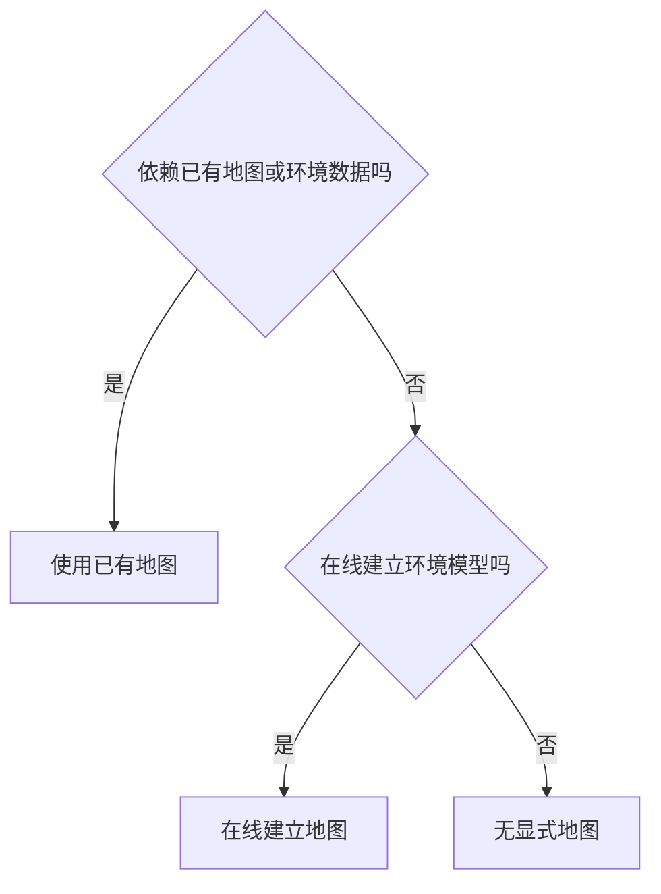
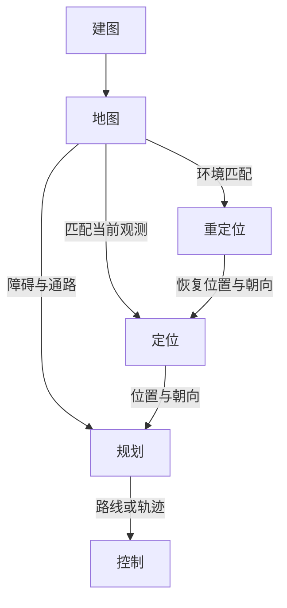
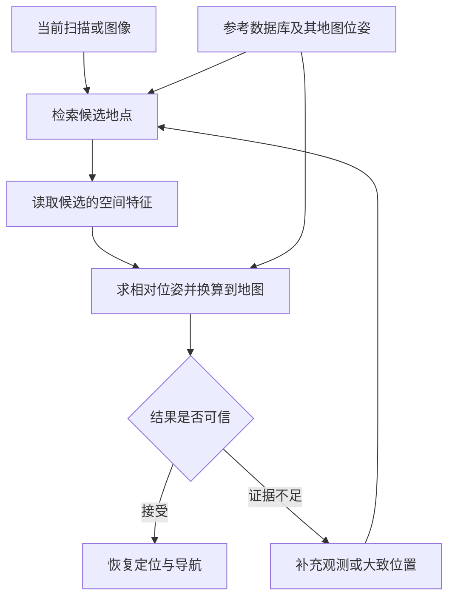

# 33. 重定位的地图需求与替代方案

导航是机器人从当前位置到达目标的过程。定位估计机器人所处的位置和朝向，规划根据当前位置、目标与环境选择路线或下一段运动，控制则计算速度和转向，使机器人执行规划结果。行驶过程中，系统根据新的传感器观测持续更新定位、规划与控制。

建图负责根据图像、激光扫描等观测，记录环境中的地点、障碍与通行关系，形成地图。使用地图时，机器人可以先将当前观测与地图比较，确定自身位置和朝向，再利用地图中的障碍与通路规划路线。地图可以在任务开始前建立，也可以在运行中随观测逐步建立和更新。

按地图的获得和使用方式，可以将导航方法分为以下三类。

| 导航方法 | 环境信息怎样使用 | 代表工作与地图需求 |
|---|---|---|
| 使用已有地图 | 使用事先保存的环境数据定位或规划，结合实时观测处理附近障碍 | Reliable MCL、BEVPlace++ 使用已有定位地图，沿已记录路线自主行驶也可以使用相互连接的局部地图 [P01]、[P19]、[P25] |
| 在线建立地图 | 从实时观测建立并更新环境模型，供定位或规划使用 | FRTree 维护自由区域树，Active NTFields 在线学习场景模型，无须提前建立整个区域的地图 [P20]、[P22] |
| 无显式地图 | 根据观测、目标和运动估计生成动作或轨迹，也可通过网络内部记忆利用历史信息，无须单独建立供定位或规划查询的环境地图 | Partsey 等用视觉里程计更新目标相对位置，再选择动作。LiDAR 在线控制屏障函数的实机实验由外部定位系统 Vicon 提供位置 [P27]、[P21] |

定位所需的信息可以来自地图匹配、里程计或外部定位。里程计估计连续时刻之间的运动，从已知初始位置和朝向出发累计运动，便可持续更新位置估计。运行中建图时，系统利用运动估计将不同时刻的观测记录到同一张地图中，已建立的地图也可以继续用于定位。无显式地图的系统可以由 GPS 与罗盘提供位置和朝向，也可以在初始目标相对位置已知时，依靠里程计持续更新自身与目标的位置关系。

定位失效后，重定位重新确定机器人在任务所用坐标系中的位置和朝向，使当前位置能再次与原目标联系起来。使用已有地图的系统可以匹配事先保存的数据，在线建图系统可以匹配运行中已经建立并保留的数据，采用外部定位的系统可以在取得有效测量后重新确定位置和朝向。

Partsey 等的无显式地图方案依靠连续视觉里程计更新目标相对位置，运行时使用 RGB-D 观测和动作信息，没有地图匹配或外部定位恢复环节。若运动估计误差使机器人最终未满足真实目标的到达条件，本次导航就记为失败。[P27]

因此，依靠环境匹配在整个工作区域恢复定位，仍需要覆盖整个区域的定位地图。地图可以只保存必要特征，也可以分成多个子地图，但仍在使用全区域的环境记录。只要求沿已记录路线恢复时，可以仅保存沿线数据，相应的恢复范围也限定在路线附近。

若采用外部定位，并能据此确定机器人在任务所用坐标系中的位置和朝向，重定位可以不使用环境地图。外部定位通过基站、地标或其他测量来源提供恢复所需的位置与朝向信息。

第 33.1 节展开导航、建图与重定位的关系，第 33.2 节介绍利用环境信息恢复定位的具体做法，第 33.3 节说明在线建图与无显式地图方法的定位条件。第 33.4 节说明外部定位，第 33.5 节比较恢复范围、输出和代价，第 33.6 节给出 WHEELTEC 的实施顺序。计算公式与在线导航的详细流程见[补充说明](research/relocalization-method-notes.md)。

## 33.1 导航、建图与重定位怎样配合

地图保存环境信息，定位与重定位提供机器人位置和朝向，规划据此选择运动。本节先说明地图保存的内容与建立时间，再展开三类导航方法的判断顺序，最后说明定位结果怎样交给导航使用。

### 33.1.1 地图记录什么，何时建立

地图记录环境中有哪些地点、障碍，以及它们的位置或连接关系。例如，占用栅格把空间划分为格子，记录哪些格子有障碍。拓扑地图用节点表示地点，用边表示地点之间可以通行。机器人可以根据栅格检查路径是否经过障碍，也可以根据地点连接选择路线。记录距离和位置的地图称为度量地图，记录地点连接的地图称为拓扑地图，两种形式也可以结合使用。

全局地图通常覆盖整个工作区域，局部地图只记录其中一部分。覆盖范围与记录细节的多少不同：只保存少量代表性观测，也可能覆盖整个区域。

地图可以事先建立，也可以在机器人运行时建立。机器人在未知环境中逐步绘制栅格地图，与加载一张栅格地图后出发，都使用栅格，但获得地图的时间不同。已有地图也可以保存为图像与激光扫描的记录，或相互连接的局部地图。因此，分类时要检查机器人实际使用了哪些环境数据，以及数据何时获得。

学习模型也可能保存特定环境的信息。有的网络只从当前图像或扫描中提取特征，可以用于不同场景。有的网络则用实际工作区域的图像和坐标训练，学习从图像预测位置和朝向。后一种模型虽然没有单独的地图文件，参数中仍保存了场景与位置的联系，本章将其归入依赖已有环境信息的方法。

### 33.1.2 三类导航方法怎样区分

根据是否使用已有环境数据、是否在运行中建立环境模型，可以将导航方法分为使用已有地图、在线建立地图和无显式地图三类。分类时要检查系统在相应运行阶段实际使用的数据。

首先检查本次运行是否依赖开始前就已保存的地图、场景记录，或用该区域数据训练的定位模型。如果依赖，就归入使用已有地图，即使运行中还更新附近的障碍。其余方法再检查是否将观测整理成环境模型，供后续定位或规划使用。如果建立了这种模型，就归入在线建立地图，否则归入无显式地图。

环境模型可以记录各处的障碍、可通行区域及其连接，让算法按位置查找所需信息。局部栅格、自由区域树和后文介绍的学习场景模型都可以起这种作用。无显式地图的方法也可以暂存最近观测、速度状态，或通过网络记忆利用历史观测。

按照是否依赖已有环境数据、是否在线建立环境模型的顺序判断，同一运行阶段只会进入下图中的一个分支。

例如，由人带领记录路线、再自主重复行驶的系统，在记录阶段采集环境数据，在重复行驶阶段使用已有数据，两个阶段应分别判断。同一次运行中利用刚建立的地图恢复定位，仍属于在线建图系统的功能。若重启后加载上次保存的地图，新的运行过程就在使用已有地图。

论文只提出轨迹生成器时，也应先判断该模块，再检查完整导航系统是否另有地图和定位模块。

这一编排借鉴了 DeSouza 与 Kak 在室内视觉导航综述中采用的三分法。[P23] Zhu 与 Zhang 的学习导航综述介绍了多种被称为“无地图”的方法，其中一些维护局部地图或依赖外部定位。[P24] 本章据此按上述顺序核对各方法实际使用的数据。

在使用已有地图或在线建图的系统中，重定位可以读取已经保存的地图，与当前观测匹配后计算位置和朝向。无显式地图的系统可以将里程计或外部定位提供的位置估计用于运动计算。外部定位也可以与使用地图的系统组合，分类时仍按系统实际使用的地图和环境模型判断。

### 33.1.3 定位结果怎样支持导航

位置与朝向合称为位姿。规划器利用机器人位姿与目标位置选择路线，控制器根据当前位姿与路线的偏差修正运动。定位持续有效时，系统可以不断更新位姿。定位失效后，则需重新建立可靠的位姿估计，才能继续使用原有目标和路线。

初始位置完全未知时，需要在较大范围内寻找机器人位姿，通常称为全局定位。重定位也可能需要这种搜索。全局定位描述初始位置未知时的定位任务，全局地图描述环境数据的覆盖范围，两者含义不同。

同一张地图可以同时用于定位和规划，也可以分别保存两种地图。定位地图保留便于识别地点和计算位姿的特征，规划地图记录障碍与可通行区域。比较地图需求时，应分别检查定位、规划与失效恢复所需的信息。

使用地图时，建图提供环境记录，定位将计算得到的位姿交给规划，规划结果再交给控制。定位丢失后，重定位恢复地图位姿，并将结果交回定位过程。下图连接了这些信息的来源与去向。

## 33.2 利用环境信息恢复定位

利用环境信息重定位时，系统将当前观测与保存的环境数据比较，确定所在地点并计算机器人位姿。本节先说明全局地图匹配，再说明怎样减少保存的观测、改用沿线局部地图，以及使用建筑资料或经过训练的场景模型。

下表列出利用环境信息定位的代表工作及其地图需求，随后依次展开具体流程。实际系统可以组合使用多种做法。

| 做法 | 怎样恢复定位 | 地图需求与适用条件 |
|---|---|---|
| 匹配全局地图 | Reliable MCL 将当前激光观测与已有地图匹配，搜索位置和朝向 [P01] | 可以在地图覆盖范围内搜索，需要采集和维护相应范围的地图 |
| 匹配代表性的历史观测 | BEVPlace++ 检索历史激光扫描，AirSLAM 匹配保存的视觉特征，再计算当前位置和朝向 [P19]、[P04] | 可以减少环境细节。要求全区域恢复时，仍需覆盖全区域的定位数据 |
| 匹配沿线局部地图 | 先由操作者带领机器人记录沿线局部地图，再识别地点并自主重复行驶 [P25] | 可以只覆盖已记录路线。若还需输出另一张全局地图中的坐标，必须保留坐标换算关系 |
| 使用建筑资料或场景模型 | AGLoc 将激光扫描与建筑几何匹配，FusedNet 用经过训练的模型预测位置和朝向 [P02]、[P07] | 可以减少详细扫描建图，但仍依赖工作区域的资料或训练数据，并须核对初始条件 |

### 33.2.1 在全局地图中搜索位置和朝向

一种常见做法是预先建立覆盖工作区域的栅格或点云地图。系统将当前扫描与地图比较，搜索机器人位姿，通过检查后再根据地图中的目标位置规划路线。控制器让机器人沿路线行驶，传感器持续检测附近障碍，以便调整运动。地图提供已经采集的环境信息，实时感知则用于发现运行中的变化。

二维栅格定位可以同时保留多个可能的位置和朝向，分别检查当前扫描与地图是否相符。蒙特卡洛定位用粒子表示这些可能的位姿，根据测得的运动更新粒子，再为与观测更相符的粒子分配较高权重，从而优先保留这些位姿假设。Reliable MCL 还估计定位结果的可靠程度，并增加全局搜索：将短时间内采集的局部观测与地图特征匹配，得到新的位姿候选，与持续更新的定位结果融合。[P01]

利用这种地图恢复定位，需要搜索可能的位姿。已知大致位置和朝向时，系统可以在附近搜索。如果完全不知道位于何处，就需要搜索更大的位置和朝向范围，再通过观测与地图的匹配确定结果。

### 33.2.2 用有代表性的历史观测恢复定位

定位地图可以只保存有代表性的历史图像或激光扫描，以及采集时在地图中的位姿。这种代表性记录称为关键帧。系统将当前观测与关键帧比较，求出两次观测之间的相对位姿，再结合关键帧在地图中的位姿，计算机器人当前的地图位姿。

BEVPlace++ 将激光空间点从上方投影成鸟瞰图，提取用于比较的数值特征，称为描述子。概括整幅观测的全局描述子用于检索相似关键帧，描述具体位置的局部描述子用于建立空间对应。数据库保存关键帧鸟瞰图、地图位姿和全局描述子，求解时再使用局部特征。[P19]（§III）

当前扫描进入系统后，算法生成同类描述子，取出相似的历史记录作为候选。候选只说明机器人可能在哪一带，布局重复、遮挡或视角变化都可能造成误检。BEVPlace++ 随后建立当前鸟瞰图与候选之间的局部特征对应，求解使对应尽量一致的平移和转动。把空间观测对齐的过程称为配准，求出的相对位姿再与候选地图位姿组合，得到当前地图位姿。[P19]（§III-D）

视觉方法也能完成这种联系。AirSLAM 保存关键帧位姿、地图三维点和线，以及图像与地图特征之间的对应。识别到候选后，算法用当前图像中的点与地图三维点匹配，根据三维点的图像投影求解相机位姿，再利用相机与机体的安装关系换算为机器人位姿。[P04]

求出位姿后，系统仍需检查有效匹配的数量与分布、对齐误差，以及其他候选是否同样合理。在实际导航系统中，还应结合后续观测和里程计测得的运动，检查结果是否持续一致。证据不足时，可以继续搜索、保留多个候选，或由其他定位来源提供大致位置。位姿通过检查后，再用于持续定位和导航。后续连续检查属于本章的工程建议，各论文实际采用的接受条件需分别核对。

参考数据库既提供候选地点，也提供位姿换算所需的空间关系。下图将检索、求解和接受判定连接起来。

只保存部分关键帧可以减少数据量，但仍需覆盖预期恢复定位的区域。数据较多时，可以先检索候选地点，再读取候选附近的一小部分地图，即子地图。按需读取可以减少同时加载到内存的数据，磁盘中仍需保存地图、检索索引及相应的坐标关系。位姿组合公式见[补充说明](research/relocalization-method-notes.md#pose-composition)。

### 33.2.3 沿路线保存并连接局部地图

局部地图也可以按地点之间的通行关系连接起来。系统先选择经过哪些地点，再使用各地点的局部地图，确定机器人在附近的位置和朝向。这种结合地点连接与局部几何信息的方式称为拓扑度量地图，可以用于规划较长路线，同时只在当前使用的子地图中进行精确定位。[P25]

一种典型用法是先由操作者带领机器人沿路线行驶，记录沿途的局部地图和相邻地点之间的相对关系。之后自主行驶时，系统从已记录的地点中选择通往目标的路线，将实时观测与附近子地图比较，计算机器人相对于原路线的位置和朝向，再通过控制器修正运动。开始自主行驶时，可以先识别所在地点，再在该地点的局部地图中确定位置和朝向。[P25]（§2）

沿路线行驶主要利用当前子地图中的距离、方向，以及通向下一子地图的连接。系统可以依次使用这些局部信息自主重复行驶，无须先把全部子地图精确拼接成一张覆盖整条路线的大地图。[P25]（§1、§2.3）自主行驶仍依赖已记录的路线与子地图，可选择的路线也受已记录地点及其连接关系限制。

定位结果首先表示机器人相对于当前子地图的位置和朝向。若任务要求输出另一张全局地图中的位姿，还需保存子地图与该地图的坐标关系。

### 33.2.4 使用建筑资料或经过训练的场景模型

建筑资料也可以提供定位所需的环境信息。AGLoc 用标有实际尺寸和位置的墙体、通道多边形与当前激光扫描匹配，并假定 Wi-Fi 与气压计能提供大致位置，先确定楼层、缩小搜索区域，再搜索精确位姿。[P02] BIM-Loc 将建筑信息模型与里程计结合，并估计设计模型与实际环境之间的差异。[P11] 使用建筑资料可以减少事先详细扫描环境的工作，但仍需确认资料使用的坐标、建筑结构的实际变化，以及算法要求的初始位置信息。

FusedNet 则使用标有拍摄位姿的场景图像训练网络，从单幅图像预测平面位置与朝向。[P07] 模型参数保存了场景与坐标的联系，运行时可以省去地图检索，但定位能力仍受训练数据覆盖范围和场景变化影响。采用这种方法时，还需考虑采集训练数据、更新模型，以及将模型用于新区域所需的工作。

保存哪些环境数据，应由任务决定。只需沿已知路线重复行驶时，可以仅保存沿途的局部地图。要求依靠环境匹配在整个工作区域恢复定位时，就要保留覆盖相应范围、足以区分地点并计算位姿的数据。

## 33.3 在线建图与无显式地图方法的定位条件

在线建图和直接根据观测生成运动，都可以减少出发前的地图准备工作。本节先说明在线地图怎样支持规划与重定位，再介绍无显式地图方法的位置来源与任务失败条件，最后说明恢复原目标需要的坐标关系。

### 33.3.1 在线建图省去预建地图

在线建图利用里程计，将不同时刻的图像、激光或深度观测放到同一坐标系中，逐步记录障碍、可通行区域及其连接。模型可以只覆盖机器人附近，也可以随探索扩大。机器人无须在出发前获得整个区域的地图，运行时仍需估计自身运动并维护模型。

FRTree 用实时点云建立自由区域树，选择通向目标的分支，遇到死路时利用已访问记录退回其他分支。算法以机器人当前位置和目标位置为输入，输出后续运动轨迹。[P20] Active NTFields 则根据里程计和传感器观测，在运行中学习供规划使用的环境模型，并维护探索地图。[P22] 两项方法都利用持续获得的位置或运动估计，将环境观测用于地图更新和运动规划。

在线建图系统可以保留此前已经探索区域的地图，用于重定位。恢复时，系统将当前观测与保留的数据匹配，完成地点搜索、位姿计算和结果检查。为此，保存的数据还需包含用于区分地点和计算位姿的观测特征及坐标关系。

### 33.3.2 直接生成运动仍需明确位置来源

无显式地图的方法可以根据当前观测修正控制指令，也可以根据连续观测和目标信息生成动作或轨迹。当前位置与目标之间的关系，可以由里程计持续更新，也可以由外部定位提供。

Partsey 等研究的目标点导航任务，在出发时给定目标相对于起点的准确坐标。运行时，视觉里程计根据连续两帧彩色与深度图像以及已执行动作，估计两次观测之间的位移和转动，用来更新目标相对于机器人的位置。导航策略再结合当前深度图像、更新后的目标位置和网络记忆，选择前进、转向或停止。[P27]（§2、§3、图 2）

这套系统依靠累计运动保持与初始目标的联系，导航策略始终使用视觉里程计更新的目标位置，未设置地图匹配或外部定位恢复环节。作者通过引入动作信息、数据增强以及扩大训练数据和模型规模，提高视觉里程计的可靠性，并评价由此带来的导航表现。导航策略训练时使用仿真器提供的准确位置和朝向，测试运行时则改用视觉里程计的估计。[P27]（§3–4）

论文将距真实目标不超过 $0.36\,\mathrm{m}$ 时发出停止指令记为成功。在 Habitat Challenge 2021 的仿真测试集上，方法达到 94% 成功率。实机初步实验共 9 次任务，成功率为 11%。里程计误差可能使估计的目标位置偏离真实目标，导致机器人在错误位置停下。最终未满足上述到达条件的任务计为失败。[P27]（§2、§5.2、§6）

LiDAR 在线控制屏障函数采用外部位置输入。系统根据当前扫描修正控制指令，不持续累积环境地图，实机实验由 Vicon 提供机器人位置。[P21]

MTG 与 DTG 利用传感器观测生成轨迹，输出机器人接下来可以怎样运动。[P14]、[P15] 任务需要原地图位姿时，由定位模块提供相应结果。DTG 的实机系统还组合了局部规划器，轨迹生成、局部规划和定位分别提供各自的输入与输出。[P15]

如果任务只要求朝向传感器可见的目标行驶，目标相对于机器人的方向可能已经足够。如果任务要求回到原地图中的指定位置，就仍需知道当前位姿与原目标的关系。使用任何一类导航方法时，都应确认当前位置和原目标之间的坐标关系。

### 33.3.3 继续使用原目标需要恢复坐标关系

里程计估计相对运动。系统将初始地图位姿与后续运动组合，持续更新机器人在地图中的位置和朝向。初始位姿未知时，需要先通过环境匹配或外部定位确定这项初始关系。

具备建图功能的系统可以在定位丢失后，从当前位置重新建立局部地图。若原目标仍用原地图坐标表示，还需利用系统提供的旧地图匹配或外部定位功能，确定新地图与原地图之间的位置和朝向关系，再继续原任务。

FRTree 的树更新、轨迹生成、在线场景学习，以及根据当前扫描计算控制指令的详细流程见[补充说明](research/relocalization-method-notes.md#online-navigation-methods)。

## 33.4 借助外部定位恢复位置与朝向

外部定位通过已知坐标的基站、地标或其他测量系统提供位置信息。本节先说明它怎样替代环境地图匹配，再检查朝向和坐标换算是否齐备。只有测量能够支持任务要求的位姿估计，系统才能据此恢复原任务。

### 33.4.1 用外部测量确定原地图中的位置

外部基站或地标的坐标已知时，可以通过测量估计机器人位置。若基站坐标与原地图坐标不同，还需事先建立两套坐标之间的换算关系。恢复定位后，系统才能将当前位置与原地图中的目标一起使用。

DURAL 将 UWB 位置测量与激光、惯性和轮速融合，改善连续定位。[P12] 外部测量为连续估计补充位置约束。采用同类方案时，还需安排初始位姿未知与定位丢失试验，检查状态怎样重新初始化。

### 33.4.2 同时检查朝向与坐标换算

测得位置不一定能确定机体朝向。单天线 GNSS 或单个 UWB 标签的一次位置测量，通常不足以确定朝向。使用视觉标记时，则需完成相机标定、保证标记可见，并正确计算相机与标记之间的位姿。

如果外部测量及其配合的估计过程能够确定所需的位置和朝向，并能换算到任务使用的坐标系，重定位就可以不依靠环境地图匹配。相应代价是安装与标定设施、维护坐标关系，并保证测量覆盖和可用性。环境地图的数据需求减少后，外部设施的条件仍应列入方案比较。

## 33.5 根据恢复要求比较方案

全局地图、关键帧、沿线局部地图、场景模型和外部定位可以提供不同形式的信息。比较时应先统一恢复范围，再核对初始条件和位姿输出，最后检验恢复表现与资源消耗。

### 33.5.1 明确需要覆盖哪些区域

依靠环境匹配重定位时，当前观测需要在保存的数据中找到对应。只要求在指定路线或区域恢复，可以仅保存相应范围的数据。要求在整个工作区域恢复，就应保留覆盖该范围、足以区分地点并计算位姿的数据。覆盖是必要条件，场景变化、重复结构和观测不足仍可能导致失败。

地图缩减可以减少细节，也可以缩小覆盖范围。例如，减少关键帧数量时可以继续维持整个区域的定位覆盖。将地图组织为相互连接的局部地图，则保留各处数据并改变加载与搜索方式。比较时应记录减少了哪些数据及相应的存储、计算开销。

地图较大时，可以先检索候选地点，再读取候选附近的数据。按需加载减少了同时驻留内存的数据量，磁盘中仍需保存预期恢复区域的数据。采用外部定位时，也需说明基站或地标覆盖哪些位置，以及测量不可用时怎样处理。

### 33.5.2 统一初始条件与位姿输出

已知大致位置与朝向时，系统可以在附近搜索。初始位姿完全未知时，需要搜索更大范围，并排除外观或结构相似的错误地点。比较依靠 Wi-Fi、楼层信息或人工位置提示的方法时，应列出辅助条件，并按相同初始范围设置对照。

定位输出也需说明坐标。机器人相对于当前子地图或已记录路线的位姿，可以支持沿线行驶。如果要求恢复另一张全局地图中的目标，则还需完成坐标换算。识别出所在地点、计算出相对位姿、得到任务所用坐标系中的位姿，分别完成了不同环节。

平面通行任务通常需要位置 $(x,y)$ 和平面内朝向角 $\psi$，即三个自由度。完整三维位姿还包括高度、横滚和俯仰，共六个自由度。BEVPlace++ 重点估计平面三自由度，其余量可取自参考记录，这与独立恢复并验证六自由度不同。[P19] 比较恢复能力前，应先统一运动假设与输出要求。

### 33.5.3 检验恢复表现与总成本

导航实验应记录是否到达目标、是否碰撞、路径长度与耗时，并说明目标和位置从何处获得。重定位实验则需另行规定允许的位置与朝向误差、结果连续成立的时长及超时条件。到达率、候选检索准确率和重定位成功率分别对应不同环节。

| 检查项目 | 应控制或改变什么 | 主要回答的问题 |
|---|---|---|
| 环境与地图条件 | 已知、未知及布局变化，局部或全局覆盖 | 方法依赖了哪些事先信息，能否适应新区域 |
| 定位与目标输入 | 已知初始位姿、初始位姿未知、定位失效及外部辅助 | 到达目标需要哪些定位条件，能否继续使用原目标 |
| 搜索与结果检查 | 遮挡、重复结构和地图未覆盖区域 | 能否排除错误地点，避免将错误定位结果判为正确 |
| 地图与模型缩减 | 关键帧数量、分辨率、存储和加载方式 | 节省资源后，覆盖、误差与耗时怎样变化 |

实验中应使用独立测量得到的位置和朝向，检查定位结果是否正确。算法使用相似度与配准误差筛选候选，实验再用独立位置与朝向检查实际定位误差。成功率需包含全部尝试，并分别记录失败、超时，以及将错误定位结果判为正确的情况。粒子滤波完整性监测研究专门分析了定位误差很大、系统却未报警的风险，这类错误需要单独统计。[P13]

资源比较应包括事先采集环境数据或训练模型的工作、地图磁盘占用、运行内存、模型更新和计算耗时。恢复定位的总耗时还应包含失效检测、搜索、位姿计算和结果检查。传感器、计算平台和每次处理所用观测的时间范围应保持一致，或明确列出差异，再比较满足同一任务要求所需的总成本。

## 33.6 WHEELTEC 的实施顺序

对 WHEELTEC，先明确任务需要的定位来源与恢复范围，再验证已有地图中的定位和重定位，最后扩展未知环境导航。以下步骤属于工程建议，具体能力仍需在本车上确认。

### 33.6.1 先确定整套导航系统采用哪类方法 {#navigation-map-needs}

Navigation2（Nav2）是 ROS 2 中常用的一套导航框架。常规配置利用已有地图组织全局路线，同时用机器人附近的局部代价地图处理实时障碍。[S02] 因为运行依赖已有地图，这套配置属于第一类，局部地图在线更新不会改变归类。

若任务是反复前往已知地点，可以先采用已有地图，明确目标坐标、需要恢复定位的区域和允许误差。若任务是在新环境中前往给定目标，则先确定当前位置怎样估计、目标位置怎样提供，再选择在线建图或直接根据观测计算运动。比较论文模块与完整系统时，应列出里程计、地图、规划和控制分别由谁提供。

### 33.6.2 先验证已有地图中的定位与恢复

已有二维雷达与导航地图时，可以从 AMCL 开始，确认雷达、轮速和坐标关系，再分别测试初始位姿正确、初始位姿错误、初始位姿未知，以及运行中定位丢失的情况。AMCL 可以在地图范围内重新生成位姿假设，自动恢复定位还需确定何时启动搜索、怎样搜索、何时接受结果。[S01] 实现核对项见[补充说明](research/relocalization-method-notes.md#amcl-implementation)。

采用 MID360 时，可以保留 FAST-LIO 连续估计局部运动的功能，再增加关键帧保存、候选地点检索、位姿计算和结果检查。先保存关键帧及其地图位姿，确认重启后能够加载数据并完成恢复定位，再逐步减少关键帧或采用按需读取。每次变化都用第 33.5 节的实验检查覆盖范围、误差和耗时。[第 42 章](42-mid360-fast-lio.md)与[第 43 章](43-mid360-fast-lio-data-flow.md)说明里程计和点云的产生过程。

重定位成功后，系统将地图位姿与同一时刻的里程计位姿组合，更新 `map → odom` 修正，使局部连续运动重新关联到原地图，并保持 `odom → base_link` 连续。[S03] 检测到定位失效时应暂停任务并约束运动，候选通过验证、坐标关系更新且路径重新检查后再恢复导航。公式与时间戳要求见[补充说明](research/relocalization-method-notes.md#map-odom-recovery)。

### 33.6.3 逐步验证能否在未知环境中到达目标

未知环境实验先检查局部里程计是否可靠、能否检测附近障碍，以及目标位置是否正确传入，再验证短距离规划与行驶。采用在线建图时，继续检查模型更新、中间目标选择、已探索区域记录，以及遇到死路后能否退回其他分支。直接根据观测计算控制指令时，则需确认当前位置从何而来、指令是否满足底盘限制，以及计算失败后机器人采取什么行动。

让机器人在未知环境中导航，还需要为尚未观察到的区域选择探索方向，并处理定位误差累积、路径无法通过和目标暂时无法到达的情况。短距离运动稳定后，再逐步增加行驶距离、遮挡和路线分支，根据到达目标的成功率和失败记录，判断是否需要保存更多环境信息。

需要恢复原地图中的任务时，应先验证完整的重定位流程，再减少关键帧、缩小覆盖范围或改用外部定位。每次调整都应确认节省了哪些资源、增加了哪些条件，以及是否仍满足恢复范围、位姿误差和耗时要求。

## 参考与补充阅读

经典分类、术语边界与拓扑度量地图的依据见[分类证据表](research/navigation-taxonomy-evidence.csv)和[分类核查说明](research/navigation-taxonomy-reference-audit.md)。重定位相关工作见[原论文证据表](research/relocalization-evidence.csv)，在线规划工作见[在线导航证据表](research/online-navigation-evidence.csv)。坐标推导与其他方法见[补充说明](research/relocalization-method-notes.md#related-methods)，正文和补充说明共用以下参考编号。

### 参考文献 {#references}

- P01 · M35 — Akai, Naoki (2023). *Reliable Monte Carlo localization for mobile robots*. Journal of Field Robotics. [DOI](https://doi.org/10.1002/rob.22149).
- P02 · S03 — Xie, Fujing et al. (2024). *Robust Lifelong Indoor LiDAR Localization Using the Area Graph*. IEEE Robotics and Automation Letters. [DOI](https://doi.org/10.1109/lra.2023.3334158).
- P03 · SC-P195 — Shen, Hongming et al. (2026). *UniLGL: Learning Uniform Place Recognition for FOV-Limited/Panoramic LiDAR Global Localization*. IEEE Transactions on Robotics. [DOI](https://doi.org/10.1109/tro.2026.3672514).
- P04 · R05 — Xu, Kuan et al. (2025). *AirSLAM: An Efficient and Illumination-Robust Point-Line Visual SLAM System*. IEEE Transactions on Robotics. [DOI](https://doi.org/10.1109/tro.2025.3539171).
- P05 · R06 — Cattaneo, Daniele et al. (2025). *CMRNext: Camera to LiDAR Matching in the Wild for Localization and Extrinsic Calibration*. IEEE Transactions on Robotics. [DOI](https://doi.org/10.1109/tro.2025.3546784).
- P06 · S26 — Zhang, Lintong et al. (2026). *Visual localization in 3D maps: comparing point cloud, mesh, and NeRF representations*. Autonomous Robots. [DOI](https://doi.org/10.1007/s10514-025-10232-5).
- P07 · M21 — Chen, Fang-xing et al. (2024). *FusedNet: End-to-End Mobile Robot Relocalization in Dynamic Large-Scale Scene*. IEEE Robotics and Automation Letters. [DOI](https://doi.org/10.1109/lra.2024.3372465).
- P08 · M34 — Xie, Yuanyan et al. (2023). *Indoor Visual Re-Localization for Long-Term Autonomous Robots Based on Object-Level Features and Semantic Relationships*. IEEE Robotics and Automation Letters. [DOI](https://doi.org/10.1109/lra.2022.3233235).
- P09 · R10 — Kruzhkov, Evgenii et al. (2026). *OMCL: Open-Vocabulary Monte Carlo Localization*. IEEE Robotics and Automation Letters. [DOI](https://doi.org/10.1109/lra.2026.3653333).
- P10 · E56 — Wang, Zihang et al. (2026). *LiteFT-PR: Lightweight and Fault-Tolerant LiDAR-Camera Fusion Network for Robust Place Recognition via Model Distillation*. IEEE Robotics and Automation Letters. [DOI](https://doi.org/10.1109/lra.2026.3662634).
- P11 · S36 — Yinqiang Zhang et al. (2026). *BIM-Loc: BIM-integrated discrepancy-aware LiDAR-based indoor localization*. The International Journal of Robotics Research. [DOI](https://doi.org/10.1177/02783649261462593).
- P12 · E03 — Hu, Kun et al. (2026). *DURAL: Degradation-Resistant Robust Adaptive Localization by LiDAR-Inertial-UWB-Wheel Fusion for Coal Mine Robots*. Journal of Field Robotics. [DOI](https://doi.org/10.1002/rob.70200).
- P13 · M28 — Hafez, Osama Abdul et al. (2024). *How Safe Is Particle Filtering-Based Localization for Mobile Robots? An Integrity Monitoring Approach*. IEEE Transactions on Robotics. [DOI](https://doi.org/10.1109/tro.2024.3420798).
- P14 · SC-M039 — Liang, Jing et al. (2024). *MTG: Mapless Trajectory Generator with Traversability Coverage for Outdoor Navigation*. 2024 IEEE International Conference on Robotics and Automation (ICRA). [DOI](https://doi.org/10.1109/icra57147.2024.10611319).
- P15 · SC-M043 — Liang, Jing et al. (2024). *DTG : Diffusion-based Trajectory Generation for Mapless Global Navigation*. 2024 IEEE/RSJ International Conference on Intelligent Robots and Systems (IROS). [DOI](https://doi.org/10.1109/iros58592.2024.10802055).
- P16 · SC-P134 — Jose Luis Blanco-Claraco (2025). *A flexible framework for accurate LiDAR odometry, map manipulation, and localization*. The International Journal of Robotics Research. [DOI](https://doi.org/10.1177/02783649251316881).
- P17 · R11 — Xiao, Renxiang et al. (2026). *LiDAR Teach, Radar Repeat: Robust Cross-Modal Navigation in Degenerate and Varying Environments*. IEEE Transactions on Robotics. [DOI](https://doi.org/10.1109/tro.2026.3699433).
- P18 — Ratz, Sebastian et al. (2020). *OneShot Global Localization: Instant LiDAR-Visual Pose Estimation*. 2020 IEEE International Conference on Robotics and Automation (ICRA). [DOI](https://doi.org/10.1109/ICRA40945.2020.9197458).
- P19 · H53 — Luo, Lun et al. (2025). *BEVPlace++: Fast, Robust, and Lightweight LiDAR Global Localization for Autonomous Ground Vehicles*. IEEE Transactions on Robotics, 41, 4479–4498. [DOI](https://doi.org/10.1109/TRO.2025.3585385).
- P20 · M05 — Li, Yulin et al. (2025). *FRTree Planner: Robot Navigation in Cluttered and Unknown Environments With Tree of Free Regions*. IEEE Robotics and Automation Letters, 10(4), 3811–3818. [DOI](https://doi.org/10.1109/LRA.2025.3544519).
- P21 · E26 — Keyumarsi, Shaghayegh, Made Widhi Surya Atman, and Azwirman Gusrialdi (2024). *LiDAR-Based Online Control Barrier Function Synthesis for Safe Navigation in Unknown Environments*. IEEE Robotics and Automation Letters, 9(2), 1043–1050. [DOI](https://doi.org/10.1109/LRA.2023.3339059).
- P22 · H47 — Liu, Yuchen, Ruiqi Ni, and Ahmed H. Qureshi (2025). *Physics-Informed Neural Mapping and Motion Planning in Unknown Environments*. IEEE Transactions on Robotics, 41, 2200–2212. [DOI](https://doi.org/10.1109/TRO.2025.3548495).

- P23 · TAX01 — DeSouza, G. N., and A. C. Kak (2002). *Vision for mobile robot navigation: a survey*. IEEE Transactions on Pattern Analysis and Machine Intelligence, 24(2), 237–267. [DOI](https://doi.org/10.1109/34.982903).
- P24 · X04 — Zhu, Kai, and Tao Zhang (2021). *Deep reinforcement learning based mobile robot navigation: A review*. Tsinghua Science and Technology, 26(5), 674–691. [DOI](https://doi.org/10.26599/TST.2021.9010012).
- P25 · J01 — Krawciw, Alexander, and Timothy D. Barfoot (2026). *Local Maps Are All You Need: A Review of Topometric Teach and Repeat Navigation*. Annual Review of Control, Robotics, and Autonomous Systems, 9, 301–324. [DOI](https://doi.org/10.1146/annurev-control-032724-020548).
- P26 · SC-R073 — Placed, Julio A. et al. (2023). *A Survey on Active Simultaneous Localization and Mapping: State of the Art and New Frontiers*. IEEE Transactions on Robotics, 39(3), 1686–1705. [DOI](https://doi.org/10.1109/TRO.2023.3248510).
- P27 — Partsey, Ruslan et al. (2022). *Is Mapping Necessary for Realistic PointGoal Navigation?* Proceedings of the IEEE/CVF Conference on Computer Vision and Pattern Recognition (CVPR), 17232–17241. [论文与引文](https://openaccess.thecvf.com/content/CVPR2022/html/Partsey_Is_Mapping_Necessary_for_Realistic_PointGoal_Navigation_CVPR_2022_paper.html).

软件与坐标规范：

- S01 — [Navigation2 Humble：AMCL 源码](https://github.com/ros-navigation/navigation2/blob/3c3db59d6969d8ecee8e68468693d006397f4a0c/nav2_amcl/src/amcl_node.cpp)，核对 `globalLocalizationCallback`、`uniformPoseGenerator`、`reinitialize_global_localization` 与恢复参数默认值。
- S02 — [Navigation2 Humble：默认参数](https://github.com/ros-navigation/navigation2/blob/3c3db59d6969d8ecee8e68468693d006397f4a0c/nav2_bringup/params/nav2_params.yaml)，局部代价地图配置为 `local_costmap.global_frame: odom` 与 `rolling_window: true`。
- S03 — [REP-105：Coordinate Frames for Mobile Platforms](https://github.com/ros-infrastructure/rep/blob/11ca24a41f31480dfb9562ba99f2a5b93d3ebda5/rep-0105.rst)，核对 `odom` 的连续性与 `map` 的全局修正语义。

## 章节导航

[上一章：地图、定位与 TF](32-map-localization-tf.md) · [返回本篇](index.md) · [下一章：Nav2 导航](34-nav2-navigation.md)

[P01]: #p01
[P02]: #p02
[P03]: #p03
[P04]: #p04
[P05]: #p05
[P06]: #p06
[P07]: #p07
[P08]: #p08
[P09]: #p09
[P10]: #p10
[P11]: #p11
[P12]: #p12
[P13]: #p13
[P14]: #p14
[P15]: #p15
[P16]: #p16
[P17]: #p17
[P18]: #p18
[P19]: #p19
[P20]: #p20
[P21]: #p21
[P22]: #p22
[P23]: #p23
[P24]: #p24
[P25]: #p25
[P26]: #p26
[P27]: #p27
[S01]: #s01
[S02]: #s02
[S03]: #s03
