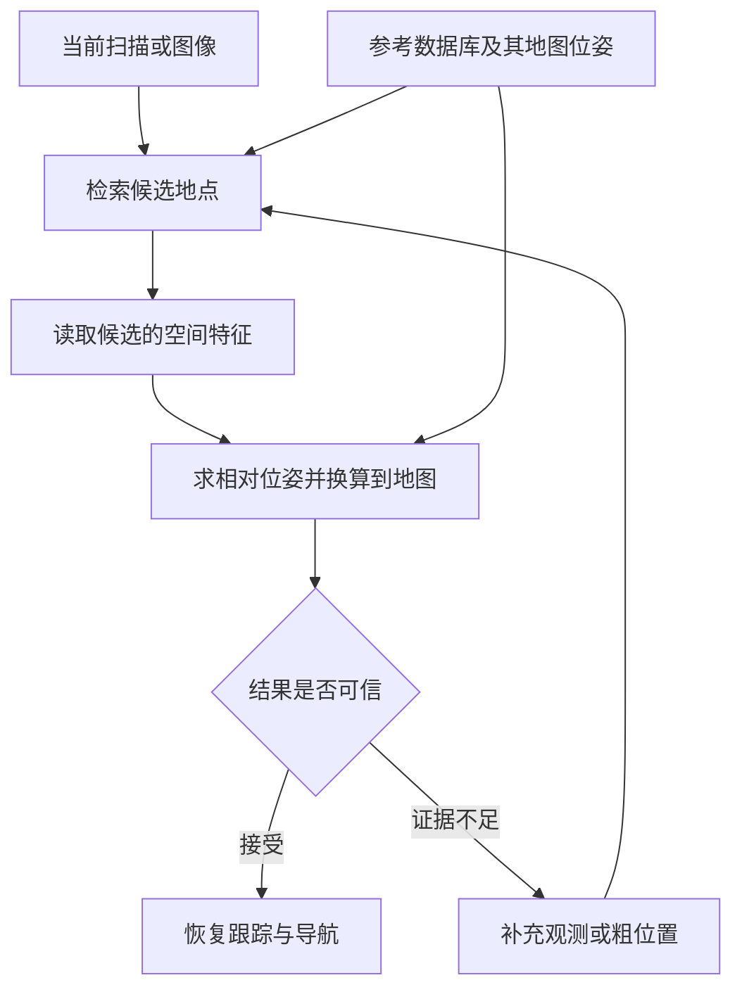

# 33. 移动机器人重定位方案与全局地图依赖

机器人不知道自己在哪里，或者原来的位置估计已经失效时，要重新确定自己在原地图中的位置和朝向，是否必须依赖一张事先建好的完整全局地图？如果可以减少地图，又需要保留哪些信息，才能继续使用原来的导航目标？这是本章要探究的问题。

位置与朝向合称为位姿，重新确定原地图中的位姿称为重定位。例如，机器人重新启动后，即使能够避开眼前的障碍，也可能不知道自己与原定目标之间的方向和距离。重定位需要恢复的，正是机器人与原地图之间的空间关系。

已有研究表明，重定位可以使用稀疏的历史观测、建筑结构或学习得到的场景模型，不必都使用记录大量环境细节的稠密地图。不同方法都需要某种与原地图相联系的参考，才能把当前观测转成地图中的位置和朝向。下表选取几项代表工作，比较它们怎样建立这种联系。

| 代表工作 | 怎样恢复位置和朝向 | 对地图依赖的结论 |
|---|---|---|
| Reliable MCL [P01] | 把当前激光观测与已有二维地图比较，搜索可能的位置，并估计结果可靠性 | 全局地图提供位置参考，可作为已有地图条件下的定位基线 |
| BEVPlace++、AirSLAM [P19]、[P04] | 保存有代表性的激光或视觉观测、采集位姿和必要的空间特征，再将当前观测与记录匹配 | 可以用稀疏记录构建定位地图，仍需覆盖预期恢复区域并保存地图坐标关系 |
| AGLoc [P02] | 用墙体和通道的位置、形状匹配当前激光，结合粗位置寻找精确位姿 | 建筑结构可以替代详细环境点云，但粗位置条件和搜索开销仍会影响恢复 |
| FusedNet [P07] | 用图像及其位姿训练网络，运行时从当前图像直接预测位置和朝向 | 场景与坐标的联系可以保存在模型中，训练覆盖和新场景泛化仍需验证 |

本章的结论是：重定位不一定需要完整、稠密的全局环境地图。是否需要覆盖整个工作区域的地图，应根据要求在哪些位置恢复，以及采用哪种定位方式，分三种情况判断。

1. 只要求在指定区域恢复时，可以只保留这些区域中足以定位的参考，无须保存其他区域的环境地图。局部参考必须与原地图坐标关联，恢复能力也只在有效参考覆盖的范围内得到支持。
2. 要求在整个工作区域从未知位置恢复，且依赖环境匹配时，仍需要覆盖整个预期恢复范围的地图或场景参考。地图可以采用稀疏关键帧、结构要素等形式，减少细节并不等于取消全局覆盖。
3. 外部定位能够提供所需的位置和朝向，并与原地图坐标对齐时，可以不依赖环境地图完成重定位。基站或地标此时提供坐标参考，其测量覆盖和精度必须满足恢复要求。

因此，仅把稠密点云改成稀疏地图，不能据此宣称“不需要全局地图”。按需加载只减少常驻内存，也不等于不再保存全局地图。重定位可以改变参考的表示和来源，但仍需建立当前位置与原地图坐标的联系，并验证恢复结果。上述结论针对重定位，路径规划是否需要地图还取决于导航方案。

第 33.1 节先解释坐标参考为什么必要。第 33.2 节以历史观测匹配为主线，讲清从搜索到接受位姿的过程。第 33.3 节再说明建筑结构、学习模型和外部地标怎样改变参考形式。第 33.4 节讨论如何比较这些方案，第 33.5 节将结论用于 WHEELTEC 的实施选择。坐标公式、其他相关工作和软件核对项集中在[补充说明](research/relocalization-method-notes.md)。

## 33.1 为什么需要与原地图相连的参考

重定位最终要给出地图中的位姿。要理解这一要求，先区分相对运动与地图位置，再看已知参考怎样把二者联系起来。

### 33.1.1 相对运动为什么不足以恢复地图位置

地图坐标系规定一个固定的原点和轴向，机器人位置与导航目标都用这套坐标表示。地图坐标系可以在建图时建立，无须与经纬度关联。本章所说的“全局位置”，指机器人在这套地图坐标系中的位置。

里程计根据轮速、图像、激光或惯性测量，持续估计相对于出发处的运动。只要初始位置和朝向已知，就能利用这些相对运动更新地图位姿。如果重新启动后初始位置未知，同一段“向前移动、随后转弯”的运动可以发生在地图中的许多地方，单凭运动本身无法确定出发处在哪里。

重新建立局部地图也面临同样的问题。新图可以记录周围结构和相对运动，但新图的原点、朝向与旧图之间的关系仍待确定。要继续到达旧图中记录的目标，系统需要通过可识别的环境或外部地标，建立新旧坐标之间的联系。

### 33.1.2 已知参考怎样确定当前位置

可用于重定位的参考，需要提供两类信息：当前观测与参考之间如何对应，以及参考在原地图中的位置。以历史图像为例，识别出曾经拍摄过的地点后，还要知道历史采集点的地图位姿，并求出机器人相对于该采集点的位置和朝向。

二维栅格地图直接把空间位置组织成格子，记录各处是否被障碍占据。定位算法可以假设机器人处在不同位置，分别检查当前扫描与地图是否相符。蒙特卡洛定位用许多个位姿假设表示位置的不确定性，每个假设称为粒子。运动测量用于更新各个粒子的位姿，扫描与地图的比较结果则改变各个假设的权重。

Reliable MCL 在持续跟踪之外增加可靠性估计和全局搜索分支。全局分支将短时积累的局部观测与地图中预先计算的空间特征匹配，产生新的位姿候选，再与跟踪分支融合。[P01] 局部观测描述机器人当前周围的结构，已有地图负责把这段结构定位到原坐标系。

全局搜索与持续跟踪的区别在于初始不确定性：有可靠的近似位姿时，只需在附近更新估计。初始位置未知或原估计失效时，则需要搜索更大的位置和方向范围。地图表示可以简化，但搜索仍须覆盖正确位置，并保留足以区分候选的参考信息。

## 33.2 历史观测数据库怎样完成重定位

历史观测不必拼成一张始终完整加载的稠密地图，也可以按代表性地点组织成数据库。本节以 BEVPlace++ 为例，依次说明数据库保存什么、怎样找到候选地点、怎样求出当前位姿，以及何时可以接受结果。最后的连续观测验证是接入机器人系统时的工程要求，具体论文的接受判据应分别核对。

### 33.2.1 建立参考：保存观测及其地图位姿

机器人先沿工作区域采集激光扫描，并记录每次采集时的位置和朝向。从观测中选出的代表性记录称为关键帧。关键帧既保留当前环境的可辨识信息，也保留采集时的地图位姿，供后续匹配和坐标换算使用。

BEVPlace++ 将激光测得的空间点从上方投影成鸟瞰图，再从图中提取用于比较的数值特征，称为描述子。全局描述子概括整幅观测的结构，用于快速寻找相似记录。局部描述子描述观测中的具体位置，用于建立空间对应。参考数据库保存关键帧鸟瞰图、全局位姿和全局描述子，求解时再利用局部特征。[P19]（§III）

数据库的覆盖范围决定机器人能在哪些区域找到参考。减少冗余关键帧可以节省存储，但参考仍要包含预期恢复位置附近的有效观测。图像或扫描过少、视角差异过大，都可能使正确地点无法被检索到。

### 33.2.2 检索候选：先确定可能在哪一带

当前扫描进入系统后，算法用同样的方法生成鸟瞰图和全局描述子，再与数据库比较，取出相似的历史记录。数据库索引负责加快比较，检索结果给出可能的地点及其已存位姿。

相似历史记录只能提供候选。机器人可能处在历史采集点旁边，也可能以不同朝向观察同一结构。因此，直接把历史记录的位姿作为当前位姿，通常只能得到粗略估计。布局重复或观测遮挡还可能让另一个地点得到较高相似度，几何求解需要继续检查候选是否成立。

### 33.2.3 几何求解：由参考位姿得到当前位姿

BEVPlace++ 在当前鸟瞰图与候选鸟瞰图中建立局部特征对应，寻找能使这些对应尽量一致的平移和转动。把两组空间观测对齐的过程称为配准。求出的相对位姿说明机器人相对于候选采集点在哪里，再与候选的地图位姿组合，就得到当前地图位姿。[P19]（§III-D）

位姿组合需要同时使用“参考在哪里”和“机器人相对参考在哪里”两项信息。只有地点名称或相似度分数时，系统还缺少完成精确坐标换算的空间关系。具体组合公式见[补充说明](research/relocalization-method-notes.md#pose-composition)。

视觉方法也可以建立同样的联系。AirSLAM 保存关键帧位姿、地图中的三维点和线，以及图像特征与地图特征之间的对应。识别到候选后，算法把当前图像中的点与地图三维点匹配，利用这些三维点在图像中的投影位置求解相机位姿。[P04] 相机与机体的固定安装关系，再用于把相机位姿换算成机器人位姿。

参考数据较大时，系统可以先检索，再按候选读取附近的几何数据，这部分局部参考称为子地图。按需加载主要改变在线内存和读取开销，仍需在持久存储中保留索引、候选几何及其地图坐标。

### 33.2.4 验证结果：判断是否足以恢复跟踪

求出位姿后，系统要检查有效对应的数量和分布、对齐误差，以及其他候选是否同样合理。有效对应集中在很小的范围，或可见结构沿某个方向变化很少时，求解结果在部分方向上可能不稳定。多个地点的结构高度相似时，错误候选也可能得到较小误差。

接入运行系统时，还可以用后续观测检查新位姿是否持续成立，以及位姿变化是否与里程计测得的运动一致。证据不足时，系统应继续等待观测、保留多个候选，或请求粗位置辅助。粒子滤波完整性监测研究专门分析“大定位误差发生而系统没有报警”的风险，因此评价时需要单独统计错误接受。[P13]

参考数据库在检索阶段提供候选，在几何求解阶段提供空间关系。接受后的位姿交给跟踪与导航，未通过验证的候选则需要继续搜索。

## 33.3 参考信息还可以采用什么形式

历史观测数据库减少了对整张稠密地图的依赖，但仍需要事先采集环境。已有工作还尝试用建筑资料减少采集，用学习模型保存场景与坐标的关系，或利用外部地标提供位置参考。三种方式改变的环节不同，需要分别理解。

### 33.3.1 用建筑结构代替详细扫描地图

建筑平面图可以记录墙体和通道的位置、形状。若这些结构与实际环境足够一致，定位算法就可以将当前激光与建筑结构比较，减少对详细物体点云的依赖。

AGLoc 采用带实际长度和位置的墙体、通道多边形作为参考。方法假定可获得 Wi-Fi 与气压计辅助位置，先确定楼层和候选区域，再搜索精确位置与朝向。[P02] 建筑结构足以支持其研究条件下的定位，同时也需要粗位置来限制搜索范围。只保留结构模型，并不会自动获得任意起点下快速恢复的能力。

BIM-Loc 进一步利用设计态建筑信息模型，将结构约束与里程计结合，并估计建筑模型与实际环境之间的差异。[P11] 建筑资料由此可以替代机器人预先扫描的部分工作。实际采用时，还要核对资料坐标、初始位置条件，以及结构变化后剩余的信息是否足以定位。

### 33.3.2 用学习模型保存场景与坐标的关系

有些方法在训练阶段输入大量场景图像及其已知位姿，让网络学习图像与位置、朝向之间的关系。训练完成后，系统可以从当前图像直接预测位姿，运行时无需显式搜索几何地图。

FusedNet 从单幅 RGB 图像预测机器人在平面内的位置和朝向角。[P07] 模型省去了显式地图匹配，但训练已经使用了带场景坐标的图像。场景与坐标的联系由模型参数保存，定位能力仍与训练区域、观测变化和泛化表现有关。

学习模型的使用方式也要区分。第 33.2 节的描述子网络只负责提取便于比较的特征，场景位置保存在参考数据库中。FusedNet 类位姿回归则直接学习特定场景中的坐标关系。比较“是否需要地图”时，应查看场景信息保存在哪里，以及新区域需要补采观测还是重新训练。

### 33.3.3 用外部地标提供坐标参考

坐标已知的基站或视觉标记，也能把当前测量关联到固定位置。外部地标因此可以减少对自然环境地图匹配的依赖，但需要部署、标定和维护设施，并保证测量覆盖。

DURAL 将 UWB 锚点提供的位置测量与激光、惯性和轮速结合，用于改善连续定位。[P12] 如果要利用同类测量完成失效恢复，还需要重新初始化状态，利用连续观测确定稳定的朝向，并确认基站坐标和原地图坐标之间的关系。

外部测量提供的量也有区别。单天线 GNSS 给出天线位置，单个 UWB 标签在条件满足时也主要约束标签位置，单次位置测量本身不足以确定机体朝向。已知尺寸与位姿的视觉标记可以利用角点几何估计相机位姿，但依赖相机标定、可见性和正确的位姿选择。外部参考是否足够，应按任务要求逐项核对。

## 33.4 怎样比较地图依赖与恢复能力

地图表示和参考来源说明了方法怎样工作，选型还需要判断它能否满足实际任务。比较时先统一参考与输出条件，再核对“无图”等说法对应的任务，最后用一致的实验标准评价恢复与资源开销。

### 33.4.1 先统一条件，再比较方法

平面机器人的常见目标是恢复位置 $(x,y)$ 与平面内的朝向角 $\psi$，后者也称偏航角。三个独立变化的量构成三个自由度。完整三维位姿还包括高度、横滚和俯仰，共六个自由度。传感器采集三维数据，并不意味着算法独立恢复了全部六个量。

BEVPlace++ 就以局部近似平面运动为假设，重点估计平面三自由度位姿。其余姿态和高度可以取自匹配记录，但这与独立估计并验证六自由度位姿的能力不同。[P19] 因此，比较结果之前，应先明确任务允许采用哪些运动假设。

| 比较条件 | 应明确的问题 | 判断依据 |
|---|---|---|
| 参考覆盖 | 正确位置是否在参考范围内，观测是否足够相似 | 覆盖范围决定哪些位置有机会恢复，重复结构使相似候选更难区分 |
| 初始信息 | 允许提供近似位置、楼层或朝向吗 | 给定粗位置后的局部求解与未知位置搜索，处理的范围不同 |
| 位姿输出 | 实际求出了哪些位置和姿态量 | 平面假设、传感器测量和辅助约束应满足任务需求 |
| 地图与资源 | 节省的是采集、磁盘、内存，还是计算 | 稀疏保存、按需加载和网络回归改变的成本不同 |

例如，“只用一次扫描”描述查询需要多少观测。OneShot 可以通过单扫描的片段匹配与几何一致性求解位姿，但参考端仍保存片段描述子和质心位置。[P18] 单扫描、低内存和不需要环境参考，是需要分别验证的能力。

### 33.4.2 把“无图”结论对应到实际任务 {#navigation-map-needs}

“无图导航”常指根据实时观测生成可通行轨迹。MTG 和 DTG 都区分训练时使用的可通行地图与运行时的观测输入，运行时可以通过当前感知生成轨迹。[P14]、[P15] 论文证明的能力应落实到相应环节。机器人要恢复原地图中的位姿，还需检查定位参考和坐标联系由谁提供。

Navigation2（Nav2）是 ROS 2 中常用的一套导航框架。其局部代价地图可以只维护机器人周围的障碍，而常规全局规划仍通过地图中的起点、目标和路径组织任务。[S02] 局部障碍表示的范围与全局定位参考的范围可以不同。

阅读相关工作时，应分别看训练阶段需要什么、运行阶段输入什么、是否维护空间记录，以及最终输出的是轨迹、候选地点还是经过验证的地图位姿。不同任务的成功率和资源指标也需要分别解释。

### 33.4.3 用实验检验节省地图的代价

评价恢复能力时，先规定位置和朝向误差的允许范围、结果需要连续成立多久，以及等待多久算超时。正确性应由独立真值或可靠测量确认，算法自己的相似度与匹配误差只用于接受判定。

| 实验 | 控制或改变什么 | 主要回答的问题 |
|---|---|---|
| 正常跟踪与全局启动 | 分别给定近似位姿和未知初始位姿 | 系统只会在附近跟踪，还是能够从较大范围找回位置 |
| 失效后恢复 | 让真实位姿与原估计发生明显失配 | 能否检测失效、拒绝错误候选并重新恢复 |
| 观测与环境变化 | 改变重叠、遮挡、可见结构或布局重复程度 | 剩余信息是否足以区分位置并约束所需方向 |
| 逐步减少参考 | 稀疏关键帧、降低分辨率或采用按需加载 | 存储与内存减少后，覆盖、误差和耗时怎样变化 |
| 未覆盖区域与错误地图 | 超出参考范围或加载不匹配的参考 | 系统能否正确拒绝，而非接受错误位姿 |

成功率应包含全部尝试，并分别记录失败、超时和错误接受。错误接受率需要明确分母，恢复耗时则应包含检测、搜索、求解和验证，报告中位数及较慢情况。通过定位验证后，还要检查机器人能否重新规划并到达原目标。

资源比较需分别记录建图或训练开销、地图磁盘占用、在线内存和运行时延。传感器、观测累积时长、计算平台和地图版本也要一致或明确列出。结构稀疏化可能减少采集和存储，按需加载可能减少内存却增加读取等待，场景模型则可能增加训练与更新成本。最终应比较满足同一恢复要求所需的总成本。

## 33.5 WHEELTEC 的实施顺序

对 WHEELTEC，首先要得到能够重复验证的定位基线，再增加解决实际恢复问题的模块，最后检查恢复后的导航是否可用。以下是建议的实施路线，具体能力需要在本车上逐项验证。

### 33.5.1 用已有地图建立基线

先规定需要恢复平面位姿还是完整三维位姿，是否允许人工提供粗位置、是否跨楼层，以及最长可以等待多久。常规平面通行任务可以先以可靠恢复 $(x,y,\psi)$ 为目标，同时规定坡度和机体姿态的有效范围。

已有二维雷达和导航地图时，可以从 AMCL 开始。确认雷达、轮速和坐标关系后，分别测试正确初值、错误初值、全局启动与失效恢复。AMCL 提供全局重新初始化能力，但自主恢复还需配置触发方式、搜索范围和接受条件。[S01] 相关实现核对项见[补充说明](research/relocalization-method-notes.md#amcl-implementation)。

### 33.5.2 为 MID360 增加独立的恢复过程

MID360 路线可以保留 FAST-LIO 的连续局部里程计，再增加历史参考、候选检索、几何求解和验证模块。[第 42 章](42-mid360-fast-lio.md)与[第 43 章](43-mid360-fast-lio-data-flow.md)说明里程计与点云数据如何产生。

首先保存与地图位姿关联的参考关键帧，确认重启后能够重新加载。随后用当前扫描寻找候选，读取候选附近的子地图，求解并验证地图位姿。候选生成与几何求解各自记录结果，才能区分失败来自参考未覆盖、检索遗漏，还是几何约束不足。

得到完整恢复基线后，再减少关键帧、调整参考分辨率或改用按需加载。每次只改变明确的因素，用第 33.4 节的实验检查资源节省是否满足恢复要求。新增相机、语义或外部基站时，也应说明要补充哪种缺失信息，并核对标定、同步和计算条件。

### 33.5.3 恢复坐标关系后再恢复导航

局部里程计在 `odom` 下提供连续运动，原地图中的导航目标则使用 `map` 坐标。重定位成功后，系统用地图位姿与同一时刻的里程计位姿计算 `map → odom` 修正，将局部运动重新联系到原地图，同时保持 `odom → base_link` 的连续性。这符合 REP-105 对两套坐标系的约定。[S03] 变换公式、时间戳和传感器安装关系见[补充说明](research/relocalization-method-notes.md#map-odom-recovery)。

检测到定位失效时，系统应暂停任务，并通过控制链约束运动。候选通过验证后，负责全局修正的模块更新坐标关系，再检查地图、目标和路径的有效性，重新规划后恢复导航。多个定位模块同时运行时，需要明确全局修正的发布者，避免相互冲突。

对本车，若采用环境匹配并要求在整个工作区域自主恢复，就应保留覆盖该范围的定位地图。地图可以稀疏保存或按需读取，能否减少细节应由恢复实验决定。采用外部定位替代环境地图时，则需先验证坐标对齐、测量覆盖，以及位置和朝向的恢复能力。

## 参考与补充阅读

正文选取了能够直接说明问题的代表工作。其他地图表示、跨模态匹配和语义方法的定位作用归入[补充说明](research/relocalization-method-notes.md#related-methods)。19 篇论文的核查位置、文件哈希和适用限制保存在[论文证据表](research/relocalization-evidence.csv)与[参考证据说明](research/relocalization-reference-audit.md)中，正文和补充说明共用以下参考编号。

### 参考文献 {#references}

- P01 · M35 — Akai, Naoki (2023). *Reliable Monte Carlo localization for mobile robots*. Journal of Field Robotics. [DOI](https://doi.org/10.1002/rob.22149).
- P02 · S03 — Xie, Fujing et al. (2024). *Robust Lifelong Indoor LiDAR Localization Using the Area Graph*. IEEE Robotics and Automation Letters. [DOI](https://doi.org/10.1109/lra.2023.3334158).
- P03 · SC-P195 — Shen, Hongming et al. (2026). *UniLGL: Learning Uniform Place Recognition for FOV-Limited/Panoramic LiDAR Global Localization*. IEEE Transactions on Robotics. [DOI](https://doi.org/10.1109/tro.2026.3672514).
- P04 · R05 — Xu, Kuan et al. (2025). *AirSLAM: An Efficient and Illumination-Robust Point-Line Visual SLAM System*. IEEE Transactions on Robotics. [DOI](https://doi.org/10.1109/tro.2025.3539171).
- P05 · R06 — Cattaneo, Daniele et al. (2025). *CMRNext: Camera to LiDAR Matching in the Wild for Localization and Extrinsic Calibration*. IEEE Transactions on Robotics. [DOI](https://doi.org/10.1109/tro.2025.3546784).
- P06 · S26 — Zhang, Lintong et al. (2026). *Visual localization in 3D maps: comparing point cloud, mesh, and NeRF representations*. Autonomous Robots. [DOI](https://doi.org/10.1007/s10514-025-10232-5).
- P07 · M21 — Chen, Fang-xing et al. (2024). *FusedNet: End-to-End Mobile Robot Relocalization in Dynamic Large-Scale Scene*. IEEE Robotics and Automation Letters. [DOI](https://doi.org/10.1109/lra.2024.3372465).
- P08 · M34 — Xie, Yuanyan et al. (2023). *Indoor Visual Re-Localization for Long-Term Autonomous Robots Based on Object-Level Features and Semantic Relationships*. IEEE Robotics and Automation Letters. [DOI](https://doi.org/10.1109/lra.2022.3233235).
- P09 · R10 — Kruzhkov, Evgenii et al. (2026). *OMCL: Open-Vocabulary Monte Carlo Localization*. IEEE Robotics and Automation Letters. [DOI](https://doi.org/10.1109/lra.2026.3653333).
- P10 · E56 — Wang, Zihang et al. (2026). *LiteFT-PR: Lightweight and Fault-Tolerant LiDAR-Camera Fusion Network for Robust Place Recognition via Model Distillation*. IEEE Robotics and Automation Letters. [DOI](https://doi.org/10.1109/lra.2026.3662634).
- P11 · S36 — Yinqiang Zhang et al. (2026). *BIM-Loc: BIM-integrated discrepancy-aware LiDAR-based indoor localization*. The International Journal of Robotics Research. [DOI](https://doi.org/10.1177/02783649261462593).
- P12 · E03 — Hu, Kun et al. (2026). *DURAL: Degradation-Resistant Robust Adaptive Localization by LiDAR-Inertial-UWB-Wheel Fusion for Coal Mine Robots*. Journal of Field Robotics. [DOI](https://doi.org/10.1002/rob.70200).
- P13 · M28 — Hafez, Osama Abdul et al. (2024). *How Safe Is Particle Filtering-Based Localization for Mobile Robots? An Integrity Monitoring Approach*. IEEE Transactions on Robotics. [DOI](https://doi.org/10.1109/tro.2024.3420798).
- P14 · SC-M039 — Liang, Jing et al. (2024). *MTG: Mapless Trajectory Generator with Traversability Coverage for Outdoor Navigation*. 2024 IEEE International Conference on Robotics and Automation (ICRA). [DOI](https://doi.org/10.1109/icra57147.2024.10611319).
- P15 · SC-M043 — Liang, Jing et al. (2024). *DTG : Diffusion-based Trajectory Generation for Mapless Global Navigation*. 2024 IEEE/RSJ International Conference on Intelligent Robots and Systems (IROS). [DOI](https://doi.org/10.1109/iros58592.2024.10802055).
- P16 · SC-P134 — Jose Luis Blanco-Claraco (2025). *A flexible framework for accurate LiDAR odometry, map manipulation, and localization*. The International Journal of Robotics Research. [DOI](https://doi.org/10.1177/02783649251316881).
- P17 · R11 — Xiao, Renxiang et al. (2026). *LiDAR Teach, Radar Repeat: Robust Cross-Modal Navigation in Degenerate and Varying Environments*. IEEE Transactions on Robotics. [DOI](https://doi.org/10.1109/tro.2026.3699433).
- P18 — Ratz, Sebastian et al. (2020). *OneShot Global Localization: Instant LiDAR-Visual Pose Estimation*. 2020 IEEE International Conference on Robotics and Automation (ICRA). [DOI](https://doi.org/10.1109/ICRA40945.2020.9197458).
- P19 · H53 — Luo, Lun et al. (2025). *BEVPlace++: Fast, Robust, and Lightweight LiDAR Global Localization for Autonomous Ground Vehicles*. IEEE Transactions on Robotics, 41, 4479–4498. [DOI](https://doi.org/10.1109/TRO.2025.3585385).

软件与坐标规范：

- S01 — [Navigation2 Humble：AMCL 源码](https://github.com/ros-navigation/navigation2/blob/3c3db59d6969d8ecee8e68468693d006397f4a0c/nav2_amcl/src/amcl_node.cpp)，核对 `globalLocalizationCallback`、`uniformPoseGenerator`、`reinitialize_global_localization` 与恢复参数默认值。
- S02 — [Navigation2 Humble：默认参数](https://github.com/ros-navigation/navigation2/blob/3c3db59d6969d8ecee8e68468693d006397f4a0c/nav2_bringup/params/nav2_params.yaml)，局部代价地图配置为 `local_costmap.global_frame: odom` 与 `rolling_window: true`。
- S03 — [REP-105：Coordinate Frames for Mobile Platforms](https://github.com/ros-infrastructure/rep/blob/11ca24a41f31480dfb9562ba99f2a5b93d3ebda5/rep-0105.rst)，核对 `odom` 的连续性与 `map` 的全局修正语义。

## 章节导航

[上一章：地图、定位与 TF](32-map-localization-tf.md) · [返回本篇](index.md) · [下一章：Nav2 导航](34-nav2-navigation.md)

[P01]: #p01
[P02]: #p02
[P03]: #p03
[P04]: #p04
[P05]: #p05
[P06]: #p06
[P07]: #p07
[P08]: #p08
[P09]: #p09
[P10]: #p10
[P11]: #p11
[P12]: #p12
[P13]: #p13
[P14]: #p14
[P15]: #p15
[P16]: #p16
[P17]: #p17
[P18]: #p18
[P19]: #p19
[S01]: #s01
[S02]: #s02
[S03]: #s03
