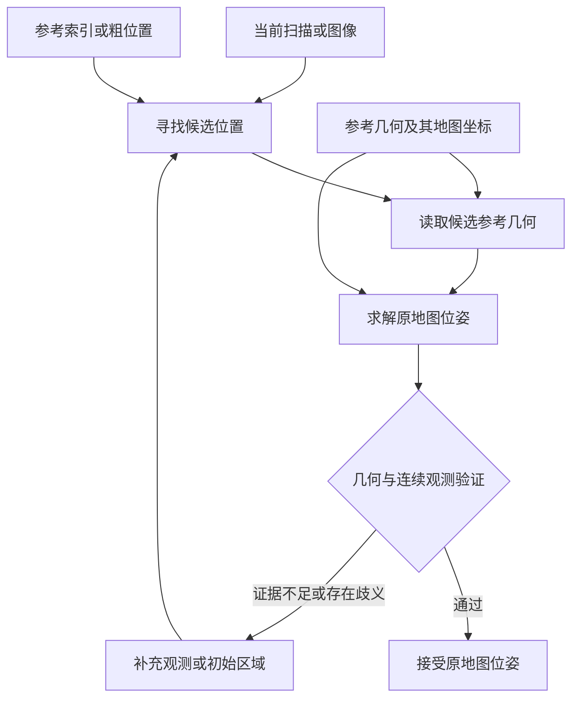
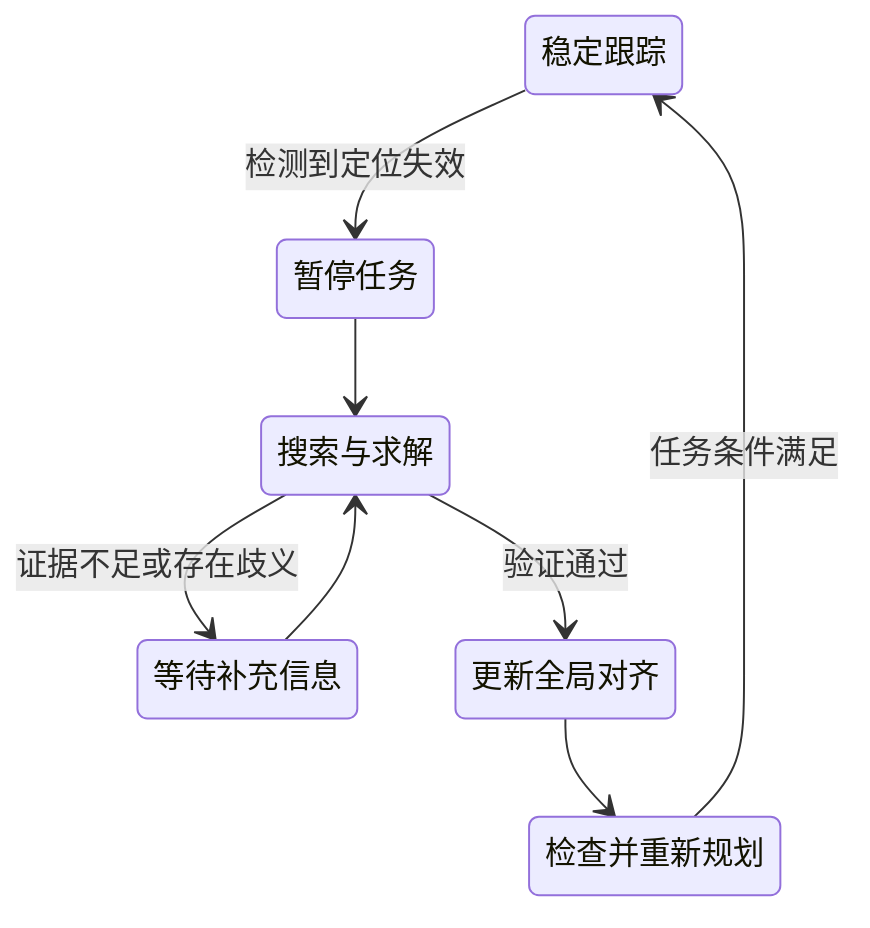

# 33. 移动机器人重定位方案与全局地图依赖

第 32 章介绍了加载地图、设置初始位姿和检查定位结果。给定大致位置后，定位算法可以结合后续观测持续更新估计。如果初始位置未知，或者原来的估计已经失效，系统就需要重新确定机器人在原地图中的位置和朝向。本章讨论怎样完成这个过程，以及需要预先保留哪些信息。

恢复原地图中的位姿，需要把当前观测与原坐标系联系起来。这种联系可以来自二维栅格、带坐标的历史观测、建筑结构，也可以来自坐标已知的外部地标。完整稠密地图只是其中一种参考形式。方案的关键在于参考是否覆盖当前位置、能否约束所需的位置和方向，以及系统能否识别错误匹配。

本章先明确重定位的输出，再说明寻找候选、求解位姿和验证结果的共同流程。随后解释坐标参考为什么需要保留，并比较激光、视觉、建筑结构和外部地标的实现方式。最后回到 WHEELTEC，说明如何接入导航系统、设计验证实验和选择方案。[第 34 章](34-nav2-navigation.md)继续介绍导航如何使用定位结果。

## 33.1 重定位要恢复什么

讨论地图依赖之前，需要先明确位姿包含哪些量、位姿属于哪个坐标系，以及重定位与连续跟踪有什么区别。

### 33.1.1 位置、朝向与参考坐标系

位姿同时描述位置和朝向。对于在平面上运动的机器人，常用 $(x,y,\psi)$ 表示位姿，其中 $x,y$ 是平面坐标，$\psi$ 是偏航角，也就是机器人在平面内的朝向。三个可以独立变化的量对应三个自由度。完整三维位姿还包括高度、横滚角和俯仰角，共有六个自由度。

位置和朝向必须相对于某个坐标系定义。本章把原地图坐标系记为 $M$，机器人机体坐标系记为 $B$。重定位的目标是恢复 $B$ 相对于 $M$ 的位姿。ROS 中通常用 `map` 表示固定的地图参考，用 `base_link` 表示机体参考。

这里的“全局”指整张地图的参考坐标系。地图坐标系可以由建图时的起点建立，无须与经纬度关联。另一个问题是输出的自由度：使用三维雷达的算法，也可能只求解平面位置和偏航角。选择方案时，应核对算法实际估计的量以及采用的地面、姿态和尺度假设。

### 33.1.2 连续跟踪、全局初始化与失效恢复

连续跟踪利用上一时刻的可靠估计，在附近寻找当前位姿。初始位置未知时，算法需要在更大的区域内寻找可能的位置，这称为全局初始化。跟踪失败后，原估计已不再可靠，系统需要检测失效并重新求解位姿，这就是失效后的重定位。

全局初始化与失效恢复都要处理较大的位置不确定性，常能共用搜索和求解方法。失效恢复还包含故障检测、运动处置和恢复导航等环节。例如，机器人被搬动后，轮速可能没有记录这段位移，原来的位姿估计便需要重新检查。机器人学中常把这种真实位姿突变而估计未同步变化的情况称为“绑架问题”。

| 过程 | 已有信息 | 要得到的结果 |
|---|---|---|
| 相对里程计 | 连续图像、扫描、惯性或轮速测量 | 相对于出发处的运动 |
| 位姿跟踪 | 地图与可靠的近似位姿 | 地图中持续更新的位姿 |
| 全局初始化 | 地图参考，初始位姿未知或误差较大 | 经过验证的初始位姿 |
| 失效后重定位 | 与原地图关联的参考，原估计已不可靠 | 恢复原地图位姿，并重新建立可用的跟踪状态 |

里程计重启后可以重新估计相对运动，但新的出发处通常具有新的坐标原点。要继续使用原地图中的导航目标，还需要求出新旧坐标系之间的关系。

## 33.2 从当前观测到可信位姿

重定位可以按处理目的分成四个环节：准备参考、寻找候选、求解位姿、验证结果。不同方法可能合并其中的计算，但仍需说明参考从哪里来、输出如何得到、结果如何接受。

### 33.2.1 准备带坐标的参考

系统先保存能够与当前观测比较的环境信息，并记录这些信息在原地图中的位置。二维激光方法常使用占据栅格。三维激光和视觉方法可以保存沿途选出的代表性观测，这些观测称为关键帧。每个关键帧可以关联原始观测、用于匹配的特征及其地图位姿。

为了快速搜索，系统还可以给每个关键帧计算描述子。描述子把观测的外观或结构编码成一组数值，便于比较相似程度。数据库通过索引快速找出相似记录，再读取相应的几何数据。参考数据的采集、组织和坐标记录通常在正式定位之前完成。

### 33.2.2 寻找可能的位置

当前扫描或图像进入系统后，算法先寻找与之相符的参考区域。描述子检索、地图上的粒子搜索、建筑区域筛选和外部粗位置测量，都可以完成这项工作。搜索环节的产出是一个或多个候选位置，或者覆盖候选区域的位姿分布。

地点识别通常只回答“当前观测最像哪条历史记录”。相似记录的地图位姿可以提供粗略位置，但机器人与历史采集点之间仍可能存在平移和转动。重复结构、视角变化和环境变化也可能产生错误候选，因此检索分数需要交给后续几何求解和验证使用。[P03]、[P10]

### 33.2.3 通过几何关系求解位姿

几何求解利用当前观测与候选参考之间的空间对应，估计二者的相对平移和旋转。把两组空间数据对齐的过程称为配准。激光方法可以对齐扫描与栅格、点云或结构模型。视觉方法可以利用图像中的特征点与地图中的三维点求解相机位姿。

如果只读取候选附近的参考几何，这部分数据称为子地图。系统可以先用小型索引搜索，再按候选加载子地图，从而控制在线内存。候选检索覆盖的范围与子地图保留的几何信息共同决定哪些位置能够恢复。

### 33.2.4 验证并接受结果

求解器给出位姿之后，系统还要检查匹配是否可信。检查内容可以包括：有多少对应符合几何关系、有效对应分布是否充分、对齐后误差是否足够小，以及其他候选是否同样合理。后续连续观测可以进一步检查位置变化是否与里程计运动一致。

几何约束不足时，某些移动方向可能难以确定。多个区域高度相似时，错误位置也可能得到较小的匹配误差。接受条件因此需要结合约束方向和候选歧义设置。证据不足时，应保留多个假设、继续收集观测或请求较粗的初始区域。

当前观测、候选和位姿分别对应不同阶段的产物。重定位流程图把参考数据接到实际使用它们的环节，并把未通过验证的结果送回搜索过程。

## 33.3 地图依赖取决于保留了哪些参考

共同流程说明了参考数据的用途。本节进一步解释坐标联系怎样进入位姿计算，再区分地图表示、覆盖与资源需求，最后说明导航中不同环节为什么可以采用不同的地图。

### 33.3.1 从相对位姿换算到原地图

设检索得到关键帧 $K$。参考数据保存了关键帧在地图中的位姿，记为 ${}^{M}T_K$。几何求解得到机器人相对于关键帧的位姿，记为 ${}^{K}T_B$。符号 ${}^{A}T_B$ 表示把 $B$ 坐标系中的坐标换算到 $A$ 坐标系的变换。两段变换组合后得到：

$$
{}^{M}T_B = {}^{M}T_K\,{}^{K}T_B.
$$

例如，关键帧位于地图的 $(10,4)$，朝向地图正 $y$ 方向。若几何求解确认机器人在关键帧前方 $2\,\mathrm{m}$、朝向相同，机器人地图位置就是 $(10,6)$。只有历史地点名称而没有关键帧地图位姿时，系统无法完成这一步坐标换算。BEVPlace++ 的正式方法也按这种关系，将匹配帧的已存位姿与求出的相对位姿组合。[P19]（§III）

只靠相对运动重新建图时，系统可以任意选择新图的原点和初始朝向，而不改变相对观测之间的关系。重力方向可以帮助确定横滚和俯仰，但不能单独确定原地图中的位置和偏航。要恢复这些量，就需要关键帧坐标、场景坐标知识、外部地标或其他与原坐标系相连的约束。

### 33.3.2 从五个维度比较地图依赖

| 维度 | 需要明确的问题 | 对设计的影响 |
|---|---|---|
| 坐标与尺度 | 参考如何关联到原地图，距离尺度是否一致 | 保存关键帧位姿、地标坐标或坐标变换 |
| 覆盖范围 | 哪些位置有参考，哪些区域容易混淆 | 确定恢复范围、候选数量与补充参考的区域 |
| 几何与自由度 | 数据能约束哪些平移和旋转 | 确定输出平面位姿还是完整三维位姿，以及是否需要辅助测量 |
| 初始信息 | 已知近似位置、楼层或朝向吗 | 选择局部配准、全局搜索或粗定位辅助 |
| 存储与计算 | 哪些数据长期保存，哪些常驻内存，哪些按需读取 | 组织索引、子地图和在线计算 |

稀疏表示减少保存的数据，按候选加载减少常驻内存，外部地标改变参考来源。稀疏表示、按需加载和外部地标可以组合使用。减少数据之后，还要验证可恢复区域、位姿误差和错误接受情况，才能判断节省资源是否影响了任务要求。

### 33.3.3 怎样理解“无图导航” {#navigation-map-needs}

导航中的近场避障，可以根据实时障碍距离、机器人外形和速度工作。局部轨迹生成也可以主要依靠当前观测。相比之下，恢复旧地图中的位姿，还需要把当前观测联系到旧坐标系。阅读“无图”方法时，应先看它解决的是哪项任务。

MTG 用近期三维点云和速度历史生成局部轨迹。DTG 进一步接收目标信息，生成朝向目标的轨迹。两者都区分训练与运行阶段：训练使用可通行地图，运行时通过观测生成轨迹。[P14]、[P15] 这些结果支持减少轨迹生成对预建地图的依赖。将机器人重新定位到旧坐标系，则需要另行检查它们与定位系统的连接方式。

Navigation2（Nav2）是 ROS 2 中常用的一套导航框架。其 Humble 默认参数让局部代价地图在 `odom` 下使用滚动窗口，只维护机器人附近的障碍区域。[S02] 常规全局规划还需要地图中的起点和终点，控制器再接收路径。因此，局部表示可以随机器人移动，而任务仍通过地图坐标连接起终点。

比较“无图”方案时，应分别记录训练是否用图、运行时是否输入地图、是否在线维护空间记忆，以及定位结果使用哪个坐标参考。场景信息也可能保存在关键帧数据库或学习模型中，不能仅凭有没有栅格文件判断参考是否存在。

## 33.4 激光方法怎样使用参考

激光测量直接提供距离，既可以与二维栅格比较，也可以与三维参考几何比较。本节先解释二维粒子定位，再说明三维检索与配准，最后讨论参考数据怎样按任务组织。

### 33.4.1 二维栅格与粒子定位

蒙特卡洛定位 MCL 用一组位姿假设表示位置的不确定性，每个位姿假设称为粒子。机器人运动后，算法按运动测量推进粒子。收到扫描后，算法比较各个假设下的扫描与地图，让观测更支持的假设获得更大权重，再通过重采样保留这些假设。

全局初始化时，粒子需要覆盖允许的位置和方向。跟踪收敛后，粒子主要集中在估计附近。AMCL 通过自适应粒子数量分配计算量，但仍然依靠地图与观测比较。多个区域都与观测相似时，算法还需要通过新观测或辅助位置消除歧义。

Akai 的 Reliable MCL 在跟踪之外增加可靠性估计和全局定位分支。全局分支把 `odom` 中累积观测形成的局部地图，与预先计算的全局自由空间特征匹配，生成新的位姿候选，再与跟踪分支融合。[P01]（§3、§4.4）局部地图描述当前观测的空间结构，全局参考负责确定这段结构在原地图中的位置。

Nav2 Humble 的 AMCL 提供 `reinitialize_global_localization` 服务，可在地图自由空间中均匀采样位姿。源码中恢复参数 `recovery_alpha_fast` 和 `recovery_alpha_slow` 的默认值均为零。[S01] 因此，使用 AMCL 时仍需核对失效如何触发搜索、恢复参数如何配置，以及怎样判断重新收敛。RViz 的 `2D Pose Estimate` 则由人提供初始分布，适合验证给定近似位置后的跟踪。

### 33.4.2 三维点云检索与几何求解

三维激光方法可以先检索相似关键帧，再把当前扫描与候选参考配准。UniLGL 先定义查询点云与数据库点云之间的地点检索，再单独构建完整三维位姿恢复方法。[P03]（§II、§III）检索与位姿求解可以共用特征，但二者的输出需要分别检查。

BEVPlace++ 把点云从上方投影成鸟瞰图，用全局描述子找出相似记录，再用局部特征对应估计平面相对位姿。数据库保存鸟瞰图、全局位姿和描述子，求解后再组合变换。论文假设地面车辆在局部区域主要沿近似平面运动，重点估计 $(x,y,\psi)$。高度、横滚和俯仰可以取自匹配记录，但不能因此视为独立求解并验证了完整六自由度位姿。[P19]（§III-A–D）

得到候选初值后，系统还可以采用迭代最近点 ICP 或正态分布变换 NDT 细化对齐。ICP 反复寻找点对应并调整变换，NDT 则利用参考点云的局部概率分布评价对齐。ICP 与 NDT 常见的局部优化形式依赖合理初值，因此未知位置启动通常还需要候选生成过程。

配准质量取决于观测重叠、有效几何和对应正确性。例如，沿某个方向变化很少的结构可能使该方向的位置难以确定，重复布局则可能造成候选混淆。环境名称本身不足以判断定位是否失效，仍应检查实际观测和求解结果。

### 33.4.3 单扫描查询与按需加载

OneShot 把当前单次扫描分割成片段，通过片段描述子检索，再进行几何一致性检查，恢复六自由度位姿。参考端仍保存片段描述子及其质心位置。[P18]（§III-D–E）“单扫描”说明查询需要多少观测，与参考数据保存多少、覆盖多大范围是不同的问题。

地图也可以先保存为带位姿和时间戳的历史观测，再根据定位或避障需求生成不同表示。Blanco-Claraco 的框架讨论了这种组织方式。[P16]（§3.1.3）工程上可让检索索引覆盖预期工作区域，把较大的参考几何放在磁盘中，选中候选后再读取相应子地图。要测量的资源包括磁盘、常驻内存和加载时延。

## 33.5 视觉方法怎样建立坐标联系

相机观测是图像，要得到地图中的位姿，需要图像与空间位置之间的联系。本节依次介绍稀疏视觉地图、相机与三维地图匹配，以及语义和学习模型中的场景参考。

### 33.5.1 稀疏视觉地图

稀疏视觉地图保存具有辨识度的特征及其三维位置，并关联到采集它们的关键帧。定位时，算法先找候选关键帧，再把当前图像中的特征与地图三维点对应，求解相机位姿。相机位姿经固定外参转换后，才得到机器人机体位姿。

AirSLAM 保存关键帧位姿、图像特征、地图点、三维线及二维与三维之间的对应关系。地图复用时，算法检索并筛选候选，建立图像点与地图点对应，最后通过 PnP 求位姿。PnP 根据已知三维点及其图像投影，估计相机的位置和朝向。[P04]（§V-F、§VI-B）这里可以省去稠密点云或占据图，但仍保留了用于定位的稀疏空间参考。

### 33.5.2 相机与其他三维地图匹配

三维参考也可以由激光或其他建模方法生成。CMRNext 根据初始位姿把 LiDAR 地图投影成深度图，与当前图像匹配，再求解位姿。论文说明初始位姿可由 GNSS 或跨模态地点识别提供。[P05]（§III-A）因此，使用这类方法进行未知位置启动时，应同时设计初始候选的来源。

三维参考可以是点云、由小面拼成的表面模型，或能合成不同视角图像的场景模型。一项地图表示对比研究比较了这些表示生成参考视图的方式。方法使用带深度和已知世界位姿的参考图像，通过检索与匹配恢复当前相机位姿。[P06]（§3.1、§3.5）地图的存储和渲染形式可以改变，但深度与参考视图位姿仍负责建立图像和地图坐标之间的联系。

### 33.5.3 语义参考与场景位姿回归

语义方法可以比较物体类别和物体之间的关系，减少只依靠局部外观匹配带来的影响。对象级语义关系研究把场景比较写成图匹配，并以相似场景检索评价方法。[P08]（§IV-C、§V-A）检索得到的参考场景仍需与所需的连续位姿输出衔接。

OMCL 把视觉语言特征保存在具有空间位置的八叉树地图中，定位时比较图像特征与地图特征。自然语言提示用于缩小粒子初始化区域，后续仍利用地图尺度的里程计和连续观测更新估计。[P09]（§III）语义提示提供粗位置线索，空间地图与后续估计负责形成位姿约束。

另一类方法用场景图像及其位姿监督训练网络，直接回归位置和朝向。FusedNet 在所研究的场景中，从单幅 RGB 图像输出平面三自由度位姿。[P07]（§III-D、§IV）这种方法运行时可以不读取显式几何地图，但训练模型已经学习了图像与场景坐标的联系。用于新区域或跨时段任务时，应重新验证场景覆盖和泛化表现。

## 33.6 建筑结构和外部地标能提供什么

定位参考可以来自机器人历史观测，也可以来自建筑资料、示教路线或坐标已知的外部地标。本节按参考来源说明这些方法保留的信息及其适用条件。

### 33.6.1 建筑结构与示教路线

AGLoc 用带度量坐标的墙体和通道多边形作为参考，减少详细环境点云的存储。方法假定可获得 Wi-Fi 和气压计辅助位置，先确定楼层与候选区域，再通过激光匹配寻找精确位置和方向。[P02]（§III、§IV-B）建筑结构因此可以替代详细扫描地图，但粗位置条件与搜索开销需要一并评价。

BIM-Loc 使用设计态建筑信息模型中的墙、柱、梁等结构，将前端里程计与建筑几何结合，同时估计模型和现实之间的差异。[P11]（§3.1）它说明建筑资料可以作为定位先验。要用于未知位置恢复，还应检查初始轨迹与建筑坐标系如何对齐，以及原论文实验验证了多大的初始不确定性。

固定路线还可以采用示教重复。LiDAR Teach, Radar Repeat 在示教阶段保存路线节点，重复阶段用雷达观测与示教节点建立对应。[P17]（§III-C–D）恢复范围受示教观测覆盖限制。若示教图与原导航地图采用不同坐标系，还需要保存二者的对齐关系。

### 33.6.2 外部地标与位置测量

坐标已知的地标或基站可以直接建立外部参考。使用时，要区分测量提供的位置约束与姿态约束，并核对其坐标系是否已经与导航地图对齐。

| 参考方式 | 可提供的约束 | 还需要核对的条件 |
|---|---|---|
| 单天线 GNSS / RTK | 天线在地理参考下的位置 | 单历元位置不能独立确定机体朝向，需要外参和地图对齐 |
| UWB 单标签与已知锚点 | 覆盖和几何满足要求时的标签位置 | 测距异常、非视距传播、基站布局，以及机体姿态来源 |
| 已知尺寸和全局位姿的视觉标记 | 相机相对于标记的位姿 | 相机标定、标记坐标、机体外参、可见性和位姿歧义 |
| Wi-Fi 指纹或楼层识别 | 粗区域或楼层候选 | 后续精确位置和朝向的求解方式 |

DURAL 用 UWB 锚点建立的坐标系提供位置参考，并融合 LiDAR、惯性和轮速测量。[P12]（§5.1.1）论文研究的是连续融合定位。将外部测量用于失效恢复时，还需要设计状态重初始化和姿态重新收敛过程。

如果基站属于坐标系 $G$，原导航地图属于 $M$，测量结果还需通过已知变换 ${}^{M}T_G$ 转换。基站覆盖、参考坐标和能约束的自由度，都应列入方案要求。

## 33.7 在 WHEELTEC 上恢复导航

前面比较了参考来源和位姿求解方式。接入本车时，还要明确恢复目标、选择与现有传感器匹配的路线、更新全局坐标关系，并规定何时允许恢复运动。

### 33.7.1 定义目标并建立基线

先规定需要恢复平面位姿还是完整三维位姿，是否允许人工提供初始区域，是否跨楼层，以及最长可以等待多久。对于常规平面通行任务，可以先以可靠恢复 $(x,y,\psi)$ 为目标，同时规定坡度和机体姿态的有效范围。

二维雷达路线可以从 AMCL 建立基线。保存二维地图，确认雷达、轮速与坐标关系，再分别测试人工初值、错误初值、全局初始化和失效恢复。得到成功率、错误接受情况和耗时后，再判断是否需要额外检索或粗位置辅助。

MID360 路线可以保留 FAST-LIO 的局部里程计，在外部增加参考关键帧、检索索引、子地图配准与结果验证模块。[第 42 章](42-mid360-fast-lio.md)与[第 43 章](43-mid360-fast-lio-data-flow.md)介绍里程计和点云数据如何产生。保存点云只是建立参考的起点，还需要保留地图坐标、构建索引，并实现进程重启后的加载与全局对齐。

若增加相机观测，应确认可用图像、深度、标定和同步条件。多个定位模块同时运行时，还必须明确哪个模块负责发布全局坐标修正，避免产生冲突。

### 33.7.2 用重定位结果更新全局对齐

局部里程计在坐标系 $O$ 中提供连续位姿 ${}^{O}T_B(t)$。重定位得到同一时刻的地图位姿 ${}^{M}T_B(t)$ 后，系统可以求出两套坐标系之间的关系：

$$
{}^{M}T_O(t) = {}^{M}T_B(t)\left({}^{O}T_B(t)\right)^{-1}.
$$

这里的逆变换把机体坐标换回里程计坐标，整式得到 `map → odom`。系统更新全局对齐，同时保留 `odom → base_link` 的连续运动，符合 REP-105 对地图和里程计坐标系的约定。[S03]

参与组合的位姿必须对应同一时刻。求解较慢时，可以先用结果时间戳处的里程计位姿计算全局对齐，再通过后续里程计得到当前地图位姿。求解器若输出传感器位姿，还需先通过固定外参换算成机体位姿。

### 33.7.3 验证通过后恢复任务

检测到定位失效后，系统应暂停任务并通过控制链约束机器人运动。搜索与求解模块产生候选，验证模块决定是否接受。恢复全局对齐之后，还要重新检查地图、目标与路径的有效性，再恢复导航。

定位状态决定任务何时暂停和恢复。恢复流程图把已接受位姿与导航状态连接起来，保留搜索失败时继续等待的分支。

匹配误差小或协方差小，都需要结合数据关联是否正确来解释。粒子滤波完整性监测研究专门分析“大定位误差发生而系统没有报警”的风险。[P13] 因此，验证环节应保留拒绝和报警能力，单独记录错误接受，而不能仅统计已经成功的结果。

## 33.8 怎样验证恢复能力与地图取舍

验证要分别回答两个问题：系统能否在失效后恢复，以及减少参考数据会影响哪些能力。先规定成功与失败标准，再改变启动条件、环境和参考数据，最后统计任务效果与资源消耗。

### 33.8.1 先固定评价标准

平面定位可以规定位置误差和偏航误差门限，三维定位则规定平移和旋转误差门限。还要规定结果需连续满足多久、等待多久判为超时，以及什么情况算错误接受。评价应有独立真值或可靠测量，不能直接把算法自己的匹配分数当作正确性依据。

成功率的分母包含全部尝试，分别报告成功、失败和超时数量。错误接受率应明确分母，例如全部尝试或已接受结果。恢复耗时分别记录失效检测、搜索求解和验证开销，报告中位数、尾部及超时门限。

### 33.8.2 按影响机制设计实验

| 实验 | 改变的条件 | 重点记录 |
|---|---|---|
| 正常跟踪基线 | 小初始误差 | 位姿误差、漂移和计算时延 |
| 全局冷启动 | 不给准确位置与朝向，覆盖多个起点 | 成功、失败、超时和错误接受 |
| 绑架与里程计失配 | 真实位姿突变，估计未同步变化 | 检测延迟、恢复时间和错误跳转 |
| 几何约束不足或候选混淆 | 改变可见结构、观测重叠或布局重复程度 | 约束不足的方向、错误候选及拒绝情况 |
| 长期环境变化 | 改变遮挡、物体布局、光照或季节 | 跨时段恢复表现与参考更新成本 |
| 参考数据消融 | 逐级减少关键帧、降低分辨率或采用子地图 | 覆盖范围、误差、错误接受、存储和加载时延 |
| 参考关联消融 | 移除全局位姿、几何或外部坐标对齐 | 哪些位置或姿态量失去约束 |
| 未覆盖区域与错误地图 | 超出参考范围或加载不匹配的地图 | 正确拒绝和错误接受次数 |
| 完整任务恢复 | 重定位后重新规划并到达原目标 | 目标有效性、路径有效性和导航完成率 |

环境条件应按实际影响设计。例如，重复布局实验可以选取外观相似的房间或楼层，但要记录相似程度与有效几何。某种场景只是测试样本，不能直接替代退化或失效的判据。

### 33.8.3 同时记录资源与运行条件

地图磁盘占用与在线内存分别统计，离线建图或训练与在线定位分别计时。每次实验记录传感器、扫描累积时长、运动速度、计算平台和地图版本。在桌面 GPU 上测得的耗时，需要在目标机载硬件上重新验证。

论文结果也要按实验条件理解。例如，OneShot 在所报告 NCLT 实验中的定位率为 38%，精确率为 94%。两项指标分别反映查询的定位覆盖情况和所报告结果的正确程度。[P18] 这组数字不能直接作为本车的恢复成功率。AGLoc 的搜索范围和逐扫描耗时同样绑定其粗定位假设及实现，具体核查位置见[参考证据说明](research/relocalization-reference-audit.md)。

## 33.9 方案选择与参考依据

恢复原地图位姿，需要保留足以建立坐标联系的参考。参考可以更稀疏、分区保存或来自外部设施。选择时，应先确认输出与初始条件，再比较覆盖、资源和错误拒绝能力。

| 方案 | 需要保留或部署的参考 | 适合优先验证的条件 |
|---|---|---|
| 二维粒子定位 | 二维地图及观测模型 | 已有二维雷达和平面导航地图 |
| 三维检索与配准 | 全局索引、参考几何和关键帧地图位姿 | 已有三维雷达，需要扩大初始搜索范围 |
| 稀疏视觉地图 | 关键帧、特征三维位置和对应关系 | 图像、标定与参考观测可长期维护 |
| 建筑结构定位 | 带坐标的建筑资料及必要的粗位置 | 建筑资料可用，且能处理模型与现实差异 |
| 语义或场景学习方法 | 空间语义地图或场景模型 | 参考覆盖明确，有相应算力与泛化验证 |
| 示教重复 | 带坐标关系的路线节点和历史观测 | 任务沿固定路线运行 |
| 外部地标辅助 | 已知坐标的基站或标记及地图对齐 | 可以布设设施，并能满足覆盖和姿态约束 |

对 WHEELTEC，可以先得到可重复的 AMCL 基线，再验证 MID360 的“候选检索、按需读取参考、几何求解、结果验证”流程。新增视觉、语义或外部基站，应针对实验中明确暴露的问题。每个方案都应交代参考来自哪里、覆盖哪些位置、能约束哪些自由度，以及参考无效时怎样拒绝结果。

本章引用采用定向全文核查，详细物理页码、定位短语、文件哈希和适用限制见[论文证据表](research/relocalization-evidence.csv)。[参考证据说明](research/relocalization-reference-audit.md)记录本次修订的引文边界及库内补充依据，便于继续核验。

### 参考文献 {#references}

- P01 · M35 — Akai, Naoki (2023). *Reliable Monte Carlo localization for mobile robots*. Journal of Field Robotics. [DOI](https://doi.org/10.1002/rob.22149).
- P02 · S03 — Xie, Fujing et al. (2024). *Robust Lifelong Indoor LiDAR Localization Using the Area Graph*. IEEE Robotics and Automation Letters. [DOI](https://doi.org/10.1109/lra.2023.3334158).
- P03 · SC-P195 — Shen, Hongming et al. (2026). *UniLGL: Learning Uniform Place Recognition for FOV-Limited/Panoramic LiDAR Global Localization*. IEEE Transactions on Robotics. [DOI](https://doi.org/10.1109/tro.2026.3672514).
- P04 · R05 — Xu, Kuan et al. (2025). *AirSLAM: An Efficient and Illumination-Robust Point-Line Visual SLAM System*. IEEE Transactions on Robotics. [DOI](https://doi.org/10.1109/tro.2025.3539171).
- P05 · R06 — Cattaneo, Daniele et al. (2025). *CMRNext: Camera to LiDAR Matching in the Wild for Localization and Extrinsic Calibration*. IEEE Transactions on Robotics. [DOI](https://doi.org/10.1109/tro.2025.3546784).
- P06 · S26 — Zhang, Lintong et al. (2026). *Visual localization in 3D maps: comparing point cloud, mesh, and NeRF representations*. Autonomous Robots. [DOI](https://doi.org/10.1007/s10514-025-10232-5).
- P07 · M21 — Chen, Fang-xing et al. (2024). *FusedNet: End-to-End Mobile Robot Relocalization in Dynamic Large-Scale Scene*. IEEE Robotics and Automation Letters. [DOI](https://doi.org/10.1109/lra.2024.3372465).
- P08 · M34 — Xie, Yuanyan et al. (2023). *Indoor Visual Re-Localization for Long-Term Autonomous Robots Based on Object-Level Features and Semantic Relationships*. IEEE Robotics and Automation Letters. [DOI](https://doi.org/10.1109/lra.2022.3233235).
- P09 · R10 — Kruzhkov, Evgenii et al. (2026). *OMCL: Open-Vocabulary Monte Carlo Localization*. IEEE Robotics and Automation Letters. [DOI](https://doi.org/10.1109/lra.2026.3653333).
- P10 · E56 — Wang, Zihang et al. (2026). *LiteFT-PR: Lightweight and Fault-Tolerant LiDAR-Camera Fusion Network for Robust Place Recognition via Model Distillation*. IEEE Robotics and Automation Letters. [DOI](https://doi.org/10.1109/lra.2026.3662634).
- P11 · S36 — Yinqiang Zhang et al. (2026). *BIM-Loc: BIM-integrated discrepancy-aware LiDAR-based indoor localization*. The International Journal of Robotics Research. [DOI](https://doi.org/10.1177/02783649261462593).
- P12 · E03 — Hu, Kun et al. (2026). *DURAL: Degradation-Resistant Robust Adaptive Localization by LiDAR-Inertial-UWB-Wheel Fusion for Coal Mine Robots*. Journal of Field Robotics. [DOI](https://doi.org/10.1002/rob.70200).
- P13 · M28 — Hafez, Osama Abdul et al. (2024). *How Safe Is Particle Filtering-Based Localization for Mobile Robots? An Integrity Monitoring Approach*. IEEE Transactions on Robotics. [DOI](https://doi.org/10.1109/tro.2024.3420798).
- P14 · SC-M039 — Liang, Jing et al. (2024). *MTG: Mapless Trajectory Generator with Traversability Coverage for Outdoor Navigation*. 2024 IEEE International Conference on Robotics and Automation (ICRA). [DOI](https://doi.org/10.1109/icra57147.2024.10611319).
- P15 · SC-M043 — Liang, Jing et al. (2024). *DTG : Diffusion-based Trajectory Generation for Mapless Global Navigation*. 2024 IEEE/RSJ International Conference on Intelligent Robots and Systems (IROS). [DOI](https://doi.org/10.1109/iros58592.2024.10802055).
- P16 · SC-P134 — Jose Luis Blanco-Claraco (2025). *A flexible framework for accurate LiDAR odometry, map manipulation, and localization*. The International Journal of Robotics Research. [DOI](https://doi.org/10.1177/02783649251316881).
- P17 · R11 — Xiao, Renxiang et al. (2026). *LiDAR Teach, Radar Repeat: Robust Cross-Modal Navigation in Degenerate and Varying Environments*. IEEE Transactions on Robotics. [DOI](https://doi.org/10.1109/tro.2026.3699433).
- P18 — Ratz, Sebastian et al. (2020). *OneShot Global Localization: Instant LiDAR-Visual Pose Estimation*. 2020 IEEE International Conference on Robotics and Automation (ICRA). [DOI](https://doi.org/10.1109/ICRA40945.2020.9197458).

- P19 · H53 — Luo, Lun et al. (2025). *BEVPlace++: Fast, Robust, and Lightweight LiDAR Global Localization for Autonomous Ground Vehicles*. IEEE Transactions on Robotics, 41, 4479–4498. [DOI](https://doi.org/10.1109/TRO.2025.3585385).

软件与坐标规范：

- S01 — [Navigation2 Humble：AMCL 源码](https://github.com/ros-navigation/navigation2/blob/3c3db59d6969d8ecee8e68468693d006397f4a0c/nav2_amcl/src/amcl_node.cpp)，核对 `globalLocalizationCallback`、`uniformPoseGenerator`、`reinitialize_global_localization` 与恢复参数默认值。
- S02 — [Navigation2 Humble：默认参数](https://github.com/ros-navigation/navigation2/blob/3c3db59d6969d8ecee8e68468693d006397f4a0c/nav2_bringup/params/nav2_params.yaml)，局部代价地图配置为 `local_costmap.global_frame: odom` 与 `rolling_window: true`。
- S03 — [REP-105：Coordinate Frames for Mobile Platforms](https://github.com/ros-infrastructure/rep/blob/11ca24a41f31480dfb9562ba99f2a5b93d3ebda5/rep-0105.rst)，核对 `odom` 的连续性与 `map` 的全局修正语义。

## 章节导航

[上一章：地图、定位与 TF](32-map-localization-tf.md) · [返回本篇](index.md) · [下一章：Nav2 导航](34-nav2-navigation.md)

[P01]: #p01
[P02]: #p02
[P03]: #p03
[P04]: #p04
[P05]: #p05
[P06]: #p06
[P07]: #p07
[P08]: #p08
[P09]: #p09
[P10]: #p10
[P11]: #p11
[P12]: #p12
[P13]: #p13
[P14]: #p14
[P15]: #p15
[P16]: #p16
[P17]: #p17
[P18]: #p18
[P19]: #p19
[S01]: #s01
[S02]: #s02
[S03]: #s03
