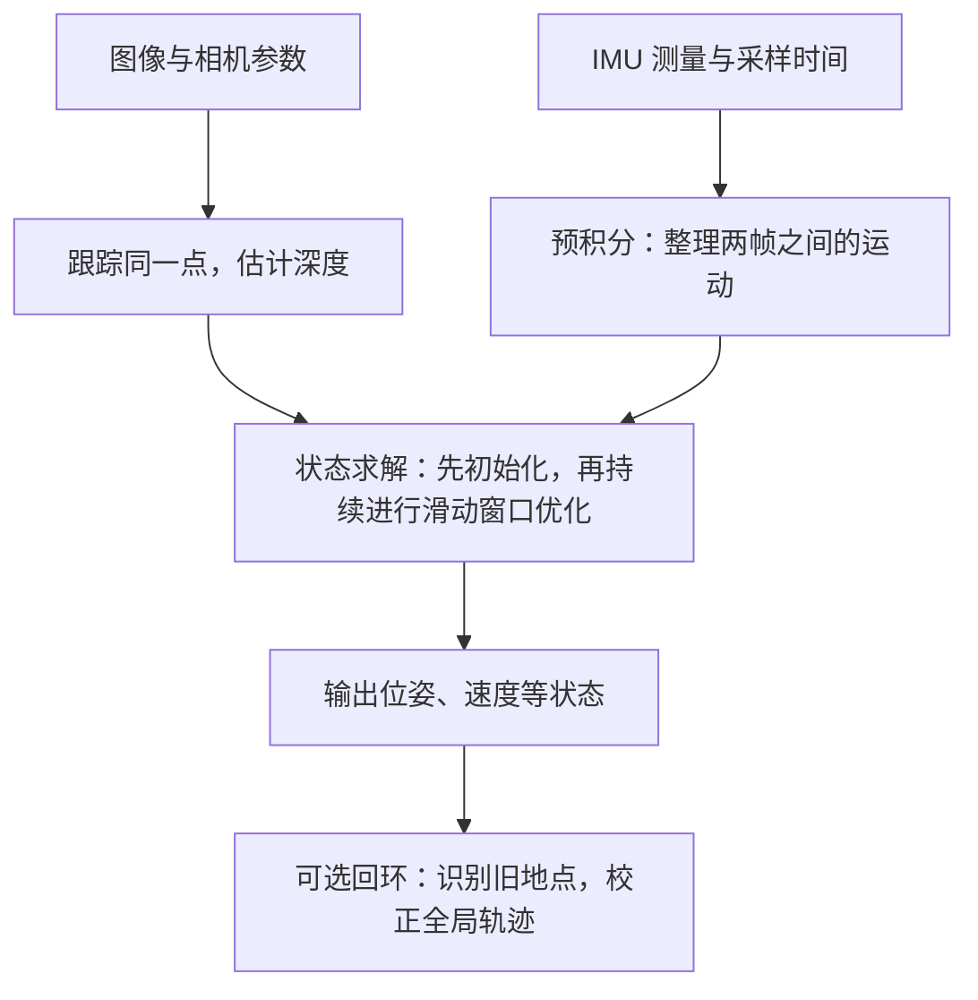
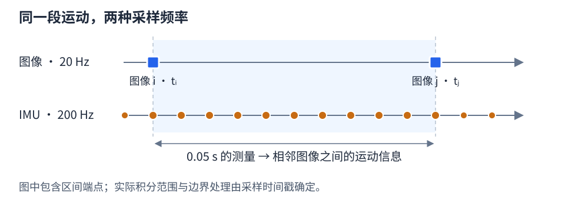
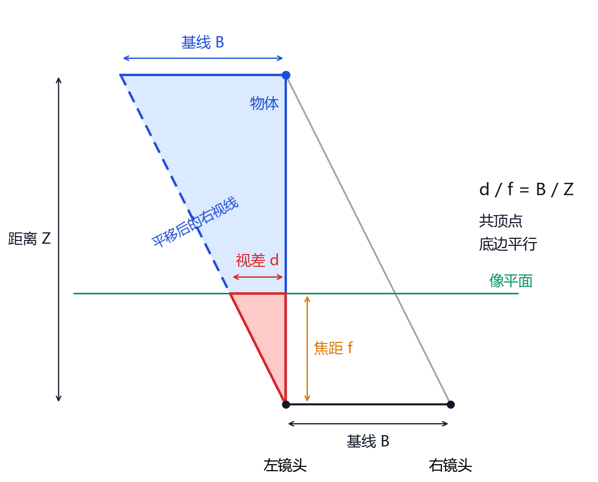
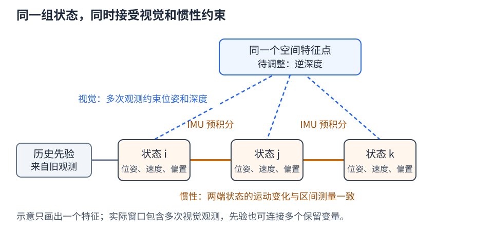
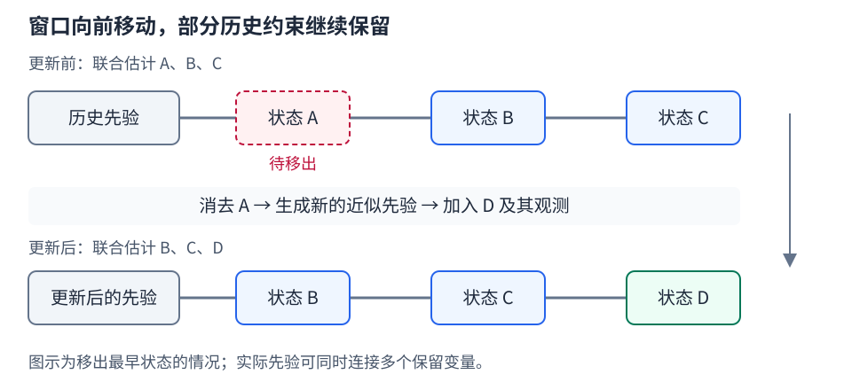

# 39. VINS：视觉惯性里程计的工作原理

机器人沿走廊行驶时，可以根据门框、墙角在图像中的位置变化，推算自己移动了多远、转过多大角度。位置与朝向合称为位姿。连续估计相对出发处的位姿，就是里程计要完成的任务。

只用图像时，白墙、快速转弯和遮挡可能使可跟踪的点不足。惯性测量单元（IMU）提供角速度和加速度计测量，可以补充两帧图像之间的运动信息，但由这些测量逐步累加得到的轨迹也会不断积累误差。**视觉惯性里程计**（Visual-Inertial Odometry，VIO）结合两类测量：利用图像核对场景与运动的关系，利用 IMU 描述相邻时刻之间的运动，再共同调整估计结果。

本章以香港科技大学团队的 VINS-Mono 和 VINS-Fusion 为例，解释这一过程。VINS 是视觉惯性导航系统（Visual-Inertial Navigation System）的缩写。VINS-Mono 使用单目相机与 IMU，VINS-Fusion 还支持双目与 IMU、纯双目视觉里程计（Visual Odometry，VO），并提供可选的视觉回环与 GPS 融合模块。下文将 VINS-Fusion 简称为 Fusion。[VINS-Mono 论文][s1]、[Fusion 官方说明][s3]

第 39.1～39.7 节依次介绍输入、视觉处理、惯性处理、初始化、联合优化、结果输出和回环。第 39.8 节再将这些原理对应到 R680。涉及加权、偏置修正和矩阵消元的进一步说明集中放在文末的[补充说明](#vins-math-details)。整套建图与导航的运行过程见[第 40 章][textbook]。

---

## 过程概要

系统在输入准备阶段先确认图像的采集时刻、相机参数和安装关系，使图像与 IMU 测量能够对应同一次运动（第 39.1 节）。

随后，图像处理部分在当前图像中找到此前跟踪的点，记录同一空间点在不同图像中的位置，并估计它的深度（第 39.2 节）。惯性处理部分则把相邻图像时刻之间的多次 IMU 采样整理为一组运动增量，这个过程称为预积分（第 39.3 节）。

系统刚启动时，需要先给位姿、速度和深度等未知量确定合理的初值，称为初始化（第 39.4 节）。之后，每收到新图像，就联合调整近期若干时刻的运动与深度估计，使图像和 IMU 对运动的描述尽量一致。只保留近期状态参与求解的范围称为滑动窗口（第 39.5 节）。

优化结果用于发布里程计，后续 IMU 测量还可据此预测更新时刻的状态（第 39.6 节）。如果启用回环模块，系统再次经过旧地点时，还能利用历史图像校正长期累计的轨迹偏差（第 39.7 节）。

图中的两条输入分支最终指向同一个求解过程。图像与 IMU 测量各自限制运动估计的可能取值，这种限制称为约束。例如，估计的相机运动应当使同一个门框角点投影到实际观测的位置。相邻时刻的转角也应当与陀螺仪记录的转动相符。联合优化就是寻找尽量符合这些约束的估计。第 39.8 节再用 R680 的输入条件和对照实验，检验各环节在本车上的适用性。

---

## 39.1 输入测量、坐标系与时间同步

系统接收到的是像素位置、角速度和加速度计读数，最终要得到的却是运动轨迹。要把这些量联系起来，需要先明确每种测量的含义，再统一它们的空间与时间关系。

### 39.1.1 图像提供方向，深度确定空间位置

图像中的像素位置用列号 $u$ 和行号 $v$ 表示。相机的焦距、主点位置等参数称为内参，用来建立像素位置与相机观测方向的关系。单幅图像中的一个像素只确定一条视线：空间中沿这条视线的多个点，都可能出现在同一个像素上。要确定点的三维位置，还需要知道它的深度。

单目相机发生平移后，可以从不同位置观察同一点，由此同时恢复场景结构与相机运动。不过，如果将恢复出的场景尺寸和相机平移都放大一倍，图像上的投影仍然相同。因此，单目图像本身无法确定重建结果中的一个长度单位究竟对应多少米。重建长度与实际长度之间的比例称为尺度。[VINS-Mono，§I、V][s1]

双目相机有两个位置不同的镜头，两个光学中心之间的距离称为基线。已知基线的实际长度，就能为重建结果提供米制尺度。单目与 IMU 的组合则需要利用运动中的惯性测量估计尺度。具体初始化过程见第 39.4 节。

### 39.1.2 IMU 提供转动与比力测量

IMU 通常包含三轴陀螺仪和三轴加速度计。陀螺仪给出绕各轴转动的角速度，单位为 rad/s。知道角速度及其持续时间，就可以逐步计算朝向变化，这种随时间累加测量的过程称为积分。

加速度计的原始读数称为比力，单位为 m/s²，表示单位质量所受的非重力作用。比力与车辆的平移加速度并不相同：车辆静止在水平地面上时，支撑作用对应向上约 9.81 m/s² 的比力，平移加速度却为零。VINS 接收未经去重力处理的加速度计测量，随后根据传感器朝向将测量换算到统一坐标系，并单独计入重力，才得到用于计算速度变化的加速度。[VINS-Mono，§IV-B][s1]、[官方设备要求][mono-device]

陀螺仪和加速度计的测量都可能带有偏置，即一段时间内持续存在的测量偏差。例如，真实角速度为零时，陀螺仪的平均输出仍可能偏离零值。偏置通常随温度和时间缓慢变化，随机噪声则造成采样值的短时波动。若投影到某一固定世界方向的加速度误差恒为 0.05 m/s²，忽略其他误差和观测校正，积分 10 s 后会产生约 2.5 m 的位置误差。因此，VINS 在估计运动的同时，也需要估计偏置。[预积分论文，§V–VI][s2]

某个时刻需要估计的这些量合称为状态。VINS 的状态包括位置、姿态、速度，以及加速度计和陀螺仪的偏置。位姿是状态的一部分。IMU 读数则是用来估计状态的测量。

### 39.1.3 坐标系与传感器安装关系

同一个点可以用相对相机、相对 IMU 或相对出发处的坐标表示。坐标系规定原点和各轴方向，坐标变换则把同一点换到另一组原点与轴向下表示。本章使用三种坐标系：

| 记号 | 坐标系 | 用途 |
| --- | --- | --- |
| $c$ | 相机光学坐标系，$x$ 向右、$y$ 向下、$z$ 向前 | 表示图像对应的视线和三维点 |
| $b$ | IMU 坐标系，轴向由设备定义 | 表示角速度与比力测量。这里的 $b$ 专指 IMU，不等同于车身坐标系 |
| $w$ | 世界坐标系，本章规定 $z$ 向上 | 统一表达运动轨迹，原点与初始航向由系统选定 |

相机与 IMU 固定安装后，两者的相对位置和朝向保持不变，这组安装关系称为外参。确定内参、外参的过程称为标定。

记 $R_{wb}$ 为把 IMU 轴向换成世界轴向的旋转矩阵，$\mathbf p_{wb}$ 为 IMU 原点在世界坐标系中的位置。相机到 IMU 的外参记为 $R_{bc}$、$\mathbf t_{bc}$：前者转换轴向，后者是相机原点在 IMU 坐标系中的位置。空间点先从相机坐标换到 IMU 坐标，再换到世界坐标：

$$
\mathbf P_b=R_{bc}\mathbf P_c+\mathbf t_{bc},
\qquad
\mathbf P_w=R_{wb}\mathbf P_b+\mathbf p_{wb}.
$$

每一步都是先按目标轴向旋转，再加上原点之间的位置差。传感器原点与车身参考点通常不重合，车辆转弯时，这些点的运动轨迹也不同。因此，将传感器位姿用于导航时，还需依据安装外参计算车身参考点的位姿，使输出与 `base_footprint` 的实际定义一致。[VINS-Mono，§III、VI][s1]、[Fusion 外参与投影因子][s8]

本章规定世界坐标系的 $z$ 轴向上，重力加速度为 $\mathbf g_w=(0,0,-9.81)^{\mathsf T}$。记加速度计测量为 $\tilde{\mathbf f}$、偏置为 $\mathbf b_a$。忽略随机噪声时，IMU 原点在世界坐标系中的平移加速度为

$$
\mathbf a_w=R_{wb}(\tilde{\mathbf f}-\mathbf b_a)+\mathbf g_w.
$$

若车辆静止、IMU 与世界坐标系的轴向一致且偏置为零，加速度计测量为 $(0,0,9.81)$，加上 $\mathbf g_w$ 后得到零平移加速度。后文沿用这一符号约定。部分论文和代码采用相反方向的重力向量定义，其运动方程相应使用减号，阅读时应结合测量模型核对。[预积分论文，§V][s2]

### 39.1.4 时间同步与外参标定

空间关系统一后，还需要知道每次测量发生在什么时候。时间戳记录采集或采样时刻。处理图像 $j$ 时，需要找到从上一幅图像时刻 $t_i$ 到当前时刻 $t_j$ 之间的 IMU 测量。相机为 20 Hz、IMU 为 200 Hz 时，两幅图像相隔约 0.05 s，其间约有 10 次 IMU 采样。

实际积分区间由时间戳确定，边界不一定恰好落在某次 IMU 采样上，因此还需处理区间端点。Fusion 在计入相机与 IMU 的时间偏移后，等待 IMU 数据覆盖目标图像时刻，再提取对应区间的测量。[Fusion `estimator.cpp`][s4]

相机与 IMU 的时间基准之间可能存在近似固定的偏移，通常记为 $t_d$，正负号取决于接口约定。在线时间标定可以估计这种固定偏移，但无法消除每条串口消息各不相同的随机传输延迟。例如，角速度为 1 rad/s 时，10 ms 的时间误差对应约 0.01 rad 的旋转误差。焦距为 400 像素时，这一误差可使图像中心附近的预测投影偏移约 4 像素。因此，时间戳应尽量反映传感器的实际采样时刻。[Fusion 时间偏移功能][s3]、[投影因子中的时间补偿][s8]

相机与 IMU 的外参可以预先标定并固定，也可以在运动估计过程中在线优化。在线估计要求运动对待估参数提供充分约束。地面车辆主要平移和绕竖直轴转动，对部分外参的约束较弱，外参与惯性偏置也可能难以区分。因此，R680 应优先使用预先标定的固定外参，再评估双目 VIO 的性能。[VINS-Mono 官方外参说明][mono-device]、[Fusion 优化参数设置][s4]

---

## 39.2 特征提取、跟踪与深度估计

图像处理部分通常称为前端，负责建立同一空间点在不同图像中的对应关系。使用这些对应关系求解运动的部分称为后端。本节先解释点怎样被持续跟踪，再说明多个观测方向怎样确定深度。前端交给后端的主要是特征编号与观测位置，深度还会在后续求解中更新。

### 39.2.1 跟踪已有特征并补充新特征

门框的角点比白墙上的普通像素更容易在下一帧中找回。这类适合持续识别的像素称为特征点。判断一个点是否适合跟踪，可以比较它周围一小块图像的亮度分布：白墙上各处都很相似，沿直线边缘移动也可能看不出变化，而角点附近沿两个方向移动都会产生明显变化，因此更容易确定对应位置。

光流描述像素位置随时间的变化。稀疏光流只跟踪选出的特征点：从上一帧的一个小图像块出发，在当前帧寻找亮度分布相近的位置，得到该点的图像位移。

VINS-Mono 采用稀疏 KLT 光流跟踪特征，并在特征数量不足时补充角点。本文引用的 Fusion 版本使用金字塔 Lucas–Kanade 光流：先在较低分辨率图像上估计位移，再逐层细化，以处理较大的图像位移。启用前后向一致性检查时，前端还会从当前帧的匹配位置反向跟踪到上一帧，检查其与原位置的偏差。前端还会剔除越界点，并限制特征点之间的最小间距。[VINS-Mono，§IV-A][s1]、[Fusion 特征前端][s5]

例如，门框角点编号为 37，上一帧位于 $(320,210)$，当前帧位于 $(312,211)$。两次观测保留同一编号，后端才能知道它们对应同一个空间点。每次处理新帧，前端先跟踪已有点，再补充新点，使连续观测尽量保留下来。

动态物体、重复纹理、运动模糊和遮挡都可能造成错误对应。符合当前静态场景运动模型的有效对应称为内点，不符合的称为外点，还需通过几何检验和后续优化检查加以区分。VINS-Mono 论文与 Fusion 源码采用的筛选流程有所不同，具体检查项应以实际使用的版本为准。[Fusion 特征前端][s5]、[后端外点剔除][s4]

### 39.2.2 双目匹配与三角化

双目模式完成左图的跨帧跟踪后，还在同一采集时刻的右图中寻找对应点。这两种匹配回答的问题不同：

| 对应关系 | 比较哪些图像 | 提供什么信息 |
| --- | --- | --- |
| 跨帧跟踪 | 同一相机在不同时刻的图像 | 同一点怎样随相机运动改变观测位置 |
| 双目匹配 | 左右相机在同一时刻的图像 | 从两个已知位置观察同一点，约束它的深度 |

两类观测通过特征编号统一关联。已知相机位置和观测方向后，可以根据两条视线求解空间点的位置，这个过程称为三角化。[Fusion 特征前端][s5]、[特征管理][s6]

为了简化双目匹配，可以按标定结果变换左右图像，使对应点位于同一行，这一步称为整流。对于整流后的水平平行针孔双目，同一点在左右图像中的列坐标之差称为视差 $d$。已知以像素为单位的焦距 $f_x$ 与基线长度 $B$，该点沿左相机光轴方向的深度 $Z$ 为

$$
Z=\frac{f_x B}{d}.
$$

取 $f_x=400$ 像素、$B=0.05$ m、$d=10$ 像素，得到 $Z=2$ m。基线以米为单位，计算结果也具有米制尺度。深度越大，视差越小，相同的视差误差会导致更大的深度误差。Fusion 实际根据相机模型和外参对观测射线进行三角化，上式是整流平行双目条件下的简化表达。[Fusion `feature_manager.cpp`][s6]

### 39.2.3 特征点的逆深度表示

三角化提供深度初值，后端还需要一种便于反复调整的表示。对于已去畸变的针孔图像，主点 $(c_x,c_y)$ 是光轴与像平面的交点，$f_x,f_y$ 是两个方向上以像素为单位的焦距。将像素位置减去主点，再除以焦距，得到归一化坐标：

$$
x=\frac{u-c_x}{f_x},\qquad y=\frac{v-c_y}{f_y}.
$$

向量 $(x,y,1)$ 给出观测射线方向，乘以深度 $Z$ 就是点的三维坐标。更完整的像素与三维坐标关系见[第 40.2.1 节](40-visual-runtime.md#4021)。

VINS 以特征首次被观测的相机坐标系为参考，用逆深度 $\lambda=1/Z$ 参数化该特征的三维位置：

$$
\mathbf P_c=\frac{1}{\lambda}(x,y,1)^{\mathsf T}.
$$

取 $(x,y)=(0.2,-0.1)$、$\lambda=0.5\,\mathrm{m}^{-1}$，可得点的坐标为 $(0.4,-0.2,2)$ m。这里的深度是沿相机 $z$ 轴的坐标，而非点到光学中心的欧氏距离。给定参考帧中的观测方向后，后端通过调整一个逆深度参数更新该点的三维位置，并计算它在其他图像中的投影。远处特征的逆深度接近零。三角化为逆深度提供初值，后续优化再利用多帧观测细化估计。[VINS-Mono，§VI-A、C][s1]、[Fusion 逆深度读写][s6]

单目三角化需要相机平移，才能形成不同观测位置之间的基线。由观测位置改变产生的观测方向差异通常也称为视差。判断两帧是否适合三角化时，需要区分平移和旋转的影响。纯旋转虽然改变像素位置，却没有产生新的观测位置，因而无法单独确定深度。双目相机已有固定基线，静止时也可估计有效匹配点的米制深度。这是第 39.4 节中两类初始化方法不同的原因之一。

---

## 39.3 IMU 积分与预积分

视觉分支提供同一点的多次观测，惯性分支则需要描述两幅图像之间发生了怎样的运动。本节先从一次短时积分说明运动如何计算，再解释为什么优化时需要预积分。

### 39.3.1 由惯性测量计算运动状态

设上一时刻的位置、速度和姿态已经有一个估计。扣除陀螺仪偏置 $\mathbf b_g$ 后，由角速度积分得到新的姿态。再用姿态把去偏置的比力换到世界坐标系，按第 39.1.3 节的关系计入重力，得到平移加速度。加速度积分得到速度变化，速度积分得到位置变化。

若在短时间段 $\Delta t$ 内近似认为世界坐标系中的加速度 $\mathbf a_w$ 不变，区间起点 $i$ 与终点 $j$ 之间有

$$
\mathbf v_j\approx\mathbf v_i+\mathbf a_w\Delta t,
\qquad
\mathbf p_j\approx\mathbf p_i+\mathbf v_i\Delta t+
\frac12\mathbf a_w\Delta t^2.
$$

例如，车辆以 1 m/s 直行，在随后 0.1 s 内保持 0.5 m/s² 的前向加速度，则速度增加 0.05 m/s，位移约为 $0.1+0.0025=0.1025$ m。对于旋转运动，若绕竖直轴的角速度恒为 0.2 rad/s，同一时长内的转角为 0.02 rad，约为 1.15°。实际积分随 IMU 采样更新姿态，并据此变换加速度测量。Fusion 的预积分采用中点积分方法。[预积分论文，§V][s2]、[Fusion 预积分实现][s7]

### 39.3.2 将区间测量整理为预积分量

上述计算从一个已知的起始状态向前推进。后端优化时，起始状态本身也在调整：如果第 $i$ 帧的速度或姿态改变了，第 $j$ 帧的预测也要随之改变。每次调整都重新处理这段区间的全部 IMU 采样，会重复许多计算。

预积分把这段采样先整理为相对于第 $i$ 帧 IMU 坐标系的运动增量。给定偏置估计后，保存三个量：

| 预积分量 | 含义 |
| --- | --- |
| $\Delta R_{ij}$ | 这段区间的相对旋转 |
| $\Delta\mathbf v_{ij}$ | 由比力积分得到的速度增量 |
| $\Delta\mathbf p_{ij}$ | 由比力二次积分得到的位置增量 |

预积分量不依赖起点在世界坐标系中的位置、速度和姿态。因此，后端改变起始状态后，可以复用它们来重新预测终点状态。[预积分论文，§VI][s2]

将第 $i$ 帧的旋转简记为 $R_i=R_{wb_i}$，位置、速度分别简记为 $\mathbf p_i$、$\mathbf v_i$。区间两端的状态应近似满足

$$
\begin{aligned}
R_j&\approx R_i\Delta R_{ij},\\
\mathbf v_j&\approx\mathbf v_i+\mathbf g_w\Delta t+
R_i\Delta\mathbf v_{ij},\\
\mathbf p_j&\approx\mathbf p_i+\mathbf v_i\Delta t+
\tfrac12\mathbf g_w\Delta t^2+R_i\Delta\mathbf p_{ij}.
\end{aligned}
$$

第一行在起始朝向上累加相对旋转。第二行在起始速度上增加重力与比力的贡献。第三行还要计入起始速度在这段时间内带来的位移。预积分中的速度、位置增量只包含比力积分部分，并不等同于区间两端在世界坐标系中的速度差、位置差。

预积分仍依赖偏置估计。偏置小幅变化时，系统可以近似修正已保存的增量，必要时再重新积分。预积分还会随积分传播测量的不确定性，供后端确定惯性约束的权重。偏置修正和噪声参数的具体含义见[补充说明](#vins-imu-uncertainty)。丢样与异常采样间隔仍需单独检查，不能依靠预积分自动补足。[预积分论文，§VI-C][s2]、[Fusion `integration_base.h`][s7]

---

## 39.4 运动状态与尺度的初始化

现在已有图像对应关系和 IMU 运动增量，但二者都需要一些待估量：三角化需要相机位姿，惯性积分需要初始姿态、速度和偏置。初始化利用刚启动时收集的一段数据，先求出一组相互协调的初值，随后才进入持续更新的联合优化。

### 39.4.1 单目视觉重建与视觉惯性对齐

位姿、深度和惯性测量之间的关系是非线性的。后续求解器从当前估计出发逐步调整，初值偏差过大时，可能无法得到合理结果。单目初始化还多一个任务：确定第 39.1.1 节介绍的尺度。

VINS-Mono 的单目初始化分为三个连续步骤。[VINS-Mono，§V][s1]

1. 先恢复相对结构。收集一段具有共同特征和足够平移视差的图像，同时求解相机位姿与三维点，称为运动恢复结构（Structure from Motion，SfM）。此时知道轨迹和场景的相对形状，尚不知道实际尺寸。
2. 再校准旋转估计。比较视觉和 IMU 给出的相对旋转，求解陀螺仪偏置，使两者对转动的描述尽量一致。
3. 最后对齐平移与尺度。将视觉平移和 IMU 预积分联系起来，求解各帧速度、重力方向与尺度，并结合已知重力模长细化重力方向。完成后，将视觉重建转换为米制尺度，进入滑动窗口优化。

加速度计偏置与重力方向会产生相似的测量影响，短时间内往往难以充分区分，偏置仍需在后续优化中继续估计。

例如，单目重建中的 1 个长度单位可能对应 0.5 m，也可能对应 2 m。只有结合具有足够运动变化的惯性测量，才能确定实际尺度，并区分速度、重力和偏置的影响。长时间静止、纯旋转或加速度变化不足时，增加图像数量也未必能够补充所缺少的约束。对于地面车辆，应结合运动类型、外参和 IMU 质量分析初始化条件，不能仅依据平面运动作出可用性判断。

### 39.4.2 双目条件下的初始化

双目基线已经提供尺度，因此可以先由同步图像对三角化，得到米制三维点。随后，在新图像中找到这些点的二维位置，求解相机相对它们的位姿，这类问题称为 **PnP**（Perspective-n-Point）。PnP 将已知三维点与当前二维观测联系起来。

本文引用的 Fusion 版本在双目与 IMU 模式下逐帧进行 PnP 求解和三角化。窗口收集到规定数量的图像帧后，估计陀螺仪偏置，按更新后的偏置重新计算预积分，再进入联合优化。初始 IMU 姿态还利用一段加速度计测量的平均方向进行重力对齐，因此启动时的运动加速度与偏置会影响初始姿态。[Fusion `estimator.cpp`][s4]

纯双目模式同样采用 PnP、三角化和视觉优化，但不包含 IMU 预积分及惯性偏置状态。双目初始化已有基线提供的尺度，不必采用单目模式的惯性尺度恢复过程。对 R680，可先用双目 VO 验证图像同步、相机标定和特征跟踪，再加入 IMU 评估惯性约束的作用。双目 VIO 对时间同步、惯性偏置和相机—IMU 外参仍有要求。

### 39.4.3 世界坐标系与不可观测自由度

初始化后，轨迹有了米制长度和重力方向参考，但还没有绝对地理位置。例如，将轨迹与重建的走廊一起向东平移 10 m，图像和 IMU 测量都不会改变。将二者一起绕竖直方向转动，测量关系也保持不变。系统因此需要自行选定世界坐标系的原点与初始航向，输出的是该参考系下的运动。

一个可以独立改变的平移或转动分量称为一个自由度。如果仅凭现有测量无法确定它，就称其不可观测。在一般具有充分运动变化的条件下，常规 VIO 有四个全局不可观测自由度：$x,y,z$ 三个平移，以及绕重力方向的航向角 yaw。重力约束横滚和俯仰，惯性约束或双目基线提供尺度。绝对地理位置与正北方向仍需 GPS、已知地图等外部参考。[VINS-Mono，§VII–VIII][s1]

纯双目 VO 具有米制尺度，但没有重力参考。对轨迹与场景同时施加任意三维平移和三维旋转，图像观测保持不变，因而对应六个全局不可观测自由度。这一区别也体现在第 39.7 节介绍的回环图优化中。

---

## 39.5 滑动窗口中的视觉惯性联合优化

初始化给出了第一组可用估计。此后每到一帧新图像，后端都要回答同一个问题：怎样调整近期的运动状态和特征深度，才能同时解释图像中的对应点与 IMU 记录的运动？本节按保留哪些变量、怎样衡量不一致、怎样联合调整、怎样移出旧状态的顺序说明。

### 39.5.1 状态变量与特征参数

后端将有限数量的图像时刻及其相关观测保留在滑动窗口中，一起求解。每个时刻的 IMU 状态包括第 39.1.2 节介绍的位置、姿态、速度和两类偏置。特征点则用逆深度表示。后端还使用此前观测对保留状态留下的近似约束，称为先验。开启在线标定时，相机—IMU 外参和时间偏移也可作为待估参数。[VINS-Mono，§VI-A][s1]、[Fusion `estimator.cpp`][s4]

窗口会根据视差和跟踪情况选出需要保留有效观测关系的图像帧，称为关键帧。例如，窗口若保留 11 个连续图像时刻，相邻时刻间隔为 0.05 s，则覆盖约 0.5 s 的运动。新观测可以同时修正当前状态、此前若干时刻的状态和特征深度。实际窗口的时间跨度还取决于帧率和关键帧选择。局部窗口中的状态与回环模块长期保存的关键帧分别管理。

图中每条连接都表示一种测量关系。同一时刻的状态被多种关系共同限制，所以调整一个位姿时，既要检查图像投影，也要检查相邻时刻的惯性运动是否仍然合理。

### 39.5.2 视觉重投影残差

继续使用编号为 37 的门框角点。根据参考帧的观测方向和当前深度估计，可以算出它的三维位置。再根据两时刻的位姿与外参，预测它在当前图像中应当出现的位置。将三维点换回图像位置称为投影，把已恢复的点投到另一幅图像中称为重投影。

实际观测位于 $(312,211)$，而当前估计的投影位于 $(315,210)$，两者之差为 $(3,-1)$ 像素。预测值与实际观测值之间的差称为残差。非零残差提示，当前位姿、深度或其他相关参数还需要调整。

记投影函数为 $\pi$，第 $l$ 个特征在第 $j$ 帧中的实际观测为 $\mathbf z_{lj}$，预测的三维点坐标为 $\mathbf P_{c_j}$，则视觉残差为

$$
\mathbf r_{V,lj}=\pi(\mathbf P_{c_j})-\mathbf z_{lj}.
$$

公式与像素例子的含义相同，但预测与观测必须使用同一种坐标表示。VINS 实现也可比较归一化坐标或观测方向，因此残差数值并不都以像素为单位。双目模式还增加右相机观测，利用同一时刻的左右观测与跨时刻观测共同约束深度和位姿。若外参参与估计，它们也受这些观测约束。[VINS-Mono，§VI-C][s1]、[Fusion 投影因子][s8]

### 39.5.3 IMU 预积分残差与紧耦合

惯性残差也在比较两种对同一次运动的描述。一种来自当前估计的区间起点与终点状态，另一种来自第 39.3 节的 IMU 预积分。例如，根据当前两端速度可以算出一段速度变化，再扣除重力贡献、换回起始 IMU 坐标系，就能与预积分速度增量比较。位置、旋转和偏置变化也分别形成残差，共同连接两个时刻的状态。具体速度残差公式见[补充说明](#vins-optimization-details)。[预积分论文，§VII][s2]、[Fusion IMU 因子][s9]

视觉残差与惯性残差约束同一组状态变量，这种在测量层面联合估计的方式称为紧耦合。视觉观测可以促使求解器修正惯性偏置，偏置更新又改变惯性约束。IMU 对转动的记录则帮助区分图像变化中的旋转与平移成分。若先独立算出视觉位姿，再交给外部滤波器融合，融合发生在估计结果层面。

紧耦合说明测量在什么层面结合，与采用滤波还是优化是两种不同的分类。直接处理图像特征的滤波器也可以实现紧耦合。[VINS-Mono，§II、VI][s1]

### 39.5.4 联合目标函数与迭代求解

一个位姿的调整可能减小某个点的视觉残差，同时增大其他点或惯性测量的残差。因此，求解器把窗口内相关残差放在一起，计算总的不一致程度，再寻找能够使它降低的状态与深度参数。这就是联合优化的目标。

不同残差的单位与可靠程度不同，不能直接比较数值大小。系统用协方差描述不确定性：对单个量，其方差表示误差分布的离散程度。对多个量，协方差还描述误差分量之间的相关性。加权后，不确定性较小的测量通常提供更强的约束。对于少量匹配错误造成的大残差，Fusion 还用 Huber 鲁棒损失降低其相对影响，避免它们过度主导求解。大量系统性错误关联仍可能导致错误结果。[VINS-Mono，式 22][s1]、[Fusion `estimator.cpp`][s4]

每次更新可以按以下顺序理解：先根据当前状态和深度计算全部预测，再比较预测与测量得到残差，随后求出一小步参数调整，更新后重新计算。反复调整估计的过程称为迭代。求解器在当前估计附近使用局部线性近似计算更新量，因此需要第 39.4 节提供合理初值。由于测量包含噪声，最终通常也无法使全部残差同时为零。

纯双目模式保留相同的窗口管理与视觉优化过程，但去掉 IMU 残差及惯性相关状态。联合目标函数的数学表达见[补充说明](#vins-optimization-details)。

### 39.5.5 通过边缘化保留历史约束

若让所有历史状态始终参与求解，计算量会随运行时间增长。窗口需要移出部分旧状态，但这些状态曾通过观测约束当前轨迹，直接全部删除也会丢失有用信息。

以 A、B、C 三个时刻为例，移出 A 前，系统先计算与 A 相关的观测对 B、C 有怎样的限制，再将这些限制保存成一项近似约束。后续求解不再调整 A，只需检查 B、C 是否符合这项约束。这项近似约束成为新的先验。消去旧变量并保留其对其余变量影响的过程称为边缘化。[VINS-Mono，§VI-D][s1]

边缘化使用当前估计附近的线性近似，因而保留的是部分历史信息。后续无法仅凭这项先验，重新计算已经移出的全部原始观测。矩阵消元方式见[补充说明](#vins-marginalization-details)。[Fusion 边缘化实现][s10]

新帧提供足够新的信息、需要保留为关键帧时，VINS 可边缘化最早状态。否则可移除靠近窗口末端的非关键帧状态，并合并相邻 IMU 区间。不同分支对相关约束的保留方式有所区别。回环模块另行保存长期关键帧，不受局部窗口长度限制。[VINS-Mono，§IV-A、VI-D][s1]、[Fusion `estimator.cpp`][s4]

---

## 39.6 状态输出与视觉跟踪有效性

窗口优化解决的是近期状态如何与测量一致，输出模块则要把这些状态变成其他程序可使用的位姿和速度。这里还需区分两种更新：新图像带来的联合校正，以及两次图像校正之间的 IMU 预测。

每次图像优化完成后，估计器得到相应时刻的位置、姿态、速度和偏置估计。按时间排列的位姿构成运动轨迹，系统还可发布里程计、特征点和相机位姿等信息。接入导航前，需要确认发布接口包含哪些状态，以及位姿所描述的传感器坐标系、位姿参考系和速度的表达坐标系。官方独立节点的线速度采用世界坐标系，接入要求机体系速度的接口时需要作相应变换。[Fusion 输出实现][s12]

由于 IMU 采样频率通常高于图像频率，官方独立估计器还提供高频状态预测：以最近一次优化结果为初始状态，利用后续 IMU 测量进行状态传播。下一次图像优化完成后，传播过程从修正后的状态重新计算。高频传播提高了输出的时间分辨率，但图像更新之间仍没有新增的视觉约束。[VINS-Mono，§VI-F][s1]、[Fusion `estimator.cpp`][s4]

相机被遮挡后，IMU 测量与预测输出仍可能持续，但纯惯性传播的误差会随时间累积。因此，看到里程计持续发布，还需要检查它是否持续得到有效视觉观测的校正。判断视觉跟踪是否有效，应检查当前图像是否完成处理、图像时间戳是否更新、有效特征及内点数量，以及系统是否处于初始化或重置状态。[VINS-Mono，§VI-E、F][s1]、[本项目视觉健康处理][project]

本项目的 B/C 组通过 RTAB-Map 封装调用 Fusion，记录图像时刻的里程计和视觉跟踪状态。这一输出接口与官方独立节点的高频预测接口不同。评估输出能否供导航与控制使用，还需核查输入时序、坐标变换、协方差和实际发布频率。[本项目封装与输出说明][project]

---

## 39.7 回环检测与全局轨迹校正

滑动窗口只联合调整近期状态，长时间行驶仍会积累漂移，即估计轨迹逐渐偏离真实轨迹。再次经过旧地点时，历史图像提供了一种跨越较长时间的核对机会，这称为回环检测。回环检测处理的是全局轨迹的一致性。

VINS 保存关键帧的特征描述，将当前图像与历史关键帧比较，先检索外观相似的回环候选，再利用特征对应和几何求解验证。相似走廊可能位于不同地点，因此图像相似只用于寻找候选。几何验证通过后，才建立当前与历史位姿之间的相对关系。[VINS-Mono，§VII][s1]、[Fusion `pose_graph.cpp`][s11]、[`keyframe.cpp`][s13]

这种关系被加入位姿图：图中的节点是关键帧位姿，边是相邻关键帧的局部运动约束或跨时间的回环约束。例如，车辆沿闭合路线返回起点，局部里程计的终点却与起点相差 0.3 m。验证通过的回环提供了返回位置与历史位置之间的相对关系，图优化据此联合调整相关关键帧，减小整条轨迹的不一致。

局部窗口优化会调整近期运动、偏置和特征深度。这里的位姿图优化主要调整长期保存的关键帧位姿。两者使用的变量、时间范围与任务不同。

完成重力对齐后，VINS-Mono 的位姿图优化修正三维位置与航向角，共 4 个自由度，横滚和俯仰由重力参考约束。本文引用的 Fusion 版本根据是否使用 IMU 选择图优化方式：VIO 使用 4 自由度优化，纯 VO 使用 6 自由度优化，同时调整三维位置与三维旋转。[VINS-Mono，§VIII][s1]、[Fusion `pose_graph.cpp`][s11]

全局图优化会修正历史位姿，并更新局部坐标系到全局坐标系的变换。用于控制的局部里程计则通常要求连续。在 ROS 中，`odom` 用于表达局部连续运动，`map` 用于表达经过地图定位或回环校正的全局位姿。系统集成时需要明确各段坐标变换（TF）的发布者。回环能够约束相对于历史轨迹的漂移，但绝对地理位置和正北方向仍需外部参考。[Fusion 漂移变换更新][s11]、[本项目 TF 分工][project]

VINS 的稀疏特征与位姿图主要服务于运动估计和轨迹校正。导航所需的障碍物表示、可通行区域和路径规划，需要由其他模块提供。R680 因此仍需保留现有深度障碍物处理、占用栅格建图、地图定位与路径规划模块。Fusion 官方系统的回环模块可选，本项目 B/C 组离线实验仅评估里程计。[Fusion 官方运行说明][s3]、[视觉导航运行章][textbook]

---

## 39.8 R680 的接入条件与验证方法

前面说明了 VINS 怎样工作，接下来要确定它在现有系统中替换哪一部分、输入能否满足要求，以及怎样验证改进。R680 目前先计算视觉里程计，再通过外部扩展卡尔曼滤波器（EKF）融合轮速和陀螺仪。引入 VINS，主要改变的是里程计内部的运动估计。深度障碍物处理、建图、定位和导航仍有各自的职责。本节先安排对照实验，再检查双目与 IMU 输入，最后讨论轮测量怎样进一步参与状态估计。

### 39.8.1 现有融合方式与 A/B/C 对照实验

R680 当前将左红外图像与对应的深度图像组成 RGB-D 输入，分别提供亮度与距离信息。轮速里程计可为视觉匹配提供运动预测。外部 EKF 再融合视觉里程计输出的速度、轮速和陀螺仪测量，生成导航使用的 `/odom`。引入 VINS 后，主要变化发生在里程计内部：图像特征构成视觉残差，完整 IMU 测量构成预积分残差，两类残差在同一窗口内联合约束状态。[视觉导航运行章，§1–2][textbook]

R680 离线评估可设置三组配置。[离线评估设计记录][project]

| 组别 | 运动估计方式 | 比较目的 |
| --- | --- | --- |
| A | 当前 RGB-D 视觉里程计、轮速与外部 EKF | 重现现有方案，建立基准 |
| B | Fusion 纯双目 VO | 与 A 比较两套视觉里程计及融合配置的总体表现 |
| C | 与 B 相同的双目输入，加上完整 IMU 测量 | 与 B 比较，分析增加惯性约束的作用 |

A/B 同时改变了视觉输入与融合方式，不能将差异全部归因于 IMU。B/C 才直接对应是否加入惯性约束。三组应回放同一原始录包，并通过多次采集与重复实验评价稳定性。有独立真值时可计算轨迹误差。缺少真值时，应报告闭合路线的端点误差、重复性等指标。

### 39.8.2 双目同步与投射器状态筛选

R680 当前默认关闭右红外图像输出，录制双目数据时需显式启用 `record_stereo:=true`。B/C 组要求左右红外图像来自同一采集时刻，输入检查采用原始整数纳秒时间戳严格配对。现有 RGB-D 配对把投射器关闭时的左红外图像与相邻时刻投射器开启时的深度图像组成一对，不能直接用于构造同步双目输入。[本项目采集与同步约束][project]

红外投射器向场景投射光点，为双目测距补充纹理。但投射器产生的散斑不固定于场景，随相机运动会改变其在物体表面的位置，因此可能干扰静态场景特征的跟踪。当前实验仅使用判定为投射器关闭时采集的左右图像对。若红外原始帧率为 30 Hz，投射器逐帧交替开关，则关闭帧的名义频率约为 15 Hz。实际可用频率还受丢帧、同步与筛选影响。VINS-Mono 官方建议图像频率高于 20 Hz、IMU 频率高于 100 Hz。当前名义图像频率低于这一建议，Fusion 的跟踪能力与实时性能仍需实测。[官方设备建议][mono-device]、[本项目帧筛选][project]

图像元数据缺少投射器状态时，可根据红外散斑特征和深度有效像素比例进行启发式分类。实验记录应注明分类方法及筛选后的有效帧率。硬件同步则通过采集时间戳和设备同步配置检查。投射器状态误判会影响静态特征跟踪，左右图像不同步则会使双目几何关系与实际运动不一致。[本项目采集说明][project]

### 39.8.3 IMU 时间质量、封装限制与外参校验

当前底盘参考驱动在主机接收串口数据后调用 `now()`，记录的是主机接收时刻。C 组实验需要传感器采样时刻，应先核对驱动的时间戳生成方式和传感器时钟。该实验要求输入包含三轴原始加速度与三轴角速度，频率高于 100 Hz，并检查静止数据、采样间隔、时间同步和 TF。[C 组输入要求][project]

本项目所用 RTAB-Map 版本仅将当前图像时刻附近的 IMU 数据送入 Fusion，非零时间偏移可能使估计器还需等待更晚的 IMU 测量。现有封装对这一调度需求的支持不完整，因此实验固定 `td=0, estimate_td=0`，并要求输入时间同步已经得到验证。若标定发现非零时差，应先修正输入时间基准，或修改并验证数据调度机制，再进行实验。Fusion 本身支持在线时间偏移估计，此处限制来自所用封装。[本项目封装限制][project]、[Fusion 时间标定能力][s3]

配置与 TF 中的外参应一致。`body_T_cam0/1` 表示左右整流相机光学坐标系到 IMU 坐标系的变换，方向与第 39.1.3 节的 $R_{bc},\mathbf t_{bc}$ 一致。由于当前 RTAB-Map 后端会根据 TF 设置相机—IMU 外参，需要同时检查标定结果、配置矩阵和实际 TF，并确认其对应整流后的光学坐标系。相机—IMU 外参应由本车标定获得。[本项目外参检查][project]

### 39.8.4 轮测量的进一步融合

地面车辆的轮编码器可提供额外的运动测量。[VIWO 论文][viwo]将轮测量引入视觉惯性估计：在初始化阶段联合约束尺度与惯性状态，在传播和优化阶段使用惯性—车轮约束，并利用近似平面运动条件。轮测量由此直接参与估计器内部的状态求解，其作用位置与 VIO 输出后再通过外部 EKF 融合轮速不同。[VIWO，§III–IV][viwo]

轮测量可以在视觉约束不足时补充运动信息，但其有效性取决于编码器尺度、安装外参、底盘运动模型和接地条件。车轮打滑会使轮速偏离车身实际运动，近似平面约束也只适用于相应路面条件。对 R680，应先分析 A/B/C 三组的输入质量与误差，再决定是否将轮约束加入初始化或滑动窗口优化。

若 VIO 已使用底盘 IMU，其输出与原始陀螺仪测量具有相关性。外部 EKF 若将两者作为独立观测再次融合，可能重复利用惯性信息，并低估输出不确定性。正式接入前，应重新设计融合输入，核对速度的表达坐标系、IMU 到车身参考点的位姿变换与输出协方差，并明确导航里程计及各段 TF 的唯一发布者。[本项目后续集成说明][project]

---

## 本章小结

VINS 将两类不同的测量联系到同一条运动轨迹上：图像分支持续记录同一空间点的观测位置，IMU 分支通过预积分描述相邻图像时刻之间的运动。初始化先确定合理的状态、深度与尺度，滑动窗口随后通过视觉残差、惯性残差和历史先验反复修正近期估计。

窗口移出旧状态时，用边缘化保留其对当前估计的部分约束。输出模块发布图像时刻的优化结果，并可利用后续 IMU 测量预测更新时刻的状态。可选回环模块则通过识别历史地点，在更长的时间范围内校正轨迹。局部运动估计、全局轨迹校正和导航地图各有不同职责。

对 R680，验证顺序应与这些依赖关系一致：先确认图像同步、投射器筛选与相机标定，再用双目 VO 检查视觉估计。随后核查 IMU 采样时刻、外参和封装限制，比较双目 VIO 的表现。接入现有融合与导航系统时，再检查信息相关性、坐标系、协方差和 TF 发布职责。下一章将沿图像采集、里程计、建图、定位与导航的数据流，解释各模块怎样组成整套系统。

---

## 补充说明：偏置、残差加权与边缘化 {#vins-math-details}

以下内容对应第 39.3、39.5 节中省略的计算细节，供进一步阅读论文、配置参数或核对源码时使用。

### 预积分的偏置修正与噪声参数 {#vins-imu-uncertainty}

预积分虽然不依赖起始世界位姿和速度，仍依赖积分时使用的偏置。系统保存预积分量对偏置的雅可比矩阵，即偏置发生微小变化时，各预积分量随之变化的局部比例关系。偏置更新较小时，可用这一关系作一阶近似修正，必要时再重新积分。[预积分论文，§VI-C][s2]、[Fusion `integration_base.h`][s7]

偏置通常用随机游走模型描述：下一时刻的偏置等于当前偏置加上一小段随机变化。随机游走模型允许偏置随时间缓慢改变，与每次采样中快速波动的测量噪声分开建模。预积分会传播测量不确定性，测量噪声和积分时长都会影响所得协方差。

本文引用的配置示例将 `acc_n/gyr_n` 标注为测量噪声标准差，将 `acc_w/gyr_w` 标注为偏置随机游走噪声标准差。标准差是方差的平方根。标定工具也可能输出连续时间噪声密度，用来描述单位带宽下的噪声水平。设置参数时，应核对各量的单位及代码中的离散化方式，按定义换算。ROS 消息协方差、噪声标准差和噪声密度不能直接互换。[官方参数示例][s14]、[预积分实现][s7]、[IMU 因子][s9]

### 惯性残差与联合目标函数 {#vins-optimization-details}

视觉残差可在归一化平面上比较，也可在观测方向附近的单位球切平面上比较。后一种方法将观测方向表示为单位球上的点，再在该点附近的局部平面中度量误差，具体表示应以所用投影因子为准。[VINS-Mono，§VI-C][s1]、[Fusion 投影因子][s8]

沿用第 39.3 节的符号，$R_i$ 把第 $i$ 帧 IMU 坐标系中的向量变换到世界坐标系，其转置 $R_i^{\mathsf T}$ 完成反向变换。速度残差可写为

$$
\mathbf r_{I,v}=R_i^{\mathsf T}
(\mathbf v_j-\mathbf v_i-\mathbf g_w\Delta t)
-\Delta\mathbf v_{ij}.
$$

括号内从世界坐标系中的速度变化扣除重力贡献，再变换到起始 IMU 坐标系，与预积分速度增量比较。位置、旋转及偏置变化也分别构成残差。完整计算还包括预积分的偏置修正。[预积分论文，§VII][s2]、[Fusion IMU 因子][s9]

将待估状态与特征参数的集合记为 $\mathcal X$，历史先验、惯性和视觉残差分别记为 $\mathbf r_P$、$\mathbf r_I$、$\mathbf r_V$，联合目标可概括为

$$
\min_{\mathcal X}
\left\{
\|\mathbf r_P\|_{\Sigma_P}^{2}
+\sum_{(i,j)}\|\mathbf r_{I,ij}\|_{\Sigma_{I,ij}}^{2}
+\sum_{(l,j)}\rho\!\left(
\|\mathbf r_{V,lj}\|_{\Sigma_{V,lj}}^{2}\right)
\right\}.
$$

三项依次衡量与历史先验、相邻时刻的惯性运动、图像观测之间的不一致。$i,j$ 表示时刻，$l$ 表示特征编号。$\Sigma$ 是相应残差的协方差，$\rho$ 是鲁棒损失函数，Fusion 对视觉残差使用 Huber 损失。[VINS-Mono，式 22][s1]、[Fusion `estimator.cpp`][s4]

加权平方范数定义为 $\|\mathbf r\|_\Sigma^2=\mathbf r^{\mathsf T}\Sigma^{-1}\mathbf r$。对一个标量残差，它等于残差平方除以方差：相同偏差在较小方差下产生更大的代价。多维协方差还计入各误差分量的相关性，使不同单位的残差能够在统一目标中比较。

### 边缘化中的矩阵消元 {#vins-marginalization-details}

第 39.5.5 节中的边缘化先在当前估计附近线性化相关残差，再从线性方程中消去旧变量，将其对保留变量的影响转为先验。这一消元过程使用**舒尔补**（Schur complement）。

若 $m$ 表示待移除变量，$r$ 表示保留变量，$H$ 为残差线性化后法方程中的信息矩阵，相应分块记为 $H_{mm},H_{mr},H_{rm},H_{rr}$，则先验对应的信息矩阵为

$$
H_{\mathrm{prior}}=H_{rr}-H_{rm}H_{mm}^{-1}H_{mr}.
$$

法方程右端向量也需作相应消元，实际实现还会处理接近零的特征值。所得先验依赖生成时的线性化点，这也是它只能近似保留历史约束的原因。[Fusion 边缘化实现][s10]

---

## 参考资料与源码阅读顺序

| 资料或源码 | 建议阅读内容 |
| --- | --- |
| [Qin、Li、Shen：VINS-Mono][s1]，IEEE TRO，2018。DOI `10.1109/TRO.2018.2853729` | §IV 测量预处理，§V 初始化，§VI 滑窗与边缘化，§VII–VIII 重定位与四自由度图优化。 |
| [Forster 等：On-Manifold Preintegration for Real-Time Visual-Inertial Odometry][s2]。DOI `10.1109/TRO.2016.2597321` | 阅读旋转预积分、不确定性传播与偏置修正的推导，核对其中的坐标和重力约定。 |
| [VINS-Fusion 官方 README][s3] | 支持的传感器组合、在线标定能力与可选回环模块。 |
| [`feature_tracker.cpp`][s5] → [`feature_manager.cpp`][s6] | 光流跟踪、双目匹配、三角化、PnP 与逆深度管理。 |
| [`estimator.cpp`][s4] → [`integration_base.h`][s7]、[IMU 因子][s9]、[投影因子][s8] | 初始化分支与 `optimization`，以及预积分、惯性残差和视觉残差的计算。 |
| [`marginalization_factor.cpp`][s10] → [`pose_graph.cpp`][s11]、[`keyframe.cpp`][s13] | 局部窗口边缘化、回环验证，以及 4/6 自由度位姿图优化。 |
| [文献库 VINS 英文技术记录][project]、[现有视觉导航运行章][textbook]、[VIWO 原文][viwo] | R680 的输入条件与封装限制、现有 EKF 配置，以及轮测量参与视觉惯性估计的方法。 |

[s1]: https://arxiv.org/abs/1708.03852
[s2]: https://arxiv.org/abs/1512.02363
[s3]: https://github.com/HKUST-Aerial-Robotics/VINS-Fusion/blob/be55a937a57436548ddfb1bd324bc1e9a9e828e0/README.md
[s4]: https://github.com/HKUST-Aerial-Robotics/VINS-Fusion/blob/be55a937a57436548ddfb1bd324bc1e9a9e828e0/vins_estimator/src/estimator/estimator.cpp
[s5]: https://github.com/HKUST-Aerial-Robotics/VINS-Fusion/blob/be55a937a57436548ddfb1bd324bc1e9a9e828e0/vins_estimator/src/featureTracker/feature_tracker.cpp
[s6]: https://github.com/HKUST-Aerial-Robotics/VINS-Fusion/blob/be55a937a57436548ddfb1bd324bc1e9a9e828e0/vins_estimator/src/estimator/feature_manager.cpp
[s7]: https://github.com/HKUST-Aerial-Robotics/VINS-Fusion/blob/be55a937a57436548ddfb1bd324bc1e9a9e828e0/vins_estimator/src/factor/integration_base.h
[s8]: https://github.com/HKUST-Aerial-Robotics/VINS-Fusion/blob/be55a937a57436548ddfb1bd324bc1e9a9e828e0/vins_estimator/src/factor/projectionTwoFrameTwoCamFactor.cpp
[s9]: https://github.com/HKUST-Aerial-Robotics/VINS-Fusion/blob/be55a937a57436548ddfb1bd324bc1e9a9e828e0/vins_estimator/src/factor/imu_factor.h
[s10]: https://github.com/HKUST-Aerial-Robotics/VINS-Fusion/blob/be55a937a57436548ddfb1bd324bc1e9a9e828e0/vins_estimator/src/factor/marginalization_factor.cpp
[s11]: https://github.com/HKUST-Aerial-Robotics/VINS-Fusion/blob/be55a937a57436548ddfb1bd324bc1e9a9e828e0/loop_fusion/src/pose_graph.cpp
[s12]: https://github.com/HKUST-Aerial-Robotics/VINS-Fusion/blob/be55a937a57436548ddfb1bd324bc1e9a9e828e0/vins_estimator/src/utility/visualization.cpp
[s13]: https://github.com/HKUST-Aerial-Robotics/VINS-Fusion/blob/be55a937a57436548ddfb1bd324bc1e9a9e828e0/loop_fusion/src/keyframe.cpp
[s14]: https://github.com/HKUST-Aerial-Robotics/VINS-Fusion/blob/be55a937a57436548ddfb1bd324bc1e9a9e828e0/config/euroc/euroc_stereo_imu_config.yaml
[mono-device]: https://github.com/HKUST-Aerial-Robotics/VINS-Mono#5-run-with-your-device
[project]: https://github.com/EnosElinsa/wheeltec-smart-car-literature/blob/99302be/04-analysis/vins-principles.md
[textbook]: 40-visual-runtime.md
[viwo]: https://doi.org/10.1109/LRA.2024.3386448

## 章节导航

[上一章：视觉跟随、巡线、KCF、AR 标签与网页视频](38-vision-applications.md) · [返回本篇](index.md) · [下一章：视觉建图与导航的运行过程](40-visual-runtime.md)
