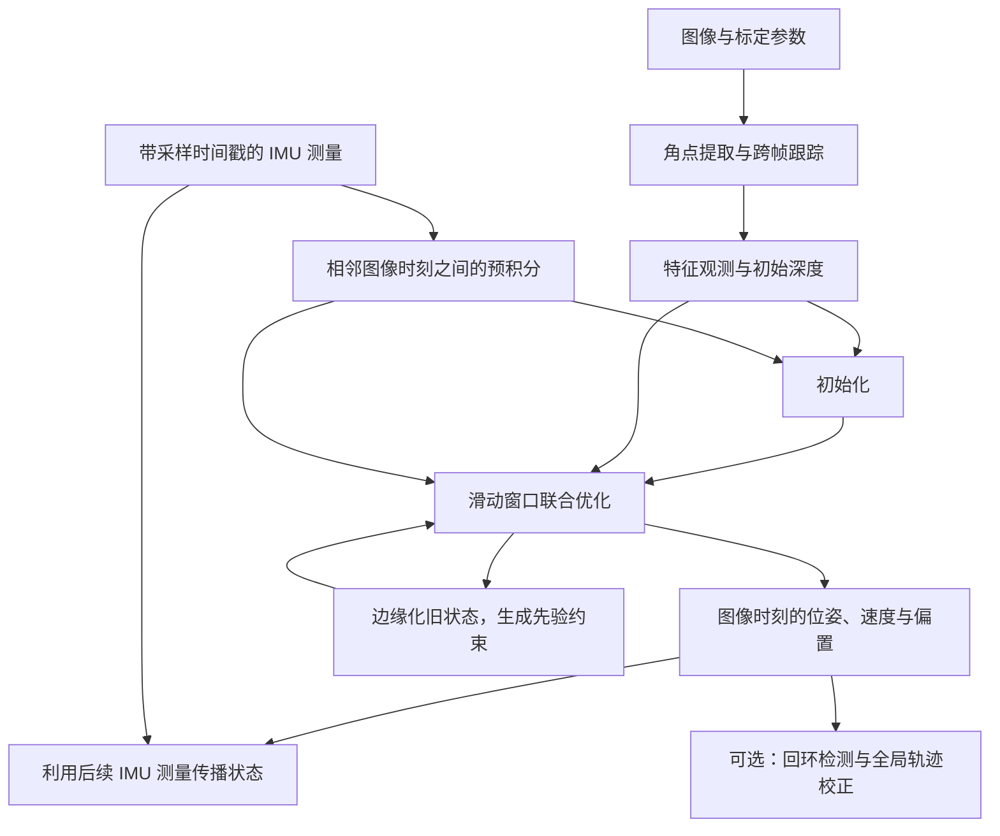

# 39. VINS：视觉惯性里程计的工作原理

视觉惯性里程计融合连续图像与惯性测量，估计相机和 IMU 的位置、姿态及速度。相机记录场景特征在图像中的位置，IMU 测量角速度和比力。估计器利用两类测量之间的约束关系，连续计算传感器的运动状态。本章按数据处理顺序介绍这一过程，并说明它与 R680 现有视觉导航系统的关系。

VINS 是视觉惯性导航系统（Visual-Inertial Navigation System）的英文缩写，VIO 则指视觉惯性里程计（Visual-Inertial Odometry），侧重于连续估计相对运动。本文介绍香港科技大学团队开发的 VINS-Mono 及其后续系统 VINS-Fusion。VINS-Mono 使用单目图像和 IMU 测量；VINS-Fusion 支持单目与 IMU、双目与 IMU，以及不使用 IMU 的纯双目三种输入组合。纯双目模式属于视觉里程计（VO）。[VINS-Mono 论文][s1]、[Fusion 官方说明][s3]

VINS-Fusion 还提供可选的视觉回环与 GPS 融合模块。本章主要介绍局部里程计与回环校正，可在第 40 章的[视觉建图与导航运行过程][textbook]之后阅读。文中的数值均为计算示例；R680 的接入条件与离线评估设计见第 8 节。下文将 VINS-Fusion 简称为 Fusion。

---

## 过程概要

相机连续采集图像，IMU 通常以更高频率采样。使用这些数据前，需要核对测量单位与坐标定义，统一时间基准，并确定相机与 IMU 之间的安装关系（第 1 节）。

图像处理前端提取角点，并在后续图像中跟踪这些特征点。双目模式还在同一采集时刻的左右图像之间建立对应关系，由此获得同一空间点在不同图像中的观测（第 2 节）。

系统对相邻图像时刻之间的 IMU 测量进行预积分，计算相对旋转、速度增量和位置增量，供后续优化使用（第 3 节）。开始运行时，还需要通过初始化确定运动状态、特征深度和重力方向等量的初值。单目与双目采用不同的初始化方法（第 4 节）。

初始化完成后，优化后端在滑动窗口内联合估计运动状态与特征深度，最小化视觉残差和惯性残差。旧状态移出窗口前，通过边缘化保留其对剩余状态的约束（第 5 节）。两次图像更新之间，后续 IMU 测量还可用于传播运动状态（第 6 节）。

启用回环后，系统识别再次经过的地点，并利用回环约束校正累计漂移（第 7 节）。最后，结合 R680 的传感器配置，说明输入要求及 A/B/C 三组离线评估的作用（第 8 节）。

---

## 39.1 输入测量、坐标系与时间同步

### 39.1.1 图像观测与惯性测量

单幅图像记录空间点的像素位置。在相机内参已知的情况下，像素位置可以换算为观测方向，但仍不足以确定点到相机的距离。单目相机发生平移后，可以利用多帧观测恢复场景结构与相机运动；不过，将场景结构和相机平移按同一比例缩放，投影位置保持不变。视觉重建结果与实际长度之间的比例称为尺度。双目利用已标定的相机基线确定尺度；单目与 IMU 的组合则需要利用运动过程中的惯性约束估计尺度。[VINS-Mono，§I、V][s1]

IMU 即惯性测量单元，通常包含三轴陀螺仪和三轴加速度计。陀螺仪测量角速度，单位为 rad/s；加速度计测量比力，单位为 m/s²，表示单位质量所受的非重力作用。车辆静止在水平地面上时，支撑作用对应向上约 9.81 m/s² 的比力，而车辆的平移加速度为零。VINS 接收未经去重力处理的加速度计测量，并在运动模型中单独计入重力。[VINS-Mono，§IV-B][s1]、[官方设备要求][mono-device]

陀螺仪和加速度计的测量均存在偏置。例如，真实角速度为零时，陀螺仪的平均输出仍可能偏离零值。偏置通常随温度和时间缓慢变化，随机噪声则造成采样值的短时波动。由于偏置误差会随积分累积，VINS 将偏置与运动状态一起估计。若投影到某一固定世界方向的加速度误差恒为 0.05 m/s²，忽略其他误差和观测校正，积分 10 s 后会产生约 2.5 m 的位置误差。[预积分论文，§V–VI][s2]

### 39.1.2 坐标系与外参定义

本章以世界坐标系 $w$ 为运动估计的参考，$b$ 表示 IMU 坐标系，$c$ 表示相机光学坐标系。相机光学坐标系通常规定 $x$ 轴向右、$y$ 轴向下、$z$ 轴向前。IMU 的轴向由设备定义；相机、IMU 与底盘之间的相对位置和姿态需要通过测量或标定确定。

记 $R_{wb}$ 为将 IMU 坐标系中的向量变换到世界坐标系的旋转矩阵，$\mathbf p_{wb}$ 为 IMU 原点在世界坐标系中的位置。相机到 IMU 的固定外参记为 $R_{bc}$、$\mathbf t_{bc}$，分别表示相机坐标系到 IMU 坐标系的旋转，以及相机原点在 IMU 坐标系中的位置。空间点的相机坐标 $\mathbf P_c$ 可变换为世界坐标：

$$
\mathbf P_w=R_{wb}(R_{bc}\mathbf P_c+\mathbf t_{bc})+\mathbf p_{wb}.
$$

上式依次完成相机坐标系到 IMU 坐标系、再到世界坐标系的变换。传感器原点与车身参考点通常不重合，车辆转弯时，这些点的运动轨迹也不同。因此，将传感器位姿用于导航时，还需依据安装外参计算车身参考点的位姿，使输出与 `base_footprint` 的实际定义一致。[VINS-Mono，§III、VI][s1]、[Fusion 外参与投影因子][s8]

本章规定世界坐标系的 $z$ 轴向上，重力加速度为 $\mathbf g_w=(0,0,-9.81)^{\mathsf T}$。记加速度计测量为 $\tilde{\mathbf f}$、偏置为 $\mathbf b_a$。忽略随机噪声时，IMU 原点在世界坐标系中的平移加速度为

$$
\mathbf a_w=R_{wb}(\tilde{\mathbf f}-\mathbf b_a)+\mathbf g_w.
$$

若车辆静止、IMU 与世界坐标系的轴向一致且偏置为零，加速度计测量为 $(0,0,9.81)$，加上 $\mathbf g_w$ 后得到零平移加速度。后文沿用这一符号约定。部分论文和代码采用相反方向的重力向量定义，其运动方程相应使用减号，阅读时应结合测量模型核对。[预积分论文，§V][s2]

### 39.1.3 时间同步与外参标定

处理时间戳为 $t_j$ 的图像时，估计器需要使用覆盖相邻图像时刻之间运动过程的 IMU 测量。相机为 20 Hz、IMU 为 200 Hz 时，相邻图像之间约有 10 次 IMU 采样。实际积分区间由时间戳确定，区间边界还需作相应处理。Fusion 在计入相机与 IMU 的时间偏移后，等待 IMU 数据覆盖目标图像时刻，再提取对应区间的测量。[Fusion `processMeasurements`][s4]

相机与 IMU 的时间基准之间可能存在近似固定的偏移，通常记为 $t_d$，正负号取决于接口约定。在线时间标定可以估计这种固定偏移，但无法消除每条串口消息各不相同的随机传输延迟。例如，角速度为 1 rad/s 时，10 ms 的时间误差对应约 0.01 rad 的旋转误差；焦距为 400 像素时，这一误差可使图像中心附近的预测投影偏移约 4 像素。因此，时间戳应尽量反映传感器的实际采样时刻。[Fusion 时间偏移功能][s3]、[投影因子中的时间补偿][s8]

相机与 IMU 的外参可以预先标定并固定，也可以在运动估计过程中在线优化。在线估计要求运动对待估参数提供充分约束。地面车辆主要平移和绕竖直轴转动，对部分外参的约束较弱，外参与惯性偏置也可能难以区分。因此，R680 应优先使用预先标定的固定外参，再评估双目 VIO 的性能。[VINS-Mono 官方外参说明][mono-device]、[Fusion 优化参数设置][s4]

---

## 39.2 特征提取、跟踪与深度估计

### 39.2.1 跟踪已有特征并补充新特征

前端首先提取适于跟踪的角点。沿直线边缘方向移动图像窗口时，窗口内的亮度分布可能变化很小，因此难以确定沿该方向的位移。角点附近的亮度在两个方向上均有明显变化，更容易确定其在相邻图像中的对应位置。光流描述图像中像素位置随时间的变化；VINS 使用稀疏光流方法估计所选特征点的图像位移。

VINS-Mono 采用稀疏 KLT 光流跟踪特征，并在特征数量不足时补充角点。本文引用的 Fusion 版本在 `trackImage` 中使用金字塔 Lucas–Kanade 光流：先在较低分辨率图像上估计位移，再逐层细化，以处理较大的图像位移。启用前后向一致性检查时，前端还会从当前帧的匹配位置反向跟踪到上一帧，检查其与原位置的偏差。前端还会剔除越界点，并限制特征点之间的最小间距。[VINS-Mono，§IV-A][s1]、[Fusion 特征前端][s5]

例如，编号为 37 的特征点在上一帧位于 $(320,210)$，当前帧的对应位置为 $(312,211)$。保留特征编号后，后端即可将这两次观测关联到同一空间点。动态物体、重复纹理、运动模糊和遮挡都可能造成错误关联，后续还需通过几何检验和优化残差剔除外点。VINS-Mono 论文与 Fusion 源码采用的筛选流程有所不同，具体检查项应以实际使用的版本为准。[Fusion 特征前端][s5]、[后端外点剔除][s4]

### 39.2.2 双目匹配与三角化

双目模式完成左图的跨帧跟踪后，还在同一采集时刻的右图中寻找对应点。跨帧跟踪建立同一相机不同时刻的观测关系，用于约束运动；双目匹配建立两台相机同一时刻的观测关系，结合已知基线约束特征深度。两类观测通过特征编号统一关联。[Fusion 特征前端][s5]、[特征管理][s6]

对于经过整流的水平平行针孔双目，同一空间点在左右图像中的列坐标之差称为视差 $d$。已知焦距 $f_x$ 与基线长度 $B$，该点沿左相机光轴方向的深度 $Z$ 为

$$
Z=\frac{f_x B}{d}.
$$

取 $f_x=400$ 像素、$B=0.05$ m、$d=10$ 像素，得到 $Z=2$ m。基线以米为单位，计算结果也具有米制尺度。深度越大，视差越小，相同的视差误差会导致更大的深度误差。Fusion 实际根据相机模型和外参对观测射线进行三角化，上式是整流平行双目条件下的简化表达。[Fusion `triangulate`][s6]

### 39.2.3 特征点的逆深度表示

相机内参用于将像素坐标换算为观测方向。对于已去畸变的针孔图像，已知主点 $(c_x,c_y)$ 与焦距 $f_x,f_y$，归一化坐标为 $x=(u-c_x)/f_x$、$y=(v-c_y)/f_y$。向量 $(x,y,1)$ 表示观测射线的方向，乘以深度 $Z$ 后得到三维坐标。

VINS 以特征首次被观测的相机坐标系为参考，用逆深度 $\lambda=1/Z$ 参数化该特征的三维位置：

$$
\mathbf P_c=\frac{1}{\lambda}(x,y,1)^{\mathsf T}.
$$

取 $(x,y)=(0.2,-0.1)$、$\lambda=0.5\,\mathrm{m}^{-1}$，可得点的坐标为 $(0.4,-0.2,2)$ m。这里的深度是沿相机 $z$ 轴的坐标，而非点到光学中心的欧氏距离。给定参考帧中的观测方向后，后端通过调整一个逆深度参数更新该点的三维位置，并计算它在其他图像中的投影。远处特征的逆深度接近零。三角化为逆深度提供初值，后续优化再利用多帧观测细化估计。[VINS-Mono，§VI-A、C][s1]、[Fusion 逆深度读写][s6]

单目三角化需要相机平移，以形成不同观测位置之间的基线。纯旋转会改变特征的像素位置，但无法提供这一基线。双目相机在同一时刻已有固定基线，静止时也可对有效匹配点进行米制深度估计。这是单目与双目初始化方法不同的原因之一。

---

## 39.3 IMU 积分与预积分

### 39.3.1 由惯性测量计算运动状态

扣除陀螺仪偏置 $\mathbf b_g$ 后，可由角速度积分更新姿态；将去偏置后的比力变换到世界坐标系并计入重力，再积分更新速度和位置。若在短时间段 $\Delta t$ 内近似认为世界坐标系中的加速度 $\mathbf a_w$ 不变，则

$$
\mathbf v_j\approx\mathbf v_i+\mathbf a_w\Delta t,
\qquad
\mathbf p_j\approx\mathbf p_i+\mathbf v_i\Delta t+
\frac12\mathbf a_w\Delta t^2.
$$

例如，车辆以 1 m/s 直行，在随后 0.1 s 内保持 0.5 m/s² 的前向加速度，则速度增加 0.05 m/s，位移约为 $0.1+0.0025=0.1025$ m。对于旋转运动，若绕竖直轴的角速度恒为 0.2 rad/s，同一时长内的转角为 0.02 rad，约为 1.15°。实际积分随 IMU 采样更新姿态，并据此变换加速度测量。Fusion 的预积分采用中点积分方法。[预积分论文，§V][s2]、[Fusion 预积分实现][s7]

### 39.3.2 预积分及其偏置修正

优化过程中，第 $i$ 帧的位置、速度和姿态会反复更新。如果每次更新都重新积分该区间的全部 IMU 测量，计算量将显著增加。预积分在给定偏置估计的条件下，将 $t_i$ 到 $t_j$ 的测量整理为相对于第 $i$ 帧 IMU 坐标系的三个量：相对旋转 $\Delta R_{ij}$、速度增量 $\Delta\mathbf v_{ij}$ 和位置增量 $\Delta\mathbf p_{ij}$。这些量不依赖起始时刻的世界位置、速度和姿态，可在优化迭代中复用。[预积分论文，§VI][s2]

记 $R_i=R_{wb_i}$，区间两端的状态应近似满足

$$
\begin{aligned}
R_j&\approx R_i\Delta R_{ij},\\
\mathbf v_j&\approx\mathbf v_i+\mathbf g_w\Delta t+
R_i\Delta\mathbf v_{ij},\\
\mathbf p_j&\approx\mathbf p_i+\mathbf v_i\Delta t+
\tfrac12\mathbf g_w\Delta t^2+R_i\Delta\mathbf p_{ij}.
\end{aligned}
$$

后端更新起始状态后，可利用上述关系重新计算对区间终点状态的预测，无需再次积分全部测量。预积分的速度与位置增量由比力计算，经过起始旋转矩阵变换到世界坐标系后，再分别计入初始速度和重力的贡献。

预积分结果仍与偏置估计有关。系统保存预积分量对偏置的雅可比矩阵，用于描述偏置小幅变化对预积分结果的一阶影响。偏置更新后，可先进行一阶修正，必要时再重新积分。偏置随时间的变化通常采用随机游走模型描述。联合优化因此能够利用视觉观测更新偏置，并相应修正惯性约束。[预积分论文，§VI-C][s2]、[Fusion `IntegrationBase`][s7]

预积分同时传播测量不确定性。测量噪声和积分时长会影响预积分协方差；丢样与异常时间间隔则需要在输入检查中单独识别，不能仅依靠协方差传播处理。

本文引用的配置示例将 `acc_n/gyr_n` 标注为测量噪声标准差，将 `acc_w/gyr_w` 标注为偏置随机游走噪声标准差。标定工具也可能输出连续时间噪声密度。设置参数时，应核对各量的单位及代码中的离散化方式，按定义换算；ROS 消息协方差、噪声标准差和噪声密度不能直接互换。预积分协方差将在第 5 节用于惯性残差加权。[官方参数示例][s14]、[预积分实现][s7]、[IMU 因子][s9]

---

## 39.4 运动状态与尺度的初始化

### 39.4.1 单目视觉重建与视觉惯性对齐

视觉惯性联合优化是非线性问题，初值偏差过大可能导致收敛失败或错误估计。初始化的作用是为位姿、特征深度、速度和重力方向等未知量提供合理初值，使后续优化能够稳定求解。

VINS-Mono 首先收集一段具有共同特征和足够视差的图像，通过运动恢复结构（Structure from Motion，SfM）估计相机位姿与三维点。此时，视觉重建结果的尺度尚未确定。随后，系统利用视觉与 IMU 估计的相对旋转求解陀螺仪偏置，再将视觉平移与 IMU 预积分关联，求解各帧速度、重力方向及尺度，并结合已知重力模长进一步细化重力方向。完成视觉惯性对齐后，重建结果转换为米制尺度，进入滑动窗口优化。加速度计偏置与重力方向的耦合较强，短时间初始化难以将两者充分区分，偏置仍需在后续优化中估计。[VINS-Mono，§V][s1]

例如，单目重建中的 1 个长度单位可能对应 0.5 m，也可能对应 2 m。只有结合具有足够运动变化的惯性测量，才能确定实际尺度，并区分速度、重力和偏置的影响。长时间静止、纯旋转或加速度变化不足时，增加图像数量也未必能够补充所缺少的约束。对于地面车辆，应结合运动类型、外参和 IMU 质量分析初始化条件，不能仅依据平面运动作出可用性判断。

### 39.4.2 双目条件下的初始化

双目相机利用同步图像对进行三角化，可获得具有米制尺度的三维点。利用这些三维点及其在后续图像中的二维对应位置，可以求解相机位姿，这类问题称为 PnP（Perspective-n-Point）。本文引用的 Fusion 版本在双目与 IMU 模式下逐帧进行 PnP 求解和三角化；窗口收集到规定数量的图像帧后，估计陀螺仪偏置，按更新后的偏置重新计算预积分，再进入联合优化。初始 IMU 姿态还利用一段加速度计测量的平均方向进行重力对齐，因此启动时的运动加速度与偏置会影响初始姿态。[Fusion `initFirstIMUPose`、`processImage`][s4]

纯双目模式同样采用 PnP、三角化和视觉优化，但不包含 IMU 预积分及惯性偏置状态。双目初始化已有基线提供的尺度，不必采用单目模式的惯性尺度恢复过程。对 R680，可先用双目 VO 验证图像同步、相机标定和特征跟踪，再加入 IMU 评估惯性约束的作用。双目 VIO 对时间同步、惯性偏置和相机—IMU 外参仍有要求。

### 39.4.3 世界坐标系与不可观测自由度

没有 GPS、已知地图或其他外部参考时，将轨迹与重建的场景整体平移，或绕重力方向整体旋转，不会改变图像与 IMU 的测量关系。因此，在一般非退化运动条件下，常规 VIO 仍有四个全局不可观测自由度：$x,y,z$ 三个平移，以及绕重力方向的航向角 yaw。系统需要选定世界坐标系的原点与初始航向，输出的是该参考系下的运动。重力提供横滚和俯仰的参考，惯性约束或双目基线提供尺度；绝对地理位置与正北方向仍需外部参考。[VINS-Mono，§VII–VIII][s1]

纯双目 VO 具有米制尺度，但没有重力参考。对轨迹与场景同时施加任意三维平移和三维旋转，图像观测保持不变，因而对应六个全局不可观测自由度。这一区别也体现在第 7 节介绍的回环图优化中。

---

## 39.5 滑动窗口中的视觉惯性联合优化

### 39.5.1 状态变量与特征参数

初始化完成后，系统在有限数量的图像时刻上联合估计状态，这组随时间更新的状态及相关观测构成滑动窗口。每个图像时刻的 IMU 状态包括位置、姿态、速度、加速度计偏置和陀螺仪偏置；特征点则以逆深度参数表示。开启在线标定时，相机—IMU 外参和时间偏移也可作为待估参数。[VINS-Mono，§VI-A][s1]、[Fusion `optimization`][s4]

例如，窗口若保留 11 个连续图像时刻，相邻时刻间隔为 0.05 s，则覆盖约 0.5 s 的运动。新观测可以同时修正当前状态、此前若干时刻的状态和特征深度。实际窗口的时间跨度还取决于帧率和关键帧选择；局部窗口中的状态与回环模块长期保存的关键帧分别管理。

### 39.5.2 视觉重投影残差

根据当前状态估计，可以由参考帧的观测方向和逆深度恢复三维点，再通过相机—IMU 外参及两时刻的位姿，将该点变换到当前相机坐标系。记投影函数为 $\pi$，当前图像中的特征观测为 $\mathbf z_{lj}$，该点在当前相机坐标系中的估计坐标为 $\mathbf P_{c_j}$，视觉残差可写为

$$
\mathbf r_{V,lj}=\pi(\mathbf P_{c_j})-\mathbf z_{lj}.
$$

下标 $l$ 表示特征编号，$j$ 表示观测帧。残差为预测投影与实际观测之差。两者必须在同一种坐标表示下比较；实现中可采用归一化平面或单位球切平面上的误差，具体数值并不都以像素为单位。双目模式增加右相机观测，利用同一时刻的左右观测与跨时刻观测共同约束深度和位姿。若外参也参与估计，这些观测还会约束相应外参。[VINS-Mono，§VI-C][s1]、[Fusion 投影因子][s8]

例如，实际观测位于 $(312,211)$，当前估计的投影位于 $(315,210)$，则以像素坐标表示的残差为 $(3,-1)$。求解器可通过调整位姿或特征深度减小该残差。由于同一状态通常关联多个视觉观测和惯性约束，优化必须同时考虑这些残差，而不能只针对单个点求解。

### 39.5.3 IMU 预积分残差与紧耦合

IMU 预积分残差衡量区间两端状态所对应的运动变化与预积分结果之间的差异。以速度残差为例：

$$
\mathbf r_{I,v}=R_i^{\mathsf T}
(\mathbf v_j-\mathbf v_i-\mathbf g_w\Delta t)
-\Delta\mathbf v_{ij}.
$$

括号内从世界坐标系中的速度变化扣除重力贡献，再经 $R_i^{\mathsf T}$ 变换到第 $i$ 帧 IMU 坐标系，与预积分速度增量比较。位置、旋转及偏置变化也分别构成残差；完整计算还包括预积分的偏置修正。这些残差共同约束两个时刻的位置、姿态、速度和偏置。[预积分论文，§VII][s2]、[Fusion IMU 因子][s9]

在测量层面联合使用图像特征观测与惯性测量来估计状态，称为紧耦合。在 VINS 中，视觉残差与预积分残差约束同一组状态变量：视觉观测可以影响惯性偏置的估计，偏置更新又改变预积分约束；惯性测量则帮助区分图像变化中的旋转与平移成分。若先独立计算视觉位姿，再将位姿结果交给外部滤波器融合，耦合发生在估计结果层面。紧耦合描述的是测量的融合层次，与采用滤波还是优化并非同一分类；直接处理图像特征的滤波器也可以实现紧耦合。[VINS-Mono，§II、VI][s1]

### 39.5.4 联合目标函数与迭代求解

记待估状态与特征参数的集合为 $\mathcal X$，此前边缘化得到的先验残差为 $\mathbf r_P$。联合优化目标可概括为

$$
\min_{\mathcal X}
\left\{
\|\mathbf r_P\|_{\Sigma_P}^{2}
+\sum_{(i,j)}\|\mathbf r_{I,ij}\|_{\Sigma_{I,ij}}^{2}
+\sum_{(l,j)}\rho\!\left(
\|\mathbf r_{V,lj}\|_{\Sigma_{V,lj}}^{2}\right)
\right\}.
$$

其中，$\|\mathbf r\|_\Sigma^2=\mathbf r^{\mathsf T}\Sigma^{-1}\mathbf r$，$\Sigma$ 为对应残差的协方差。协方差加权用于统一不同量纲的残差，并反映测量不确定性对权重的影响。$\rho$ 为鲁棒损失函数；Fusion 对视觉残差采用 Huber 损失，减小较大残差的相对影响，降低少量外点对估计的干扰。鲁棒损失无法消除系统性的错误关联，在大量特征来自动态物体等情况下仍可能得到错误结果。[VINS-Mono，式 22][s1]、[Fusion `optimization`][s4]

求解器在当前估计附近线性化残差，计算状态增量并更新估计，通过迭代降低联合目标函数值。由于测量包含噪声，通常无法使所有残差同时为零。纯双目模式去掉 IMU 残差及惯性相关状态，仅保留滑动窗口中的视觉优化。

### 39.5.5 通过边缘化保留历史约束

若保留全部历史状态参与优化，变量数量和计算开销会随运行时间增长。滑动窗口通过移除部分状态控制问题规模。移除前，系统将相关观测对保留变量的约束转化为先验，这一过程称为边缘化。这样可以保留部分历史信息，避免直接删除状态及其全部约束。[VINS-Mono，§VI-D][s1]

以 A、B、C 三个时刻为例，需要移除 A 时，可以先在当前估计附近线性化相关残差，再从线性方程中消去 A 对应的变量，将其对 B、C 的影响保留为近似约束。这一消元过程使用舒尔补（Schur complement）。

若 $m$ 表示待移除变量，$r$ 表示保留变量，$H$ 为残差线性化后法方程中的信息矩阵，相应分块记为 $H_{mm},H_{mr},H_{rm},H_{rr}$，则先验对应的信息矩阵为

$$
H_{\mathrm{prior}}=H_{rr}-H_{rm}H_{mm}^{-1}H_{mr}.
$$

法方程右端向量也需作相应消元，实际实现还会处理接近零的特征值。边缘化得到的先验保留了旧状态对剩余变量的部分约束，但它依赖当时的线性化点。后续优化无法利用该先验重新线性化已经移除的全部原始观测。[Fusion 边缘化实现][s10]

VINS 根据视差和跟踪情况选择窗口更新方式。需要保留新的关键帧时，边缘化最早状态；否则可移除靠近窗口末端的非关键帧状态，并合并相邻 IMU 区间。不同分支对相关约束的保留方式有所区别。回环模块则另行保存长期关键帧，不受局部窗口长度限制。[VINS-Mono，§IV-A、VI-D][s1]、[Fusion `slideWindow`][s4]

---

## 39.6 状态输出与视觉跟踪有效性

每次图像优化完成后，估计器得到相应时刻的位置、姿态、速度和偏置估计。按时间排列的位姿构成运动轨迹，系统还可发布里程计、特征点和相机位姿等信息。接入导航前，需要确认发布接口包含哪些状态，以及位姿所描述的传感器坐标系、位姿参考系和速度的表达坐标系。官方独立节点的线速度采用世界坐标系，接入要求机体系速度的接口时需要作相应变换。[Fusion 输出实现][s12]

由于 IMU 采样频率通常高于图像频率，官方独立估计器还提供高频状态预测：以最近一次优化结果为初始状态，利用后续 IMU 测量进行状态传播。下一次图像优化完成后，传播过程从修正后的状态重新计算。高频传播提高了输出的时间分辨率，但图像更新之间仍没有新增的视觉约束。[VINS-Mono，§VI-F][s1]、[Fusion `inputIMU`、`fastPredictIMU`][s4]

相机被遮挡后，IMU 测量与预测输出仍可能持续，但纯惯性传播的误差会随时间累积。判断视觉跟踪是否有效，需要检查当前图像是否完成处理、图像时间戳是否持续更新、当前有效特征及内点数量，以及系统是否处于初始化或重置状态。惯性预测持续发布，或滑动窗口仍保留历史特征，都不能证明当前图像提供了有效的视觉约束。[VINS-Mono，§VI-E、F][s1]、[本项目视觉健康处理][project]

本项目的 B/C 组通过 RTAB-Map 封装调用 Fusion，记录图像时刻的里程计和视觉跟踪状态。这一输出接口与官方独立节点的高频预测接口不同。评估输出能否供导航与控制使用，还需核查输入时序、坐标变换、协方差和实际发布频率。[本项目封装与输出说明][project]

---

## 39.7 回环检测与全局轨迹校正

局部滑动窗口的计算规模有限，长时间运行仍会产生累计漂移。回环检测通过识别再次经过的地点，为当前轨迹与历史轨迹建立约束。VINS 保存关键帧的特征描述，将当前图像与历史关键帧比较，检索回环候选，再利用特征对应和几何求解进行验证。外观相似的场景可能位于不同地点，因此仅凭图像相似性不足以确认回环。[VINS-Mono，§VII][s1]、[Fusion `detectLoop`][s11]、[`findConnection`][s13]

回环通过验证后，其相对位姿作为约束加入位姿图。图中的节点表示关键帧位姿，边表示局部运动约束或回环约束。例如，车辆沿闭合路线返回起点时，局部里程计的终点位置与起点相差 0.3 m。有效的回环约束提供返回位置与历史位置之间的相对关系，图优化据此联合调整相关关键帧位姿，减小轨迹的不一致。

完成重力对齐后，VINS-Mono 的位姿图优化修正三维位置与航向角，共 4 个自由度，横滚和俯仰由重力参考约束。本文引用的 Fusion 版本根据 `use_imu` 选择图优化方式：VIO 使用 4 自由度优化，纯 VO 使用 6 自由度优化，同时调整三维位置与三维旋转。[VINS-Mono，§VIII][s1]、[Fusion `setIMUFlag`][s11]

全局图优化会修正历史位姿，并更新局部坐标系到全局坐标系的变换；用于控制的局部里程计则通常要求连续。在 ROS 中，`odom` 用于表达局部连续运动，`map` 用于表达经过地图定位或回环校正的全局位姿。系统集成时需要明确各段 TF 的发布者。回环能够约束相对于历史轨迹的漂移，但绝对地理位置和正北方向仍需外部参考。[Fusion 漂移变换更新][s11]、[本项目 TF 分工][project]

VINS 的稀疏特征与位姿图主要服务于运动估计和轨迹校正。导航所需的障碍物表示、可通行区域和路径规划，需要由其他模块提供。R680 因此仍需保留现有深度障碍物处理、占用栅格建图、地图定位与路径规划模块。Fusion 官方系统的回环模块可选，本项目 B/C 组离线实验仅评估里程计。[Fusion 官方运行说明][s3]、[视觉导航运行章][textbook]

---

## 39.8 R680 的接入条件与验证方法

### 39.8.1 现有融合方式与 A/B/C 对照实验

R680 当前的 RGB-D 输入由投射器关闭时采集的左红外图像，以及相邻时刻投射器开启时生成的深度图像配对组成。轮速里程计可为视觉匹配提供运动预测；外部 EKF 再融合视觉里程计输出的速度、轮速和陀螺仪测量，生成导航使用的 `/odom`。引入 VINS 后，主要变化发生在里程计内部：图像特征构成视觉残差，完整 IMU 测量构成预积分残差，两类残差在同一窗口内联合约束状态。[视觉导航运行章，§1–2][textbook]

本项目的离线评估工具提供三组配置：A 重现当前 RGB-D 视觉里程计、轮速与 EKF 方案；B 使用 Fusion 纯双目 VO；C 使用相同双目输入并加入完整 IMU 测量。A/B 比较两套视觉里程计与融合配置的总体表现，B/C 用于分析惯性约束的增益。三组应回放同一原始录包，并通过多次采集与重复实验评价稳定性。有独立真值时可计算轨迹误差；缺少真值时，应报告闭合路线的端点误差、重复性等指标。[离线评估设计记录][project]

### 39.8.2 双目同步与投射器状态筛选

R680 当前默认关闭右红外图像输出，录制双目数据时需显式启用 `record_stereo:=true`。B/C 组要求左右红外图像来自同一采集时刻，输入检查采用原始整数纳秒时间戳严格配对。现有 RGB-D 配对针对相邻帧的红外图像与深度图像，不能直接用于构造同步双目输入。[本项目采集与同步约束][project]

红外投射器产生的散斑不固定于场景，随相机运动会改变其在物体表面的位置，因此可能干扰静态场景特征的跟踪。当前实验仅使用判定为投射器关闭时采集的左右图像对。若红外原始帧率为 30 Hz，投射器逐帧交替开关，则关闭帧的名义频率约为 15 Hz；实际可用频率还受丢帧、同步与筛选影响。VINS-Mono 官方建议图像频率高于 20 Hz、IMU 频率高于 100 Hz。当前名义图像频率低于这一建议，Fusion 的跟踪能力与实时性能仍需实测。[官方设备建议][mono-device]、[本项目帧筛选][project]

图像元数据缺少投射器状态时，工具可根据红外散斑特征和深度有效像素比例进行启发式分类。实验记录应注明状态判定方法及筛选后的有效帧率，不能将间接分类结果作为硬件状态或硬件同步的证据。投射器状态误判会影响静态特征跟踪，左右图像不同步则会使双目几何关系与实际运动不一致。[本项目采集说明][project]

### 39.8.3 IMU 时间质量、封装限制与外参校验

当前底盘参考驱动在主机接收串口数据后调用 `now()` 设置时间戳，尚不能据此确定传感器的实际采样时刻。C 组因此拒绝时间戳来源为 `host_receive` 的输入；声明为 `sensor` 时，需有传感器采样时钟的证据。输入还须包含三轴加速度计原始测量和三轴角速度测量，频率严格高于 100 Hz，并通过静止数据、采样间隔和 TF 检查。这些条件是本项目的保守准入标准，不是 Fusion 的通用硬件规范，也不能代替时间同步与传感器标定。[本项目 C 组准入][project]

本项目所用 RTAB-Map 版本仅将当前图像时刻附近的 IMU 数据送入 Fusion，非零时间偏移可能使估计器还需等待更晚的 IMU 测量。现有封装对这一调度需求的支持不完整，因此实验固定 `td=0, estimate_td=0`，并要求输入时间同步已经得到验证。若标定发现非零时差，应先修正输入时间基准，或修改并验证数据调度机制，再进行实验。Fusion 本身支持在线时间偏移估计，此处限制来自所用封装。[本项目封装限制][project]、[Fusion 时间标定能力][s3]

配置与 TF 中的外参应一致。`body_T_cam0/1` 表示左右整流相机光学坐标系到 IMU 坐标系的变换，方向与第 1.2 节的 $R_{bc},\mathbf t_{bc}$ 一致。由于当前 RTAB-Map 后端会根据 TF 设置相机—IMU 外参，需要同时核验标定结果、配置矩阵和实际 TF，并确认其对应整流后的光学坐标系。D435i 示例参数和 CAD 名义位姿不能替代本车标定。[本项目外参检查][project]

目前，项目已在本地编写离线评估工具及输入检查，但尚未在 R680 上完成 ROS 编译、实物标定和定位性能验证。相关设计保存在[文献库的英文技术记录][project]中；本章介绍评估原理与输入条件，不代表试验工具已公开发布或通过实车验证。

### 39.8.4 轮测量的进一步融合

地面车辆的轮编码器可提供额外的运动测量。本资料库收录的 [VIWO 论文][viwo]将轮测量引入视觉惯性估计：在初始化阶段联合约束尺度与惯性状态，在传播和优化阶段使用惯性—车轮约束，并利用近似平面运动条件。轮测量由此直接参与估计器内部的状态求解，其作用位置与 VIO 输出后再通过外部 EKF 融合轮速不同。[VIWO，§III–IV][viwo]

轮测量可以在视觉约束不足时补充运动信息，但其有效性取决于编码器尺度、安装外参、底盘运动模型和接地条件。车轮打滑会使轮速偏离车身实际运动，近似平面约束也只适用于相应路面条件。其他机器人或公开数据集上的实验结果仅可作为参考。对 R680，应先分析 A/B/C 三组的输入质量与误差，再决定是否将轮约束加入初始化或滑动窗口优化。

若 VIO 已使用底盘 IMU，其输出与原始陀螺仪测量具有相关性。外部 EKF 若将两者作为独立观测再次融合，可能重复利用惯性信息，并低估输出不确定性。正式接入前，应重新设计融合输入，核对速度的表达坐标系、IMU 到车身参考点的位姿变换与输出协方差，并明确导航里程计及各段 TF 的唯一发布者。[本项目后续集成说明][project]

---

## 参考资料与源码阅读顺序

| 资料或源码 | 建议阅读内容 |
| --- | --- |
| [Qin、Li、Shen：VINS-Mono][s1]，IEEE TRO，2018；DOI `10.1109/TRO.2018.2853729` | §IV 测量预处理，§V 初始化，§VI 滑窗与边缘化，§VII–VIII 重定位与四自由度图优化。 |
| [Forster 等：On-Manifold Preintegration for Real-Time Visual-Inertial Odometry][s2]；DOI `10.1109/TRO.2016.2597321` | 阅读旋转预积分、不确定性传播与偏置修正的推导，核对其中的坐标和重力约定。 |
| [VINS-Fusion 官方 README][s3] | 支持的传感器组合、在线标定能力与可选回环模块。 |
| [`feature_tracker.cpp`][s5] → [`feature_manager.cpp`][s6] | 光流跟踪、双目匹配、三角化、PnP 与逆深度管理。 |
| [`estimator.cpp`][s4] → [`integration_base.h`][s7]、[IMU 因子][s9]、[投影因子][s8] | 初始化分支与 `optimization`，以及预积分、惯性残差和视觉残差的计算。 |
| [`marginalization_factor.cpp`][s10] → [`pose_graph.cpp`][s11]、[`keyframe.cpp`][s13] | 局部窗口边缘化、回环验证，以及 4/6 自由度位姿图优化。 |
| [文献库 VINS 英文技术记录][project]、[现有视觉导航运行章][textbook]、[VIWO 原文][viwo] | R680 的输入条件与封装限制、现有 EKF 配置，以及轮测量参与视觉惯性估计的方法。 |

本章引用的 Fusion 源码统一对应提交 `be55a937a57436548ddfb1bd324bc1e9a9e828e0`。R680 实验所用的 ROS 2 移植版本、RTAB-Map 版本与补丁由项目文档另行记录。资料核对日期：2026-10-24。

[s1]: https://arxiv.org/abs/1708.03852
[s2]: https://arxiv.org/abs/1512.02363
[s3]: https://github.com/HKUST-Aerial-Robotics/VINS-Fusion/blob/be55a937a57436548ddfb1bd324bc1e9a9e828e0/README.md
[s4]: https://github.com/HKUST-Aerial-Robotics/VINS-Fusion/blob/be55a937a57436548ddfb1bd324bc1e9a9e828e0/vins_estimator/src/estimator/estimator.cpp
[s5]: https://github.com/HKUST-Aerial-Robotics/VINS-Fusion/blob/be55a937a57436548ddfb1bd324bc1e9a9e828e0/vins_estimator/src/featureTracker/feature_tracker.cpp
[s6]: https://github.com/HKUST-Aerial-Robotics/VINS-Fusion/blob/be55a937a57436548ddfb1bd324bc1e9a9e828e0/vins_estimator/src/estimator/feature_manager.cpp
[s7]: https://github.com/HKUST-Aerial-Robotics/VINS-Fusion/blob/be55a937a57436548ddfb1bd324bc1e9a9e828e0/vins_estimator/src/factor/integration_base.h
[s8]: https://github.com/HKUST-Aerial-Robotics/VINS-Fusion/blob/be55a937a57436548ddfb1bd324bc1e9a9e828e0/vins_estimator/src/factor/projectionTwoFrameTwoCamFactor.cpp
[s9]: https://github.com/HKUST-Aerial-Robotics/VINS-Fusion/blob/be55a937a57436548ddfb1bd324bc1e9a9e828e0/vins_estimator/src/factor/imu_factor.h
[s10]: https://github.com/HKUST-Aerial-Robotics/VINS-Fusion/blob/be55a937a57436548ddfb1bd324bc1e9a9e828e0/vins_estimator/src/factor/marginalization_factor.cpp
[s11]: https://github.com/HKUST-Aerial-Robotics/VINS-Fusion/blob/be55a937a57436548ddfb1bd324bc1e9a9e828e0/loop_fusion/src/pose_graph.cpp
[s12]: https://github.com/HKUST-Aerial-Robotics/VINS-Fusion/blob/be55a937a57436548ddfb1bd324bc1e9a9e828e0/vins_estimator/src/utility/visualization.cpp
[s13]: https://github.com/HKUST-Aerial-Robotics/VINS-Fusion/blob/be55a937a57436548ddfb1bd324bc1e9a9e828e0/loop_fusion/src/keyframe.cpp
[s14]: https://github.com/HKUST-Aerial-Robotics/VINS-Fusion/blob/be55a937a57436548ddfb1bd324bc1e9a9e828e0/config/euroc/euroc_stereo_imu_config.yaml
[mono-device]: https://github.com/HKUST-Aerial-Robotics/VINS-Mono#5-run-with-your-device
[project]: https://github.com/EnosElinsa/wheeltec-smart-car-literature/blob/99302be/04-analysis/vins-principles.md
[textbook]: 40-visual-runtime.md
[viwo]: https://doi.org/10.1109/LRA.2024.3386448

## 章节导航

[上一章：视觉跟随、巡线、KCF、AR 标签与网页视频](38-vision-applications.md) · [返回本篇](index.md) · [下一章：视觉建图与导航的运行过程](40-visual-runtime.md)
