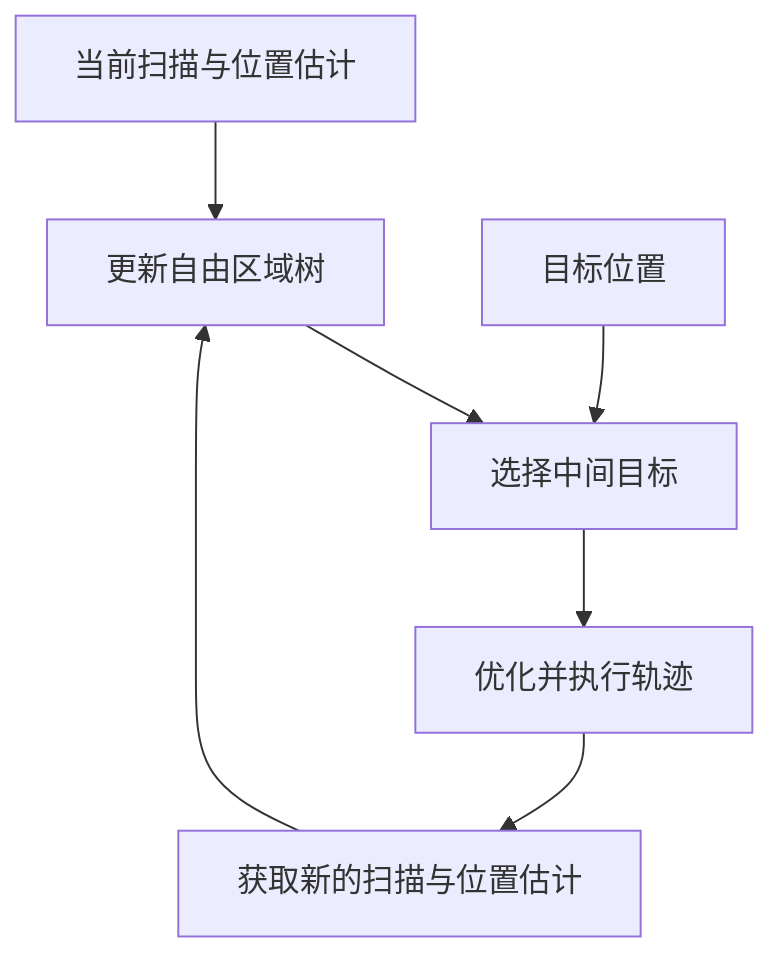

# 第 33 章补充说明：坐标计算与相关方法

[第 33 章](../33-relocalization-map-dependence.md)先用三类导航方法说明地图的作用，再围绕重定位比较全局地图、关键帧、沿线局部地图、场景模型和外部定位。本页补充位姿与坐标计算、其他相关定位方法、在线导航的详细流程，以及 AMCL 的实现核对项。参考编号与正文一致，重定位证据见[论文证据表](relocalization-evidence.csv)和[核查说明](relocalization-reference-audit.md)，在线导航证据见[补充核查](online-navigation-reference-audit.md)。

## 位姿与坐标计算

地图位姿可以由参考位姿与相对位姿组合得到。导航系统随后用地图位姿计算全局修正，使连续局部运动重新关联到原地图。两次计算使用的参考不同，下面分别说明。

### 从参考位姿得到当前位姿 {#pose-composition}

设原地图坐标系为 $M$，参考关键帧坐标系为 $K$，机器人机体坐标系为 $B$。记 ${}^{A}T_B$ 为将 $B$ 中坐标转换到 $A$ 中坐标的变换，其中包括旋转与平移。在三维情况下，其形式为：

$$
{}^{A}T_B=
\begin{bmatrix}
{}^{A}R_B & {}^{A}\mathbf p_B\\
\mathbf 0^{\mathsf T} & 1
\end{bmatrix}.
$$

旋转矩阵 ${}^{A}R_B$ 将轴向转换到 $A$，平移向量 ${}^{A}\mathbf p_B$ 给出 $B$ 原点在 $A$ 中的位置。例如，在平面示意中，关键帧位于地图的 $(10,4)$，朝向地图正 $y$ 方向，其三维表示可写为：

$$
{}^{M}R_K=
\begin{bmatrix}
0&-1&0\\
1&0&0\\
0&0&1
\end{bmatrix},
\qquad
{}^{M}\mathbf p_K=
\begin{bmatrix}10\\4\\0\end{bmatrix}\mathrm{m}.
$$

若机器人位于关键帧正前方 $2\,\mathrm{m}$，朝向相同，取关键帧的 $x$ 轴为前向，则相对旋转与平移为：

$$
{}^{K}R_B=
\begin{bmatrix}
1&0&0\\
0&1&0\\
0&0&1
\end{bmatrix},
\qquad
{}^{K}\mathbf p_B=
\begin{bmatrix}2\\0\\0\end{bmatrix}\mathrm{m}.
$$

把相对位姿与关键帧地图位姿组合，即可得到：

$$
{}^{M}T_B={}^M T_K\,{}^K T_B,
\qquad
{}^{M}\mathbf p_B={}^M R_K\,{}^K\mathbf p_B+{}^M\mathbf p_K
=\begin{bmatrix}10\\6\\0\end{bmatrix}\mathrm{m}.
$$

组合过程先把相对位移换成地图轴向，再加上关键帧的位置。BEVPlace++ 在平面位姿求解后使用的就是这种组合关系。[P19] 例中数值只用于说明坐标计算。

### 用地图位姿恢复导航坐标 {#map-odom-recovery}

局部里程计坐标系记为 $O$。里程计提供机器人位姿 ${}^{O}T_B(t)$，重定位提供地图位姿 ${}^{M}T_B(t)$。在同一时刻计算：

$$
{}^{M}T_O(t)={}^{M}T_B(t)\left({}^{O}T_B(t)\right)^{-1}.
$$

该结果给出 `map → odom` 修正。后续里程计仍持续更新 `odom → base_link`，两段关系组合后即可得到新的地图位姿。REP-105 要求 `odom` 中的位姿连续，允许 `map` 中的位姿因全局修正而发生跳变。[S03]

参与计算的两项机器人位姿必须对应同一时刻。求解较慢时，先用结果时间戳处的里程计位姿计算修正，再由后续里程计得到当前地图位姿。若求解器输出相机或雷达位姿，应先通过固定安装外参转换为机体位姿，再进行组合。

里程计进程重新启动时，还需检查 $O$ 是否已经改变。旧修正不能直接沿用到新的里程计原点，系统需要重新建立与地图的关系。若多个定位模块并行运行，应明确哪个模块负责发布全局修正。

## 其他相关方法的作用与边界 {#related-methods}

正文说明了利用环境信息重定位的主要做法。下表进一步说明怎样检索地点、计算位姿，以及组织地图数据，便于按具体环节继续阅读。

| 研究 | 补充哪项问题 | 做法与适用边界 |
|---|---|---|
| UniLGL [P03] | 检索之后如何恢复三维位姿 | 先从数据库中检索与当前点云对应的地点，再计算三维位姿。数据库中的点云仍需记录其地图坐标。 |
| LiteFT-PR [P10] | 传感器质量变化时如何改进候选检索 | 结合激光与相机特征、估计观测质量，并通过模型蒸馏训练较小的网络。PR、Recall@1、F1-max 衡量检索结果是否准确，完整定位还需检查计算得到的位姿。 |
| CMRNext [P05] | 相机怎样使用 LiDAR 地图 | 根据初始位姿把地图投影为深度图，与当前图像匹配后计算位姿。投影需要相机内参和初始位姿，位置完全未知时需先用其他方法找到候选地点。 |
| OneShot [P18] | 单次扫描怎样用于地图定位 | 保存历史扫描片段的描述子与中心位置，检索相似片段，再根据片段之间的几何关系计算三维位姿。单次查询仍需使用已保存的环境数据，论文定位率也不能直接视为本车任务恢复率。 |
| 三维地图表示比较 [P06] | 地图存储形式能否替换 | 比较点云、网格和神经辐射场怎样生成供当前图像匹配的地图图像。生成图像时已知的相机位姿和深度，用于确定匹配点在地图中的位置。 |
| 对象级语义关系 [P08] | 物体变化时怎样比较场景 | 用物体及其关系构成场景图，寻找相似场景。评价时检查检索地点与实际位姿之间的误差，不能据此判断算法是否另外计算了当前图像的完整位姿。 |
| OMCL [P09] | 语言信息能帮助哪一环节 | 在分层划分空间的八叉树地图中保存视觉语言特征，用自然语言提示缩小最初放置粒子的范围。后续仍需利用里程计和新观测更新位置，里程计位移与地图距离的比例也需一致。 |
| 历史观测地图框架 [P16] | 同一批观测能否服务不同任务 | 先保存带位姿和时间戳的观测，再生成定位或避障所需的地图。可以按需读取这些数据，但仍需实现候选地点搜索与位姿计算。 |
| LiDAR Teach, Radar Repeat [P17] | 固定路线能否减少全区域建图 | 沿路线行驶时用激光记录各个地点，之后自主重复行驶时，用雷达观测匹配已记录地点。定位范围受已记录路线限制，使用另一张导航地图时，还需确定两套地图坐标之间的关系。 |

上述方法可以用于同一系统的不同环节。例如，地点识别算法先给出候选地点，位姿计算模块再求出位置和朝向，最后检查是否接受结果。评价整套系统时，应分别记录各环节失败的原因，避免把某个模块的检索准确率直接当作恢复导航的成功率。

## 在线建图与无显式地图方法的流程 {#online-navigation-methods}

正文第 33.3 节比较了在线建图与无显式地图方法的地图需求，以及它们与重定位的关系。本节进一步说明局部观测怎样形成地图、自由区域树怎样生成轨迹、在线学习怎样表示环境，再说明怎样根据当前观测计算控制指令、利用学习模型生成轨迹，以及历史信息的作用。论文证据与实验条件见[在线导航核查说明](online-navigation-reference-audit.md)。

### 用局部观测记录障碍与可通行区域

没有预建地图时，机器人仍可以建立坐标系，用同一原点和坐标轴表示机器人位姿与目标位置。坐标系只规定怎样描述位置，并不要求已经知道全部障碍。前往给定目标时，规划器必须能够根据当前位置和目标位置，计算两者之间的距离与方向。

里程计根据轮速、图像、激光或惯性测量估计相对运动。机器人利用运动估计，将不同时刻的观测放到同一坐标系中，逐步记录障碍、可通行区域及其连接。记录可以是只覆盖附近的栅格，也可以是随探索扩展的区域树。将当前点云整理成记录地面高度的局部高程图，再据此优化下一段路径，也属于在线建图。

环境模型可以随机器人移动而更新，无须始终保留全部历史。保留较多已探索区域及其连接，有助于判断哪些方向已经尝试过、遇到死路后应退回哪里，但也会增加存储和更新开销。里程计误差逐渐累积时，不同时刻的观测可能无法准确放到一起，因此在线建图仍需要可靠的运动估计。

### 从自由区域树到可执行轨迹

FRTree 用实时点云寻找附近可以继续前进的方向，沿各方向提取一组相互重叠的自由区域。自由区域描述当前观测中没有障碍的空间，区域之间的重叠为连续通行提供候选连接。规划器将方向和区域组织成树，新增观测到达时继续扩展。[P20]（§III-A）

选择分支时，FRTree 同时考虑到达候选区域的距离，以及从候选区域到目标的估计距离，选出本次规划先要到达的中间目标。轨迹优化器再检查机器人能否按自身运动限制依次通过这些自由区域，同时确认机体能够通过，生成交给控制器执行的轨迹。选择中间目标时，算法明确需要机器人当前位置与目标位置。[P20]（§III-B–C）

机器人前进后获取新的观测，规划器更新树并重新选择中间目标。尚未观测到的空间是否真正可通行，需要后续感知确认。某条分支不能继续时，算法利用已访问区域和死路记录，沿树回退到仍有其他可行分支的节点，再继续搜索。[P20]（§III-A–B）

自由区域树记录可以通行的区域及其连接，规划器结合当前位置与目标位置选择前进方向。下图将环境感知、地图更新与运动执行连接起来。

FRTree 无须预建环境地图，但仍在运行中记录可通行区域及其连接。路径会随观测逐步形成，机器人可能需要回退。论文使用 Go1 四足机器人进行实验，尚不能据此判断 WHEELTEC 轮式底盘能否使用同一方法，还需检查车体尺寸和运动限制。

### 在运行中学习供规划使用的环境模型

环境模型还可以用函数表示。Active NTFields 根据里程计与激光或深度观测，将障碍信息整理成训练样本，在运行中学习从一个位置到另一个位置需要的时间。规划时，算法用模型估计到达目标所需的时间，并沿估计时间逐渐减小的方向生成路径。[P22]（§IV-D–E）

探索过程还维护占用地图，用于区分已观察与未观察区域，从边界选择接下来要观察的位置，再利用学习模型生成前往该处的路径。[P22]（§IV-E）模型参数、在线样本和探索地图共同保存了环境信息，采用神经网络并不意味着省去了地图。

在线建图省去了事先采集完整地图的工作，运行时则需要同时完成感知、模型更新与规划。机器人能否到达目标，取决于感知范围、模型误差、探索方法和定位质量。某组未知环境实验成功，不能据此推断任意环境都能成功，也不能证明重启后可以恢复原地图中的位姿。

### 根据当前扫描修正控制指令

LiDAR 在线控制屏障函数方法先计算朝向目标的控制指令，再根据当前扫描中的障碍边界，计算为避开障碍需要满足的条件。控制屏障函数将这些条件写成对控制指令的数学约束，求解器据此修正原指令，将结果交给机器人执行。新的扫描到达后，算法重新计算约束，不持续累积环境地图。[P21]（§III–IV）

这种方法减少了地图更新和存储工作，计算控制指令时仍需知道当前位置与目标的关系。该研究的 TurtleBot3 实验由外部光学定位系统 Vicon 提供位置，因此实验验证的避障能力，不能说明机器人能够自行确定未知的初始位置，或在定位丢失后重新定位。[P21]（§V-A）

避障要求还需要在机器人实际能够执行的控制范围内满足。论文指出，如果同时限制控制指令的取值范围，求解器可能找不到满足全部条件的指令。观测数据持续更新时，论文的安全结论也依赖相应假设。[P21]（§IV-B）附近避障是否安全、能否最终到达远处目标，需要分别验证。

### 从观测生成轨迹

学习方法可以将最近的传感器观测编码后，直接输出候选轨迹。MTG 根据激光观测和运动信息生成可通行方向上的轨迹，DTG 进一步将目标作为输入，用扩散模型生成朝向目标的轨迹。[P14]、[P15] 轨迹生成后，完整系统还要选择可执行运动，并由局部规划与控制完成跟随。

DTG 的输入包括连续激光观测、速度与目标信息，训练时则利用可通行地图和规划结果生成轨迹，作为模型的学习目标。论文的实机系统还使用局部规划器，将生成的轨迹用于实际运动，并处理小型和动态障碍。[P15]（§III、§IV）因此，判断轨迹生成器不依赖显式地图后，还需检查系统中其他模块是否使用地图。

训练时使用地图，与运行时依赖工作区域的地图，作用不同。通用模型可以在其他区域学习后用于新环境，不要求预先采集实际工作区域的地图。如果必须先用工作区域的图像和坐标训练模型，就仍依赖该区域事先采集的环境信息，例如正文第 33.2 节根据图像预测位姿的模型。比较模型时，应同时说明训练数据来自哪里，以及运行时实际读取什么。

### 省去地图后仍需哪些信息

无显式地图的方法也可以保留最近观测、速度状态或网络内部记忆。判断是否建图，要看系统是否建立了记录各处环境信息、供定位或规划使用的模型，不能仅凭是否保存历史数据判断。[P23]、[P24] 如果外部系统已经提供目标相对于机器人的方向，控制器也可以据此前进，无须自己估计全局位姿。

没有环境模型时，机器人难以查找远处路线，也难以判断哪些通路已经探索过。遇到遮挡、布局重复或死路时，系统可能需要额外的搜索方法和历史记录。若因此增加区域树、局部地图或相互连接的地点记录，就需要重新判断整套方法属于哪一类，并检查新增记录是否改善了到达目标的能力、增加了多少更新和存储开销。

## AMCL 的实现核对项 {#amcl-implementation}

正文讨论的 AMCL 能力对应 Nav2 Humble 的固定提交，具体来源见[AMCL 源码][S01]与[默认参数][S02]。实际部署可能使用不同版本和配置，需要核对本车软件。

| 核对项 | 固定版本中的行为 | 对恢复过程的影响 |
|---|---|---|
| `reinitialize_global_localization` | 通过 `globalLocalizationCallback` 重新生成粒子 | 可以在地图范围内重新搜索位姿，何时判定定位丢失、何时调用仍需设计 |
| `uniformPoseGenerator` | 在地图自由空间采样位置，并采样方向 | 初始搜索依赖可用地图与粒子覆盖 |
| `recovery_alpha_fast`、`recovery_alpha_slow` | 声明默认值均为零 | 不能仅凭使用 AMCL 就假定自主恢复参数已启用 |
| RViz 的 `2D Pose Estimate` | 由人给出大致位置、朝向及其不确定范围 | 验证的是已知大致位置时能否得到正确定位，还需另外测试位置完全未知的情况 |
| 局部代价地图 | 默认使用 `odom` 与滚动窗口 | 只维护周边障碍，仍需定位和全局路径连接原地图目标 |

重新生成粒子后，系统还需检查定位结果是否逐渐集中到正确位置，并在恢复导航前处理错误候选与超时。确认软件提供了重新搜索的接口之后，还需验证整套恢复流程是否完成。

[P03]: ../33-relocalization-map-dependence.md#p03
[P05]: ../33-relocalization-map-dependence.md#p05
[P06]: ../33-relocalization-map-dependence.md#p06
[P08]: ../33-relocalization-map-dependence.md#p08
[P09]: ../33-relocalization-map-dependence.md#p09
[P10]: ../33-relocalization-map-dependence.md#p10
[P14]: ../33-relocalization-map-dependence.md#p14
[P15]: ../33-relocalization-map-dependence.md#p15
[P16]: ../33-relocalization-map-dependence.md#p16
[P17]: ../33-relocalization-map-dependence.md#p17
[P18]: ../33-relocalization-map-dependence.md#p18
[P19]: ../33-relocalization-map-dependence.md#p19
[P20]: ../33-relocalization-map-dependence.md#p20
[P21]: ../33-relocalization-map-dependence.md#p21
[P22]: ../33-relocalization-map-dependence.md#p22
[P23]: ../33-relocalization-map-dependence.md#p23
[P24]: ../33-relocalization-map-dependence.md#p24
[S01]: ../33-relocalization-map-dependence.md#s01
[S02]: ../33-relocalization-map-dependence.md#s02
[S03]: ../33-relocalization-map-dependence.md#s03
