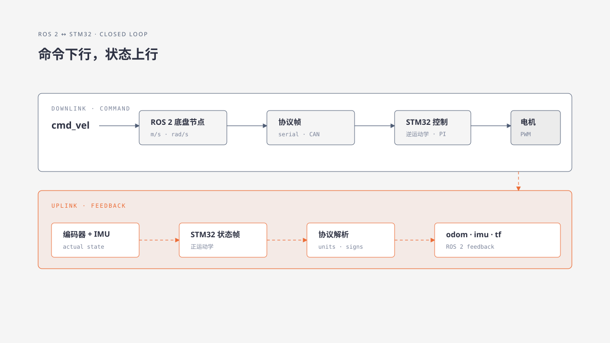

# 49. ROS 2 与 STM32 联调

ROS 2 节点和控制板分别检查通过后，还要验证它们连接起来的结果。一条速度命令在下行过程中经历消息读取、单位换算、报文编码与固件解析；反馈又沿相反方向回到里程计和 IMU 话题。任一接口解释不一致，都可能表现为动作或数据异常。

本章沿完整往返链路设置检查点，把 `cmd_vel`、串口字节、控制板目标值、电机执行和 ROS 2 反馈对应起来。联调时一次检查一个接口，先验证零速和停止，再逐步加入低速运动，从而区分节点配置、协议转换、物理通信与固件执行的问题。

## 49.1 学习目标

沿 `cmd_vel` 到电机、编码器/IMU 回到 ROS 2 的链路，记录各检查点的数据、单位与方向，找出首次出现不一致的位置。

## 49.2 适用范围

使用 `turn_on_wheeltec_robot` 与串口底盘协议的 ROS 2 机器人。CAN 驱动可沿用同样的边界检查。

## 49.3 操作前检查

- STM32 固件已通过架空验收并可回滚。
- 串口设备别名和权限稳定。
- ROS 2 底盘节点源码与固件协议版本匹配。

## 49.4 工作原理



图中的每个箭头都是一个可单独检查的接口。常见错误包括设备端口选错、协议版本不一致、毫米每秒与米每秒漏换、角速度缩放倍数错误，以及字节序或坐标符号相反。

## 49.5 ROS—串口—固件链 {#ros-serial-firmware-chain}

### 从 `cmd_vel` 追到 STM32，再回到 ROS 2

底盘节点通常订阅 `geometry_msgs/msg/Twist` 类型的 `cmd_vel`，把线速度和角速度编码为串口下行帧。这里的帧是一段按协议排列的连续字节，通常包含帧头、数据字段、校验值和帧尾。STM32 返回编码器、IMU 和电压等数据后，节点解析并发布里程计、原始 IMU 和供电电压。可以按下列链路定位：

```text
/cmd_vel
  → wheeltec_robot_node 订阅回调
  → 速度缩放、车型运动学与协议封包
  → /dev/wheeltec_controller
  → STM32
  → 串口上行帧
  → 校验、单位换算和状态更新
  → /odom、/imu/data_raw、/PowerVoltage
  → EKF、TF 与上层导航
```

阅读源码后，启动节点并核对消息类型、发布者、订阅者和消息内容：

```bash
ros2 node info <底盘节点名>
ros2 topic info /cmd_vel --verbose
ros2 topic echo /odom --once
ros2 topic echo /imu/data_raw --once
ros2 topic echo /PowerVoltage --once
ros2 run tf2_ros tf2_echo odom_combined base_footprint
```

将 `/odom` 的 `header.frame_id`、`child_frame_id` 与节点参数比较；将 IMU 的 `header.frame_id` 与 TF 树比较；同时记录 `ros2 topic hz` 的频率。命名空间会给一组接口增加名称前缀，重映射（Remapping）则在启动时把原接口名替换为另一个名称。因此，实际话题名应以 `ros2 node info` 的运行结果为准。

继续检查节点打开串口的日志或设备句柄，核对端口与波特率。在电机失能或车轮架空时发送零速命令，观察下行串口帧，再检查 STM32 返回帧是否被节点接收并转换为里程计、IMU 和电压话题。

代码入口见第 25 章的[底盘启动链示例](../05-ros2-development/25-launch-and-parameters.md#bringup-launch-chain)。

## 49.6 验收标准

- 设备别名在重插后稳定。
- ROS 速度和协议整数的缩放可手算复核。
- OLED、轮速、里程计和 IMU 符号一致。
- 停止、节点退出和通信断开都能让底盘安全停机。
- 记录中包含 ROS 包版本、固件版本和抓帧记录。

## 49.7 故障排查

| 现象 | 边界 |
|---|---|
| `cmd_vel` 有值但无下行帧 | ROS 节点订阅、端口或 Control 函数 |
| 下行正确但 OLED 不变 | 线缆、波特率、帧校验或固件协议 |
| 电机动作正确但 odom 错 | 上行解析、编码器方向、正运动学或单位 |
| IMU 方向错 | 板载轴定义、固件重映射或 ROS frame_id |
| 断开主控后继续运动 | 通信超时和失能逻辑缺失，停止测试 |

## 章节导航

[上一章：修改、编译、烧录与回滚固件](48-build-flash-rollback.md) · [返回本篇](index.md) · [下一章：仿真与 Gazebo](../08-advanced-applications/50-gazebo-simulation.md)
