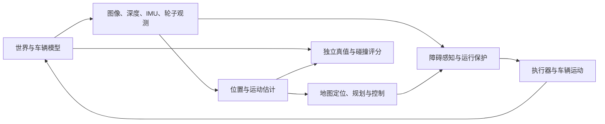

# 50. 仿真与 Gazebo

机器人仿真是在计算机中建立机器人、传感器和环境的模型，让算法根据虚拟观测控制机器人运动。对于视觉导航，仿真既能提供相机看到的图像，也能计算车辆执行指令后的运动和碰撞，因此可以研究“看到了什么、估计在哪里、准备怎样走、实际走到了哪里”之间的关系。本章以 Gazebo Simulation Platform（Gazebo）为例介绍这一过程。

本章面向初次接触机器人仿真的读者。第 50.1～50.3 节介绍仿真的用途、代表平台及选择依据，第 50.4～50.6 节解释本项目采用的 Gazebo 及其适用范围。随后，[第 50.8 节](vision-simulation-lab.md)说明视觉导航实验怎样设计，[第 50.9 节](vision-simulation-results.md)报告结果与局限；需要实际复跑时，再查阅[第 50.10 节](vision-simulation-reproducibility.md)的复现附录。

## 50.1 仿真在机器人研究中解决什么问题

### 50.1.1 从观测回放到闭环运动

研究定位算法时，可以先给算法播放一段预先采集的图像和惯性数据。所有方法看到相同的输入，再与参考轨迹比较，便于判断误差来自算法、参数还是输入条件。这类实验称为数据集回放。即使算法估计出错误位置，后续图像仍由原始记录决定。

导航需要进一步研究控制行为。算法估计位置后，规划器选择路径，控制器发出指令；指令改变车辆的位置，也改变下一时刻的相机图像。这个不断反馈的过程称为闭环。只有允许控制指令影响后续观测的仿真，才能直接检查车辆能否绕开障碍、到达目标，以及传感器失效后是否停车。

| 验证方式 | 输入与运动怎样产生 | 适合回答的问题 | 主要限制 |
| --- | --- | --- | --- |
| 真实数据集回放 | 使用已采集的固定观测和参考轨迹 | 定位是否准确、是否丢失、能否按原速处理 | 无法改变车辆在数据中的运动 |
| 闭环仿真 | 模型执行指令，生成下一时刻的运动与观测 | 定位、规划、避障和保护能否共同工作 | 结果受模型、场景与传感器近似影响 |
| 实车实验 | 真实车辆在真实环境中运动 | 标定、制动、计算负载及实际任务能力 | 重复条件较难控制，试验成本较高 |

本项目据此采用“真实数据回放 → 闭环仿真 → 实车验收”的验证路径。前两步可以尽早发现问题、缩小实车调试范围，但每一步都保留自己的评价对象，不能互相替代。

### 50.1.2 为什么需要可控场景与独立真值

仿真允许固定环境、初始位置和随机种子，再有计划地改变一个条件，例如暂停相机输入或在车前放入障碍。这有助于区分算法本身的表现与偶然的场景变化。随机种子控制噪声、纹理等随机过程；相同种子有利于复跑，但计算调度仍可能使重复结果略有差异。

仿真器还知道车辆在虚拟世界中的实际位置，可将其作为评分真值。真值必须与估计器的输入分开：若直接把世界位置提供给定位算法，再以同一位置评分，就没有真正验证定位能力。对于导航，软件报告“目标成功”和车辆实际到达也应分别检查。

## 50.2 有哪些仿真平台，分别适合什么任务

机器人研究包含导航、操作、运动控制、具身智能和自动驾驶等方向，平台需要提供的能力并不相同。因此，“学术界最常用哪个平台”需要先限定研究任务。下表根据各平台的官方定位归纳代表用途，供选型参考；它不表示使用量排名，也不构成性能测试。[S1]～[S8]

| 平台 | 主要能力与代表用途 | 对本项目的适合程度与选择条件 |
| --- | --- | --- |
| Gazebo | 刚体运动、碰撞、虚拟传感器与 ROS 系统集成；适合移动机器人建图、导航和故障实验 | 能围绕现有 ROS 2 导航系统建立闭环，符合本轮需求；仍需构建车辆与视觉场景 |
| Webots | 集成机器人模型、传感器和控制示例；面向移动机器人研究与教学 | 适合从模型和控制实验入门；复用既有 ROS 软件时，需核对对应版本的接口与模型 |
| NVIDIA Isaac Sim / Isaac Lab | Isaac Sim 提供物理与视觉仿真、合成数据等能力；Isaac Lab 面向强化学习、示范学习等机器人学习流程 | 适合后续需要复杂视觉场景或学习训练的研究；需评估 GPU、资产和版本要求，两者承担的任务也不同 |
| MuJoCo | 关节系统、接触动力学、控制与学习实验 | 适合重点研究动力学或控制策略；本车的视觉场景、导航系统和传感器接口仍需另行组织 |
| Habitat-Sim / Habitat-Lab | 三维室内场景、具身导航任务及其训练和评测 | 适合研究室内视觉、语义或指令导航；具体任务的运动模型未必对应本车的 Ackermann 底盘 |
| CARLA | 道路、交通参与者、天气和车辆传感器；面向自动驾驶研究 | 适合道路驾驶问题；当前室内小车的短程导航不需要完整交通环境 |

例如，比较室内视觉导航策略时，场景数据集、任务定义和评价协议可能比底盘细节更重要，Habitat 系列值得考虑；研究轮式车辆在 ROS 中的定位、避障与停车时，Gazebo 的系统集成能力更直接；研究接触控制或大量学习试验时，则应重点比较 MuJoCo、Isaac Lab 等平台。平台的能力可以重叠，最终选择取决于需要验证的假设。

EuRoC、TUM RGB-D、KITTI 等属于数据集，不属于可接受控制指令的闭环仿真平台。RViz 用于显示机器人状态、地图与观测，本身也不计算车辆运动。区分这些工具的作用，可以避免把“看到机器人模型”误认为“完成导航仿真”。

## 50.3 怎样为视觉导航选择平台

### 50.3.1 先确定研究问题，再确定模型精度

选型首先取决于实验结论需要什么证据。若要比较定位精度，应优先考虑标定可靠、时间关系明确、参考轨迹可用的固定数据；若要验证障碍停车，应要求平台能够执行控制指令、计算碰撞，并在故障发生后继续记录实际运动；若要评估学习方法，还需考虑任务规模、训练效率和训练场景与测试场景的划分。

随后判断模型要精确到什么程度。验证导航软件能否形成闭环，可以从简化车体开始；研究转弯半径、窄通道通过性或制动距离，则需要更可信的几何、转向、摩擦和执行器模型。视觉里程计还依赖纹理、光照、相机成像和采样时序，仅有精确车体并不足够。

| 选择维度 | 需要明确的问题 | 对实验解释的影响 |
| --- | --- | --- |
| 任务与接口 | 能否接入待测估计器、规划器和控制器？ | 决定测试的是原有系统还是重新实现的替代系统 |
| 运动与碰撞 | 底盘自由度、轮胎接触和执行器是否适合研究对象？ | 决定转向、停车与碰撞结果能推广到什么范围 |
| 传感器与环境 | 能否表达纹理、深度、噪声、延迟和遮挡？ | 决定视觉与避障实验的难度及真实性 |
| 真值与实验控制 | 能否固定起点、注入故障、记录真值并保留失败？ | 决定对照是否公平、结论能否追溯 |
| 计算资源与维护 | 目标硬件能否运行，版本能否长期复现？ | 决定实时性和后续维护成本 |

### 50.3.2 本项目为什么采用 Gazebo

本项目已有 RGB-D、轮速与 IMU 融合、RTAB-Map 建图定位、Nav2 导航以及最终速度保护。首轮目标是验证这些组件能否共同控制一辆简化车辆，并在输入中断时安全停止。Gazebo 能提供运动、碰撞、相机、深度和 IMU，同时保留现有 ROS 2 系统的主要结构，因此被选为闭环实验平台。

VINS 的定位能力另用 EuRoC 真实数据检验。这一安排让“理想化模型中的系统功能”与“真实传感器数据上的估计质量”分别接受检查。当前任务不涉及训练导航策略；VINS 的状态优化也不等同于强化学习训练，因此本轮没有为训练吞吐量引入另一套平台。

## 50.4 Gazebo 怎样形成机器人闭环 {#simulation-basics}

### 50.4.1 世界、机器人与传感器

Gazebo 在世界（World）中计算机器人和环境的状态。世界包含地面、墙体、物体、照明及物理设置；机器人模型包含车体、车轮、关节、质量、惯量和碰撞形状。物理计算根据关节驱动、重力与接触作用更新运动，渲染系统再根据相机位置和场景外观生成图像。[S9]

视觉外观和碰撞几何承担不同作用。墙上的纹理影响图像中能否找到特征，却不改变墙体是否挡住车辆；碰撞模型决定物体能否接触，画面上的精细装饰则未必参与碰撞计算。实验应分别说明两者，不能只凭截图判断模型是否真实。

虚拟相机生成图像，深度传感器输出可见表面的距离，IMU 根据模型运动生成惯性观测。插件（Plugin）扩展传感器、执行器和仿真系统的能力，ROS 接口让外部算法读取观测并发送控制命令。不同版本的插件与接口可能变化，复现实验时需要固定版本。[S1]、[S2]

### 50.4.2 估计、决策与执行各自负责什么

图中，VINS 属于位置与运动估计环节。它根据双目图像，或双目图像与 IMU，估计车辆怎样运动；RTAB-Map 将局部运动与地图联系起来；Nav2 再根据目标与障碍生成行驶指令。最终保护限制或停止指令，执行器才改变车辆运动。因而，“VINS 接管”在本项目中主要指替换定位输入，并不表示 VINS 自己完成规划、避障和制动。

### 50.4.3 仿真时间与真实等待时间

仿真时间描述虚拟世界经历了多久，墙钟时间描述计算机实际运行了多久。两者之比称为实时因子：等于 1 表示虚拟一秒约用真实一秒完成，小于 1 表示计算跟不上预定速度。比较处理能力时必须说明这一比例，否则慢速仿真可能掩盖积压。

暂停仿真时，虚拟时间可以停止，但现实中的等待仍在继续。保护机制因此需要独立于仿真时间判断输入中断。恢复后，也要检查车辆是否等待新的任务，避免暂停前的目标或指令突然继续执行。

## 50.5 本项目的平台与运行方式

本轮沿用实车软件的 ROS 2 Humble 基线，使用 Ubuntu 22.04 与 Gazebo Fortress；它是一组为既有系统复现而固定的实验配置。Gazebo 官方配套表同时列出其他 ROS 发行版的推荐组合，例如 Jazzy 与 Harmonic。新项目或迁移项目应重新核对配套关系和支持周期，不能将本轮版本直接当作普遍适用的最新方案。[S1]、[S2]

Windows 本机负责阅读、编辑与结果分析，具有独立显卡的 Ubuntu 远程机负责图像渲染、仿真和批量运行。远程机的宿主系统与固定实验环境分开，便于保留原有软件，同时复跑相同配置。实验可以在没有图形窗口的情况下生成图像；能否打开窗口与传感器是否真正输出数据是两件事。

这种分工利用了服务器的计算资源，也带来一个解释边界：服务器上能按时处理，不代表车载计算机同样能够处理。最终仍需在目标设备上测量观测延迟、控制周期、温度和内存趋势。硬件与软件身份集中保存在复现附录，正文只讨论影响实验结论的条件。

## 50.6 仿真结果怎样用于实车决策

仿真与实车之间存在差异，通常称为仿真到现实差距。模型可以近似轮胎和相机，却不会自动复现 USB 传输中断、曝光变化、运动模糊、结构振动、轮胎形变、串口阻塞或电池压降。理想同步的图像和 IMU，也可能比真实采样条件更容易处理。

因此，结果必须带着条件解读。在高纹理房间完成导航，说明系统在该房间和模型下能够工作；它没有同时验证白墙、玻璃、强反光、复杂人流或狭窄通道。一次故障后收到零速指令，只证明软件作出了响应；车辆还会受到惯性、执行器和通信状态影响，实际停车要根据运动记录判断。

本轮采用逐层验收：定位比较同时报告误差和覆盖率；导航同时检查任务状态、独立真值终点与碰撞；故障实验同时检查输入状态、指令响应与实际运动。只有相应证据齐备，才能批准该层结论。进入实车前，还需完成相机与 IMU 标定、采样同步、目标计算平台实时性和失联制动验收。

## 50.7 阅读路径与参考资料

### 50.7.1 本章后续内容

| 阅读内容 | 主要问题 |
| --- | --- |
| [50.8 视觉导航实验设计与评价方法](vision-simulation-lab.md) | 比较哪些方案，场景怎样设置，指标怎样计算？ |
| [50.9 视觉导航实验结果与分析](vision-simulation-results.md) | 哪些证据支持通过，哪些问题仍未解决？ |
| [50.10 实验复现与证据附录](vision-simulation-reproducibility.md) | 怎样复跑，版本、原始记录与修订依据在哪里？ |

视觉惯性估计的算法基础见[第 39 章](../06-sensors-navigation/39-vins-principles.md)，实车操作见[第 41 章](../06-sensors-navigation/41-visual-operation.md)。

### 50.7.2 平台参考资料

以下为平台官方文档或维护仓库，访问日期为 2026-11-12。表中的用途比较据此归纳，没有对平台开展统一性能排名。

- [S1] Gazebo：[ROS 配套关系](https://gazebosim.org/docs/latest/ros_installation/)。
- [S2] Gazebo：[发行版与支持周期](https://gazebosim.org/docs/latest/releases/)。
- [S3] Cyberbotics：[Webots 平台介绍](https://github.com/cyberbotics/webots/blob/master/docs/guide/introduction-to-webots.md)。
- [S4] NVIDIA：[Isaac Sim 文档](https://docs.isaacsim.omniverse.nvidia.com/latest/index.html)。
- [S5] Isaac Lab：[机器人学习框架介绍](https://isaac-sim.github.io/IsaacLab/main/index.html)。
- [S6] MuJoCo：[平台概述](https://mujoco.readthedocs.io/en/stable/overview.html)。
- [S7] Habitat：[Habitat-Sim 与 Habitat-Lab 的分工](https://github.com/facebookresearch/habitat-sim)。
- [S8] CARLA：[自动驾驶仿真平台介绍](https://carla.org/)。
- [S9] Gazebo：[机器人模型构建教程](https://gazebosim.org/docs/fortress/building_robot/)。

[上一章：ROS 2 与 STM32 联调](../07-stm32-firmware/49-ros2-stm32-integration.md) · [返回本篇](index.md) · [继续：50.8 实验设计](vision-simulation-lab.md) · [下一章：多机编队与控制界面](51-multi-robot-and-qt.md)
