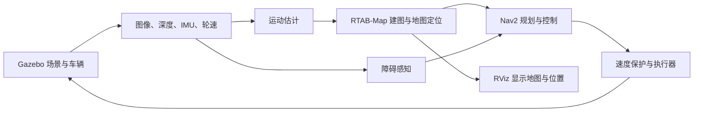

# 50. 仿真与 Gazebo

一辆小车要从房间的一处驶向另一处，需要先了解周围环境，知道自己在哪里，再选择路线并控制车轮。机器人仿真把这个过程搬进计算机：建立房间和车辆模型，生成相机、深度和惯性观测，让原有导航程序控制虚拟车辆。本章采用 Gazebo Simulation Platform（Gazebo）介绍这一过程。

本章介绍实验方式、平台选择以及从建图到导航的基本过程。随后，第 [51 章](51-vision-simulation-lab.md)给出实验设计，第 [52 章](52-vision-simulation-results.md)展示轨迹与结果，第 [53 章](53-vision-simulation-reproducibility.md)提供操作步骤和原始记录。

## 50.1 数据回放、闭环仿真与实车实验

假设小车要从房间入口出发，绕过桌子，到达另一侧的目标位置。验证这项任务，既要检查建图和定位是否准确，也要观察车辆能否沿规划路线行驶、避开障碍并到达目标。机器人导航研究通常采用数据回放、闭环仿真和实车实验，分别检查算法处理数据的结果，以及虚拟车辆和真实车辆的行驶表现。

### 50.1.1 数据回放：用已有记录检查算法

数据回放把已经采集的图像、深度、激光或 IMU 数据，按原来的时间顺序重新输入算法。数据可以由本车录制，也可以来自公开数据集。算法接收记录后重新计算输出：定位算法估计轨迹，建图算法生成地图，障碍检测算法识别桌腿等物体。同一份记录可以反复使用，便于比较不同方法和参数。

例如，回放一段沿桌子左侧行驶的记录，可以检查轨迹估计是否准确、墙面是否被正确拼入地图，也可以查看规划器给出的绕行路径。回放时，车辆的行驶过程已经记录下来；即使规划器给出桌子右侧的路线，下一帧图像仍来自原来左侧的行驶过程。因此，检查车辆执行新路线后的表现，需要让算法实际控制虚拟车或真车。

### 50.1.2 闭环仿真：让算法控制虚拟车完成任务

闭环仿真在计算机中建立房间、小车和传感器模型，由仿真器根据周围环境和车辆运动生成图像、深度与 IMU 等观测。建图时，让虚拟车行驶并观察环境，逐步建立和保存地图；导航时，加载地图，确定车辆的起点位置，再设置目标，由规划器和控制器引导车辆行驶。

例如，规划器选择从桌子右侧绕行，控制器就发出转向指令，虚拟车随之转弯，相机也会看到右侧的新画面。算法根据新画面更新位置和障碍信息，再决定下一步动作。这种“观测—决策—运动—新观测”的反馈过程称为闭环。实验可以据此检查整段路线是否走通、车辆是否碰撞、到点误差多大，以及输入中断后能否及时停车。

### 50.1.3 实车实验：在真实场地检查行驶表现

实车实验将建图、定位、规划和控制程序接入真实车辆，使用车载相机、IMU 和轮速观测，在实际场地中建立地图并完成导航。车辆执行指令后，传感器测量新的环境和运动，同样形成闭环。

除任务完成情况外，实车实验还要测量实际转向、车轮打滑、制动和停车距离，检查通信延迟、定位重复性，以及车载计算机能否及时处理数据。这些结果用于调整车辆模型、控制参数和运行配置。

### 50.1.4 本项目怎样结合三种方式

本项目回放 EuRoC 飞行器数据集中的真实双目图像与 IMU 测量，检查 VINS 的运动估计；在 Gazebo 中，让虚拟小车先建立并保存房间地图，随后加载地图确定位置，再驶向指定目标，比较 RGB-D 基线、双目 VO 和双目 VIO 接入系统后的表现。两类实验分别运行，通过估计器的检查与修正衔接，具体设置见第 [51 章](51-vision-simulation-lab.md)。后续实车测试将进一步检查真实场地中的导航与停车表现。

## 50.2 常见仿真平台与选择依据

移动机器人建图与 ROS 导航常采用 Gazebo 或 Webots；具身视觉导航研究常使用 Habitat；机器人学习与控制研究常采用 Isaac Lab 或 MuJoCo；道路自动驾驶研究则常使用 CARLA。它们各自提供的场景、传感器、动力学和任务工具，适合不同的实验。[S1]～[S8]

| 平台 | 主要用途与特点 | 适合怎样的研究 |
| --- | --- | --- |
| Gazebo | 车辆与关节运动、碰撞、虚拟传感器，便于连接 ROS | 复用 ROS 建图导航系统，研究轮式车辆控制与避障 |
| Webots | 集成机器人、传感器与控制示例，建模和教学流程集中 | 机器人教学、移动机器人算法与控制实验 |
| NVIDIA Isaac Sim / Isaac Lab | Isaac Sim 提供视觉与物理仿真；Isaac Lab 在其上组织学习训练 | 复杂视觉场景、合成数据、强化学习与机器人操作 |
| MuJoCo | 关节动力学、接触与控制，适合大量重复计算 | 运动控制、接触操作、学习控制策略 |
| Habitat-Sim / Habitat-Lab | 三维室内场景、具身任务与训练评测工具 | 视觉、语义和语言指令导航 |
| CARLA | 道路、交通参与者、天气与车辆传感器 | 自动驾驶感知、规划与交通交互 |

选择平台时，先看要研究什么，再看现有软件与计算条件。例如，本车已经使用 ROS 2、RTAB-Map 和 Nav2，采用 Gazebo 可以保留这些算法，只把真实车辆和传感器换成虚拟模型。若研究目标转为室内语义指令导航，场景数据与任务定义会更加重要，Habitat 就值得优先考虑。

模型精度也随任务而变化。验证建图导航的完整过程，可以先使用简化车体；研究窄通道、最小转弯半径或制动距离时，需要进一步核准车体尺寸、转向、摩擦和执行器响应。视觉算法则需要合适的纹理、光照与成像条件。

## 50.3 Gazebo 中有哪些东西 {#simulation-basics}

### 50.3.1 场景、车辆与传感器

Gazebo 的世界（World）包含地面、墙体、物体、光照和物理设置。车辆模型描述车体、车轮、转向关节、质量与碰撞形状。仿真器根据驱动、重力和接触作用计算车辆运动，再从相机所在位置渲染图像。[S9]

虚拟深度相机测量可见表面的距离，IMU 提供角速度和加速度，车轮观测用于推算车辆运动。插件（Plugin）为仿真器提供传感器、执行器及 ROS 接口等功能。墙上的纹理为视觉特征匹配提供线索，墙体的碰撞形状则决定车辆能否通过。三维运行画面见第 [51.1 节](51-vision-simulation-lab.md#scene-demo)。

### 50.3.2 Gazebo、RViz 与导航算法怎样分工

Gazebo 负责虚拟世界和运动；RViz 负责显示地图、轨迹、传感器观测与目标；建图和导航由接入的 ROS 算法完成。它们的关系如下：

VINS 位于运动估计环节，根据双目图像，或双目图像与 IMU，估计车辆怎样移动。RTAB-Map 将这些运动与环境观测组织成地图，并在已有地图中确定当前位置。Nav2 根据当前位置、目标和障碍选择路线，生成速度指令，最后由执行器驱动车辆。

## 50.4 从建图到导航的完整过程

### 50.4.1 观察环境，建立并保存地图

开始建图时，小车还没有房间的地图。操作员遥控它缓慢行驶，或给定安全的行驶动作，让相机从不同位置观察周围环境。运动估计提供车辆移动了多少，深度图提供墙面和物体相对相机的距离；RTAB-Map 把不同时刻的观测放进同一坐标系，逐步形成地图。

RTAB-Map 选取有代表性的图像作为关键帧，保存它们之间的位置关系。再次看到熟悉区域时，可以通过图像匹配修正累计位置误差，这称为回环检测。建图结束后，数据库保存关键帧、环境观测和位姿关系，供后续定位使用。

导航使用的二维占用栅格将地面划成小方格，标记可通行、障碍和未知区域。Nav2 在栅格上寻找路线，并用当前深度观测更新附近障碍物。车辆观察的区域越多，地图覆盖范围就越大。

### 50.4.2 加载地图，确定当前位置

导航阶段加载保存的数据库。RTAB-Map 将当前图像与地图关键帧匹配，结合运动估计求出小车在地图中的位置和朝向，这称为地图定位。重新找到曾经到过的位置，也称为重定位。

定位建立后，小车才知道自己相对地图中的墙、路口和目标位于哪里。地图坐标的原点由建图过程确定；它与仿真世界坐标之间的关系，需要在评价实际行驶结果时对齐。

### 50.4.3 设置目标，规划并控制行驶

导航目标包含地图中的位置和到达朝向，可以在 RViz 上点击并拖出箭头，也可以由任务程序发送。Nav2 根据当前位置和目标规划通路，随后根据车辆运动与附近障碍持续调整速度和转向。

车辆在行驶中不断重新定位、更新障碍并修正控制，直到进入预设的到达范围。规划路径表示准备怎么走，实际轨迹记录已经怎么走；将起点、目标和实际终点画在同一张图上，可以直接观察任务完成情况。

## 50.5 本项目的实验安排

本项目采用 ROS 2 Humble、Ubuntu 22.04 与 Gazebo Fortress，复用已有的 RTAB-Map 和 Nav2。Windows 本机负责教材编辑和结果分析，Ubuntu 远程机负责仿真、三维渲染与批量实验。不同 ROS 版本有各自的 Gazebo 推荐组合，搭建环境时可查官方配套表。[S1]、[S2]

实验分为两部分：在 Gazebo 房间中比较 RGB-D 基线、双目 VO 和双目 VIO 的建图导航过程；使用 EuRoC 真实飞行记录比较 VO 与 VIO 的运动估计。EuRoC 属于数据回放，用固定记录检查估计器；Gazebo 用实时生成的观测完成小车建图与导航，两部分共用估计器代码并分别运行。具体设置和衔接过程见第 [51 章](51-vision-simulation-lab.md#euroc-replay)。

Gazebo 保存车辆在虚拟世界中的实际位置，称为世界真值。估计程序用相机、IMU 和轮速计算位置，评分时再与世界真值比较。导航结果同时记录任务状态和实际终点，定位结果则比较估计轨迹与参考轨迹。

仿真时间与实际运行时间之比称为实时因子。数值为 1，表示虚拟一秒约用真实一秒计算；小于 1，表示世界推进较慢。本项目将这一比例与运行记录一同保存，便于解释处理速度。

## 50.6 参考资料

视觉惯性估计的基础见[第 39 章](../06-sensors-navigation/39-vins-principles.md)，实车操作见[第 41 章](../06-sensors-navigation/41-visual-operation.md)。以下为平台官方资料，访问日期为 2026-11-12。

- [S1] Gazebo：[ROS 配套关系](https://gazebosim.org/docs/latest/ros_installation/)。
- [S2] Gazebo：[发行版与支持周期](https://gazebosim.org/docs/latest/releases/)。
- [S3] Cyberbotics：[Webots 平台介绍](https://github.com/cyberbotics/webots/blob/master/docs/guide/introduction-to-webots.md)。
- [S4] NVIDIA：[Isaac Sim 文档](https://docs.isaacsim.omniverse.nvidia.com/latest/index.html)。
- [S5] Isaac Lab：[机器人学习框架介绍](https://isaac-sim.github.io/IsaacLab/main/index.html)。
- [S6] MuJoCo：[平台概述](https://mujoco.readthedocs.io/en/stable/overview.html)。
- [S7] Habitat：[Habitat-Sim 与 Habitat-Lab 的分工](https://github.com/facebookresearch/habitat-sim)。
- [S8] CARLA：[自动驾驶仿真平台介绍](https://carla.org/)。
- [S9] Gazebo：[机器人模型构建教程](https://gazebosim.org/docs/fortress/building_robot/)。

## 章节导航

[上一章：ROS 2 与 STM32 联调](../07-stm32-firmware/49-ros2-stm32-integration.md) · [返回本篇](index.md) · [下一章：视觉导航实验设计与评价方法](51-vision-simulation-lab.md)
