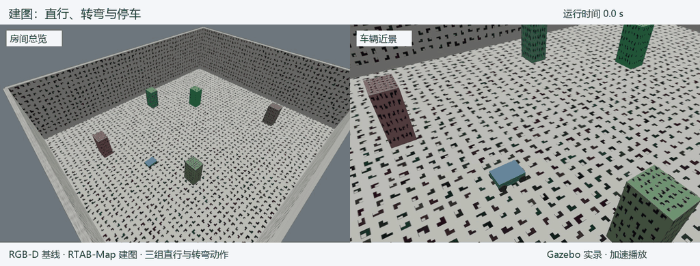
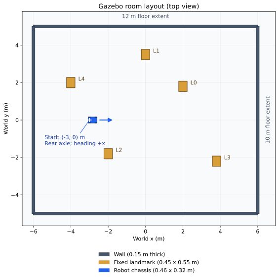
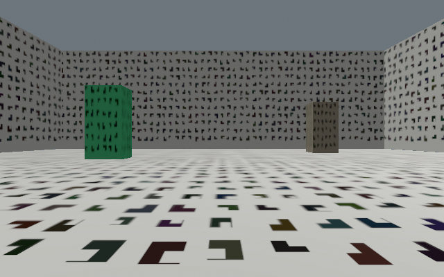
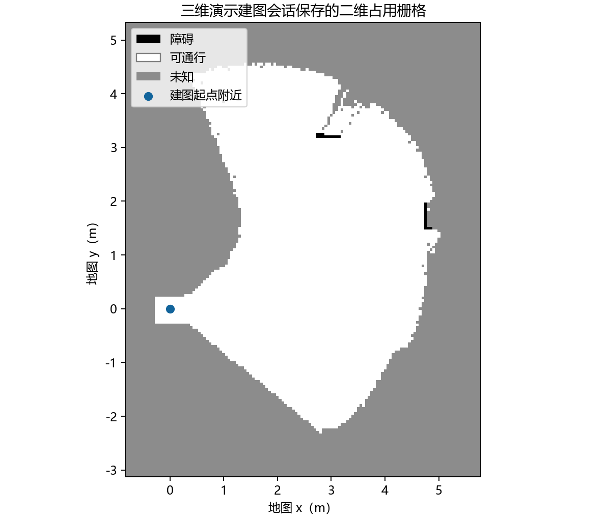
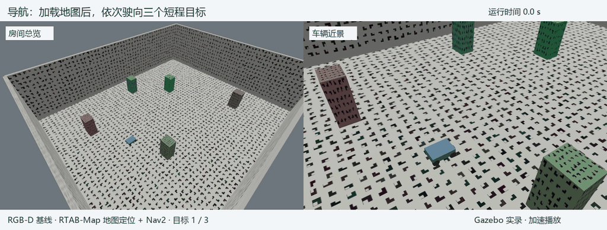

# 51. 视觉导航实验设计与评价方法

本实验研究双目 VO 和 VIO 接入现有小车系统后的表现。VO 根据连续图像估计运动，VIO 在图像之外加入 IMU 的惯性观测。实验先在同一房间完成建图、地图定位与短程导航，再用 EuRoC 真实记录比较两种运动估计的轨迹误差。本章依次说明场景、车辆与传感器、建图、地图定位、目标设置和评价方法。

## 51.1 场景与三维运行画面 {#scene-demo}

仿真场景是一间 12 m × 10 m 的矩形房间，墙高 3 m。室内放置五个长方体地标，地面、墙面和地标表面带有角点纹理，方便视觉算法寻找和跟踪特征。车辆从世界坐标（−3，0）m 出发，车头朝 x 轴正方向。

*图 51.1 Gazebo 中的建图运行画面。左侧观察小车在房间中的位置，右侧观察直行、转弯与停车。录像来自独立的 RGB-D 基线演示会话，按原始图像顺序加速播放。[打开 MP4](simulation-results/gazebo-mapping-3d.mp4)。*

*图 51.2 同一场景的俯视布局。蓝色箭头为初始位置与朝向，L0～L4 为固定地标。*

本轮任务在起点附近进行；地标位置和房间边界如图 51.2 所示。

*图 51.3 车载相机的实际输出。算法从这样的第一人称画面中提取特征；图 51.1 的外部观察相机用于展示车辆运动。*

## 51.2 车辆与对照方案

### 51.2.1 小车怎样运动、使用哪些传感器

车辆采用前轮转向的 Ackermann 结构，转弯方式与普通汽车相近。车体长 0.46 m、宽 0.32 m，轴距 0.34 m，轮距 0.30 m，轮半径 0.065 m。相机距地面 0.32 m，左右相机相距 0.095 m。

车辆提供双目图像、深度、IMU 和轮子观测。图像与深度为 640 × 400、20 Hz，IMU 为 200 Hz，轮子观测为 50 Hz。仿真器按已知安装关系生成同步观测，并加入模型设定的高斯噪声。环境纹理、车辆和传感器配置在三种方案间保持一致。

### 51.2.2 三种方案改变了什么

| 方案 | 运动估计怎样获得 | 本实验中的用途 |
| --- | --- | --- |
| RGB-D 基线 | 图像与深度估计运动，再与轮速、IMU 经 EKF 融合 | 现有系统的对照基线 |
| 双目 VO | VINS 根据左右图像估计运动，再接入轮速、IMU 融合 | 观察更换视觉估计器后的表现 |
| 双目 VIO | VINS 联合双目图像与 IMU 估计运动，再与轮速融合 | 观察加入惯性约束后的表现 |

三种方案共用 RTAB-Map 建图与地图定位、Nav2 规划控制、深度避障和速度保护。因此，本实验比较的是更换运动估计输入后，同一套建图导航系统的表现。双目 VIO 已在估计器内使用 IMU，后续 EKF 使用轮速融合，避免重复计入同一惯性信息。

## 51.3 建图怎样进行

### 51.3.1 行驶与观测

每种方案分别建立自己的地图。开始时，车辆位于（−3，0）m、朝向 x 轴正方向，系统从空地图开始接收图像和深度。程序让车辆以 0.12 m/s 直行 3 s，再以 0.10 m/s、0.12 rad/s 转弯 4 s，随后停车 1 s；这组动作连续执行三次。它相当于用固定动作代替人工遥控，便于比较三种估计方案。

RTAB-Map 一边接收运动估计，一边将图像特征、深度和关键帧组织到同一地图中。相机看见的墙面、地面与地标逐步进入地图。深度观测用于生成分辨率为 0.05 m 的二维占用栅格，已观察的地面与障碍为后续导航提供空间信息。

### 51.3.2 地图保存与使用

建图结束后正常关闭程序，将结果保存为 RTAB-Map 数据库。数据库同时保留视觉关键帧、环境观测和位姿关系，导航时由 RTAB-Map 加载并提供地图与当前位置。

房间俯视图描述完整的场景模型；算法建立的地图则随相机实际观察而形成。本轮车辆只走过房间局部，地图覆盖沿途可见区域。三维演示使用独立数据库，记录正常建图动作；正式对照会话还包含输入中断和障碍停车试验，完整轨迹见第 [52.1 节](52-vision-simulation-results.md#measured-path)。

*图 51.4 演示会话由 RTAB-Map 生成的占用栅格。白色为已观察的可通行区域，黑色为障碍，灰色为未知；蓝点标出建图起点附近。坐标以地图原点为基准，每格 0.05 m。相机沿行驶方向观察，因而地图向前方展开。*

## 51.4 建图之后怎样导航

### 51.4.1 加载地图并找到起点

导航会话重新启动房间和车辆，将车放回初始世界位置（−3，0）m，加载该方案刚保存的数据库。RTAB-Map 用当前图像匹配已有关键帧，确定车在地图中的位置。地图定位建立后，Nav2 才开始接收导航任务。

世界坐标描述车辆在 Gazebo 房间中的位置；地图坐标以建图起点附近为原点。因此，世界坐标（−3，0）m 对应地图坐标约（0，0）m。导航目标在地图坐标中发送，结果图统一换算到世界坐标，方便与房间布局一起阅读。

### 51.4.2 三个目标怎样设置

程序依次发送三个短程目标，每个目标位于车辆当前位置沿车头方向前方 0.65 m，目标朝向比当前增加 0.10 rad。前一个任务结束后，程序根据车辆新的位置设置下一个目标。车辆在三个任务之间持续运行。

Nav2 根据已有地图规划路线，再根据实时深度观测调整速度和转向。本轮位置容差为 0.25 m，朝向容差为 0.25 rad；车辆进入到达范围后结束当前任务，再从新的位置设置下一个目标。请求目标、实际终点和容差范围见第 [52.2 节](52-vision-simulation-results.md#measured-routes)。

*图 51.5 地图定位后的导航运行画面。来自与图 51.1 配套的演示会话，使用刚保存的数据库，按同一规则依次发送三个目标。黄色十字圈按记录的目标位置叠加，便于观察车辆接近目标的过程。[打开 MP4](simulation-results/gazebo-navigation-3d.mp4)。*

### 51.4.3 怎样判断到达

每个目标同时记录 Nav2 的任务结果和车辆在 Gazebo 世界中的实际终点。程序在会话开始时对齐地图坐标与世界坐标，随后保持这一关系，用终点到目标的距离作为位置误差，用朝向之差作为朝向误差。任务成功、位置与朝向均在容差内、行驶过程中没有碰撞，该项到点检查即通过。

## 51.5 EuRoC 是什么，怎样用于本项目

### 51.5.1 一套真实采集的双目与惯性记录

[EuRoC MAV](https://ethz-asl.github.io/datasets/euroc-mav/)是由苏黎世联邦理工学院等研究团队发布的微型飞行器数据集。研究人员让携带双目相机和 IMU 的飞行器在机器大厅和室内场景中运动，保存图像、惯性数据、传感器标定及参考轨迹，供不同视觉定位方法使用。

本项目选用机器大厅（Machine Hall）的三个序列：`MH_01_easy`、`MH_03_medium` 和 `MH_05_difficult`。MH 表示采集地点，数字区分记录，easy、medium、difficult 是数据集给出的难度标记。双目约 20 Hz、IMU 约 200 Hz，包含真实运动和成像变化，适合检查运动估计在真实观测上的表现。

### 51.5.2 回放时算法实际做什么

回放程序按原采集顺序和速度发布左右图像及 IMU，估计器据此重建飞行器的三维运动轨迹，再与数据集参考轨迹比较。双目 VO 使用两路图像，VIO 额外使用 IMU。图像使用数据集标定整流，评分统一到 IMU 原点并保留三维运动。

EuRoC 在本项目中承担运动估计对照：同一段飞行记录交给 VO 和 VIO，检查各自的误差、输出连续性和处理速度。Gazebo 则承担本车建图导航：加入轮式车模型、深度与轮速，并让算法控制车轮。两部分分别使用真实观测和可控制的车辆运动。

第一轮为三个序列、两种模式、各三次，共 18 次运行。检查 IMU 噪声配置后，又对 VIO 在三个序列各运行三次，共 9 次。结果页分别报告两组数据，便于观察配置修改的影响。

## 51.6 比较哪些指标

### 51.6.1 运动估计的轨迹误差

比较轨迹前，需要按时间找到估计位置与参考位置的对应点，再把两条轨迹的整体原点和朝向对齐。本轮使用固定尺度的刚体对齐，保留算法估计的米制尺度。

| 指标 | 含义 | 阅读方法 |
| --- | --- | --- |
| 绝对轨迹误差 ATE，m | 对齐后，各对应位置偏差的均方根 | 衡量整条已关联轨迹的整体偏离，越小越准确 |
| 1 s 平移相对位姿误差 RPE，m | 比较相隔 1 s 的运动增量，统计平移偏差的均方根 | 观察局部运动估计的漂移 |
| 关联覆盖率，% | 有效估计与参考成功关联的图像时刻数，占原始图像时刻数的比例 | 说明误差统计覆盖了多少输入 |
| 输出缺失时段，s | 初始化、途中中断或提前停止输出的时间 | 观察算法能否持续完成整段记录 |

例如，ATE 较小而覆盖率只有一半，表示已获得关联的那部分轨迹较准确，同时还需检查另外一半的输出。结果页将误差与覆盖率并列，便于阅读完整过程。

### 51.6.2 建图与导航的任务结果

建图观察车辆运动、地图形成与保存；导航记录三个目标的到达情况、终点位置与朝向误差，以及碰撞。三种方案在相同房间和目标设置规则下运行，结果页展示各自轨迹与逐次终点误差。

本轮还进行了输入中断、前方障碍、暂停恢复和执行器失联等保护试验，观察停车与恢复行为；另有 30 分钟静止运行，观察渲染、感知与估计持续工作时的计算负载。具体操作与结果集中在第 [53.5 节](53-vision-simulation-reproducibility.md#supplementary-tests)。

## 章节导航

[上一章：仿真与 Gazebo](50-gazebo-simulation.md) · [返回本篇](index.md) · [下一章：视觉导航实验结果与分析](52-vision-simulation-results.md)
