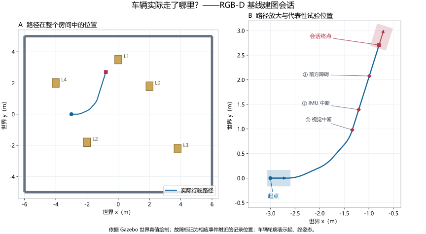
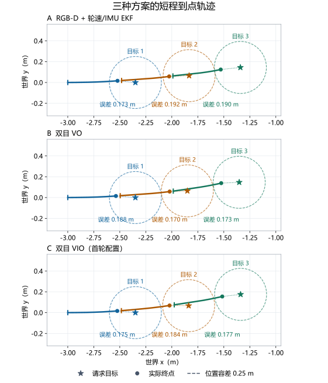
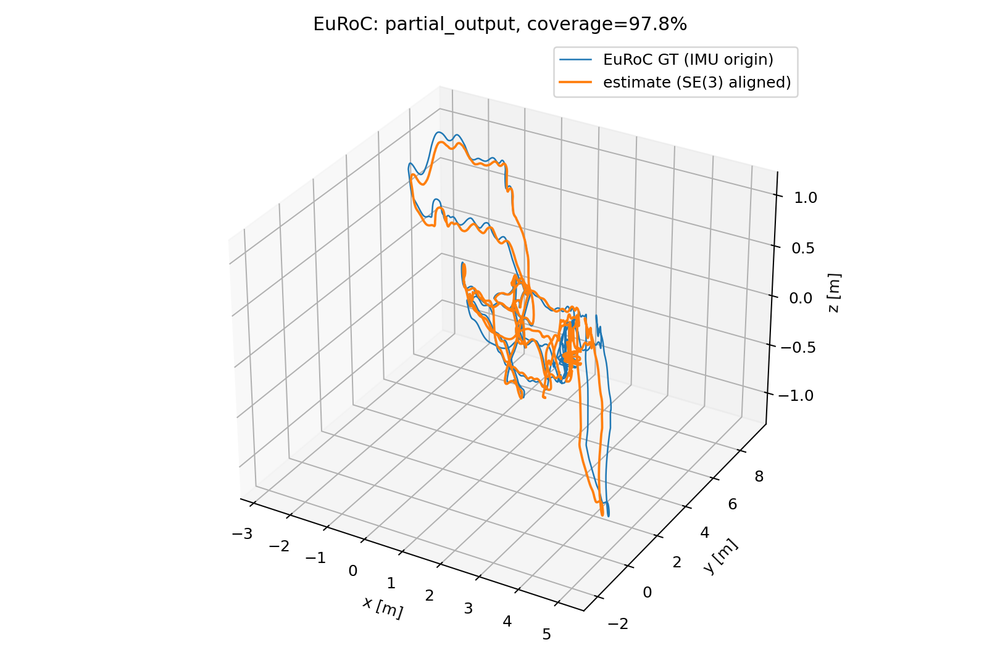

# 52. 视觉导航实验结果与分析

本章先看小车在房间里走了哪里、加载地图后停在了哪里，再分析 VO 与 VIO 在 EuRoC 真实数据上的轨迹误差。场景、建图和目标设置见第 [51 章](51-vision-simulation-lab.md)。本轮三种方案均完成了所设定的短程导航；EuRoC 回放则发现当前 VIO 实现及配置存在轨迹发散和输出中断，需要继续修复。

## 52.1 从三维场景到实际轨迹 {#measured-path}

第 51 章的[三维动图](51-vision-simulation-lab.md#scene-demo)展示 RGB-D 演示会话；本章轨迹取自三种方案的正式对照实验。RGB-D 建图会话先执行直行、转弯和停车，随后进行输入中断与障碍停车检查，下图记录整段会话中的实际位置。

*图 52.1 正式 RGB-D 建图会话的行驶路径。蓝色为 Gazebo 世界位置记录，半透明车体表示起、终姿态，标记为代表性试验开始附近的车辆位置。[查看 PNG](simulation-results/measured-room-path.png)；[查看二维轨迹回放](simulation-results/measured-mapping-replay.gif)。*

轨迹集中在房间局部，与建图时相机沿途观察的范围对应。导航阶段重新启动场景、加载所保存的地图，车辆回到（−3，0）m 附近再执行目标。路径数据和图表来源见[第 53.4.2 节](53-vision-simulation-reproducibility.md#path-data)。

## 52.2 建图与短程导航结果 {#measured-routes}

### 52.2.1 三种方案的任务完成情况

三种方案分别完成建图并保存数据库，随后加载各自地图进行定位与导航。每个正式会话含八类场景、每类三次，共 24 项条件检查；其中导航的前三项是短程到点，其余为输入中断、障碍与恢复等系统检查。

*表 52.1 三种方案的建图导航会话结果。终点误差对应三个短程导航目标，位置容差为 0.25 m。*

| 定位方案 | 建图会话 | 导航会话 | 三个导航终点位置误差（m） |
| --- | --- | --- | --- |
| RGB-D + 轮速/IMU EKF | 24/24 | 24/24 | 0.173 / 0.192 / 0.190 |
| 双目 VO | 24/24 | 24/24 | 0.188 / 0.170 / 0.173 |
| 双目 VIO | 24/24 | 24/24 | 0.175 / 0.184 / 0.177 |

六个会话合计 144 项检查通过，均无碰撞。三种方案的到点误差约为 0.17～0.19 m，均位于预设容差内。正式导航还检查了任务状态与朝向误差，地图坐标与世界坐标在开始时一次对齐。

*图 52.2 三种方案的三个短程任务。蓝、橙、绿线依次为三个任务的实际轨迹，短竖线为首个记录位置，星形为目标，圆点为实际终点，虚线圆半径为 0.25 m。[查看 PNG](simulation-results/measured-navigation-routes.png)。*

下表列出 RGB-D 基线三个任务的请求目标和实际终点，统一使用世界坐标。首项从（−3，0）m 附近出发，后两项分别从前一项结束后的新位置设置。任务 1 的实际终点距目标 0.173 m，位于图中半径为 0.25 m 的到达范围内。

*表 52.2 RGB-D 基线的目标与实际终点，坐标保留三位小数。*

| 任务 | 请求目标（x，y），m | 实际终点（x，y），m | 终点位置误差 |
| --- | --- | --- | --- |
| 1 | （−2.350，0.000） | （−2.522，0.016） | 0.173 m |
| 2 | （−1.833，0.066） | （−2.025，0.058） | 0.192 m |
| 3 | （−1.341，0.144） | （−1.530，0.124） | 0.190 m |

图中展示车辆已走过的世界轨迹。相邻任务之间的准备过程单独记录，所以彩色线段各自显示。三种方案都完成了本轮短程任务，下一轮将使用固定独立起终点、较长路线与更多障碍条件比较表现。

### 52.2.2 最终 VIO 配置的复测

修正 VIO 关键输入监测后，另行完成导航会话，24/24 检查通过，三个终点位置误差为 0.185、0.179、0.178 m。该组对应最终 VIO 配置，单独保存在结果记录中。

建图复测先出现一次执行器独立停车检查失败，调整计算资源后为 24/24。失败原因、运行配置与逐次记录见第 [53.6 节](53-vision-simulation-reproducibility.md#revision-notes)。

### 52.2.3 纹理对建图导航的影响

早期场景的纹理较稀疏，RGB-D 曾出现特征不足与跟踪丢失。当前房间在地面、墙体和地标上加入角点纹理，提供了更多可跟踪特征，三种方案在这一场景中完成建图定位与短程导航。

下一轮可保持路线与车辆不变，逐步降低墙面或地面纹理，观察丢失发生的位置、恢复时间和任务完成情况。这样可以直接研究视觉条件怎样影响地图与导航。

## 52.3 EuRoC 真实数据上的定位结果 {#euroc-results}

本节评分对象是回放重建的飞行器传感器轨迹。双目 VO 和 VIO 处理相同的 EuRoC 记录，与数据集参考轨迹比较；小车的导航到点结果在第 52.2 节报告。回放步骤及其与闭环实验的关系见第 [51.5 节](51-vision-simulation-lab.md#euroc-replay)。

### 52.3.1 原配置下的双目 VO 与 VIO

表 52.3 对比三个机器大厅序列。每个序列、每种模式按原速回放三次，每格依次列出三次结果。ATE 表示整体轨迹位置偏差，1 s 平移 RPE 表示局部运动漂移，关联覆盖率表示参与评分的图像时刻比例。

*表 52.3 原配置下的 EuRoC 定位结果，共 18 次运行。*

| 序列 | 模式 | ATE RMSE（m） | 1 s 平移 RPE RMSE（m） | 关联覆盖率 |
| --- | --- | --- | --- | --- |
| MH01 | 双目 VO | 0.156 / 0.136 / 0.134 | 0.012 / 0.012 / 0.012 | 96.09% / 97.96% / 97.77% |
| MH01 | VIO | 1.663 / 49.243 / 10284.401 | 0.474 / 1.968 / 367.017 | 84.90% / 87.75% / 98.15% |
| MH03 | 双目 VO | 0.107 / 0.131 / 0.127 | 0.033 / 0.033 / 0.033 | 96.26% / 96.22% / 95.93% |
| MH03 | VIO | 1.328 / 1.325 / 1.232 | 0.136 / 0.140 / 0.209 | 93.30% / 88.48% / 51.37% |
| MH05 | 双目 VO | 0.182 / 0.205 / 0.237 | 0.034 / 0.032 / 0.036 | 96.22% / 95.60% / 96.04% |
| MH05 | VIO | 1.161 / 1.128 / 0.942 | 0.099 / 0.100 / 0.106 | 92.70% / 89.35% / 87.15% |

双目 VO 的 ATE 为 0.107～0.237 m，覆盖率为 95.60%～97.96%，三次重复较接近。VIO 的波动明显更大：MH01 第三次 ATE 超过 10 km，而覆盖率达到 98.15%，显示估计轨迹在持续输出的过程中严重发散；MH03 第三次覆盖率为 51.37%，还存在较长的输出缺失。

*图 52.3 MH01 双目 VO 的一次评分示例，展示估计轨迹与参考轨迹的比较。三次重复的指标列于表 52.3。*

全部 18 次运行均产生评分。逐次结果、数据年龄与输出状态见[原配置记录](simulation-results/euroc-2026-11-12.json)。

### 52.3.2 修正 IMU 噪声配置之后

检查发现，连续时间 IMU 噪声密度曾直接用于当前移植版需要的离散噪声参数。按采样频率和当前积分实现转换参数后，另行完成 9 次 VIO 回放，时间与评分方法保持一致。

*表 52.4 修正噪声配置后的 VIO 结果，共 9 次运行。*

| 序列 | ATE RMSE（m） | 1 s 平移 RPE RMSE（m） | 关联覆盖率 |
| --- | --- | --- | --- |
| MH01 | 0.0388 / 0.0872 / 0.0952 | 0.0121 / 0.0144 / 0.0136 | 47.15% / 86.91% / 88.51% |
| MH03 | 1143.393 / 1334.529 / 3080.031 | 36.669 / 45.006 / 133.415 | 94.30% / 96.89% / 94.48% |
| MH05 | 0.237 / 0.230 / 0.235 | 0.031 / 0.032 / 0.030 | 91.03% / 90.81% / 92.65% |

MH01 已关联部分的误差下降，但第一次在最后图像前约 79.05 s 停止输出，覆盖率为 47.15%，并出现 IMU 缓冲溢出。播放器已经发布全部 3682 对图像和 36820 个 IMU 样本，接下来需要排查估计器的接收、排队与处理过程。

MH05 三次 ATE 为 0.230～0.237 m，覆盖率为 90.81%～92.65%。MH03 三次仍严重发散，ATE 为 1.14～3.08 km；三次都输出到序列末尾，原始估计终点达到数千米。当前配置修改改善了部分序列，MH03 的发散仍需定位根因。

完整指标见[新配置三个序列的记录](simulation-results/euroc-noise-three-sequence-2026-11-12.json)，MH01 的输出诊断见[对应记录](simulation-results/euroc-noise-2026-11-12.json)。

### 52.3.3 为什么还要使用真实数据

Gazebo 房间提供纹理丰富、同步关系已知的小车运动；EuRoC 提供真实飞行中的成像和惯性变化。本轮 VIO 在房间内完成短程导航，却在 EuRoC MH03 上发散。真实数据回放由此暴露了仍需解决的估计问题，也给下一步调试提供了固定可重复的输入。

当前项目使用固定的 ROS 2 VINS 移植实现与配置。后续将修复发散和输出中断，再按同样的三个序列进行全程回归。实车继续使用 RGB-D、轮速与 IMU 融合基线。

## 52.4 下一轮实验

下一轮先修复 VIO 在真实数据中的发散与输出中断，再扩展导航场景。导航实验应固定独立起终点，加入较长路线、转角、窄通道和障碍移除过程，逐次记录到达、耗时、最小间距和失败原因。

随后在目标车载计算机上运行移动任务，测量处理延迟与持续负载，最后开展相机和 IMU 标定、时间同步、真实停车距离与场地导航实验。现有地图、轨迹、失败记录及三维演示均保留，作为后续比较的起点。

输入中断、障碍停车与 30 分钟静止运行的操作和结果见第 [53.5 节](53-vision-simulation-reproducibility.md#supplementary-tests)。

## 章节导航

[上一章：视觉导航实验设计与评价方法](51-vision-simulation-lab.md) · [返回本篇](index.md) · [下一章：视觉导航实验操作与复现](53-vision-simulation-reproducibility.md)
