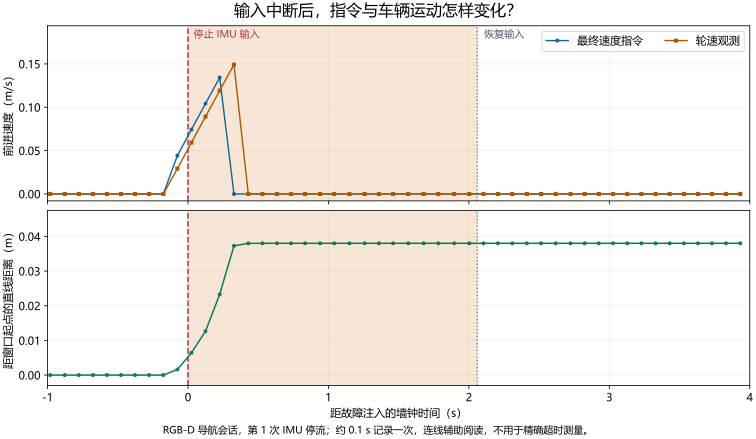

# 53. 视觉导航实验操作与复现

本章提供第 51～52 章实验的复跑步骤、原始数据和图表来源。操作顺序是准备独立环境，建图并保存数据库，再加载地图导航；EuRoC 回放单独运行。以下记录对应 2026-11-12 的实验，改变软件或参数后应使用新的结果目录保存运行配置。

## 53.1 实验环境

| 项目 | 实际设置 |
| --- | --- |
| 远程主机 | Ubuntu 24.04.5、AMD EPYC 9554、188 GiB 内存、RTX 4090 D |
| 隔离运行环境 | Ubuntu 22.04、ROS 2 Humble、Gazebo Fortress 6.18.0、Python 3.10 |
| 估计后端 | RTAB-Map strategy 9、固定 ROS 2 VINS 移植版、独立 Ceres 2.1 |
| 首轮代码 | [1e518ba9](https://github.com/EnosElinsa/wheeltec-ros-source-reference/tree/1e518ba923e6876254ae0eddddab5ac52d42798c/ros2/navigation/vision-nav)；[对应 CI](https://github.com/EnosElinsa/wheeltec-ros-source-reference/actions/runs/43210363593) |
| 最终代码 | [d6092f1a](https://github.com/EnosElinsa/wheeltec-ros-source-reference/tree/d6092f1a270ec64b24c11f8c1c9b1c8d5d473043/ros2/navigation/vision-nav) |
| VIO 关键输入修正 | [75026789](https://github.com/EnosElinsa/wheeltec-ros-source-reference/commit/750267894c90516f21debac62364c34753de3939) |
| 首轮计算资源 | EuRoC 每序列绑定 8 个 CPU；Gazebo 正式故障会话绑定 32 个 CPU、内存上限 24 GiB；例外见逐次会话记录 |
| 隔离要求 | 独立 ROS 域、数据库与结果目录；仿真不启动串口或物理 RealSense |

在 Ubuntu 远程机执行以下命令，先准备 Docker 和 NVIDIA CDI，再按实际可用资源选择 GPU 与 CPU 集合。安装说明见固定版本源码的 [containers 目录](https://github.com/EnosElinsa/wheeltec-ros-source-reference/tree/d6092f1a270ec64b24c11f8c1c9b1c8d5d473043/ros2/navigation/vision-nav/containers)。构建入口安装所需的 Ceres 2.1，并编译 VINS 与 RTAB-Map。

原实验镜像、完整重建镜像及包清单保存在[镜像记录](simulation-results/final-image-2026-11-12.json)。两个镜像分别记录身份，复跑时应保存实际使用的版本与配置。

## 53.2 建图与导航操作

### 53.2.1 准备独立运行目录

```bash
cd wheeltec-ros-source-reference/ros2/navigation/vision-nav/containers
export SIM_ROOT="$HOME/wheeltec_vision_sim"
mkdir -p "$SIM_ROOT"/{source,data,results}
cp -a . "$SIM_ROOT/containers"
for package in wheeltec_vision_nav wheeltec_tf_guard wheeltec_vision_benchmark wheeltec_vision_sim wheeltec_sim_actuator; do
  cp -a "../$package" "$SIM_ROOT/source/"
done
sudo docker build -t wheeltec-vision-sim:humble-20261112 .
sudo env WHEELTEC_SIM_ROOT="$SIM_ROOT" bash build.sh
```

显式传入实验目录，避免 `sudo` 改变用户目录后挂载到其他位置。同次实验的节点置于同一容器；并行会话分别使用独立 ROS 域、CPU 集合、数据库和结果目录。启动后先核对虚拟图像、深度与 TF，再执行运动任务。

### 53.2.2 建图、保存并加载地图

`baseline`、`stereo`、`vio` 分别对应 RGB-D 基线、双目 VO 和双目 VIO。先以建图模式启动，按第 51.3 节的动作观察环境，正常停止以保存数据库，再加载同一数据库进行地图定位。

```bash
sudo env WHEELTEC_SIM_ROOT="$SIM_ROOT" WHEELTEC_SIM_GPU=1 bash run.sh \
  ros2 launch wheeltec_vision_sim sim.launch.py estimator:=baseline mode:=mapping \
  database_path:=/work/results/room.db output:=/work/results/mapping-001
# 正常停止建图后运行：
sudo env WHEELTEC_SIM_ROOT="$SIM_ROOT" WHEELTEC_SIM_GPU=1 bash run.sh \
  ros2 launch wheeltec_vision_sim sim.launch.py estimator:=baseline mode:=localization \
  database_path:=/work/results/room.db output:=/work/results/localization-001
```

定位就绪后，在 RViz 设置目标或由任务程序发送目标。完整对照使用下面的批量入口，自动组织运动、检查和会话关闭：

```bash
sudo env WHEELTEC_SIM_ROOT="$SIM_ROOT" WHEELTEC_SIM_GPU=1 WHEELTEC_SIM_CPUS=32 \
  WHEELTEC_SIM_CPUSET=0-31 ROS_DOMAIN_ID=88 \
  bash run.sh python3 /work/containers/run_sim_trial.py \
  --output /work/results/mapping-suite-001 --database /work/results/room-suite.db \
  --mode mapping --estimator baseline --scenario all
```

导航对照使用 `--mode localization` 和已保存地图。一次会话内车辆连续运行，三个任务按前一个结束后的位置继续设置；重新设置独立起点时，需要另启场景。任务定义见[仿真包说明](https://github.com/EnosElinsa/wheeltec-ros-source-reference/tree/d6092f1a270ec64b24c11f8c1c9b1c8d5d473043/ros2/navigation/vision-nav/wheeltec_vision_sim)。

仿真轮速由关节观测生成，世界位姿用于评分。`odom → base_footprint` 保持唯一发布者，RTAB-Map 发布 `map → odom`；实际地图定位输出决定定位是否就绪。VIO 在估计器内使用 IMU，后续 EKF 只与轮速融合，关键轮速和 IMU 仍独立参与健康监测。

## 53.3 EuRoC 回放与评分

此入口启动数据播放器和 VINS 运动估计器，播放器按时间发布图像与 IMU，并记录估计轨迹供评分。它与第 53.2 节的 Gazebo 会话分别运行；从回放切换到小车闭环时，结束回放，按小车入口加载对应的传感器配置，再建图和导航。两类实验的完整数据流见第 [51.5 节](51-vision-simulation-lab.md#euroc-replay)。

数据保留 `mav0/cam0`、`cam1`、`imu0` 和 `state_groundtruth_estimate0` 的原始结构，通过 SHA256、ZIP CRC 和文件检查核对完整性。下面以 MH01 的 VIO 为例：

```bash
python3 fetch_euroc.py --destination "$SIM_ROOT/data" --sequence MH_01_easy
sudo env WHEELTEC_SIM_ROOT="$SIM_ROOT" WHEELTEC_SIM_GPU=1 bash run.sh \
  ros2 run wheeltec_vision_benchmark validate_euroc \
  --dataset /work/data/MH_01_easy --output /work/results/mh01-validation --mode vio
sudo env WHEELTEC_SIM_ROOT="$SIM_ROOT" WHEELTEC_SIM_GPU=1 bash run.sh \
  ros2 launch wheeltec_vision_benchmark euroc.launch.py \
  dataset:=/work/data/MH_01_easy output:=/work/results/mh01-vio-001 mode:=vio
```

`mode:=stereo` 选择双目 VO。批量入口 `run_euroc_suite.sh` 对三个序列、两种模式分别运行三次。单次结果包括运行配置、轨迹、播放记录、评分与图表；检查误差时一并查看覆盖率、输出缺失、数据年龄和退出状态。

时间戳保留原始整数纳秒，左右图像按原记录配对并使用数据集标定整流。评分通过完整的相机、IMU 与参考传感器变换统一到 IMU 原点，使用固定尺度的三维刚体对齐。Machine Hall 的参考位置和朝向来自 Leica 位置与 IMU 的批量解，本轮报告平移 ATE 和平移 RPE。

MH05 首张图像早于首个 IMU 约 20 ms，VIO 跳过这一帧并保存原因。关联覆盖率以全部原始双目图像时刻为分母，包含初始化、跳过帧和参考不覆盖部分。IMU 噪声转换记录源单位、采样频率和派生参数；当前积分器的共享端点及高阶相关性仍待完善。

原配置双目 VO 数据年龄 P95 约 59.6 ms、P99 为 60.0～61.0 ms；VIO 的 P95 为 45.8～64.6 ms、P99 为 60.0～71.5 ms。数据年龄从原始采样计到记录端接收，包含播放调度、排队与估计。P95、P99 分别表示约 95%、99% 的样本不超过的值。

## 53.4 原始记录与图表来源 {#evidence-index}

### 53.4.1 实验记录

仓库收录 JSON 摘要、轨迹 CSV 和图表；完整图像、数据库、构建产物及原始日志保留在远程实验目录。JSON 中的版本和哈希用于对应各次产物，通过与失败结果分别保存。

| 实验或证据 | 记录入口 |
| --- | --- |
| EuRoC 原配置 18 次 | [逐次评分](simulation-results/euroc-2026-11-12.json) |
| 新噪声配置 MH01 诊断 | [三次诊断](simulation-results/euroc-noise-2026-11-12.json) |
| 新噪声配置三序列 9 次 | [完整摘要](simulation-results/euroc-noise-three-sequence-2026-11-12.json) |
| RGB-D、双目 VO、VIO 首轮建图 | [RGB-D](simulation-results/mapping-baseline-2026-11-12.json)；[双目 VO](simulation-results/mapping-stereo-2026-11-12.json)；[VIO](simulation-results/mapping-vio-2026-11-12.json) |
| 三方案首轮导航 | [RGB-D](simulation-results/localization-baseline-2026-11-12.json)；[双目 VO](simulation-results/localization-stereo-2026-11-12.json)；[VIO](simulation-results/localization-vio-2026-11-12.json) |
| 首轮六个闭环会话 | [命令、资源、日志与退出身份](simulation-results/sessions-2026-11-12.json) |
| 最终 VIO 建图：16 CPU 失败、32 CPU 通过 | [失败](simulation-results/mapping-vio-required-inputs-failed-2026-11-12.json)；[复测](simulation-results/mapping-vio-required-inputs-2026-11-12.json) |
| 最终 VIO 导航及会话身份 | [导航](simulation-results/localization-vio-required-inputs-2026-11-12.json)；[会话](simulation-results/vio-required-inputs-sessions-2026-11-12.json) |
| 独立关键输入 ROS 测试 | [直接响应测量](simulation-results/ros-critical-inputs-2026-11-12.json) |
| 旧 schema 1 长测 | [原失败与派生统计](simulation-results/stationary-2026-11-12.json) |
| schema 2 抽查及修正 | [旧快照外推失败](simulation-results/stationary-schema2-smoke-2026-11-12.json)；[修正后抽查](simulation-results/stationary-schema2-smoke-corrected-2026-11-12.json) |
| 独立会话抽查与正式长测 | [30 s](simulation-results/stationary-session-schema2-smoke-2026-11-12.json)；[1800 s 最终记录](simulation-results/stationary-final-2026-11-12.json) |
| 镜像构建与重建验证 | [身份记录](simulation-results/final-image-2026-11-12.json) |

场景来自固定版本的 [model.py](https://github.com/EnosElinsa/wheeltec-ros-source-reference/blob/d6092f1a270ec64b24c11f8c1c9b1c8d5d473043/ros2/navigation/vision-nav/wheeltec_vision_sim/wheeltec_vision_sim/model.py)，任务与临时障碍来自 [mission_runner.py](https://github.com/EnosElinsa/wheeltec-ros-source-reference/blob/d6092f1a270ec64b24c11f8c1c9b1c8d5d473043/ros2/navigation/vision-nav/wheeltec_vision_sim/wheeltec_vision_sim/mission_runner.py)。首轮 RGB-D/VIO 建图会话安全指令接收年龄 P95 分别为 45.9/46.8 ms、P99 为 51.0/52.4 ms，实时因子中位数约 0.895；统计包含故障注入阶段。

### 53.4.2 轨迹数据与绘图 {#path-data}

图 52.1、52.2、53.1 及二维回放来自正式对照会话。CSV 保留全部记录行，无新鲜真值的位置留为空缺；轨迹按原坐标绘制。数据约每 0.1 s 记录一次，精确停车响应使用高频指令接收日志。

| 图示用途 | 会话 | 可下载数据 |
| --- | --- | --- |
| 房间中的实测路径与二维回放 | `mapping-all-05` | [RGB-D 建图轨迹 CSV](simulation-results/mapping-baseline-path.csv) |
| 三个短程任务：RGB-D | `localization-baseline-04` | [导航轨迹 CSV](simulation-results/localization-baseline-path.csv) |
| 三个短程任务：双目 VO | `localization-stereo-01` | [导航轨迹 CSV](simulation-results/localization-stereo-path.csv) |
| 三个短程任务：VIO 首轮配置 | `localization-vio-05` | [导航轨迹 CSV](simulation-results/localization-vio-path.csv) |

[来源与变换清单](simulation-results/path-figure-provenance.json)保存原始 JSONL、CSV 和输出哈希。CSV 以首条记录为墙钟零点，世界位置单位为米，朝向由四元数换算。二维动图每十条记录取一条并补入末条，加速播放时仍显示实际记录时间。

运行教材仓库的 `tools/render_simulation_figures.py` 可重新生成图表，需要 NumPy、Matplotlib、Pillow 和中文字体。完整诊断图保留为 [RGB-D 建图](simulation-results/mapping-baseline.png)、[RGB-D 导航](simulation-results/localization-baseline.png)和 [VIO 导航](simulation-results/localization-vio.png)。

### 53.4.3 三维录像与算法地图 {#gazebo-media}

图 51.1、51.5 来自独立 RGB-D 演示：建图会话从空数据库开始完成三组运动，导航会话重启后加载该数据库完成三个目标，两组均为 3/3、无碰撞。图 51.2 按场景几何绘制，图 51.4 为演示会话实际生成的占用栅格。

两个外部观察相机录制房间总览与车辆近景，估计器接收车载相机。`tools/record_gazebo_demonstration.py` 记录原图，`tools/render_gazebo_demonstration.py` 按仿真时间匹配视角并合成加速录像。黄色目标标记由任务的实际世界坐标投影到画面。

| 产物 | 数据与媒体 |
| --- | --- |
| 建图运行 | [GIF](simulation-results/gazebo-mapping-3d.gif)；[MP4](simulation-results/gazebo-mapping-3d.mp4)；[逐帧来源与任务记录](simulation-results/gazebo-mapping-frames.json) |
| 导航运行 | [GIF](simulation-results/gazebo-navigation-3d.gif)；[MP4](simulation-results/gazebo-navigation-3d.mp4)；[逐帧来源与任务记录](simulation-results/gazebo-navigation-frames.json) |
| 算法建立的二维地图 | [占用栅格图](simulation-results/gazebo-mapping-grid.png)；[原始栅格数据](simulation-results/gazebo-mapping-grid.json) |
| 场景、变换与输出身份 | [来源清单](simulation-results/gazebo-demonstration-provenance.json) |

## 53.5 故障停车与持续运行 {#supplementary-tests}

### 53.5.1 保护设置

故障前确认车辆实际运动；故障后同时保存最终指令、轮速、世界位移与接触记录。执行器失联时保持上游指令新鲜且非零，再阻断执行器接收，以检查执行器自身的超时停车。

| 保护设置 | 当前值或条件 |
| --- | --- |
| 保护检查周期 | 50 ms，使用单调墙钟 |
| 轮速、IMU、融合里程计、有效深度超时 | 0.3 s |
| VO 消息或有效视觉结果超时 | 0.5 s |
| 允许的视觉降级 | 仅基线和双目 VO；其他关键输入及前向避障有效时，最多 1 s 或 0.10 m，速度不超过 0.10 m/s，仅前进 |
| 执行器独立指令超时 | 0.25 s，属于本轮仿真执行器配置 |
| 严重故障后的恢复 | 清除旧指令、取消旧目标，恢复健康后等待新目标 |

导航到点要求任务成功、位置误差不超过 0.25 m、朝向误差不超过 0.25 rad，并具有新鲜真值。地图与世界坐标在首次静止观测时对齐后保持固定。仿真节点跟随仿真时间，保护定时器使用单调墙钟；允许视觉降级的方案按获准续行的时间、距离和速度评价。

### 53.5.2 停车与恢复结果 {#measured-stop}

通过会话覆盖视觉、IMU、深度停发，仿真暂停恢复、旧目标处理、前方障碍和执行器失联。前方长方体出现后车辆停车，无碰撞；输入恢复后等待新任务。



*图 53.1 RGB-D 导航第一次 IMU 中断前后的记录。零点为故障注入，浅色区域为输入停止时段；上图为最终速度指令与轮速，下图为距窗口起点的直线距离。指令和轮速归零后，位置保持稳定，输入恢复后仍保持停车。点为约 0.1 s 一次的观测；精确指令响应见表 53.1。[查看 PNG](simulation-results/measured-fault-stop.png)。*

独立 ROS 2 测试保持其他输入正常，每次只停止轮速或 IMU。从最后一次实际接收到首条零速的测量如下：

*表 53.1 关键输入停流后的指令响应。*

| 停止的输入 | 最后接收到首条零速 | 配置响应范围 | 结果 |
| --- | --- | --- | --- |
| 轮速 | 338.32 ms | 300 ms 超时 + 两个 50 ms 检查周期 | 满足 |
| IMU | 340.32 ms | 同上 | 满足 |

测试另设 10 ms 调度容差，实际测量未用到。五项测试还检查取消旧目标、恢复后拒绝旧目标和接收新目标后恢复运动，见[直接测量记录](simulation-results/ros-critical-inputs-2026-11-12.json)。实车阶段继续测量串口、驱动与下位机失联后的停车时间和距离。

### 53.5.3 30 分钟静止运行

以下入口创建新地图，保持车辆静止并持续渲染、感知与估计，结束后关闭整组进程：

```bash
sudo env WHEELTEC_SIM_ROOT="$SIM_ROOT" WHEELTEC_SIM_GPU=1 WHEELTEC_SIM_CPUS=16 \
  WHEELTEC_SIM_CPUSET=0-15 ROS_DOMAIN_ID=92 \
  bash run.sh python3 /work/containers/run_soak_trial.py \
  --output /work/results/stationary-load-001 --duration 1800 --estimator baseline
```

最终独立会话持续 1800.006 s，收到 35999 条安全零速指令、81382 个轮速回调和 7871 个 READY 健康回调，记录与会话检查均通过。

*表 53.2 最终静止长测统计。*

| 指标 | 结果 | 统计范围与解释 |
| --- | --- | --- |
| 时间推进 | 墙钟 1800.006 s；仿真 1627.65 s，平均实时因子约 0.904 | 虚拟世界平均每真实秒推进约 0.904 s |
| 安全指令间隔 | P95 52.25 ms；P99 54.43 ms；最大覆盖间隔 62.62 ms | 记录端接收，最大覆盖间隔含测量窗口首尾 |
| 忙碌 CPU 核数 | 中位数 6.40；P99 6.66 | 当前进程树的累计 CPU 时间差分 |
| 进程树 RSS | 前、后 300 个快照的中位数约 3.49、4.01 GiB | 各进程 RSS 相加，共享页可能重复计入 |
| 健康快照中的视觉年龄 | P95 98.78 ms；P99 109.54 ms | 按周期收到的健康快照统计 |
| 所采集 GPU 温度 | 39～61 °C | 整张所选 GPU 的采集值，未完整覆盖实验窗口 |
| 结束情况 | 正常中断关闭，无强制终止升级 | 全部进程与地图正常关闭 |

CPU 以进程树忙碌核数表示；RSS 为各进程驻留内存之和，共享页可能重复计入。RSS 前后窗口增加约 0.52 GiB，后续延长采样并检查缓存与共享页变化。GPU 温度采集晚于实验启动，覆盖整张设备及其他进程负载。行驶控制负载、逐帧有效视觉帧率、CPU 温度与长期内存趋势将在移动任务中补测。

## 53.6 修订记录与软件复核 {#revision-notes}

| 问题 | 处理与保留结果 |
| --- | --- |
| 稀疏纹理导致 RGB-D 特征不足、跟踪丢失 | 为房间增加角点纹理；早期场景日志保留，当前场景复测另存 |
| 图像、点云处理与 TF 队列积压 | 改用批量数据处理和有界队列，缓存受原始观测期限约束；恢复检查通过 |
| 导航任务报告成功，世界终点偏差约 0.6 m | 原检查判失败；修正坐标初始对齐时刻，并为新目标重建行为树节点 |
| VIO 未直接监测关键轮速和 IMU | 修正后独立监测；16 CPU 建图复测 23/24，执行器试验中视觉也停发，32 CPU 复测 24/24；最终导航 24/24 |

长测记录器的失败与重跑单独保留：

| 记录 | 实际观察 | 保留与处理方式 |
| --- | --- | --- |
| 旧 schema 1，约 1800.001 s | 35999 条零速；间隔 P95/P99 52.08/54.18 ms，最大 60.75 ms；1793 个约 1 Hz READY 快照 | 开窗时清空最后接收状态，约 0.3 ms 的首快照误报缺失；原 `passed=false` 保留，连续接收证据也不足 |
| 旧 schema 1 资源 | 忙碌核数中位数/P99 6.33/6.58；RSS 首尾约 3.49/4.07 GiB；快照视觉年龄 P95/P99 97.46/108.05 ms | 保留旧运行的资源统计；温度和逐帧有效帧率待补测 |
| schema 2 首次 30 s 抽查 | 将旧健康快照外推为源未更新，产生误判 | 失败摘要保留，改为按实际收到的快照判断源状态 |
| 修正后 30 s 抽查 | 600 条安全指令、1362 个轮速、130 个 READY 回调，无失败；含窗口首尾最大指令覆盖间隔 57.61 ms | 通过后再验证独立会话启动与关闭 |
| 独立会话 30 s 抽查 | 启动进程持续存活，结束仅发送 SIGINT，全部进程及地图正常关闭 | 无 TERM/KILL 升级，再开展正式长测 |
| 最终独立长测 | 1800.006 s，记录与会话均通过 | 正文采用此组结果，旧结果不覆盖 |

对应源码的本地复核为 692 项通过、8 项因 ROS/POSIX 环境跳过；Linux/Windows Python 3.10、3.12 及 Humble CI 通过。Humble 关键输入集成测试 5 项通过，耗时 19.23 s；POSIX 会话退出测试 7 项、原生执行器 CTest 1/1 通过。五个本地 ROS 包已构建，虚拟图像、深度、IMU、关节、五路接触和独立真值均有输出。完整重建镜像通过 4 项 ROS 集成测试、CTest 1/1 和 30 s 无界面渲染验证。

下一轮实验安排见第 [52.4 节](52-vision-simulation-results.md)，实车操作见[第 41 章](../06-sensors-navigation/41-visual-operation.md)，最终验收见[第 62 章](../10-deployment-maintenance/62-system-acceptance.md)。

## 章节导航

[上一章：视觉导航实验结果与分析](52-vision-simulation-results.md) · [返回本篇](index.md) · [下一章：多机编队与 Qt 控制界面](54-multi-robot-and-qt.md)
