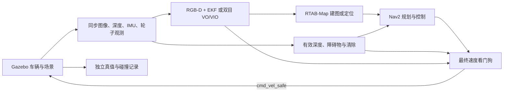

# 视觉导航仿真实验

视觉导航需要同时检查定位算法和导航闭环。公开数据集提供固定观测与独立真值，适合检验 VINS 的初始化、轨迹误差和处理速度；Gazebo 接收车辆控制指令并生成后续观测，适合检验规划、避障、停车与故障恢复。两种实验各自回答不同的问题。

本文配套代码位于 [wheeltec-ros-source-reference 的 vision-nav 目录](https://github.com/EnosElinsa/wheeltec-ros-source-reference/tree/d6092f1a270ec64b24c11f8c1c9b1c8d5d473043/ros2/navigation/vision-nav)。运行包、依赖与实验脚本放在源码仓库；教材维护操作说明、指标解释和验证记录。[本轮实验报告](vision-simulation-results.md)保存实测结果、失败项与配置身份。当前实车运行基线仍是 RGB-D、轮速和 IMU EKF。VINS 输出位姿与速度，Nav2 生成行驶指令，最终指令通过安全看门狗进入执行器。

## 选择实验环境

首轮沿用 Ubuntu 22.04、ROS 2 Humble 和 Gazebo Fortress。远程主机使用 Ubuntu 24.04 时，把这一组合放入独立容器。原生 Jazzy 与 Harmonic 可另行移植，需经过新的构建和行为测试后形成基线。[Gazebo 的 ROS 配套表](https://gazebosim.org/docs/latest/ros_installation/)给出了发行版组合。

Windows 本机负责编辑、查看结果和轻量分析，具有独立显卡的 Ubuntu 远程机负责渲染、编译与批量实验。按共享服务器的实时占用选择 GPU，并限制容器 CPU、内存与共享内存。给实验分配独立的非零 ROS 域；首次使用容器内回环通信，避免与实机共用速度话题。

| 层次 | 检查项目 | 能证明什么 |
| --- | --- | --- |
| GPU 设备映射 | 容器内 `nvidia-smi` | 容器可访问选定设备及管理库 |
| 无界面渲染 | EGL、相机图像和深度帧 | 仿真传感器能实际生成观测 |
| ROS 安装与构建 | 包、入口、消息、TF、QoS | 软件组件能够连接 |
| 数据集回归 | 轨迹、覆盖率、ATE、RPE、延迟 | 对指定数据与配置的定位表现 |
| 导航闭环 | 到达率、碰撞、停车响应 | 对指定场景与车模的导航表现 |
| 实车验收 | 时序、标定、制动、算力 | 对真实设备及场地的适用性 |

设备查询成功之后仍需检查渲染。服务器按原速处理数据，也需要在车载平台上重新检查实时性。

## 先验证 VINS：EuRoC

### 构建隔离环境

从配套源码仓库复制实验文件，示例中用 `$SIM_ROOT` 指定数据、编译和结果的独立目录。容器需要 Docker 与可用的 NVIDIA CDI 配置，首次安装步骤见源码 `containers/README.md`。

```bash
cd wheeltec-ros-source-reference/ros2/navigation/vision-nav/containers
export SIM_ROOT="$HOME/wheeltec_vision_sim"
mkdir -p "$SIM_ROOT"/{source,data,results}
cp -a . "$SIM_ROOT/containers"
for package in wheeltec_vision_nav wheeltec_tf_guard wheeltec_vision_benchmark wheeltec_vision_sim wheeltec_sim_actuator; do
  cp -a "../$package" "$SIM_ROOT/source/"
done
sudo docker build -t wheeltec-vision-sim:humble-20261112 .
sudo env WHEELTEC_SIM_ROOT="$SIM_ROOT" bash build.sh
```

固定的 ROS 2 VINS 移植版使用 `ceres::Manifold`，Ubuntu 22.04 的系统 Ceres 2.0 不满足这一接口。构建脚本先在实验目录安装固定提交的 Ceres 2.1，再编译 VINS 与 RTAB-Map；主机和系统 Ceres 保持原有安装。构建产物、补丁、CMake 配置和动态库依赖记录保存在实验目录。

实际实验通过 `run.sh` 启动，显式传入目录，避免 `sudo` 改变 `$HOME` 后挂载到错误位置。一个容器内运行同一次实验的全部节点。GPU 编号按服务器当前占用调整；需要代理时按源码说明向构建传入必要的代理变量。

### 数据和单次定位运行

[EuRoC 官方说明](https://ethz-asl.github.io/datasets/euroc-mav/)提供双目图像、IMU、相机标定与参考轨迹。[VINS-Fusion 官方示例](https://github.com/HKUST-Aerial-Robotics/VINS-Fusion)包含 EuRoC 的双目 VO 和双目 VIO。首个序列选择 `MH_01_easy`，通过后扩展 `MH_03_medium` 和 `MH_05_difficult`。

数据集保留原始目录结构：

```text
MH_01_easy/
└── mav0/
    ├── cam0/                         # data.csv、sensor.yaml、data/*.png
    ├── cam1/                         # 同步右图像与本侧标定
    ├── imu0/                        # 时间、角速度、加速度、安装关系
    └── state_groundtruth_estimate0/  # 独立参考轨迹与坐标关系
```

图像与 IMU 的时间用整数纳秒读取，保留左右图像的原始配对关系。EuRoC 的原始图像具有畸变，进入要求整流输入的后端前，需要按两侧标定进行双目整流，并发布与整流图像一致的 CameraInfo 和光学 TF。相机坐标、IMU 坐标与真值传感器坐标之间的安装关系也要参与变换。

部分序列的首张图像早于首个 IMU 采样。VIO 播放时只排除 IMU 时间范围外的图像，并记录原始帧号、时间和原因；VO 保留所有图像。两者仍以全部原始图像作为覆盖率分母，不补造 IMU，也不重打时间戳。`MH_05_difficult` 的首张图像比 IMU 早约 20 ms，属于这一边界。

基准程序使用 IMU 原点作为被估计对象，保留完整三维位姿。四轮车辆的平面约束不用于这组飞行数据。真值只交给评分器；送入估计器的数据是图像、相机参数、静态安装变换及 VIO 模式所需的 IMU。

下载时记录来源 URL、固定版本和本地 SHA256。官方地址限流时可以使用明确标注来源的公开镜像，校验压缩包 CRC 和展开文件。镜像完整性检查与官方真实性验证需分别说明，不能把自算哈希称为官方校验值。

每次运行使用新的结果目录，保存数据身份、生成配置、版本、原始里程计、视觉状态与时延。先分别运行双目 VO 和双目 VIO，再比较同一序列、同一播放速度下的结果。EuRoC 没有本车 RGB-D 与轮速组合，因此这一步验证 VO/VIO，完整的车辆基线对照放在仿真或同包实车实验中完成。

```bash
python3 fetch_euroc.py --destination "$SIM_ROOT/data" --sequence MH_01_easy
sudo env WHEELTEC_SIM_ROOT="$SIM_ROOT" WHEELTEC_SIM_GPU=1 bash run.sh \
  ros2 run wheeltec_vision_benchmark validate_euroc \
  --dataset /work/data/MH_01_easy --output /work/results/mh01-validation --mode vio
sudo env WHEELTEC_SIM_ROOT="$SIM_ROOT" WHEELTEC_SIM_GPU=1 bash run.sh \
  ros2 launch wheeltec_vision_benchmark euroc.launch.py \
  dataset:=/work/data/MH_01_easy output:=/work/results/mh01-vio-001 mode:=vio
```

`mode:=stereo` 使用纯双目 VO。结果包括 `manifest.json`、`trajectory.csv`、`visual_status.csv`、`playback.csv`、`metrics.json` 和轨迹图。`metrics.json` 中的覆盖率、无输出标记和延迟必须与误差同时阅读。单次成功后再运行 `run_euroc_suite.sh`，分别对三个序列、两种模式各重复三次，失败日志同样保留。

EuRoC YAML 中的 IMU 噪声是连续时间密度，不能直接当作 VINS 积分器每步使用的标准差。当前固定移植版采用中点积分：基准配置生成器根据实际 IMU 频率转换测量噪声和零偏随机游走，并在 manifest 保存原始数值、单位、转换策略与派生参数。程序同时检查原始 IMU 采样间隔，保持时间戳不变。这是特定积分实现的近似离散模型，仍需重复实验评估精度与全程覆盖率；配置生成成功不代表 VIO 通过。

## 再验证导航：简化 Ackermann 车辆

首轮模型使用方形车体、四轮和前轮转向。配置中保存车长宽、轴距、轮距、轮径、转向限位、质量、摩擦和传感器安装位姿。近似尺寸适合检查软件链路，实测尺寸决定窄通道、转弯半径与碰撞结论的适用范围。房间的地面、四面墙和地标使用固定种子生成的角点纹理；纹理只影响图像，碰撞几何保持固定。相同地图的建图和定位须使用相同纹理版本。




仿真入口使用合成传感器，不启动串口和物理 RealSense。普通 Gazebo 相机没有 D435C 的投影交替 metadata，应使用独立的同步输入适配，记录合成来源。避障直接使用有效原始深度，避免依赖视觉定位配对成功。

进入 EKF 的轮速应从轮子或关节观测生成，并保存噪声模型。Gazebo 世界位姿只用于评分。每次切换估计器，都核对 `odom → base_footprint` 的唯一发布者；RTAB-Map 负责 `map → odom`。导航就绪需要可信地图定位，RViz 的初始恒等变换不能代替这一证据。

先完成建图并保存数据库，再加载数据库进行定位和导航。两次运行保留相同车模、场景与相机参数。VIO 已经使用同一 IMU 时，融合策略需处理测量相关性，避免再次把它作为独立高置信度输入。

```bash
sudo env WHEELTEC_SIM_ROOT="$SIM_ROOT" WHEELTEC_SIM_GPU=1 bash run.sh \
  ros2 launch wheeltec_vision_sim sim.launch.py estimator:=baseline mode:=mapping \
  database_path:=/work/results/room.db output:=/work/results/mapping-001
# 正常停止建图后，使用同一数据库启动定位导航：
sudo env WHEELTEC_SIM_ROOT="$SIM_ROOT" WHEELTEC_SIM_GPU=1 bash run.sh \
  ros2 launch wheeltec_vision_sim sim.launch.py estimator:=baseline mode:=localization \
  database_path:=/work/results/room.db output:=/work/results/localization-001
```

`baseline` 复用 RGB-D 与轮速、IMU 融合；`stereo` 和 `vio` 选择已构建的 VINS 后端。相同容器内的 `mission_runner` 可注入传感器停发和暂停，并保存原始传感器时间、最终速度、轮速、碰撞和资源证据。运行器命令与场景定义见配套包 README；每次启动和每组实验使用新的结果目录。

批量运行时可让会话脚本在一个容器内启动仿真和实验，并统一关闭进程组：

```bash
sudo env WHEELTEC_SIM_ROOT="$SIM_ROOT" WHEELTEC_SIM_GPU=1 WHEELTEC_SIM_CPUS=32 \
  WHEELTEC_SIM_CPUSET=0-31 ROS_DOMAIN_ID=88 \
  bash run.sh python3 /work/containers/run_sim_trial.py \
  --output /work/results/mapping-suite-001 --database /work/results/room-suite.db \
  --mode mapping --estimator baseline --scenario all
```

一组实验内的三次试验沿用正在演化的车辆位置。需要独立起点的统计时，应重新启动仿真并使用新的结果目录。会话的日志、命令、退出码与实际断言分别保存在 `launch.log`、`mission.log`、`session.json` 和 `mission/results.json`。仅有零速命令不足以证明停车，运行器还检查新鲜轮速与独立真值位移；路线到达同时检查 Nav2 状态与固定初始坐标对齐下的真值终点。

CPU 编号按主机可用核心调整。CPU 配额控制总计算用量，CPU 亲和性限制进程可见的核心，二者分别配置；在多核服务器上只设配额，图像库仍可能建立过多工作线程。并行实验使用不同 CPU 集合、DDS 域和地图数据库，同时记录实际亲和性与线程限制。

导航开始前，运行器等待七个 Nav2 生命周期节点全部 ACTIVE。每个试验还需连续 0.5 s 获得新鲜健康状态、轮速、真值、五路接触观测和清空的前向观测走廊，45 s 内未满足则失败。准备阶段单独记录；进入故障测试后持续检查全部证据，不通过等待或过滤删除失效样本。Gazebo 创建、移除障碍与暂停服务等待期间继续处理 ROS 回调。

## 时间、暂停与停车

仿真节点使用 `/clock` 与 `use_sim_time`。保护定时器仍使用单调墙钟，确保仿真暂停或观测停发后最终速度变为零。恢复时清除旧指令，严重故障遵循取消旧目标、等待新目标的规则。

首次按实时速度运行。慢速仿真用于诊断时，在报告中写明实时因子与保护阈值的关系；通过关闭看门狗得到的导航结果不能作为现有保护链的验收结果。仿真执行器还需有命令超时，覆盖看门狗进程退出的情况。

前进是默认策略。受控倒车需显式开启，保持规划、控制、恢复行为和最终速度出口一致；视觉降级时禁止倒车。模型中的后方空旷不能证明真实车辆后方净空。

## 固定实验与结果解释

| 实验 | 记录内容 |
| --- | --- |
| 静止、直行、转弯、停车 | 位姿漂移、方向与单位、曲率、停车距离 |
| 固定路线与窄通道 | 到达率、碰撞、人工干预、最小间距、耗时 |
| 弱纹理、遮挡、动态障碍 | 视觉失效与恢复、障碍标记及移走后的清除 |
| 图像、IMU、深度停发 | 故障注入时刻、最后有效观测、首个零速、目标取消结果 |
| 暂停、恢复、时间回退 | 零速保持、旧指令清除、新目标边界 |
| 持续负载 | 数据年龄 P95/P99、控制周期超限、CPU、内存与实时因子 |

同一场景至少重复三次，固定起终点和随机种子，并保留失败运行。三次重复是首轮工程检查，扩展统计结论时还需增加场景与重复次数。

轨迹评分先做唯一时间关联，再做不调尺度的刚体对齐。平移绝对轨迹误差（ATE）衡量整体轨迹偏离；固定时间间隔相对位姿误差（RPE）衡量局部漂移。报告关联覆盖率与初始化前的缺失段，防止只评分少量正常片段。VO/VIO 的米制尺度不能用任意缩放拟合修正。

EuRoC Machine Hall 的参考轨迹来自 Leica 位置与 IMU 的批量优化，朝向只由 IMU 观测。因此该序列的旋转 RPE 表示与所提供参考朝向的一致程度；独立运动捕捉朝向精度需要另外的数据来源。程序保存参考传感器 YAML 的原文及哈希，避免丢失这一来源说明。

没有独立同步真值的实车实验，可以报告闭环端点误差、重复性、丢失率与恢复时间。地图自洽、轮速轨迹和回到起点本身不能替代独立真值。

静止负载可通过专用会话入口记录，默认创建新地图、持续 1800 s，并在结束时关闭整组进程：

```bash
sudo env WHEELTEC_SIM_ROOT="$SIM_ROOT" WHEELTEC_SIM_GPU=1 WHEELTEC_SIM_CPUS=16 \
  WHEELTEC_SIM_CPUSET=0-15 ROS_DOMAIN_ID=92 \
  bash run.sh python3 /work/containers/run_soak_trial.py \
  --output /work/results/stationary-load-001 --duration 1800 --estimator baseline
```

该入口不发送运动指令。逐回调保存安全指令收流、轮速与时钟证据，每秒保存资源快照，并保留异常和提前退出的失败摘要。健康话题中的源状态是周期快照；判断连续源覆盖还需原始输入的独立接收记录。静止负载不能代替 Nav2 行驶负载或实车实时性验收。

## 实施与验证记录

2026-11-12 开始实现以下配套模块。表中只列实际验证层级，后续运行结果在此维护。

| 项目 | 当前证据 |
| --- | --- |
| NVIDIA 容器设备映射 | 一次性容器成功识别选定 GPU |
| 既有保护链与新增仿真工具测试 | Windows 控制端复核：692 项通过、8 项按 ROS/POSIX 环境跳过；GitHub Linux/Windows Python 3.10、3.12 与 Humble CI 已通过 |
| ROS 中间件保护集成测试 | 隔离 Humble 容器：5 项通过，19.23 s；独立轮速/IMU 停流分别约 338/340 ms 输出零速；POSIX 会话退出测试 7 项、原生执行器 CTest 1/1 通过 |
| Humble/Fortress 实验镜像 | 已构建，Gazebo 6.18.0；五个本地 ROS 包编译通过，原生执行器 CTest 1/1 通过 |
| 仿真传感器首轮检查 | 无界面图像、深度、IMU、关节、五路碰撞观测与独立真值已输出；最终速度出口和暂停时的墙钟保护已实测 |
| EuRoC 数据完整性 | MH01、MH03、MH05 下载与 ZIP CRC、标定、图像和时序验证通过；MH05 VIO 记录一帧边界排除 |
| EuRoC 正式 VO/VIO 回归 | 原策略 18 次加新噪声策略 VIO 9 次，均保留；双目 VO 可复现，VIO 在 MH03 反复发散且有覆盖率缺失，未通过 |
| Gazebo 建图与故障闭环 | RGB-D、双目 VO、VIO 在统一纹理房间各 24/24 通过，地图正常关闭 |
| Gazebo 地图定位与 Nav2 | 三种模式各 24/24 通过，独立真值到点误差 0.170–0.192 m；范围限于当前房间和短路线 |
| 30 分钟持续负载 | 最终 schema 2 静止长测 1800.006 s 通过，无失败，安全指令间隔 P99 为 54.43 ms，正常退出；旧失败保留，行驶控制及实车负载待测 |
| 实车标定、采样时序与制动 | 待实车测量 |

实车操作与验收分别见[视觉建图与导航操作](../06-sensors-navigation/41-visual-operation.md)和[全系统验收清单](../10-deployment-maintenance/59-system-acceptance.md)。
