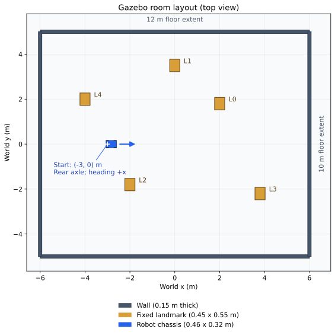
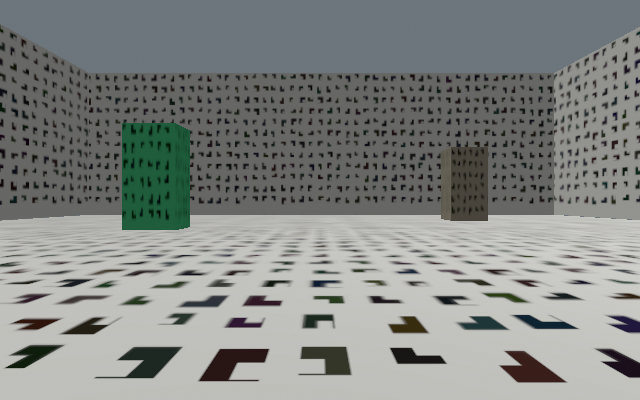

# 50.8 视觉导航实验设计与评价方法

本节说明本轮实验研究什么、怎样比较，以及每项指标能够支持什么结论。实验分为真实数据集回放、Gazebo 闭环测试和持续负载观察三部分，分别检验定位质量、导航与故障行为、长时间运行情况。平台背景见[第 50.1～50.6 节](50-gazebo-simulation.md)，实测结果见[第 50.9 节](vision-simulation-results.md)。

## 50.8.1 研究问题与总体设计

本项目希望在保留既有导航系统的条件下，评估 VINS 提供的双目视觉里程计和视觉惯性里程计。视觉里程计（VO）主要根据图像估计运动；视觉惯性里程计（VIO）进一步使用 IMU。研究对象既包括这些估计器，也包括它们接入整车系统后的行为，因此不能只用一项轨迹误差判断全部工作是否完成。

| 研究问题 | 实验材料与方法 | 主要观察量 | 对应结果 |
| --- | --- | --- | --- |
| Q1：当前 VO/VIO 实现在真实观测上能否持续、准确地估计运动？ | EuRoC 三个难度序列，按原速回放，每种配置重复三次 | 轨迹误差、覆盖率、输出中断、数据年龄 | 50.9.2 |
| Q2：不同定位方案能否支撑建图和短程导航？ | 同一 Gazebo 房间、简化车辆及公共导航系统 | 功能检查、真值终点误差、碰撞 | 50.9.3 |
| Q3：关键输入或控制链中断时，系统能否停止并阻止旧任务恢复？ | 仿真故障注入，另以独立 ROS 中间件测试测量指定输入的响应 | 首条零速、实际运动、目标取消与恢复边界 | 50.9.4 |
| Q4：固定负载下运行 30 分钟是否出现监测范围内的中断或资源异常？ | 静止车辆，持续渲染、感知与估计 | 指令间隔、健康状态、CPU、内存与温度记录 | 50.9.5 |

这些问题构成递进关系，但验收相互独立。Gazebo 中的功能检查通过，不能抵消真实数据回放中的轨迹发散；静止长测通过，也不能证明行驶控制的实时性。

## 50.8.2 对照方案与可比性

### 50.8.2.1 三种定位方案

| 方案 | 视觉运动估计 | 车辆运动信息的使用 | 实验角色 |
| --- | --- | --- | --- |
| RGB-D 基线 | 由图像与深度估计运动 | 与轮速、IMU 经扩展卡尔曼滤波（EKF）融合 | 既有车辆运行基线 |
| 双目 VO | VINS 后端使用左右相机图像 | 接入车辆轮速/IMU 融合链 | 不使用惯性约束的视觉估计对照 |
| 双目 VIO | VINS 后端联合使用双目图像与 IMU | 与轮速融合；同一 IMU 不再作为独立测量重复进入 EKF | 待验证的视觉惯性方案 |

三种方案共用 RTAB-Map 建图定位、Nav2 规划控制、原始深度避障和最终速度保护。因此，Gazebo 对照比较的是定位方案接入同一导航系统后的表现，不能据此宣称比较了三种完全独立的导航算法。

VIO 方案仍直接监测轮速和 IMU 是否有效。健康监测与状态融合承担不同作用：禁止重复融合 IMU，不意味着可以忽略 IMU 断流。当前 VIO 禁止视觉失效后依靠轮速继续前进；其他两种方案在满足保护条件时允许有界降级。

### 50.8.2.2 两类实验的比较范围

EuRoC 提供双目与 IMU，不包含本车的 RGB-D、轮速组合，因此该部分只比较双目 VO 与 VIO。Gazebo 才进行三种车辆方案的闭环检查。两类实验的传感器、运动和环境不同，结果不合并为统一误差排名。

本轮属于探索性的实现验证与配置诊断，尚未构成算法优越性的统计研究。特别是修改 IMU 噪声配置后的试验属于另一个实验组，原始失败结果继续保留。后续若要声称某种方法更好，需要在独立测试场景中冻结配置，并增加独立起点和重复次数。

## 50.8.3 真实数据集：EuRoC 回放条件

[EuRoC MAV 数据集](https://ethz-asl.github.io/datasets/euroc-mav/)提供真实飞行过程中采集的双目图像、IMU、标定和参考轨迹。本轮采用 Machine Hall 的三个序列，依次为 `MH_01_easy`、`MH_03_medium` 和 `MH_05_difficult`，保留数据集自身的难度标记。它们用于覆盖不同运动与观测条件，不代表本车的三种室内道路场景。

双目图像约 20 Hz、IMU 约 200 Hz，按采集时序原速回放。图像根据原始标定进行双目整流，估计结果统一换算到 IMU 原点，保留完整三维运动；不对飞行数据施加车辆平面约束。参考轨迹只用于评分，不输入估计器。[VINS-Fusion 官方仓库](https://github.com/HKUST-Aerial-Robotics/VINS-Fusion)提供该数据集的双目与视觉惯性示例，但本轮评价对象是项目固定的 ROS 2 移植实现及配置，不能将结果概括为所有 VINS 实现的表现。

第一轮为三个序列、两种模式、各三次，共 18 次运行。检查 IMU 噪声单位后，另对 VIO 在三个序列各运行三次，共 9 次。两组总计 27 次，参数改变前后分别报告。噪声转换对应当前积分器的近似离散模型，不是实车传感器的标定结果。

图像与 IMU 的原始时间保持不变。MH05 的首张图像早于首个 IMU 约 20 ms，VIO 只排除这一帧，同时记录原因；它仍保留在覆盖率分母中。Machine Hall 的参考位置与朝向来自 Leica 位置和 IMU 的批量解，其中朝向依赖 IMU，因此不能把旋转一致性解释为独立运动捕捉系统测得的朝向精度。正文采用平移指标作为主要轨迹结果。

## 50.8.4 闭环仿真：场景、车辆与任务

### 50.8.4.1 房间布局与观测条件

仿真采用一间矩形房间，地面范围为 12 m × 10 m，四面墙高 3 m、厚 0.15 m，墙体中心线位于横向 ±6 m 和纵向 ±5 m。房间内布置五个固定长方体地标，每个为 0.45 m × 0.55 m × 1.10 m。地面、墙体与地标均使用固定种子 17 生成的角点纹理，形成特征较丰富的视觉环境。

*图 50.1 仿真场景俯视图。尺寸和位置取自实验场景模型；蓝色箭头表示车辆初始朝向。图中不绘制实验轨迹，各项检查会使车辆位置持续变化。*

车辆初始参考点位于世界坐标（−3 m，0 m），朝世界坐标的 x 轴正方向。图中 L0～L4 的地标中心依次为（2，1.8）、（0，3.5）、（−2，−1.8）、（3.8，−2.2）和（−4，2）m。这个布置用于提供可重复的背景和空间约束；当前短程目标并不要求遍历整个房间。

*图 50.2 仿真相机实际输出，显示当前实验采用的纹理条件。该场景用于首轮系统验证，尚未代表低纹理、强反光或复杂光照环境。*

场景模型与车辆实际行驶范围需要结合阅读。完整会话的[实测路径和二维回放](vision-simulation-results.md#measured-path)显示车辆怎样从起点运动到各试验位置；[短程到点图](vision-simulation-results.md#measured-routes)进一步区分请求目标、实际终点和到达容差。

### 50.8.4.2 简化 Ackermann 车辆与传感器

车辆使用前轮转向、四轮接触地面的 Ackermann 结构，其转向方式与普通汽车相近，不能像差速车一样原地旋转。车体和轮子采用简化几何，适合首先验证运动与软件闭环。

| 参数 | 本轮设定 | 与实验结论的关系 |
| --- | --- | --- |
| 车体长、宽 | 0.46 m、0.32 m | 影响占用空间与碰撞判定 |
| 轴距、轮距、轮半径 | 0.34 m、0.30 m、0.065 m | 影响转弯和轮速换算 |
| 双目基线、相机高度 | 0.095 m、0.32 m | 影响视觉几何、视野与可见障碍 |
| 双目与深度 | 640 × 400，20 Hz | 决定图像规模与观测更新频率 |
| IMU | 200 Hz | 提供惯性观测 |
| 关节观测与独立真值 | 50 Hz | 分别用于车辆轮速与实验评分 |

观测采用合成同步输入，并包含模型设定的高斯噪声；它没有完整复现 D435C 的曝光、投影交替、传输和时间同步误差。轮速来自车轮观测，世界位置只交给评分器。深度避障独立于视觉定位配对，避免把定位输入失效直接等同于避障失效。

### 50.8.4.3 正常任务与故障场景

每种方案先建图，再加载其保存的地图进行定位与导航。建图阶段检查直行、转弯和停车；导航阶段将这一项替换为短程到点，其余七类场景相同。每个会话共八类场景，每类检查三次，共 24 次条件检查。

| 场景 | 实验操作 | 主要检验内容 |
| --- | --- | --- |
| 正常运动或短程到点 | 建图时直行、转弯、停车；导航时发送前方 0.65 m、目标朝向增加 0.10 rad 的目标 | 运动方向、转向、停车；导航任务状态与真值终点 |
| 视觉输入中断 | 在已观测到运动后停止视觉输入 | 有界降级或停车，恢复后不擅自续行 |
| IMU 输入中断 | 在运动后停止 IMU 输入 | 关键惯性输入失效时的保护 |
| 深度输入中断 | 在运动后停止深度输入 | 避障观测失效时停车 |
| 暂停与恢复 | 暂停世界推进，再恢复 | 虚拟时间停住时仍能保护，恢复后处理旧任务 |
| 旧任务阻止恢复 | 以视觉故障触发停止并恢复输入 | 旧指令或旧目标不得直接恢复运动 |
| 前方障碍 | 在车辆前方放入长方体障碍 | 最终指令停止且没有接触碰撞 |
| 执行器失联 | 阻断执行器接收指令，保持上游非零指令新鲜 | 执行器自身超时是否使车辆停止 |

建图的正常运动单元依次请求以 0.12 m/s 直行 3 s、以 0.10 m/s 和 0.12 rad/s 转弯 4 s，随后请求停车 1 s。这些是给定控制条件，实际运动仍以轮速和真值记录为准。导航的 0.65 m 目标则由规划控制系统执行，不将请求距离直接视为实际行驶长度。

前方障碍的中心位于车辆参考点前 0.85 m，沿行进方向厚 0.20 m、横向宽 0.80 m、高 1.00 m，朝向随车辆设置。该试验检查障碍出现后的停车；移除障碍用于结束该项试验，尚未形成针对地图清除效果的独立验收。它也不等同于行人持续运动等复杂动态障碍实验。

三次检查沿用同一会话中持续演化的位置，没有每次重置为独立起点。因此，24/24 表示这 24 次条件检查满足判据，不能直接解释为 100% 的独立导航成功率，也不足以估计不同算法的可靠性差异。正式扩展实验应重新启动场景，固定独立起终点，并分别报告地图建立与定位初始化的影响。

## 50.8.5 指标定义与判定规则

### 50.8.5.1 定位误差必须与输出覆盖一起看

评分先按时间唯一关联估计与参考位姿，再进行一次固定尺度的三维刚体对齐，即只调整整体平移与旋转，不缩放轨迹。这可消除坐标原点和朝向差异，同时保留米制尺度是否正确的信息。

| 指标 | 定义与单位 | 怎样解读 |
| --- | --- | --- |
| 绝对轨迹误差 ATE | 对齐后，各关联位置差的均方根（RMSE），单位 m | 反映已关联轨迹的整体偏离；越小越好，但必须同时看覆盖范围 |
| 1 s 平移相对位姿误差 RPE | 比较相隔 1 s 的估计相对运动与参考相对运动，取平移误差 RMSE，单位 m | 反映该时间尺度上的局部漂移；不能直接当成每米误差 |
| 关联覆盖率 | 获得有效估计及参考关联的原始图像时刻数，占全部原始双目图像时刻数的比例 | 说明有多少输入参与评分；高覆盖率也可能伴随严重发散 |
| 输出缺失与尾部缺失 | 无估计的时段，以及最后估计距最后图像的时间，单位 s | 帮助区分初始化、途中中断与提前停止输出 |
| 数据年龄 | 从原始采样到记录端接收所经历的时间，单位 ms | 包含播放、调度、排队和估计；不能直接称为纯算法耗时 |

覆盖率分母包含初始化期间、跳过图像和参考轨迹不覆盖的部分。因此，100% 减去关联覆盖率并不全是视觉跟踪丢失率。只在少量正常片段计算到较小 ATE，也不能说明算法完成了整个序列。

P95、P99 分别表示约 95%、99% 的观测不超过该值，用于观察大部分样本和较慢尾部的情况；它们都不是最大值。处理耗时、端到端数据年龄与保护指令间隔来自不同观测过程，报告时分别命名。

### 50.8.5.2 导航与保护判据

导航到点同时要求任务成功、位置误差不超过 0.25 m、朝向误差不超过 0.25 rad，并具备新鲜真值。地图坐标与世界坐标仅在首次静止观测时对齐，随后冻结，不为每个终点重新拟合。这样能够发现“导航软件认为到达、车辆实际仍有偏差”的情况。

故障前先确认车辆实际运动；故障后检查最终指令、轮速、世界位移与接触记录。零速指令反映软件响应，轮速与位移反映物理停止，两者分别记录。执行器失联试验还要求上游指令持续新鲜且非零，否则车辆可能因其他保护停车，无法证明执行器自身超时有效。

| 保护设置 | 当前值或条件 |
| --- | --- |
| 保护检查周期 | 50 ms，使用单调墙钟 |
| 轮速、IMU、融合里程计、有效深度超时 | 0.3 s |
| VO 消息或有效视觉结果超时 | 0.5 s |
| 允许的视觉降级 | 仅基线和双目 VO；其他关键输入及前向避障有效时，最多 1 s 或 0.10 m，速度不超过 0.10 m/s，仅前进 |
| 执行器独立指令超时 | 0.25 s，属于本轮仿真执行器配置 |
| 严重故障后的恢复 | 清除旧指令、取消旧目标，恢复健康后等待新目标 |

仿真场景的通过判据与严格超时测量分开报告。视觉方案允许降级时，停车时间还包含获准续行的时间；不能套用所有输入均在 0.4 s 内停车的结论。独立 ROS 测试针对轮速、IMU 分别停流，测量最后一次真实接收到首条零速的时间，以 0.3 s 超时加两个保护周期作为响应范围，另记录 10 ms 测试调度容差。

### 50.8.5.3 持续负载指标

30 分钟试验保持车辆静止，但继续渲染、感知与估计，记录安全指令间隔、轮速与健康回调、时钟推进、CPU 使用、内存和可获得的温度。CPU 以进程树的忙碌核数表示，例如 6.4 核约相当于总计 6.4 个核心持续忙碌；它不是整机 CPU 百分比。内存采用进程树 RSS 总和，可能重复计算共享页。

该试验用于观察固定静止负载的连续性，不包含 Nav2 行驶控制，也未逐帧测量有效视觉帧率。健康消息报告的视觉年龄是周期快照中的值，不能当成全部图像的逐帧延迟分布。温度还需说明覆盖的是哪台设备、哪个时间窗口。

## 50.8.6 实验过程与记录原则

实验先确认数据完整性和传感器能输出，再运行定位回放。Gazebo 部分先建立地图、正常关闭并保存，再启动地图定位；获得可信定位并确认导航系统就绪后才发送目标。每项检查开始前要求连续 0.5 s 的新鲜观测和清空的前向走廊，随后在活动阶段持续检查证据，不能利用准备等待排除真实故障。

每次运行使用独立结果目录，保存场景、配置、软件身份、原始观测和退出情况。失败和配置修改前的记录保留，修正后的结果另行报告。并行实验分配独立资源并记录实际计算条件；改变 CPU 资源后的复测不能作为完全相同条件下的重复。

本轮默认前进，受控倒车没有纳入正式通过结论。所有故障测试保持保护阈值启用；通过关闭看门狗或放宽判据获得的运动，不计入当前保护系统的验收。

## 50.8.7 下一轮实验如何扩展

本轮首先确认实现是否具备可继续研究的基础。下一轮需要将单个纹理房间扩展为独立起点、较长路线、窄通道、低纹理、遮挡和复杂动态障碍，并将地图建立条件与测试条件分开。导航比较应补充独立试验的成功次数/总次数、人工干预、最小间距、完成耗时和失败原因。

真实传感器实验还需验证标定、同步、丢失与恢复、实际制动距离和目标平台计算能力。没有独立同步真值时，实车可以报告终点误差、重复性与任务表现，但不据此给出 ATE/RPE。

这些项目属于后续验证范围，当前结果页不会将其列为已完成。现有数据的分析与适用条件见[50.9 实验结果与分析](vision-simulation-results.md)，命令与原始证据索引见[50.10 复现附录](vision-simulation-reproducibility.md)。

[返回：50 仿真与 Gazebo](50-gazebo-simulation.md) · [继续：50.9 实验结果](vision-simulation-results.md)
