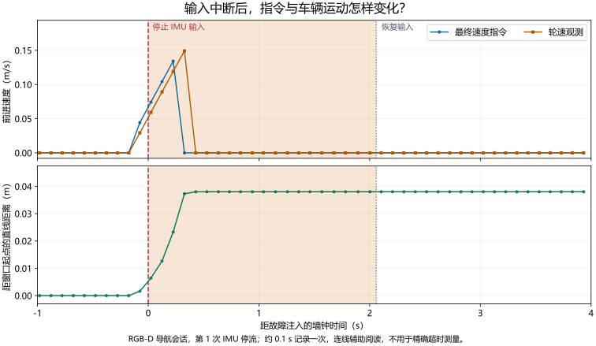

# 50.10 实验复现与证据附录

本附录供复跑实验和核查结果时使用，集中保存环境、命令、原始记录索引与修订经过。理解研究问题和结论，可先阅读[实验设计](vision-simulation-lab.md)及[结果分析](vision-simulation-results.md)。以下记录对应 2026-11-12 的实验；重新构建或改变配置时，为新运行记录对应的软件与参数。

## 50.10.1 环境与版本身份

| 项目 | 实际设置 |
| --- | --- |
| 远程主机 | Ubuntu 24.04.5、AMD EPYC 9554、188 GiB 内存、RTX 4090 D |
| 隔离运行环境 | Ubuntu 22.04、ROS 2 Humble、Gazebo Fortress 6.18.0、Python 3.10 |
| 估计后端 | RTAB-Map strategy 9、固定 ROS 2 VINS 移植版、独立 Ceres 2.1 |
| 首轮代码 | [1e518ba9](https://github.com/EnosElinsa/wheeltec-ros-source-reference/tree/1e518ba923e6876254ae0eddddab5ac52d42798c/ros2/navigation/vision-nav)；[对应 CI](https://github.com/EnosElinsa/wheeltec-ros-source-reference/actions/runs/43210363593) |
| 最终代码 | [d6092f1a](https://github.com/EnosElinsa/wheeltec-ros-source-reference/tree/d6092f1a270ec64b24c11f8c1c9b1c8d5d473043/ros2/navigation/vision-nav) |
| VIO 关键输入修正 | [75026789](https://github.com/EnosElinsa/wheeltec-ros-source-reference/commit/750267894c90516f21debac62364c34753de3939) |
| 首轮计算资源 | EuRoC 每序列绑定 8 个 CPU；Gazebo 正式故障会话绑定 32 个 CPU、内存上限 24 GiB；例外见逐次会话记录 |
| 隔离要求 | 独立 ROS 域、数据库与结果目录；仿真不启动串口或物理 RealSense |

实验镜像身份为 `sha256:7d3475065612914a4373817087fdd8c63ee653a63aee356adbdb9f28e559bc0b`。从提交 Dockerfile 完整重建的镜像为 `sha256:be84532f7ecd6f19cf5ff680fde22c2f1e7e51fc462ae8ea9969c61f38926125`，通过 4 项 ROS 集成测试、原生执行器 CTest 1/1 及 30 s 无界面渲染会话，并正常关闭。[镜像记录](simulation-results/final-image-2026-11-12.json)保存构建与包清单证据。原实验和重建验证分别记录镜像身份。

固定 VINS 移植版使用 `ceres::Manifold`，系统 Ceres 2.0 不满足接口。构建脚本先在实验目录安装固定的 Ceres 2.1，再编译 VINS 与 RTAB-Map；主机原有 ROS、驱动和系统 Ceres 保持原安装。构建日志、补丁与动态库依赖保存在实验目录。

## 50.10.2 复跑入口

### 50.10.2.1 构建独立实验环境

以下命令在 Ubuntu 远程机执行，要求 Docker 与可用的 NVIDIA CDI 配置。首次安装及代理配置见固定版本源码的 [containers 说明](https://github.com/EnosElinsa/wheeltec-ros-source-reference/tree/d6092f1a270ec64b24c11f8c1c9b1c8d5d473043/ros2/navigation/vision-nav/containers)。GPU 编号和 CPU 集合需按主机实际可用资源调整。

```bash
cd wheeltec-ros-source-reference/ros2/navigation/vision-nav/containers
export SIM_ROOT="$HOME/wheeltec_vision_sim"
mkdir -p "$SIM_ROOT"/{source,data,results}
cp -a . "$SIM_ROOT/containers"
for package in wheeltec_vision_nav wheeltec_tf_guard wheeltec_vision_benchmark wheeltec_vision_sim wheeltec_sim_actuator; do
  cp -a "../$package" "$SIM_ROOT/source/"
done
sudo docker build -t wheeltec-vision-sim:humble-20261112 .
sudo env WHEELTEC_SIM_ROOT="$SIM_ROOT" bash build.sh
```

显式传入实验目录，避免 `sudo` 改变用户目录后挂载到其他位置。同次实验的节点放在同一容器中，使用容器内回环通信，并核实速度接口与实车隔离。设备查询后，检查无界面渲染产生的图像与深度是否有效。

### 50.10.2.2 EuRoC 单次与批量运行

数据保留 `mav0/cam0`、`cam1`、`imu0` 和 `state_groundtruth_estimate0` 的原始结构。记录下载来源，使用本地 SHA256、ZIP CRC 和文件检查核对完整性。每次输出到新目录。

```bash
python3 fetch_euroc.py --destination "$SIM_ROOT/data" --sequence MH_01_easy
sudo env WHEELTEC_SIM_ROOT="$SIM_ROOT" WHEELTEC_SIM_GPU=1 bash run.sh \
  ros2 run wheeltec_vision_benchmark validate_euroc \
  --dataset /work/data/MH_01_easy --output /work/results/mh01-validation --mode vio
sudo env WHEELTEC_SIM_ROOT="$SIM_ROOT" WHEELTEC_SIM_GPU=1 bash run.sh \
  ros2 launch wheeltec_vision_benchmark euroc.launch.py \
  dataset:=/work/data/MH_01_easy output:=/work/results/mh01-vio-001 mode:=vio
```

`mode:=stereo` 选择纯双目 VO。单次结果包括身份清单、轨迹、视觉状态、播放记录、指标与图表。批量入口 `run_euroc_suite.sh` 用于三个序列、两种模式各三次运行；参数变更后的组需要新的身份记录。除了误差，须核查覆盖率、缺失尾部、数据年龄和正常退出状态。

### 50.10.2.3 建图、导航与故障会话

先建图并正常停止，再用同一场景、车模和相机配置加载数据库导航。`baseline`、`stereo`、`vio` 分别对应正文三种估计方案。

```bash
sudo env WHEELTEC_SIM_ROOT="$SIM_ROOT" WHEELTEC_SIM_GPU=1 bash run.sh \
  ros2 launch wheeltec_vision_sim sim.launch.py estimator:=baseline mode:=mapping \
  database_path:=/work/results/room.db output:=/work/results/mapping-001
# 正常停止建图后运行：
sudo env WHEELTEC_SIM_ROOT="$SIM_ROOT" WHEELTEC_SIM_GPU=1 bash run.sh \
  ros2 launch wheeltec_vision_sim sim.launch.py estimator:=baseline mode:=localization \
  database_path:=/work/results/room.db output:=/work/results/localization-001
```

批量会话入口统一启动、检查和关闭整组进程：

```bash
sudo env WHEELTEC_SIM_ROOT="$SIM_ROOT" WHEELTEC_SIM_GPU=1 WHEELTEC_SIM_CPUS=32 \
  WHEELTEC_SIM_CPUSET=0-31 ROS_DOMAIN_ID=88 \
  bash run.sh python3 /work/containers/run_sim_trial.py \
  --output /work/results/mapping-suite-001 --database /work/results/room-suite.db \
  --mode mapping --estimator baseline --scenario all
```

导航使用 `--mode localization` 和已保存的地图。场景定义和其余参数见[仿真包说明](https://github.com/EnosElinsa/wheeltec-ros-source-reference/tree/d6092f1a270ec64b24c11f8c1c9b1c8d5d473043/ros2/navigation/vision-nav/wheeltec_vision_sim)。会话分别保存命令、日志、退出码及任务判定，复跑后应检查任务结果与轨迹。

CPU 配额控制总计算用量，CPU 亲和性限制可见核心；图像库线程数也需记录。并行会话使用不同 CPU 集合、ROS 域和数据库。一次会话的三次检查不重置车辆，独立起点实验需另行启动世界。

### 50.10.2.4 30 分钟静止长测

```bash
sudo env WHEELTEC_SIM_ROOT="$SIM_ROOT" WHEELTEC_SIM_GPU=1 WHEELTEC_SIM_CPUS=16 \
  WHEELTEC_SIM_CPUSET=0-15 ROS_DOMAIN_ID=92 \
  bash run.sh python3 /work/containers/run_soak_trial.py \
  --output /work/results/stationary-load-001 --duration 1800 --estimator baseline
```

该入口创建新地图、不发送运动指令，并在结束时关闭整组进程。使用修正后的 schema 2 记录器逐回调记录安全指令、轮速和时钟，周期保存资源与健康状态。保留异常及提前退出摘要；健康快照与原始输入接收证据分别解释。

## 50.10.3 输入、坐标与计时核对

EuRoC 时间以原始整数纳秒读取，保留左右图像配对；整流图像、标定与光学坐标必须一致。相机、IMU 与参考传感器的完整安装变换参与评分，参考传感器 YAML 原文及哈希随结果保存。MH05 的一帧边界排除仍计入原始覆盖率分母。

IMU 噪声转换清单保存源单位、采样频率、转换策略和派生参数。当前积分器对两端测量和每步零偏采用近似离散噪声模型，共享端点及高阶相关性仍待完善。实车噪声参数需通过对应传感器的采样标定获得。

仿真轮速由关节观测生成，世界位姿仅用于评分。`odom → base_footprint` 保持唯一发布者，RTAB-Map 提供 `map → odom`；地图定位就绪根据实际定位输出判断。VIO 删除 EKF 中全部 `imu0*` 参数以避免重复融合，同时使用独立的 `require_wheel/require_imu` 监测关键输入，`wheel_backup=false` 禁止视觉降级。

普通合成相机不具有 D435C 的投影交替元数据，使用同步输入适配并记录合成来源。避障使用原始有效深度，保留观测年龄。仿真节点跟随仿真时钟，保护定时器使用单调墙钟。慢速诊断保持保护启用，同时记录实时因子。

### 50.10.3.1 EuRoC 评分细节

MH05 首张图像早于首个 IMU 约 20 ms，VIO 排除这一帧并记录原因，覆盖率分母仍包含它。关联覆盖率以全部原始双目图像时刻为分母，包括初始化、跳过帧和参考不覆盖部分；输出缺失时段另行统计。

Machine Hall 的参考位置与朝向来自 Leica 位置和 IMU 的批量解，其中朝向使用了惯性信息。本轮主要报告平移 ATE 和平移 RPE，保留参考传感器变换与评分记录。

原配置双目 VO 的数据年龄 P95 约为 59.6 ms、P99 为 60.0～61.0 ms；VIO 的 P95 为 45.8～64.6 ms、P99 为 60.0～71.5 ms。数据年龄从原始采样计到记录端接收，包含播放调度、排队与估计。P95、P99 表示约 95%、99% 的样本不超过的值。

## 50.10.4 修订与失败记录

### 50.10.4.1 输入处理与试验准备

早期 Humble Python 消息对普通 `bytes` 图像载荷逐字节检查，后改用内容相同的类型化数组；图像像素、编码和时间戳不变。点云逐点 Python 转换改为结构化 NumPy 批量读取，原始观测年龄继续参与保护。精确时间 TF 暂缺时，仅在原始接收和采样期限内短暂缓存，新的非法观测清除待处理旧帧。

动态 TF 队列积压曾导致保护停车后无法恢复，改为有界队列后恢复检查通过。早期稀疏纹理引起 RGB-D 低内点丢失，当前纹理场景的复测结果单独保存，并记录场景变化。早期场景日志保留在远程实验目录。

导航准备增加等待全部七个生命周期节点 ACTIVE，并在每项试验前连续 0.5 s 检查健康、轮速、真值、五路接触和前向走廊；45 s 内未就绪则失败。Gazebo 服务等待期间继续接收观测。准备阶段单独标记，活动试验中的证据要求不放宽。

地图与真值的初始对齐使用首次静止观测的同一时刻，并等待该时刻的对应 TF。旧运行中出现任务成功而真值终点偏差约 0.6 m，被正确判失败；启用 Humble 的 `always_reload_bt_xml` 后，新目标重建行为树节点，避免沿用上一目标的节流与动作状态，黑板仍由 Nav2 管理。

### 50.10.4.2 VIO 最终保护复测

早期 `wheel_backup=false` 同时关闭关键输入订阅，造成 IMU 先经 VIO 停输出再触发保护。修正后直接监测轮速与 IMU。16 CPU 建图复测中，执行器试验同时发生 VO 断流和上层零速，23/24 的失败结果保留；32 CPU 复测为 24/24。最终导航为 24/24。逐次记录各自的资源与软件版本。

### 50.10.4.3 长测记录器的失效与重跑

| 记录 | 实际观察 | 保留与处理方式 |
| --- | --- | --- |
| 旧 schema 1，约 1800.001 s | 35999 条零速；间隔 P95/P99 52.08/54.18 ms，最大 60.75 ms；1793 个约 1 Hz READY 快照 | 开窗时清空最后接收状态，约 0.3 ms 的首快照误报缺失；原 `passed=false` 保留，连续接收证据也不足 |
| 旧 schema 1 资源 | 忙碌核数中位数/P99 6.33/6.58；RSS 首尾约 3.49/4.07 GiB；快照视觉年龄 P95/P99 97.46/108.05 ms | 保留旧运行的资源统计；温度和逐帧有效帧率待补测 |
| schema 2 首次 30 s 抽查 | 将旧健康快照外推为源未更新，产生误判 | 失败摘要保留，改为按实际收到的快照判断源状态 |
| 修正后 30 s 抽查 | 600 条安全指令、1362 个轮速、130 个 READY 回调，无失败；含窗口首尾最大指令覆盖间隔 57.61 ms | 通过后再验证独立会话启动与关闭 |
| 独立会话 30 s 抽查 | 启动进程持续存活，结束仅发送 SIGINT，全部进程及地图正常关闭 | 无 TERM/KILL 升级，再开展正式长测 |
| 最终独立长测 | 1800.006 s，记录与会话均通过 | 正文采用此组结果，旧结果不覆盖 |

## 50.10.5 原始证据索引 {#evidence-index}

Git 仓库收录紧凑 JSON 与必要图表，完整图像、数据库、构建产物和原始日志保留在实验目录。JSON 中的运行身份和哈希用于关联对应产物。下表同时保留通过、失败和修正前结果。

| 实验或证据 | 记录入口 |
| --- | --- |
| EuRoC 原配置 18 次 | [逐次评分](simulation-results/euroc-2026-11-12.json) |
| 新噪声配置 MH01 诊断 | [三次诊断](simulation-results/euroc-noise-2026-11-12.json) |
| 新噪声配置三序列 9 次 | [完整摘要](simulation-results/euroc-noise-three-sequence-2026-11-12.json) |
| RGB-D、双目 VO、VIO 首轮建图 | [RGB-D](simulation-results/mapping-baseline-2026-11-12.json)；[双目 VO](simulation-results/mapping-stereo-2026-11-12.json)；[VIO](simulation-results/mapping-vio-2026-11-12.json) |
| 三方案首轮导航 | [RGB-D](simulation-results/localization-baseline-2026-11-12.json)；[双目 VO](simulation-results/localization-stereo-2026-11-12.json)；[VIO](simulation-results/localization-vio-2026-11-12.json) |
| 首轮六个闭环会话 | [命令、资源、日志与退出身份](simulation-results/sessions-2026-11-12.json) |
| 最终 VIO 建图：16 CPU 失败、32 CPU 通过 | [失败](simulation-results/mapping-vio-required-inputs-failed-2026-11-12.json)；[复测](simulation-results/mapping-vio-required-inputs-2026-11-12.json) |
| 最终 VIO 导航及会话身份 | [导航](simulation-results/localization-vio-required-inputs-2026-11-12.json)；[会话](simulation-results/vio-required-inputs-sessions-2026-11-12.json) |
| 独立关键输入 ROS 测试 | [直接响应测量](simulation-results/ros-critical-inputs-2026-11-12.json) |
| 旧 schema 1 长测 | [原失败与派生统计](simulation-results/stationary-2026-11-12.json) |
| schema 2 抽查及修正 | [旧快照外推失败](simulation-results/stationary-schema2-smoke-2026-11-12.json)；[修正后抽查](simulation-results/stationary-schema2-smoke-corrected-2026-11-12.json) |
| 独立会话抽查与正式长测 | [30 s](simulation-results/stationary-session-schema2-smoke-2026-11-12.json)；[1800 s 最终记录](simulation-results/stationary-final-2026-11-12.json) |
| 镜像构建与重建验证 | [身份记录](simulation-results/final-image-2026-11-12.json) |

RGB-D/VIO 首轮建图的安全指令接收年龄 P95 分别为 45.9/46.8 ms，P99 为 51.0/52.4 ms，实时因子中位数约 0.895。年龄统计包含故障注入期的旧观测，描述整段会话的接收情况。场景布局来自固定版本的 [model.py](https://github.com/EnosElinsa/wheeltec-ros-source-reference/blob/d6092f1a270ec64b24c11f8c1c9b1c8d5d473043/ros2/navigation/vision-nav/wheeltec_vision_sim/wheeltec_vision_sim/model.py)，任务与临时障碍来自 [mission_runner.py](https://github.com/EnosElinsa/wheeltec-ros-source-reference/blob/d6092f1a270ec64b24c11f8c1c9b1c8d5d473043/ros2/navigation/vision-nav/wheeltec_vision_sim/wheeltec_vision_sim/mission_runner.py)。图 50.2 按模型几何绘制；图 50.1、50.5 为新增演示会话的实际渲染画面。

### 50.10.5.1 轨迹图、回放与数据下载 {#path-data}

图 50.6、50.7、附录图 50.A1 及二维回放根据原有正式会话记录绘制。三维动图使用下节列出的新增演示会话。导入时核对原始 JSONL 的 SHA256，确认与相应已发布摘要一致。CSV 保留全部记录行，包括启动、无真值与过期观测；绘图时将无有效真值的位置留为空缺，不平滑、拟合或插值路径。

| 图示用途 | 会话 | 可下载数据 |
| --- | --- | --- |
| 房间中的实测路径与二维回放 | `mapping-all-05` | [RGB-D 建图轨迹 CSV](simulation-results/mapping-baseline-path.csv) |
| 三个短程任务：RGB-D | `localization-baseline-04` | [导航轨迹 CSV](simulation-results/localization-baseline-path.csv) |
| 三个短程任务：双目 VO | `localization-stereo-01` | [导航轨迹 CSV](simulation-results/localization-stereo-path.csv) |
| 三个短程任务：VIO 首轮配置 | `localization-vio-05` | [导航轨迹 CSV](simulation-results/localization-vio-path.csv) |

CSV 的时间以首条记录为墙钟零点，世界 x、y 以米计；车体朝向由原始四元数换算。记录约每 0.1 s 采一次；精确响应评分使用高频指令接收日志。图 50.7 的目标、终点与容差取自结果 JSON，轨迹使用原始坐标。附录图 50.A1 的直线距离相对于图中时间窗口的起点，用于观察本次仿真停车过程。

[来源与变换清单](simulation-results/path-figure-provenance.json)记录原始哈希、CSV 哈希、绘图版本与输出身份。动图取每十条记录中的一条并补入末条，按固定显示间隔加速播放，显示的时间仍为实际记录时间。缺少新鲜真值时不显示推测车体位置；图中的灰色完整轨迹只提供回放参照。

图可由教材仓库的 `tools/render_simulation_figures.py` 使用已发布 CSV 重新生成，需要 NumPy、Matplotlib、Pillow 及可用的中文字体。原有全会话诊断图继续保留：[RGB-D 建图轨迹与速度](simulation-results/mapping-baseline.png)、[RGB-D 导航轨迹与速度](simulation-results/localization-baseline.png)、[VIO 导航诊断](simulation-results/localization-vio.png)。

### 50.10.5.2 三维运行录像与实际地图 {#gazebo-media}

图 50.1、50.5 来自新增的 RGB-D 基线演示，使用固定实验镜像和原有仿真软件。`presentation-mapping-01` 从空数据库开始，完成三组正常运动；`presentation-navigation-01` 重新启动场景，加载该数据库，完成三个短程导航目标。两组任务各 3/3 通过，均无碰撞。

两个固定观察相机分别拍摄房间总览与车辆近景，只用于录制展示画面，运动估计继续接收原车载相机。录制脚本为 `tools/record_gazebo_demonstration.py`，合成脚本为 `tools/render_gazebo_demonstration.py`。原始观察图像、世界真值、任务结果和地图保存在远程实验目录；视频按原图顺序抽帧，左右视角按仿真时间匹配，加速播放并标注原始运行时间。黄色目标标记由实际任务的世界坐标投影到观察画面。

| 产物 | 数据与媒体 |
| --- | --- |
| 建图运行 | [GIF](simulation-results/gazebo-mapping-3d.gif)；[MP4](simulation-results/gazebo-mapping-3d.mp4)；[逐帧来源与任务记录](simulation-results/gazebo-mapping-frames.json) |
| 导航运行 | [GIF](simulation-results/gazebo-navigation-3d.gif)；[MP4](simulation-results/gazebo-navigation-3d.mp4)；[逐帧来源与任务记录](simulation-results/gazebo-navigation-frames.json) |
| 算法建立的二维地图 | [占用栅格图](simulation-results/gazebo-mapping-grid.png)；[原始栅格数据](simulation-results/gazebo-mapping-grid.json) |
| 场景、变换与输出身份 | [来源清单](simulation-results/gazebo-demonstration-provenance.json) |

新增演示单独保存，正式三方案对照的逐次结果沿用上节列出的原有会话。

## 50.10.6 软件检查与实车待验项目

代码与工具的既有本地复核为 692 项通过、8 项按 ROS/POSIX 环境跳过；Linux/Windows Python 3.10、3.12 及 Humble CI 已通过。隔离 Humble 环境的关键输入集成测试为 5 项通过、耗时 19.23 s；POSIX 会话退出测试 7 项、原生执行器 CTest 1/1 通过。五个本地 ROS 包已构建，无界面图像、深度、IMU、关节、五路接触与独立真值均实际输出。

以上为对应软件版本的构建与测试结果。后续继续完成 VIO 全程稳定性、独立场景导航、障碍清除、行驶负载和实车标定、同步、失联停车。实车操作见[第 41 章](../06-sensors-navigation/41-visual-operation.md)，最终系统验收见[第 59 章](../10-deployment-maintenance/59-system-acceptance.md)。

## 50.10.7 保护与持续负载补充记录 {#supplementary-tests}

本节供复跑保护试验和资源试验时核对采样方法，建图导航的主要实验见第 50.8 节。

### 50.10.7.1 导航与保护设置

导航到点同时要求任务成功、位置误差不超过 0.25 m、朝向误差不超过 0.25 rad，并具备新鲜真值。地图坐标与世界坐标仅在首次静止观测时对齐，随后冻结，不为每个终点重新拟合。这样能够发现“导航软件认为到达、车辆实际仍有偏差”的情况。

故障前先确认车辆实际运动；故障后检查最终指令、轮速、世界位移与接触记录。零速指令、轮速与位移分别反映指令响应和车辆运动，均保存记录。执行器失联试验还要求上游指令持续新鲜且非零，以便直接观察执行器自身超时后的运动变化。

| 保护设置 | 当前值或条件 |
| --- | --- |
| 保护检查周期 | 50 ms，使用单调墙钟 |
| 轮速、IMU、融合里程计、有效深度超时 | 0.3 s |
| VO 消息或有效视觉结果超时 | 0.5 s |
| 允许的视觉降级 | 仅基线和双目 VO；其他关键输入及前向避障有效时，最多 1 s 或 0.10 m，速度不超过 0.10 m/s，仅前进 |
| 执行器独立指令超时 | 0.25 s，属于本轮仿真执行器配置 |
| 严重故障后的恢复 | 清除旧指令、取消旧目标，恢复健康后等待新目标 |

视觉方案允许降级时，停车过程包含获准续行时间，按相应限时、限距与限速设置记录。独立 ROS 测试针对轮速、IMU 分别停流，测量最后一次真实接收到首条零速的时间，以 0.3 s 超时加两个保护周期作为响应范围，另记录 10 ms 测试调度容差。

### 50.10.7.2 持续负载的采样方法

30 分钟试验保持车辆静止，继续渲染、感知与估计，记录安全指令间隔、轮速与健康回调、时钟推进、CPU、内存和可获得的温度。CPU 用进程树的忙碌核数表示，例如 6.4 核约相当于 6.4 个核心持续忙碌；内存采用进程树 RSS 总和，共享页可能重复计入。

该试验观察静止渲染、感知与估计负载的连续性。视觉年龄来自周期健康快照；Nav2 行驶控制、有效视觉帧率和逐帧延迟安排在后续移动任务中测量。温度记录应注明设备与采集窗口。

### 50.10.7.3 故障停车与恢复结果

#### 50.10.7.3.1 闭环故障检查 {#measured-stop}

通过会话覆盖视觉、IMU、深度停发，仿真暂停恢复、旧任务阻止恢复、前方障碍和执行器失联。活动检查要求持续存在新鲜轮速、独立真值与五路接触观测；故障前先确认实际运动，再依据指令和运动证据判断结果。



*图 50.A1 RGB-D 导航会话中第一次 IMU 中断前后的记录。横轴零点为故障注入，浅色区域表示输入被停止的时间；上图显示最终速度指令与轮速，下图显示车辆距窗口起点的直线距离。指令和轮速归零后，位置曲线保持水平，输入恢复后也没有继续运动。点为约 0.1 s 一次的观测，连线辅助阅读；本图用于观察过程，精确命令响应时间另见表 50.A1。[查看 PNG](simulation-results/measured-fault-stop.png)。*

执行器失联试验保持上游安全指令新鲜且非零，同时阻断原生执行器接收，再检查轮速与世界位移。这一设计将“上层软件主动停车”与“执行器自己超时停车”区分开来。本项仿真执行器检查通过后，继续安排实车串口、驱动和下位机的失联试验。

障碍试验中，车辆在前方长方体出现后停车且无碰撞。后续增加障碍移走后的地图清除及受控倒车试验。

#### 50.10.7.3.2 独立关键输入的响应时间

为避免 IMU 先影响 VIO、再经视觉超时间接触发停车，最终配置直接监测轮速和 IMU。另以真实 ROS 2 中间件测试保持 VO 与其他输入正常，只停止一个关键输入。测量起点是看门狗最后一次实际接收，终点是首条零速命令。

*表 50.A1 独立输入停流的命令响应测量。*

| 停止的输入 | 最后接收到首条零速 | 配置响应范围 | 结果 |
| --- | --- | --- | --- |
| 轮速 | 338.32 ms | 300 ms 超时 + 两个 50 ms 检查周期 | 满足 |
| IMU | 340.32 ms | 同上 | 满足 |

测试另留 10 ms 调度容差，实际测量未用到这部分余量。五项测试还验证了目标取消、恢复后拒绝旧目标，以及新目标才允许恢复运动。[直接测量记录](simulation-results/ros-critical-inputs-2026-11-12.json)保留计时和日志证据。

这两项时间测量从最后收到轮速或 IMU 到首条零速命令的间隔。基线和双目 VO 的视觉中断按允许的续行时间、距离和速度评价；实车停车时间与距离需在车辆上另行测量。

### 50.10.7.4 30 分钟静止运行结果

#### 50.10.7.4.1 最终正式运行结果

使用修正记录器后的独立会话完成 1800.006 s 墙钟时间运行，记录与会话均通过，没有监测到失败事件。车辆保持静止，渲染、感知和估计持续工作。共收到 35999 条安全零速指令、81382 个轮速回调和 7871 个 READY 健康回调。

*表 50.A2 最终静止长测的描述统计。*

| 指标 | 结果 | 统计范围与解释 |
| --- | --- | --- |
| 时间推进 | 墙钟 1800.006 s；仿真 1627.65 s，平均实时因子约 0.904 | 虚拟世界平均每真实秒推进约 0.904 s |
| 安全指令间隔 | P95 52.25 ms；P99 54.43 ms；最大覆盖间隔 62.62 ms | 记录端接收，最大覆盖间隔含测量窗口首尾 |
| 忙碌 CPU 核数 | 中位数 6.40；P99 6.66 | 当前进程树的累计 CPU 时间差分 |
| 进程树 RSS | 前、后 300 个快照的中位数约 3.49、4.01 GiB | 各进程 RSS 相加，共享页可能重复计入 |
| 健康快照中的视觉年龄 | P95 98.78 ms；P99 109.54 ms | 按周期收到的健康快照统计 |
| 所采集 GPU 温度 | 39～61 °C | 整张所选 GPU 的采集值，未完整覆盖实验窗口 |
| 结束情况 | 正常中断关闭，无强制终止升级 | 全部进程与地图正常关闭 |

数据见[最终 30 分钟记录](simulation-results/stationary-final-2026-11-12.json)。早期记录器误报及其原始失败摘要保留在附录，最终结果来自修正后的独立运行。

#### 50.10.7.4.2 资源统计说明

安全指令间隔接近设定的 50 ms 周期。RSS 前后窗口增加约 0.52 GiB，后续需要延长采样，并结合缓存和共享页变化分析内存趋势。

GPU 温度来自整张主机设备，采集晚于实验启动，包含其他进程负载。CPU 温度与逐帧有效视觉帧率留待后续补测。

后续移动任务将记录 Nav2 控制负载、长期内存趋势，以及车载平台的温度与处理延迟。

[返回：50.9 实验结果](vision-simulation-results.md) · [返回：50 仿真与 Gazebo](50-gazebo-simulation.md)
