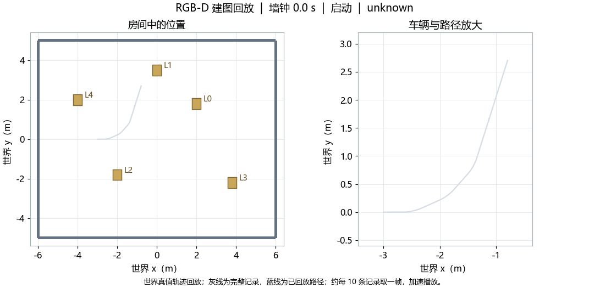

# 50.9 视觉导航实验结果与分析

本节报告 2026-11-12 的实验结果，按定位、导航、故障保护和持续负载依次展开。研究问题、场景和指标定义见[第 50.8 节](vision-simulation-lab.md)。本轮结果支持当前高纹理房间中的短程导航与指定保护功能；真实数据上的 VIO 仍存在严重发散和输出缺失，因此尚不具备接管实车定位的验收依据。

## 50.9.1 结果范围与阅读方式

本轮包括 EuRoC 原配置的 18 次 VO/VIO 回放、修改噪声配置后的 9 次 VIO 回放，以及三种定位方案在 Gazebo 中的建图、短程导航和故障检查。VIO 输入保护修正后的复测单独列出。持续负载部分采用修正记录器后重新完成的正式 30 分钟试验。

### 50.9.1.1 从实测轨迹观察实验 {#measured-path}

先看车辆实际怎样运动，再阅读各项指标。图 50.3 把 RGB-D 基线建图会话的世界真值轨迹叠加到房间布局中：车辆从左侧出发，经过直行和转弯，随后在不同位置接受故障检查。整段轨迹位于房间局部，图中标出代表性试验的位置。

*图 50.3 车辆在房间中的实际行驶路径。左、右两幅图均以米为单位，分别显示场景范围与路径细节；半透明车体按简化模型尺寸表示起、终姿态。试验标记取事件开始附近的记录位置，障碍试验标记表示车辆位置。该图展示同一会话的连续运动，不表示完整房间覆盖或独立重复路线。[查看 PNG](simulation-results/measured-room-path.png)。*

*图 50.4 根据世界真值记录重建的二维回放。约 135.6 s 的会话压缩为 13.1 s，画面保留原始墙钟时间；灰线为完整记录，蓝线为已回放路径。动画约每十条记录取一帧，未插值生成位置，属于轨迹重建，不是仿真相机录像。[单独打开动图](simulation-results/measured-mapping-replay.gif)。*

短程任务的目标与实际终点见[图 50.6](#measured-routes)，输入中断后的速度与位移变化见[图 50.7](#measured-stop)。所有路径采用原始世界坐标，缺少新鲜真值时保留间断；数据与绘图依据见[附录 50.10.5.1](vision-simulation-reproducibility.md#path-data)。

### 50.9.1.2 结果覆盖哪些验证层次

| 证据层次 | 本轮观察 | 能够支持的结论 |
| --- | --- | --- |
| 真实数据定位 | 双目 VO 三个序列重复误差相近；VIO 存在发散与覆盖不全 | 当前 VIO 实现及配置未通过全程定位验证 |
| 闭环导航 | 三种方案均完成指定房间的短程导航和故障检查 | 系统在当前车模、纹理与任务条件下可形成闭环 |
| 保护响应 | 仿真停车与恢复检查通过；独立轮速/IMU 停流有直接时间测量 | 指定输入的命令响应达到配置范围；实车停车仍需测量 |
| 持续负载 | 最终静止试验完成约 1800 s，监测范围内没有失败事件 | 当前静止渲染、感知与估计负载连续运行通过 |

以下表格保留逐次结果或明确的范围，不将单会话检查换算为独立成功率，也不将不同参数和资源条件的运行合并排名。软件版本、命令、修订经过和原始文件索引集中在[复现附录](vision-simulation-reproducibility.md)。

## 50.9.2 Q1：真实数据上的定位质量

### 50.9.2.1 原配置下的 VO 与 VIO

表 50.1 给出每个序列、每种模式的三次原速运行。ATE 和 1 s 平移 RPE 均以米计，覆盖率以全部原始双目图像时刻为分母；每格依次为三次重复。轨迹先按唯一时间关联，再以固定尺度刚体对齐。

*表 50.1 原配置下的 EuRoC 定位结果，共 18 次运行。*

| 序列 | 模式 | ATE RMSE（m） | 1 s 平移 RPE RMSE（m） | 关联覆盖率 |
| --- | --- | --- | --- | --- |
| MH01 | 双目 VO | 0.156 / 0.136 / 0.134 | 0.012 / 0.012 / 0.012 | 96.09% / 97.96% / 97.77% |
| MH01 | VIO | 1.663 / 49.243 / 10284.401 | 0.474 / 1.968 / 367.017 | 84.90% / 87.75% / 98.15% |
| MH03 | 双目 VO | 0.107 / 0.131 / 0.127 | 0.033 / 0.033 / 0.033 | 96.26% / 96.22% / 95.93% |
| MH03 | VIO | 1.328 / 1.325 / 1.232 | 0.136 / 0.140 / 0.209 | 93.30% / 88.48% / 51.37% |
| MH05 | 双目 VO | 0.182 / 0.205 / 0.237 | 0.034 / 0.032 / 0.036 | 96.22% / 95.60% / 96.04% |
| MH05 | VIO | 1.161 / 1.128 / 0.942 | 0.099 / 0.100 / 0.106 | 92.70% / 89.35% / 87.15% |

双目 VO 在三个序列上的 ATE 为 0.107～0.237 m，关联覆盖率为 95.60%～97.96%。三次重复的结果相对接近，支持该配置在本组数据上的可复现性；由于仍有未关联部分，不能称为全图像覆盖。

VIO 的表现差异较大。MH01 的第三次运行虽有 98.15% 的关联覆盖率，ATE 却超过 10 km，说明持续输出并不等于估计正确。MH03 的第三次覆盖率仅 51.37%，其误差只反映获得有效关联的部分。消息新鲜、特征数量正常或后端返回成功，都不能替代独立轨迹检查。

*图 50.5 MH01 双目 VO 的一次轨迹评分示例。完整比较以表 50.1 的逐次指标为准，单张轨迹图不代表全部重复。*

所有 18 次进程均正常退出并产生评分，但都带有部分输出标记，包含初始化、未输出或参考不覆盖的时段。双目 VO 的数据年龄 P95 约为 59.6 ms、P99 为 60.0～61.0 ms；VIO 的 P95 为 45.8～64.6 ms、P99 为 60.0～71.5 ms。这些数值包括播放调度、排队、估计和回调接收，不能解释为纯算法计算耗时。逐次指标见[原配置结果](simulation-results/euroc-2026-11-12.json)。

### 50.9.2.2 IMU 噪声配置修正后的结果

检查发现，连续时间 IMU 噪声密度曾直接用于当前移植版所需的离散噪声参数。修正后按实际采样频率和该积分实现转换参数，时间戳、评分方法与覆盖率分母保持不变。表 50.2 为另行完成的 9 次 VIO 运行，不覆盖或删除表 50.1 的结果。

*表 50.2 修正噪声配置后的 VIO 结果，共 9 次运行。*

| 序列 | ATE RMSE（m） | 1 s 平移 RPE RMSE（m） | 关联覆盖率 |
| --- | --- | --- | --- |
| MH01 | 0.0388 / 0.0872 / 0.0952 | 0.0121 / 0.0144 / 0.0136 | 47.15% / 86.91% / 88.51% |
| MH03 | 1143.393 / 1334.529 / 3080.031 | 36.669 / 45.006 / 133.415 | 94.30% / 96.89% / 94.48% |
| MH05 | 0.237 / 0.230 / 0.235 | 0.031 / 0.032 / 0.030 | 91.03% / 90.81% / 92.65% |

MH01 已关联片段的误差下降，但第一次在距最后图像约 79.05 s 时停止输出，覆盖率只有 47.15%，同时出现 IMU 缓冲溢出。播放器仍发布了全部 3682 对图像与 36820 个 IMU 样本，因此这次较小的 ATE 不能解释为完成整个序列。溢出与提前停止之间的具体根因尚未确定。

MH05 三次 ATE 为 0.230～0.237 m，覆盖率为 90.81%～92.65%。然而，MH03 三次均严重发散，ATE 为 1.14～3.08 km；这三次都输出到最后图像，且没有 IMU 溢出，原始估计终点本身已达到数千米，不能归因于评分坐标对齐。

因此，噪声配置修正后的改善只在部分序列和已关联片段中出现，尚未解决 VIO 的全程稳定性。九次结果仍带部分输出标记。完整指标见[三序列新配置结果](simulation-results/euroc-noise-three-sequence-2026-11-12.json)，MH01 的额外诊断见[对应记录](simulation-results/euroc-noise-2026-11-12.json)。

### 50.9.2.3 对定位接入的含义

Q1 的结论是：双目 VO 已获得本组数据上的重复证据，当前 VIO 实现及配置未通过验证。这个结论针对项目实际运行的移植实现，不能推断为视觉惯性方法整体不如纯视觉方法。后续需要定位发散根因，在冻结实现和配置后重新完成三个序列的全程回归，并同时检查误差、覆盖和输出连续性。

## 50.9.3 Q2：建图与短程导航表现

### 50.9.3.1 首轮三方案闭环检查 {#measured-routes}

在第 50.8.4 节的统一纹理房间中，三种方案分别完成建图和地图定位后的导航。每个会话包含八类场景、每类三次检查。表 50.3 将正常任务和故障检查的总体完成情况集中列出，故障行为另在 50.9.4 分析。

*表 50.3 首轮 Gazebo 建图与导航检查。终点误差来自三个短程到点检查，位置容差为 0.25 m。*

| 定位方案 | 建图会话 | 导航会话 | 三个导航终点位置误差（m） |
| --- | --- | --- | --- |
| RGB-D + 轮速/IMU EKF | 24/24 | 24/24 | 0.173 / 0.192 / 0.190 |
| 双目 VO | 24/24 | 24/24 | 0.188 / 0.170 / 0.173 |
| 双目 VIO | 24/24 | 24/24 | 0.175 / 0.184 / 0.177 |

六个会话合计 144 次条件检查均满足各自判据，未观测到碰撞，结束时正常关闭并保存地图。导航判定同时检查任务成功、固定坐标对齐下的真值终点和朝向容差。早期曾出现导航软件报告成功、真值仍距目标约 0.6 m 的情况，该次被判为失败并保留，未纳入表中通过会话。

*图 50.6 三种方案的短程到点轨迹，对应表 50.3 的首轮会话。每幅图的蓝、橙、绿线依次表示三个任务，短竖线为各任务的首个记录位置；星形表示请求目标，圆点表示实际终点，虚线圆表示 0.25 m 位置容差。三幅图使用相同坐标范围，终点误差另以文字标注。车辆在进入目标容差后即可完成任务，因此实际终点可以位于星形之前。[查看 PNG](simulation-results/measured-navigation-routes.png)。*

三个任务的目标随各自会话中的当前位置依次设置，任务之间车辆还可能有短暂运动，所以相邻彩色段不强行连接。图中的路径来自世界真值，表示实际行驶过程；本轮没有在这份记录中保存规划器的参考路径，图中也不将实际路径标为规划路径。完整会话的速度诊断图保留在[复现附录](vision-simulation-reproducibility.md#path-data)。

三种方案的终点误差都落在当前容差内。由于路线较短、同会话位置持续变化、独立重复不足，这些数值支持功能可运行，不支持按几厘米差异给出算法精度排名。完整数据索引见[复现附录 50.10.5](vision-simulation-reproducibility.md#evidence-index)。

### 50.9.3.2 最终 VIO 配置的复测

VIO 的关键输入监测修正后，另行完成导航会话，24/24 检查通过，三个终点位置误差为 0.185、0.179、0.178 m。该组为最终 VIO 导航证据，与表 50.3 的首轮结果分别保存。

建图复测在 16 个绑定 CPU 下为 23/24：执行器失联检查中车辆停住，但同时发生视觉输出中断，上层保护也给出零速，无法把停车单独归因于执行器超时，因此正确判为失败。保留该结果后，改用 32 个绑定 CPU 复测为 24/24。资源改变与复测结果共同记录，不能由此推断同一条件下算法可靠性已经提高。

### 50.9.3.3 场景对结果的影响

早期稀疏纹理场景中曾出现 RGB-D 特征不足与跟踪丢失；当前通过会话使用全表面角点纹理。改变纹理改善了可跟踪条件，也限制了结论的外推范围。本轮尚未验证低纹理导航、长路线、窄通道、持续遮挡或复杂动态障碍。

Q2 因而只支持当前车模和高纹理房间中的建图、定位及短程导航闭环。Gazebo 的相机和 IMU 同步较理想，运动范围也不同于 EuRoC；VIO 在这里完成任务，与它在真实数据中发散并不矛盾，两类实验检验了不同条件。

## 50.9.4 Q3：故障停车与恢复边界

### 50.9.4.1 闭环故障检查 {#measured-stop}

通过会话覆盖视觉、IMU、深度停发，仿真暂停恢复、旧任务阻止恢复、前方障碍和执行器失联。活动检查要求持续存在新鲜轮速、独立真值与五路接触观测；故障前先确认实际运动，再依据指令和运动证据判断结果。

*图 50.7 RGB-D 导航会话中第一次 IMU 中断前后的记录。横轴零点为故障注入，浅色区域表示输入被停止的时间；上图显示最终速度指令与轮速，下图显示车辆距窗口起点的直线距离。指令和轮速归零后，位置曲线保持水平，输入恢复后也没有继续运动。点为约 0.1 s 一次的观测，连线辅助阅读；本图用于观察过程，精确命令响应时间另见表 50.4。[查看 PNG](simulation-results/measured-fault-stop.png)。*

执行器失联试验保持上游安全指令新鲜且非零，同时阻断原生执行器接收，再检查轮速与世界位移。这一设计将“上层软件主动停车”与“执行器自己超时停车”区分开来。通过结果支持当前仿真执行器的超时能力，实车串口、驱动和下位机仍需独立验证。

障碍检查支持指定前方长方体出现后的停车和无碰撞；障碍移走后的地图清除效果尚未形成独立验收。受控倒车未纳入本轮正式通过范围。

### 50.9.4.2 独立关键输入的响应时间

为避免 IMU 先影响 VIO、再经视觉超时间接触发停车，最终配置直接监测轮速和 IMU。另以真实 ROS 2 中间件测试保持 VO 与其他输入正常，只停止一个关键输入。测量起点是看门狗最后一次实际接收，终点是首条零速命令。

*表 50.4 独立输入停流的命令响应测量。*

| 停止的输入 | 最后接收到首条零速 | 配置响应范围 | 结果 |
| --- | --- | --- | --- |
| 轮速 | 338.32 ms | 300 ms 超时 + 两个 50 ms 检查周期 | 满足 |
| IMU | 340.32 ms | 同上 | 满足 |

测试另留 10 ms 调度容差，实际测量未用到这部分余量。五项测试还验证了目标取消、恢复后拒绝旧目标，以及新目标才允许恢复运动。[直接测量记录](simulation-results/ros-critical-inputs-2026-11-12.json)保留计时和日志证据。

这两项时间支持指定输入的命令响应结论，不能推断所有仿真故障都已按相同期限定量测量，更不等于实车停车时间。基线和双目 VO 允许的视觉降级还会增加获准续行时间，应单独按限时、限距和限速条件评价。

## 50.9.5 Q4：30 分钟静止持续负载

### 50.9.5.1 最终正式运行结果

使用修正记录器后的独立会话完成 1800.006 s 墙钟时间运行，记录与会话均通过，没有监测到失败事件。车辆保持静止，渲染、感知和估计持续工作。共收到 35999 条安全零速指令、81382 个轮速回调和 7871 个 READY 健康回调。

*表 50.5 最终静止长测的描述统计。*

| 指标 | 结果 | 统计范围与解释 |
| --- | --- | --- |
| 时间推进 | 墙钟 1800.006 s；仿真 1627.65 s，平均实时因子约 0.904 | 虚拟世界推进速度低于真实时间，不能称为严格实时运行 |
| 安全指令间隔 | P95 52.25 ms；P99 54.43 ms；最大覆盖间隔 62.62 ms | 记录端接收，最大覆盖间隔含测量窗口首尾 |
| 忙碌 CPU 核数 | 中位数 6.40；P99 6.66 | 当前进程树的累计 CPU 时间差分 |
| 进程树 RSS | 前、后 300 个快照的中位数约 3.49、4.01 GiB | 含共享页重复计数，不能直接解释为独占内存 |
| 健康快照中的视觉年龄 | P95 98.78 ms；P99 109.54 ms | 周期快照统计，不是逐帧延迟 |
| 所采集 GPU 温度 | 39～61 °C | 整张所选 GPU 的采集值，未完整覆盖实验窗口 |
| 结束情况 | 正常中断关闭，无强制终止升级 | 全部进程与地图正常关闭 |

数据见[最终 30 分钟记录](simulation-results/stationary-final-2026-11-12.json)。早期记录器误报及其原始失败摘要保留在附录，最终结果来自修正后重新运行，没有通过删除旧异常获得。

### 50.9.5.2 资源结果的适用范围

安全指令间隔接近设定的 50 ms 周期，支持本次记录范围内的输出连续性。RSS 前后窗口增加约 0.52 GiB，但共享页计数和缓存会影响总量，仅凭这一次增长无法判定泄漏，也无法声称内存已稳定。

GPU 温度来自主机整张设备，采集开始晚于实验启动，可能含窗口外和其他进程负载，不能归因于某个算法。CPU 完整温度没有测得。实验也没有逐帧统计有效视觉帧率，不能将健康快照或输入频率当作有效处理帧率。

Q4 的通过范围限于静止渲染、感知、估计和现有监测项目。Nav2 行驶控制负载、缓存稳定后的长期内存趋势、目标车载平台温度与实时性仍待测量。

## 50.9.6 综合讨论与后续验证

本轮最明确的发现是：软件闭环已经具备继续实验的基础，但当前 VIO 的真实数据稳定性仍是接入实车的阻碍。轨迹误差、输出覆盖、导航功能和保护响应需要分别验收；其中一项通过不能替代另一项。尤其是“持续有输出”和“估计位置正确”，在 MH01 与 MH03 的失败中表现出明显差别。

现有结论还受到四类条件限制：EuRoC 仅有三个序列且每配置三次；Gazebo 采用单一高纹理房间和简化车辆；闭环重复未重置为独立起点；长测仅覆盖静止服务器负载。因此，本轮不报告算法排名、独立导航成功率或实车安全性能。

后续应先定位并修复 VIO 发散与输出中断，在冻结配置后完成真实数据全程回归，再扩大独立起点、路线长度和环境难度。与此同时，补测障碍移除后的清除、导航行驶负载和目标平台延迟。进入实车前，最后完成相机/IMU 标定、采样同步、失联制动与实际停车距离测试。

实车运行基线继续采用 RGB-D、轮速与 IMU 融合。仿真与数据回放中已经通过的项目作为下一轮对照保留，未通过和未开展的项目分别记录，不以局部改善提前批准 VIO 接管。

[返回：50.8 实验设计](vision-simulation-lab.md) · [继续：50.10 复现与证据附录](vision-simulation-reproducibility.md)
