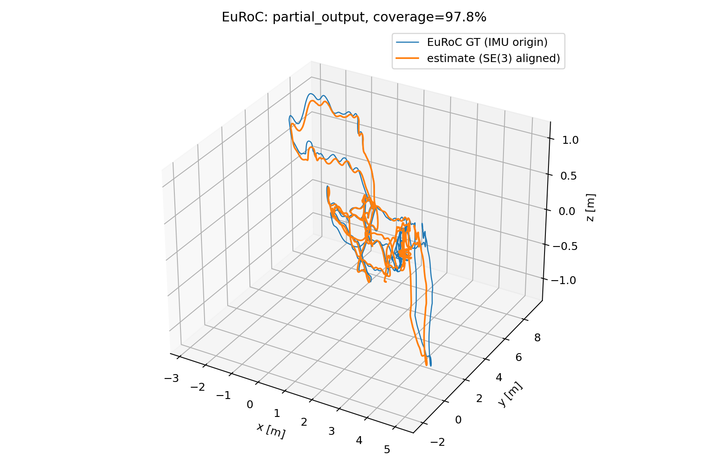
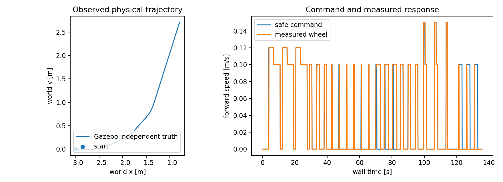

# 视觉导航仿真：2026-11-12 实验记录

本轮完成了隔离的 Humble/Fortress 环境、EuRoC 原速回归和简化 Ackermann 车辆的建图故障测试。RGB-D、双目 VO 与 VIO 均已在指定场景完成故障停车实验。EuRoC 的 VIO 精度尚未通过；导航到点、长期负载和实车验收分别记录，不能由建图测试代替。

操作步骤见[视觉导航仿真实验](vision-simulation-lab.md)。本页保留失败结果，并区分可计算的轨迹评分、保护功能通过与算法精度通过。

## 环境与实验身份

| 项目 | 实际设置 |
| --- | --- |
| 主机 | Ubuntu 24.04.5、AMD EPYC 9554、188 GiB 内存、RTX 4090 D |
| 隔离运行环境 | Ubuntu 22.04、ROS 2 Humble、Gazebo Fortress 6.18.0、Python 3.10 |
| 后端 | RTAB-Map strategy 9 + 固定 ROS 2 VINS 移植版、独立 Ceres 2.1 |
| EuRoC | MH_01_easy、MH_03_medium、MH_05_difficult；每模式三次，原始整数纳秒时间、原速播放 |
| 评分 | IMU 原点的完整三维位姿；唯一时间关联、固定尺度 SE(3) 对齐、1 s 平移 RPE |
| 仿真车辆 | 车长 0.46 m、宽 0.32 m、轴距 0.34 m、轮距 0.30 m、轮半径 0.065 m |
| 合成观测 | 640×400、20 Hz 双目与深度、200 Hz IMU、50 Hz 关节与真值；随机种子 17 |
| 保护 | 50 ms 墙钟检查；传感器 0.3 s、VO 0.5 s、执行器独立 0.25 s 超时；默认前进 |

EuRoC 三个序列分别使用 8 个绑定 CPU；Gazebo 故障实验使用 32 个绑定 CPU、24 GiB 内存上限和独立 DDS 域。GPU 设备映射与无界面图像输出均实际验证。主机与容器软件版本、构建日志和补丁保存在实验目录；主机已有 ROS 与驱动保持原有安装。

代码基线及 CI：[55bc02e4](https://github.com/EnosElinsa/wheeltec-ros-source-reference/tree/55bc02e4dfada82c84f59161884d12a029766987/ros2/navigation/vision-nav)、[通过的 GitHub Actions](https://github.com/EnosElinsa/wheeltec-ros-source-reference/actions/runs/43204203112)。后续导航与参数修正的版本在对应结果段补充。数据来自明确标注的公开镜像；本地 SHA256 和 ZIP CRC 验证不等同于官方真实性认证。

## EuRoC 第一轮：18 次运行

以下数字均来自[逐次评分和产物哈希](simulation-results/euroc-2026-11-12.json)。ATE 与 RPE 单位均为米，三列依次对应三次重复；覆盖率以全部原始双目图像为分母。所有进程正常退出并产生评分，但每次均标记 `partial_output`，包含初始化、未输出和真值不覆盖的部分。

| 序列 | 模式 | ATE RMSE：三次 | 1 s RPE RMSE：三次 | 关联覆盖率：三次 |
| --- | --- | --- | --- | --- |
| MH01 | 双目 VO | 0.156 / 0.136 / 0.134 | 0.012 / 0.012 / 0.012 | 96.09% / 97.96% / 97.77% |
| MH01 | VIO | 1.663 / 49.243 / 10284.401 | 0.474 / 1.968 / 367.017 | 84.90% / 87.75% / 98.15% |
| MH03 | 双目 VO | 0.107 / 0.131 / 0.127 | 0.033 / 0.033 / 0.033 | 96.26% / 96.22% / 95.93% |
| MH03 | VIO | 1.328 / 1.325 / 1.232 | 0.136 / 0.140 / 0.209 | 93.30% / 88.48% / 51.37% |
| MH05 | 双目 VO | 0.182 / 0.205 / 0.237 | 0.034 / 0.032 / 0.036 | 96.22% / 95.60% / 96.04% |
| MH05 | VIO | 1.161 / 1.128 / 0.942 | 0.099 / 0.100 / 0.106 | 92.70% / 89.35% / 87.15% |

双目 VO 的接收数据年龄 P95 约 59.6 ms、P99 为 60.0–61.0 ms；VIO 的 P95 为 45.8–64.6 ms、P99 为 60.0–71.5 ms。它们包含播放器调度、队列、估计与回调接收时间，不能直接称为算法计算耗时。原始 CSV 分别保存调度延迟和算法耗时。

第一轮 VIO 在 MH01 出现严重发散，且覆盖率仍可能很高。视觉特征数量、消息新鲜度和后端返回成功无法独立证明轨迹正确。当前配置不具备切换实车驾驶的精度证据。噪声参数与离散积分模型的单位关系正在受控对照；这里保留修正前结果。

MH05 VIO 首张图像早于首个 IMU 约 20 ms，只排除这一帧，不补造观测或改时间戳。Machine Hall 参考朝向来自 Leica+IMU 批量解中的 IMU，因此旋转 RPE 不能解释为独立运动捕捉朝向精度。

## Gazebo 建图与故障实验

每组使用一个持续演化的车辆姿态，各场景重复三次。统计单位是同一会话的三次检查，尚非三个独立起点的成功率实验。

| 实验组 | 场景版本 | 结果 | 会话及地图退出 |
| --- | --- | --- | --- |
| RGB-D + 轮速/IMU EKF，`mapping-all-05` | 全表面固定种子纹理 | 24/24，通过 | SIGINT 正常退出，地图保存 |
| VIO，`mapping-vio-02` | 同一纹理房间 | 24/24，通过 | SIGINT 正常退出，地图保存 |
| 双目 VO，`mapping-stereo-01` | 早期稀疏几何纹理 | 24/24，通过 | SIGINT 正常退出，地图保存 |

八个场景分别是直行/转弯/停车、视觉停发、IMU 停发、深度停发、暂停恢复、旧指令锁存、障碍停车与执行器命令租约失效。各组没有观测到碰撞；每个活动采样点必须具有新鲜的轮速、独立真值与五路接触观测。

执行器实验刻意阻断原生插件接收指令，同时要求 ROS `/cmd_vel_safe` 继续新鲜且非零，并检查轮子停车和真值位移。该项通过证明的是仿真原生执行器的超时能力。实车串口、驱动和下位机仍需单独验收。

完整描述统计与断言：[RGB-D 记录](simulation-results/mapping-baseline-2026-11-12.json)、[VIO 记录](simulation-results/mapping-vio-2026-11-12.json)。RGB-D/VIO 的安全指令接收年龄 P95 分别为 45.9/46.8 ms，P99 为 51.0/52.4 ms；仿真与墙钟时间比中位数约 0.895。故障注入期间的旧观测会进入年龄分位数，不能把这些值当作正常状态的传感器延迟。所有保护阈值均保持启用。

## 失败记录与导航边界

早期运行中，普通 `bytes` 图像载荷触发 Humble Python 消息逐字节检查。采用内容相同的类型化数组后，像素、编码与时间戳保持一致。点云逐点 Python 转换改为结构化 NumPy 批量读取，原始观测年龄仍参与保护。精确时间 TF 暂缺时，只在原始接收和采样期限内短暂缓存；新的非法观测会清除待处理旧帧。

动态 TF 默认历史队列积压曾使看门狗停车且无法恢复，改为有界队列后恢复测试通过。早期稀疏纹理还引发 RGB-D 低内点丢失；全表面纹理改善跟踪，原有失败日志保持保存。改善场景后获得的结果不能视为弱纹理场景已通过。

导航使用可信地图重定位后再激活 Nav2。初版运行器在 Nav2 激活完成前发送目标，出现目标拒绝；现已等待全部七个生命周期节点进入 ACTIVE。真值与地图对齐固定在首次静止观测的同一时间，允许有界等待该时间的 TF，不使用最新 TF 替代。

新一轮导航前两个目标可通过独立真值检查，但第三个目标曾出现 Nav2 报告成功而真值仍距目标约 0.6 m。运行器正确判为失败；行为树与路径更新问题继续修复。当前未宣告完整导航闭环通过。

30 分钟静止感知与估计负载记录已经启动；该实验与行驶控制负载、目标平台实时性、低纹理/遮挡/窄通道扩展场景及实车制动验收分别记录。
