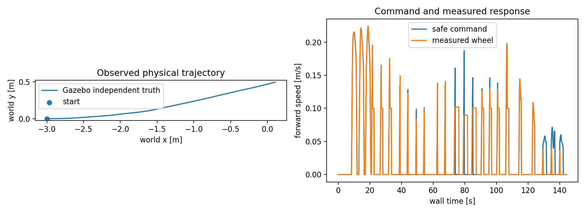

# 视觉导航仿真：2026-11-12 实验记录

本轮完成了隔离的 Humble/Fortress 环境、EuRoC 原速回归和简化 Ackermann 车辆的建图故障测试。RGB-D、双目 VO 与 VIO 也分别完成了地图定位后的 Nav2 到点和故障检查，各为 24/24。EuRoC 的 VIO 全程稳定性尚未通过；长期负载和实车验收分别记录。

操作步骤见[视觉导航仿真实验](vision-simulation-lab.md)。本页保留失败结果，并区分可计算的轨迹评分、保护功能通过与算法精度通过。

## 环境与实验身份

| 项目 | 实际设置 |
| --- | --- |
| 主机 | Ubuntu 24.04.5、AMD EPYC 9554、188 GiB 内存、RTX 4090 D |
| 隔离运行环境 | Ubuntu 22.04、ROS 2 Humble、Gazebo Fortress 6.18.0、Python 3.10 |
| 后端 | RTAB-Map strategy 9 + 固定 ROS 2 VINS 移植版、独立 Ceres 2.1 |
| EuRoC | MH_01_easy、MH_03_medium、MH_05_difficult；每模式三次，原始整数纳秒时间、原速播放 |
| 评分 | IMU 原点的完整三维位姿；唯一时间关联、固定尺度 SE(3) 对齐、1 s 平移 RPE |
| 仿真车辆 | 车长 0.46 m、宽 0.32 m、轴距 0.34 m、轮距 0.30 m、轮半径 0.065 m |
| 合成观测 | 640×400、20 Hz 双目与深度、200 Hz IMU、50 Hz 关节与真值；随机种子 17 |
| 保护 | 50 ms 墙钟检查；传感器 0.3 s、VO 0.5 s、执行器独立 0.25 s 超时；默认前进 |

EuRoC 三个序列分别使用 8 个绑定 CPU；Gazebo 故障实验使用 32 个绑定 CPU、24 GiB 内存上限和独立 DDS 域。GPU 设备映射与无界面图像输出均实际验证。主机与容器软件版本、构建日志和补丁保存在实验目录；主机已有 ROS 与驱动保持原有安装。

首轮代码基线及 CI：[1e518ba9](https://github.com/EnosElinsa/wheeltec-ros-source-reference/tree/1e518ba923e6876254ae0eddddab5ac52d42798c/ros2/navigation/vision-nav)、[通过的 GitHub Actions](https://github.com/EnosElinsa/wheeltec-ros-source-reference/actions/runs/43210363593)。最终实现见 [d6092f1a](https://github.com/EnosElinsa/wheeltec-ros-source-reference/tree/d6092f1a270ec64b24c11f8c1c9b1c8d5d473043/ros2/navigation/vision-nav)，VIO 保护修正及实际中间件测试在下文单独记录。数据来自明确标注的公开镜像；本地 SHA256 和 ZIP CRC 验证不等同于官方真实性认证。

实验镜像为 `sha256:7d3475065612914a4373817087fdd8c63ee653a63aee356adbdb9f28e559bc0b`。从提交的 Dockerfile 另行完整重建得到 `sha256:be84532f7ecd6f19cf5ff680fde22c2f1e7e51fc462ae8ea9969c61f38926125`：4 项 ROS 集成、CTest 1/1 和 30 s 无界面渲染会话均通过，正常关闭。两次镜像身份分别保留，重建通过不能替换原实验的软件身份；[构建、包清单与验证证据](simulation-results/final-image-2026-11-12.json)保存相关哈希。

## EuRoC 第一轮：18 次运行

以下数字均来自[逐次评分和产物哈希](simulation-results/euroc-2026-11-12.json)。ATE 与 RPE 单位均为米，三列依次对应三次重复；覆盖率以全部原始双目图像为分母。所有进程正常退出并产生评分，但每次均标记 `partial_output`，包含初始化、未输出和真值不覆盖的部分。

| 序列 | 模式 | ATE RMSE：三次 | 1 s RPE RMSE：三次 | 关联覆盖率：三次 |
| --- | --- | --- | --- | --- |
| MH01 | 双目 VO | 0.156 / 0.136 / 0.134 | 0.012 / 0.012 / 0.012 | 96.09% / 97.96% / 97.77% |
| MH01 | VIO | 1.663 / 49.243 / 10284.401 | 0.474 / 1.968 / 367.017 | 84.90% / 87.75% / 98.15% |
| MH03 | 双目 VO | 0.107 / 0.131 / 0.127 | 0.033 / 0.033 / 0.033 | 96.26% / 96.22% / 95.93% |
| MH03 | VIO | 1.328 / 1.325 / 1.232 | 0.136 / 0.140 / 0.209 | 93.30% / 88.48% / 51.37% |
| MH05 | 双目 VO | 0.182 / 0.205 / 0.237 | 0.034 / 0.032 / 0.036 | 96.22% / 95.60% / 96.04% |
| MH05 | VIO | 1.161 / 1.128 / 0.942 | 0.099 / 0.100 / 0.106 | 92.70% / 89.35% / 87.15% |

双目 VO 的接收数据年龄 P95 约 59.6 ms、P99 为 60.0–61.0 ms；VIO 的 P95 为 45.8–64.6 ms、P99 为 60.0–71.5 ms。它们包含播放器调度、队列、估计与回调接收时间，不能直接称为算法计算耗时。原始 CSV 分别保存调度延迟和算法耗时。

第一轮 VIO 在 MH01 出现严重发散，且覆盖率仍可能很高。视觉特征数量、消息新鲜度和后端返回成功无法独立证明轨迹正确。当前配置不具备切换实车驾驶的精度证据。这里保留修正前结果。

MH05 VIO 首张图像早于首个 IMU 约 20 ms，只排除这一帧，不补造观测或改时间戳。Machine Hall 参考朝向来自 Leica+IMU 批量解中的 IMU，因此旋转 RPE 不能解释为独立运动捕捉朝向精度。

## VIO 噪声单位对照：另三次 MH01

检查发现，EuRoC 的连续 IMU 噪声密度曾直接进入固定 VINS 移植版的离散中点积分噪声矩阵。现在按该实现的两端测量注入和每步零偏注入转换标准差，并验证原始 200 Hz IMU 间隔。manifest 保留源单位和派生参数。共享端点与高阶相关性仍属于模型近似，不能将这组参数称为实车标定结果。

| MH01 VIO | ATE RMSE | 1 s 平移 RPE RMSE | 关联覆盖率 | 输出尾部 |
| --- | --- | --- | --- | --- |
| 重复 1 | 0.0388 m | 0.0121 m | 47.15% | 距最后图像约 79.05 s 停止输出 |
| 重复 2 | 0.0872 m | 0.0144 m | 86.91% | 覆盖最后图像 |
| 重复 3 | 0.0952 m | 0.0136 m | 88.51% | 覆盖最后图像 |

三次播放器均发布全部 3682 对双目图像与 36820 个 IMU 样本，进程正常退出；第一轮尾部出现大量 IMU 缓冲溢出。误差下降与覆盖率不稳定同时存在，结论是噪声单位修正有效果，VIO 全程稳定性仍未通过。[逐次结果与原始产物哈希](simulation-results/euroc-noise-2026-11-12.json)与原 18 次实验分别保存。后端的失效标记不能可靠检测全部发散，也必须结合独立轨迹评分。

相同新策略继续在中等、困难序列各运行三次，参数与算法源码哈希保持一致，原速、固定尺度评分和覆盖率分母保持不变：

| 序列 | ATE RMSE：三次，m | 1 s 平移 RPE RMSE：三次，m | 关联覆盖率：三次 |
| --- | --- | --- | --- |
| MH03 VIO | 1143.393 / 1334.529 / 3080.031 | 36.669 / 45.006 / 133.415 | 94.30% / 96.89% / 94.48% |
| MH05 VIO | 0.237 / 0.230 / 0.235 | 0.031 / 0.032 / 0.030 | 91.03% / 90.81% / 92.65% |

这六次均到达原始最后图像，无 IMU 溢出。MH03 的原始估计终点已达到数千米，三次均严重发散，不能归因于评分对齐。新策略九次均为 `partial_output`，[完整摘要](simulation-results/euroc-noise-three-sequence-2026-11-12.json)保存数据年龄、处理分位数、缺失尾部、原始位姿异常及产物哈希。噪声单位修正没有解决整个 VIO 系统的问题，当前结论仍是不通过。

## Gazebo 建图与故障实验

每组使用一个持续演化的车辆姿态，各场景重复三次。统计单位是同一会话的三次检查，尚非三个独立起点的成功率实验。

| 实验组 | 场景版本 | 结果 | 会话及地图退出 |
| --- | --- | --- | --- |
| RGB-D + 轮速/IMU EKF，`mapping-all-05` | 全表面固定种子纹理 | 24/24，通过 | SIGINT 正常退出，地图保存 |
| VIO，`mapping-vio-02` | 同一纹理房间 | 24/24，通过 | SIGINT 正常退出，地图保存 |
| 双目 VO，`mapping-stereo-02` | 同一纹理房间 | 24/24，通过 | SIGINT 正常退出，地图保存 |

八个场景分别是直行/转弯/停车、视觉停发、IMU 停发、深度停发、暂停恢复、旧指令锁存、障碍停车与执行器命令租约失效。各组没有观测到碰撞；每个活动采样点必须具有新鲜的轮速、独立真值与五路接触观测。

执行器实验刻意阻断原生插件接收指令，同时要求 ROS `/cmd_vel_safe` 继续新鲜且非零，并检查轮子停车和真值位移。该项通过证明的是仿真原生执行器的超时能力。实车串口、驱动和下位机仍需单独验收。

完整描述统计与断言：[RGB-D 记录](simulation-results/mapping-baseline-2026-11-12.json)、[VIO 记录](simulation-results/mapping-vio-2026-11-12.json)。RGB-D/VIO 的安全指令接收年龄 P95 分别为 45.9/46.8 ms，P99 为 51.0/52.4 ms；仿真与墙钟时间比中位数约 0.895。故障注入期间的旧观测会进入年龄分位数，不能把这些值当作正常状态的传感器延迟。所有保护阈值均保持启用。

双目 VO 在统一纹理后重新建图，[记录与断言](simulation-results/mapping-stereo-2026-11-12.json)单独保存。早期稀疏纹理版本的通过记录也保留在远程实验目录，不能与新场景结果混合计算算法排名。

## 失败记录与导航边界

早期运行中，普通 `bytes` 图像载荷触发 Humble Python 消息逐字节检查。采用内容相同的类型化数组后，像素、编码与时间戳保持一致。点云逐点 Python 转换改为结构化 NumPy 批量读取，原始观测年龄仍参与保护。精确时间 TF 暂缺时，只在原始接收和采样期限内短暂缓存；新的非法观测会清除待处理旧帧。

动态 TF 默认历史队列积压曾使看门狗停车且无法恢复，改为有界队列后恢复测试通过。早期稀疏纹理还引发 RGB-D 低内点丢失；全表面纹理改善跟踪，原有失败日志保持保存。改善场景后获得的结果不能视为弱纹理场景已通过。

导航使用可信地图重定位后再激活 Nav2。初版运行器在 Nav2 激活完成前发送目标，出现目标拒绝；现已等待全部七个生命周期节点进入 ACTIVE。真值与地图对齐固定在首次静止观测的同一时间，允许有界等待该时间的 TF，不使用最新 TF 替代。

第三个目标曾出现 Nav2 报告成功而真值仍距目标约 0.6 m。运行器正确判为失败。启用 Humble 的 `always_reload_bt_xml` 后，每个新目标重建行为树节点，避免沿用上一目标的节流与动作状态；黑板仍由 Nav2 管理。

最终复测在每项测试前增加连续 0.5 s 的新鲜、走廊清空检查；Gazebo 服务等待期间继续接收 ROS 观测。它修复的是试验准备和观测回调，活动试验中的故障门槛与证据要求保持启用。

| 导航会话 | 八场景各三次 | 三个路线终点位置误差 | 会话退出 |
| --- | --- | --- | --- |
| RGB-D + EKF，`localization-baseline-04` | 24/24，通过 | 0.173 / 0.192 / 0.190 m | SIGINT 正常，地图正常关闭 |
| VIO，`localization-vio-05` | 24/24，通过 | 0.175 / 0.184 / 0.177 m | SIGINT 正常，地图正常关闭 |
| 双目 VO，`localization-stereo-01` | 24/24，通过 | 0.188 / 0.170 / 0.173 m | SIGINT 正常，地图正常关闭 |

三个短程路线目标和视觉、IMU、深度、暂停、旧目标、障碍与执行器租约场景全部完成。路线容差预先固定为 0.25 m、0.25 rad；真值对齐在首次静止观测冻结，此后不重拟合。各组均无碰撞，故障前须先观测到实际运动，故障后检查实际停车和旧目标阻止恢复。

原始断言及统计：[RGB-D 导航](simulation-results/localization-baseline-2026-11-12.json)、[VIO 导航](simulation-results/localization-vio-2026-11-12.json)、[双目 VO 导航](simulation-results/localization-stereo-2026-11-12.json)。这些是单个纹理房间、短距离目标与同一会话重复的结果，尚未覆盖窄通道、长路线和弱纹理导航。

六次建图/导航会话的命令、CPU 亲和性、退出结果及日志和原始观测 SHA256 见[会话身份记录](simulation-results/sessions-2026-11-12.json)。完整图像数据、数据库、构建目录与日志保留在实验目录，Git 仓库只收录紧凑结果与必要图表。

## VIO 关键输入保护的最终复测

最终审计发现，VIO 禁止轮速降级的 `wheel_backup=false` 也连带关闭了看门狗对轮速和 IMU 的直接订阅。IMU 失流会经 VIO 停输出再触发保护，多等待一层超时。提交 [75026789](https://github.com/EnosElinsa/wheeltec-ros-source-reference/commit/750267894c90516f21debac62364c34753de3939)增加独立的 `require_wheel/require_imu`：VIO 必须直接监测这两个输入，仍禁止视觉降级，也仍删除 EKF 的全部 `imu0*` 参数。健康监测不等同于再次融合。

修正后在新镜像复测，VIO 导航 `localization-vio-required-inputs-01` 为 24/24，三个路线终点误差 0.185 / 0.179 / 0.178 m。16 CPU 的建图 `mapping-vio-required-inputs-01` 为 23/24：执行器租约试验中车辆实际停住，但 VO 同时短暂断流、看门狗也输出零速，因此未能单独证明原生执行器超时，正确判失败。

保留这次失败，改用 32 个绑定 CPU 后，`mapping-vio-required-inputs-02` 为 24/24。最终 VIO 建图与导航均正常 SIGINT 关闭；所有保护和判定门槛保持启用。原始结果：[失败建图](simulation-results/mapping-vio-required-inputs-failed-2026-11-12.json)、[32 CPU 建图](simulation-results/mapping-vio-required-inputs-2026-11-12.json)、[导航](simulation-results/localization-vio-required-inputs-2026-11-12.json)、[版本、资源和日志身份](simulation-results/vio-required-inputs-sessions-2026-11-12.json)。这说明资源配置需要随结果一起保存，也说明一次停车可能有多个原因，不能自动归功于被测保护层。

随后新增真实 Humble 中间件测试，保持 VO 与其他关键输入正常，单独停止轮速或 IMU。从看门狗最后一次真实 DDS 接收至首条零速命令分别为 338.32 ms、340.32 ms，满足 0.3 s 输入期限加两个 50 ms 保护周期的响应范围。测试另外留出明确的 10 ms 调度容差；实际测量未用到这部分余量。测试同时验证取消目标、恢复后拒绝旧目标，以及新目标才恢复运动。[5 项测试结果与日志哈希](simulation-results/ros-critical-inputs-2026-11-12.json)单独保存；命令响应不是实车停车距离或时间。

## 30 分钟静止负载与记录器验证

静止 RGB-D 感知与估计记录持续 1800.001 s，接收 35999 条零速命令。指令间隔 P95 为 52.08 ms、P99 为 54.18 ms、最大 60.75 ms，没有超过 100 ms 的接收间隔。1793 个约 1 Hz 健康快照均为 READY，ROS 时钟与所记录源时间戳均持续推进。这些是记录端观察，不等于车辆执行时延。

累计 CPU ticks 的相邻快照差值折算为忙碌 CPU 核数，中位数 6.33，P99 为 6.58。进程树 RSS 总和的前后 300 个快照中位数从 3.49 GiB 增至 4.07 GiB；RSS 含共享页重复计数，需继续观察缓存稳定后趋势，不能直接诊断为泄漏。健康快照报告的视觉年龄 P95/P99 为 97.46/108.05 ms，未采到温度，也未逐帧记录有效视觉帧率。

原 schema 1 记录器在测量开始时清空了最后一次安全命令收时，首个快照约 0.3 ms 时误报缺失。原始摘要的 `passed=false` 保留；该版本也没有足够的连续 health/wheel 接收证据，不能据此批准完整 30 分钟负载验收。[原始摘要、派生统计与样本哈希](simulation-results/stationary-2026-11-12.json)保留这些限制。

schema 2 修正初始化和逐回调断流记录后，首次 30 s 抽查又暴露了旧健康快照外推的误判：实际快照中源仍有效，但监测器假设快照之间源没有更新。[这次失败](simulation-results/stationary-schema2-smoke-2026-11-12.json)同样保留。修正为按收到的健康快照判断源状态，并继续独立监测安全指令、轮速和时钟后，[新 30 s 抽查](simulation-results/stationary-schema2-smoke-corrected-2026-11-12.json)通过：600 条安全命令、1362 个轮速、130 个 READY 健康回调，无失败，含窗口首尾的最大安全命令覆盖间隔为 57.61 ms。

随后用 `run_soak_trial.py` 从头启动独立仿真，[新会话的 30 s 记录](simulation-results/stationary-session-schema2-smoke-2026-11-12.json)也通过，且启动进程始终存活，结束时仅发送 SIGINT，全部进程与地图正常关闭，无 TERM/KILL 升级。该入口可用于最终版本的长测复跑。

最终使用修正后的正式入口另行完成 1800.006 s 长测，记录与会话均通过：35999 条安全零速指令、81382 个轮速回调、7871 个 READY 健康回调，无失败事件。安全指令间隔 P95/P99 为 52.25/54.43 ms，含窗口首尾的最大覆盖间隔 62.62 ms；结束时仅发送 SIGINT，所有进程和地图正常关闭。

此轮忙碌 CPU 核数中位数 6.40、P99 为 6.66，RSS 前后 300 个快照中位数约 3.49/4.01 GiB。GPU 温度采集值为 39–61°C：来自主机所选整张 GPU，采集开始晚于实验启动，可能包含测量窗口外及其他进程负载，不能当作完整 CPU 温度或单进程归因。源健康快照中的视觉年龄 P95/P99 为 98.78/109.54 ms；它不代表逐帧处理年龄。[最终长测摘要、原始接收时间证据与哈希](simulation-results/stationary-final-2026-11-12.json)保留镜像、源码与统计范围。

这一轮支持当前静止渲染、感知、估计负载及监测范围的通过结论。尚未完成 Nav2 行驶控制负载、逐帧有效视觉帧率、内存缓存稳定后的长期趋势、目标车载平台完整温度与实时性、低纹理/遮挡/窄通道扩展场景和实车制动验收。通过的仿真检查与这些未通过或未测项分别维护。
