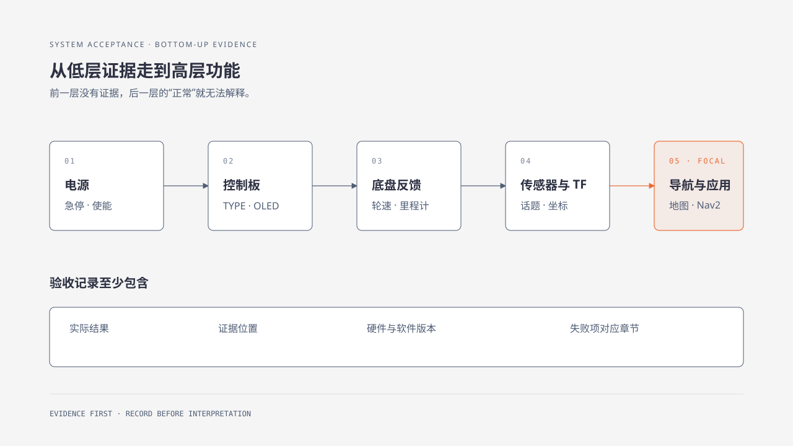

# 62. 全系统验收清单

底盘能运动、雷达有数据、导航能启动，分别说明了部分功能可用。系统交付或维护完成后，还需要确认这些部分能一起工作：坐标和时间是否一致，反馈是否支持定位，规划输出能否被底盘执行，以及异常时是否按预期停止。

本章将前面的分项检查汇成一条全系统验收路线，从供电和控制板开始，依次推进到运动、通信、传感器、建图定位、Nav2 和应用。每一项填写实际观察结果并附照片、日志或命令输出；低层发现问题时先修复并复测，再继续依赖它的高层项目。

## 62.1 学习目标

用同一张清单完成整机验收，逐项填写观察结果，并附上对应的照片、日志、命令输出或测量记录。

## 62.2 适用范围

交付、升级、维修和更换主控/固件后的 WHEELTEC 机器人。

## 62.3 操作前检查

- 运动区域清空，急停可触及。
- 第 10 章配置表、版本、固件和地图记录齐全。
- 关闭不参加验收的高级应用。

## 62.4 工作原理

系统验收沿数据链从低到高进行：电源 → 底盘控制板 → 运动控制 → 反馈 → 主控通信 → 传感器 → TF → 建图/定位 → Nav2 → 应用。发现低层失败后先停止后续项目，修复并复测该层；这样才能判断高层现象是否仍然存在。

## 62.5 操作步骤

逐项填写：

| 层级 | 检查项目 | 通过条件 | 实际结果 | 日志或照片 |
|---|---|---|---|---|
| 电源 | 电池、变压、急停、使能 | 电压稳定，停止可靠 |  |  |
| 控制板 | TYPE、OLED、自检 | 型号正确，无 `TYPE X` |  |  |
| 底盘 | 前后、转向/横移、停止 | 方向正确，松手归零 |  |  |
| 反馈 | 编码器、里程计、IMU | 频率稳定，符号合理 |  |  |
| 通信 | 串口/CAN、设备别名 | 重插后稳定，协议匹配 |  |  |
| 雷达 | 扫描/点云 | 频率、距离、坐标正确 |  |  |
| 相机 | 图像与 `camera_info` | 尺寸、编码、频率正确 |  |  |
| TF | `map→odom→base_link→sensor` | 无断链/冲突 |  |  |
| 建图定位 | 地图加载与初始位姿 | 扫描贴合，短程不跳 |  |  |
| Nav2 | 目标、取消、障碍 | 到达/取消/失败可停 |  |  |
| 应用 | 跟随、视觉、语音等 | 丢失/退出有安全停止 |  |  |

每次升级、搬运或拆装后至少重复电源、控制板、底盘、反馈、通信和传感器检查。

## 62.6 验收标准

- 逐项填写测试结果，并附日志或照片。
- 失败项指向一个具体章节，记录具体现象与相关日志，避免只写“系统异常”。
- 验收记录包含日期、硬件、ROS、源码和固件版本。
- 机器人停止、急停和通信超时经过实际测试。

可以直接使用[全系统验收记录表](system-acceptance-checklist.md)保存结果。

## 62.7 故障排查

| 失败位置 | 返回章节 |
|---|---|
| 电源/开关/接线 | 第三篇第 11～12 章 |
| TYPE/OLED/电机 | 第三篇第 14 章、第九篇第 58～59 章 |
| 编码器/PI/纠偏 | 第四篇第 20～21 章、第七篇第 47 章 |
| ROS 设备/参数 | 第五篇第 22～27 章 |
| 雷达/TF/地图 | 第六篇第 29～32 章 |
| 视觉/应用 | 第六篇第 36～41 章、第八篇 |
| 升级/恢复 | 本篇第 60～61 章 |

## 章节导航

[上一章：日志、备份、升级与恢复](61-logs-backup-upgrade-recovery.md) · [返回本篇](index.md)
